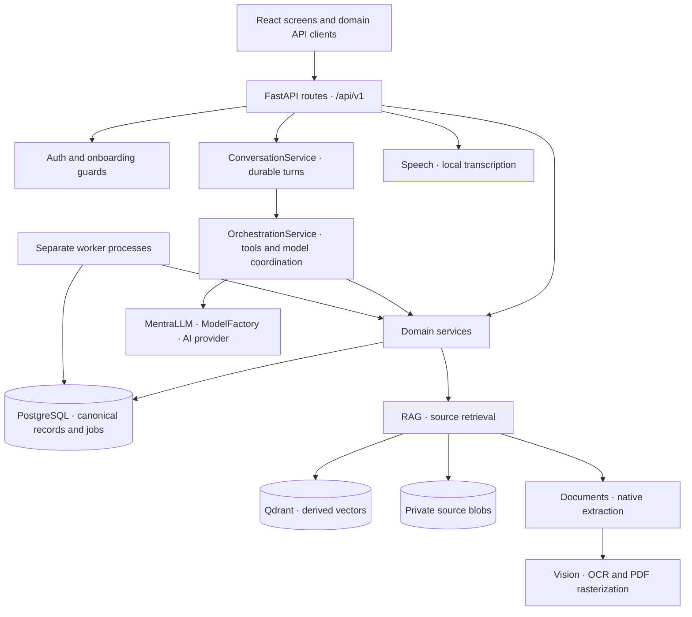

# Mentra · Backend Atlas

> **A map for finding your way around the system.** Module responsibilities, feature dependencies, APIs, storage, workers, and important files in one place.
>
> **Source snapshot:** 15 October 2026 · **Scope:** current repository code · **Audience:** someone who needs to understand, navigate, or change Mentra.
>
> This describes how the checked-out code is assembled. It does not establish which revision, configuration, migrations, or optional services are running in production. Paths are relative to the repository root; file links open the implementation.

## Start here

| If you want to understand… | Go to |
| :--- | :--- |
| The whole system in two minutes | [System at a glance](#system-at-a-glance) |
| Where a feature belongs | [Module directory](#module-directory) |
| Which feature uses which other feature | [Feature dependency map](#feature-dependency-map) |
| What happens after a user action | [End-to-end journeys](#end-to-end-journeys) |
| An individual module and its files | [Module reference](#module-reference) |
| Where records and files are stored | [Storage and ownership](#storage-and-ownership) |
| Background work and deployment | [Processes and queues](#processes-and-queues) |
| The few frontend files that matter to backend work | [Frontend integration points](#frontend-integration-points) |
| Migrations, tools, tests, and operational files | [Repository support files](#repository-support-files) |
| Where to begin a particular change | [Change navigation](#change-navigation) |

## System at a glance

| Layer | What it does | Main entry point | How to think about it |
| :--- | :--- | :--- | :--- |
| HTTP | Validates requests, binds identity, calls services, returns public contracts | [`backend/app/api/router.py`](../backend/app/api/router.py) | The external interface; individual handlers can delegate directly to their domain repository for simple operations. |
| Application wiring | Creates services and adapters, places them on `app.state`, closes resources | [`backend/app/main.py`](../backend/app/main.py) | The best starting point for understanding actual dependencies. |
| Domains | Own business validation, records, revisions, lifecycle, and public facades | `backend/app/<module>/` | Chat, Assessments, Learner, RAG, Profile, History/Memory, Events, Notifications. |
| [AI orchestration](#module-orchestration) | Selects context/tools, runs bounded model workflows, handles recovery and activity | `backend/app/langchain/` | Coordinates domain capabilities; domain services and repositories retain business writes. |
| Shared processing | Reads documents, performs OCR/rasterization, transcribes audio | `documents/`, `vision/`, `speech/` | Reusable capabilities; they do not own Library, assessments, or learner records. |
| Persistence | Executes SQL, enforces ownership, transactions, leases, publication, and replay | Each domain's `repositories/` | PostgreSQL is authoritative; browser caches and Qdrant are secondary views. |
| Infrastructure | Settings, sessions, admission, exceptions, tracing, bounded subprocesses | `core/`, `db/` | Shared operational foundation. |

### Application assembly

| Startup step | What is connected | Why it matters |
| :--- | :--- | :--- |
| Database and local engines | Session factory, Speech service, process-based embeddings, Qdrant adapter | Shared infrastructure is created before dependent services. |
| Identity and teaching context | Auth, Learner Engine, Student Profile | Requests and model workflows receive trusted identity and bounded context. |
| Materials | RAG receives Learner, embeddings, Qdrant, storage, repository, and admission | Retrieval scope, source ownership, and vector infrastructure meet here. |
| History and delivery | Conversation service; History Management with chat read facade, memories, profile, learner, and Events | History lookup reads the canonical transcript rather than maintaining another transcript. |
| Events and notifications | Notifications is attached to the Events repository; proposals wrap Events plus an LLM | Reminder publication is a domain integration; Notifications does not run a scheduler. |
| Assessments and attachments | Assessment service receives LLM, Learner, RAG, and Profile; attachments receive repository and admission | Generation, grading, source handling, and later learning updates remain separate capabilities. |
| Chat orchestration | Chat model service plus RAG, Learner, History, attachments, proposals, assessments, and Web Search | One coordinator can use these features within a persistent turn. |

## Module directory

| Module | Responsibility | Backend home | Public entry / primary owner |
| :--- | :--- | :--- | :--- |
| [Auth](#module-auth) | Accounts, external identity mapping, session issuance and authentication | `auth/` | `AuthService` |
| [Student Profile](#module-profile) | Onboarding facts, calibration, broad teaching estimates | `student_profile/` | `StudentProfileService`, `CalibrationService`, `ProfileEvidenceService` |
| [Chat](#module-chat) | Conversations, immutable displayed messages, turn execution/recovery, files, private summaries | `chat/` | `ConversationService`, `AttachmentService` |
| AI orchestration | Model invocation, context preparation, tools, budgets, recovery, assessment AI workflows | `langchain/` | `OrchestrationService`, `ChatService`, `MentraLLM` |
| [Assessments](#module-assessments) | Papers, chat practice, attempts, answer revisions, grading jobs, evidence outbox | `assessments/` | `AssessmentService` and domain repositories |
| [Learner](#module-learner) | Concepts, learning contexts, accepted evidence, mastery/confidence/retention, recommendations | `learner/` | `LearnerEngine` implementing `LearnerService` |
| [RAG / Library](#module-rag) | Source uploads, versions, ingestion, chunks, provenance, retrieval, source lifecycle | `rag/` | `RAGService` |
| [Documents](#module-documents) | Format detection and native/isolated document extraction | `documents/` | `DocumentReader` |
| [Vision](#module-vision) | Shared OCR/rasterization, chat image preparation, assessment transcription | `vision/` | `VisionService`, `AssessmentAnswerExtractor` |
| [Speech](#module-speech) | Local multilingual voice transcription | `speech/` | `SpeechService` |
| [History / Memory](#module-history) | Exact/keyword chat recovery, evidence-backed persistent memories and preferences | `history_management/` | `HistoryManagement` |
| [Events / Proposals](#module-events) | Agenda, temporal validation, reminder schedules, event capture and review | `history_management/events/` | `EventsService`, `EventProposalService` |
| [Notifications](#module-notifications) | Inbox publication, read/dismiss changes, preferences and synchronization | `notifications/` | `NotificationsService` |
| [Web Search / Research](#module-web) | External current-knowledge tools, dated sources, quotas and result cache | `web_search/` | `WebSearchService` with separate search/research providers |
| [Integration contracts](#module-integrations) | External platform provisioning, currently EduVerse | `integrations/` | `provision_eduverse_student` |
| [Core / DB / API](#module-infrastructure) | Runtime configuration, errors, tracing, capacity, database lifecycle, transport | `core/`, `db/`, `api/` | `create_app`, `api_router`, session factory |

All backend homes above are under `backend/app/`. Events is a distinct capability nested under History Management. The `langchain` directory contains Mentra's workflow code as well as LangChain/LangGraph integration; the name covers more than a provider wrapper.

## Feature dependency map

Read each row as **consumer feature → provider capability**. These are meaningful application calls, rather than every Python import.

| Consumer feature | Uses module → capability | Connection / implementation | Result visible to the user |
| :--- | :--- | :--- | :--- |
| Protected requests | Auth → `require_identity` | Route dependencies read a cookie or supported session token and resolve the account's learner identity | Owned records and authenticated actions. |
| Onboarded workspace actions | Profile + Auth → `require_onboarded_identity` | `student_profile/dependencies.py` | Core actions require completed profile setup. |
| New persistent chat turn | Chat → Orchestration → model/tools | `ConversationService.send` → `chat/generation.py` → `OrchestrationService.chat_reply` | Durable turn state, answer, references, and interactive cards. |
| Personalized chat | Orchestration → Profile teaching packet + Learner context packet | `profile.prompt_context`, `learner.get_relevant_context` | Broad teaching adaptation and concept-specific context. |
| Chat using selected materials | Orchestration → RAG `search`, chunk reads | `rag_tools.py`, `workflow_tools.py`; owner and source consent are server-bound | Source-grounded answers with stable source references. |
| Faster context preparation | Orchestration → concurrent reads + RAG candidate cache | `concurrent_reads.py`; speculative RAG result is discarded after warming candidates | Independent reads overlap; model-visible passages still require actual tool retrieval. |
| Chat attachment questions | Chat attachments → Documents + Vision | `AttachmentService.extract` / `image_input`; orchestration selects turn-scoped uploads | Extracted document context or direct image input. |
| Save chat upload to Library | Attachments → RAG upload/extracted-material acceptance | `api/routes/chat_attachments.py`, `AttachmentService.add_to_library` | A one-off file becomes a managed Library source. |
| Chat history recovery | History → Chat's read facade | `ChatReadFacade.lookup`, `window`, `evidence` | Exact owned messages and historical references beyond the normal context window. |
| Remember user information | History → memory validator → exact chat evidence + optional semantic validation | `memory/validation.py`, `MemoryRepository` | Evidence-backed memories with review/edit/delete controls. |
| Capture a personal event in chat | Orchestration → Event Proposals → Events | `capture` → semantic admission → event save or durable proposal | Complete unambiguous events can be saved; uncertain details remain reviewable. |
| Confirm/edit an event proposal | Event Proposals → confirmation graph + Events transactions | `graphs/event_confirmation.py`, proposal repository | A durable decision reconciles with the actual event record. |
| Reminder delivery | Events worker → Events reminder repository → Notifications publication | `deliver_reminders()`; notification receipt/inbox | A due reminder appears in the independent inbox. |
| Generate adaptive practice | Assessments → Learner targets/concept resolution + Profile context | `AssessmentWorkflows.generate`, assessment selection/concept adapters | Questions reflect the requested topic, context, and supported learner needs. |
| Generate grounded practice | Assessments → RAG `search_assessment` | Explicit approved documents and learning context | Paper provenance and source excerpts accompany generation. |
| Generate a mixed/mock paper | Assessment workflow → design prompt + deterministic blueprint | `assessment_design.py`, `assessments/blueprint.py` | Validated question/part counts, sections, and marks. |
| Grade typed/MCQ answers | Assessment worker → AI grading workflow + canonical alignment | `grade_alignment.py`, `grading_batches.py`, revision checkpoints | Published grades bind to server-owned question IDs and maxima. |
| Read a handwritten/document answer sheet | Assessments → Documents or Vision answer extractor | `upload_paper`, `upload_paper_with_vision` | Editable transcription requiring review before confirmed submission. |
| Update learning after grading | Assessment evidence worker → Learner + profile projection | Grades and outbox publish first; worker applies evidence for the exact answer revision | Results remain available while `evidence_status` reports learning updates. |
| Learn from demonstrated chat answers | Chat evidence worker → structured extraction → Learner + profile projection | `langchain/evidence_worker.py`, `ChatEvidenceRepository` | Eligible demonstrated answers can update learning in the background. |
| Browse understanding/recommendations | Learning HTTP routes → Learner retrieval and state services | `get_learning_progress`, `get_study_targets`, `get_relevant_context` | Searchable understanding, practice suggestions, supported verification. |
| Confirm a suggested concept | Learning route → Learner concept review | `review_owned_candidate` | Accepts a topic identity; confirmation itself creates no mastery evidence. |
| Scope sources to learning context | RAG → Learner context and concept ownership | `learner_scope.py`, RAG scope validation | Searches respect owned context selection and lifecycle. |
| Ingest Library documents | RAG worker → Documents → Vision when required → embeddings → Qdrant | Native extraction, block-aware chunks, batched vectors, fenced PostgreSQL publication | A ready source with recoverable provenance. |
| Transcribe voice | Speech route → Speech worker process → Faster Whisper | `speech/service.py`, `speech/engine.py` | Text is returned to the editable chat composer. |
| Search current information | Chat tool adapter → Web Search → You.com MCP / authenticated research | `web_tools.py`, fixed provider transports, quota repository | Dated source packets, web citations, and explicit unavailable/quota outcomes. |
| Provision an EduVerse student | Integration → Auth external login + Profile initialization | Subject verification precedes idempotent profile setup | Existing external identity joins the same Mentra account/learner model. |
| Bound expensive work | Auth/chat/uploads/tools → DB admission and workflow budgets | `db/admission.py`, `workflow_budget.py`, `token_policy.py` | Capacity/rate errors and bounded retries rather than unlimited work. |
| Diagnose a request across queues | API/domain/model/worker → shared workflow logging | `core/observability/`, persisted job log context | Correlated operational traces without retaining query/response bodies. |

### Boundaries that prevent confusion

| Similar-looking concepts | Actual distinction | Where the distinction is enforced |
| :--- | :--- | :--- |
| Student Profile vs Learner | Profile owns broad teaching facts/estimates; Learner owns granular concept evidence and state | Separate schemas/services/repositories; accepted learning observations feed a conservative profile projection. |
| History vs chat summaries vs memories | Transcript is canonical; summaries compact private prompt context; memories are separately admitted user information | Chat repository, summary repository, History/Memory repository. |
| Library source vs chat upload | A Library source has versions/generations/chunks; a chat attachment is bound to a turn and can be explicitly promoted | RAG tables vs `chat_attachment`; attachment-to-Library action. |
| Documents vs RAG | Documents reads bytes into blocks; RAG owns storage, indexing, retrieval, citations, and lifecycle | `DocumentReader` vs `RAGService` and ingestion worker. |
| Local OCR vs multimodal transcription | Shared OCR is currently English Tesseract; assessment answer extraction can invoke a configured vision model | `vision/providers/local.py` vs `vision/assessment_extractor.py`. |
| Event vs notification | Event is the schedule and reminder source; notification is an inbox delivery | Events repository publishes through Notifications; Notifications has no scheduler/model dependency. |
| Grade vs learner evidence | Grade publication is a result; evidence processing updates learning afterward | `assessment_evidence_job` and independent evidence consumer. |
| LangGraph checkpoint vs business record | Checkpoint stores workflow progress; proposals, events, assessments, and receipts remain domain records | Checkpointer adapter plus domain repositories and transaction guards. |
| Qdrant hit vs authorized source | Vector candidate IDs/scores require canonical hydration and current ownership checks | `RAGService.search` and `RAGRepository.eligible/hydrate`. |
| Session cookie vs external assertion | A Mentra session authenticates subsequent calls; signed external tokens are verified against configured provider trust during login | Auth cookies/dependencies vs `ExternalTokenVerifier`. |

## End-to-end journeys

| Journey | Ordered path through the backend | Durable checkpoints / important behavior |
| :--- | :--- | :--- |
| Send a chat message | `POST /conversations/turns` → identity/onboarding → `ConversationService.send` → begin turn → context/tool orchestration → model → finish turn | Frontend asks for async acknowledgement; turn status and activity are fetched separately; generation survives an HTTP disconnect. Stop is an explicit action. |
| Retrieve a selected source | Chat selection → owned context validation → RAG tool → eligible active generations → dense/lexical candidates → optional reranker → authorized hydration → source packet | Prefetch alone does not authorize a citation or supply passages to the model. References carry document/version/generation/chunk provenance. |
| Upload material | `POST /documents` → bounded multipart/private blob → metadata/version/job → ingestion worker → Documents/Vision → chunks → embeddings/Qdrant → publication | Upload returns `202`; ingestion is durable and separate from the request. Replacements produce new versions/generations. |
| Generate practice | Generation-job API or chat tool → owned request and source scope → target/concept resolution → design/blueprint → generated content validation → saved paper/chat draft | Generation jobs retain resumable checkpoints; chat drafts can be explicitly published as saved assessments. |
| Submit and grade | Attempt submission → immutable question/answer revision → grading claim → bounded model grading → alignment/checkpoints → grades + evidence outbox commit → evidence worker | Grade availability does not wait for Learner/Profile updates; corrections and retries are revision-fenced. |
| Record a chat learning demonstration | Eligible chat turn → durable chat-evidence job → allowed learner concept packet → quote/confidence validation → evidence transaction → profile projection | Only qualifying observations become evidence; arbitrary statements and topic confirmation do not establish mastery. |
| Create and deliver a reminder | Manual event or admitted chat announcement → temporal/context validation → event + reminder persistence → events-worker due batch → notification publication | Replay receipts/revisions protect writes; event schedule and inbox state have separate ownership. |
| Login and enter workspace | Login/register → account/session repository → HTTP-only session response → profile read → onboarding/calibration if needed → protected requests | Browser uses credentialed requests; identity is derived on the server, rather than accepted as an arbitrary learner ID in request data. |

## Module reference

The following sections list each module's capabilities, collaborators, API surface, and implementation files. **Every non-package-marker Python file under `backend/app/` is indexed.** Empty `__init__.py` files are omitted; nonempty package entry points are listed. Schemas define contracts, ports/protocols define adapter interfaces, repositories own SQL, and factories wire concrete implementations.

API tables show **paths relative to `/api/v1`**. They list registered HTTP methods and handler names, not a replacement for generated OpenAPI request/response schemas. Use `/docs` on a running API for parameter details. APIs without dedicated frontend callers are identified in the integration notes.

### 01 · Identity and sessions

| Aspect | Map |
| :--- | :--- |
| Owns | Account registration/login, signed external identity verification, session authentication and revocation. |
| Used by | Protected API routes, onboarded identity guard, and EduVerse provisioning. |
| Depends on | PostgreSQL identity repository, Argon2id password handling, trusted provider configuration, DB admission. |
| Frontend connection | `AuthProvider` and `services/auth.ts` use cookie sessions; the ordinary browser client does not call external provisioning. |

**HTTP surface**

[`backend/app/api/routes/auth.py`](../backend/app/api/routes/auth.py) · Browser uses register/login/me/logout; external login is an integration entry.

| Method | Path after /api/v1 | Handler / operation |
| :--- | :--- | :--- |
| `POST` | `/auth/register` | Register an account · `register` |
| `POST` | `/auth/login` | Authenticate account credentials · `login` |
| `POST` | `/auth/external` | Exchange a trusted external assertion · `external_login` |
| `GET` | `/auth/me` | Read the authenticated identity · `identity` |
| `POST` | `/auth/logout` | Revoke the current session · `logout` |

**File guide**

| File | One-line responsibility |
| :--- | :--- |
| [`backend/app/api/routes/auth.py`](../backend/app/api/routes/auth.py) | Registers HTTP handlers for auth; validates request data and binds server-owned identity before delegation. |
| [`backend/app/auth/__init__.py`](../backend/app/auth/__init__.py) | Standalone and external identity authentication, separate from the Learner Engine. |
| [`backend/app/auth/config.py`](../backend/app/auth/config.py) | Validates configured external identity providers and trusted verification keys. |
| [`backend/app/auth/cookies.py`](../backend/app/auth/cookies.py) | HTTP-only session transport. Cookie requests require a trusted browser origin. |
| [`backend/app/auth/dependencies.py`](../backend/app/auth/dependencies.py) | Provides identity and sessions helpers: `get_auth_service`, `get_session_token`, `require_identity`. |
| [`backend/app/auth/errors.py`](../backend/app/auth/errors.py) | Defines domain-specific failures for identity and sessions. |
| [`backend/app/auth/factory.py`](../backend/app/auth/factory.py) | Builds AuthService with its SQL repository, password hasher, and external-token verifier. |
| [`backend/app/auth/models.py`](../backend/app/auth/models.py) | Defines accounts, authenticated identities, and verified external identities independently of persistence. |
| [`backend/app/auth/passwords.py`](../backend/app/auth/passwords.py) | Argon2id password handling. Plaintext is never passed to repositories. |
| [`backend/app/auth/ports.py`](../backend/app/auth/ports.py) | Defines the identity/session repository boundary used by AuthService. |
| [`backend/app/auth/repositories/__init__.py`](../backend/app/auth/repositories/__init__.py) | Authentication persistence adapters. |
| [`backend/app/auth/repositories/postgres.py`](../backend/app/auth/repositories/postgres.py) | Transactional identity provisioning and sessions through SQLAlchemy 2.x. |
| [`backend/app/auth/repositories/tables.py`](../backend/app/auth/repositories/tables.py) | Declares PostgreSQL tables: `learner`, `mentra_account`, `external_identity`, `auth_session`. |
| [`backend/app/auth/schemas.py`](../backend/app/auth/schemas.py) | Defines validated request/result contracts for identity and sessions. |
| [`backend/app/auth/service.py`](../backend/app/auth/service.py) | Coordinates registration/login, session authentication/revocation, external identities, and auth admission. |
| [`backend/app/auth/tokens.py`](../backend/app/auth/tokens.py) | Verify external assertions against server-configured trust only. |

### 02 · Student Profile and calibration

| Aspect | Map |
| :--- | :--- |
| Owns | Profile facts, onboarding version/state, curated screening calibration, evidence-backed broad teaching estimates. |
| Used by | Chat personalization, adaptive assessment generation, onboarding guards, external profile initialization. |
| Depends on | Auth identity, profile repository, configured structured evaluator; accepted learning evidence has a separate deterministic projection adapter. |
| Important distinction | Profile estimates are broad teaching context; they do not replace concept mastery in Learner. |
| Frontend connection | `StudentProfileProvider`, onboarding, and profile settings use `services/studentProfile.ts`. |

**HTTP surface**

[`backend/app/api/routes/student_profile.py`](../backend/app/api/routes/student_profile.py) · Onboarding, calibration, and profile settings.

| Method | Path after /api/v1 | Handler / operation |
| :--- | :--- | :--- |
| `GET` | `/student-profile` | Read profile/onboarding state · `get_profile` |
| `PUT` | `/student-profile/details` | Update profile facts · `update_profile` |
| `GET` | `/student-profile/calibration` | Read calibration state · `get_calibration` |
| `POST` | `/student-profile/calibration` | Start calibration · `start_calibration` |
| `POST` | `/student-profile/calibration/skip` | Skip optional calibration · `skip_calibration` |
| `POST` | `/student-profile/calibration/evaluate` | Retry profile evaluation · `evaluate_calibration` |
| `PATCH` | `/student-profile/calibration/{attempt_id}/answers` | Save calibration answers · `save_answer` |
| `POST` | `/student-profile/calibration/{attempt_id}/complete` | Complete calibration · `complete_calibration` |

**File guide**

| File | One-line responsibility |
| :--- | :--- |
| [`backend/app/api/routes/student_profile.py`](../backend/app/api/routes/student_profile.py) | Registers HTTP handlers for student profile; validates request data and binds server-owned identity before delegation. |
| [`backend/app/student_profile/__init__.py`](../backend/app/student_profile/__init__.py) | Defines the Student Profile package boundary for broad teaching context, separate from concept knowledge. |
| [`backend/app/student_profile/calibration/__init__.py`](../backend/app/student_profile/calibration/__init__.py) | Controlled calibration content and deterministic extraction. |
| [`backend/app/student_profile/calibration/blueprints.py`](../backend/app/student_profile/calibration/blueprints.py) | Curated English, level-relative screening items. Never generated by an LLM. |
| [`backend/app/student_profile/calibration/domains.py`](../backend/app/student_profile/calibration/domains.py) | Controlled field variants: two familiarity items, never generated on request. |
| [`backend/app/student_profile/calibration/scoring.py`](../backend/app/student_profile/calibration/scoring.py) | Scores curated calibration items and projects a public attempt without private answer keys. |
| [`backend/app/student_profile/calibration/service.py`](../backend/app/student_profile/calibration/service.py) | Manages calibration start/answers/completion/skip and deferred evaluation retry. |
| [`backend/app/student_profile/dependencies.py`](../backend/app/student_profile/dependencies.py) | Retrieves Profile service and combines authentication with onboarding-completion checks. |
| [`backend/app/student_profile/errors.py`](../backend/app/student_profile/errors.py) | Defines profile conflicts, missing-information responses, and unavailable-evaluation errors. |
| [`backend/app/student_profile/evidence_service.py`](../backend/app/student_profile/evidence_service.py) | Persist evidence first; evaluate outside DB locks; apply once under ownership lock. |
| [`backend/app/student_profile/factory.py`](../backend/app/student_profile/factory.py) | Constructs the student profile and calibration service with its concrete repository and adapters. |
| [`backend/app/student_profile/policy.py`](../backend/app/student_profile/policy.py) | Centralized, bounded adaptation of estimates. Never writes profile facts. |
| [`backend/app/student_profile/ports.py`](../backend/app/student_profile/ports.py) | Defines profile transaction/store and structured evaluator adapter interfaces. |
| [`backend/app/student_profile/repositories/__init__.py`](../backend/app/student_profile/repositories/__init__.py) | Persistence adapters, kept outside profile services and AI orchestration. |
| [`backend/app/student_profile/repositories/learning_projection.py`](../backend/app/student_profile/repositories/learning_projection.py) | Correction-safe, conservative profile projection from accepted observations. |
| [`backend/app/student_profile/repositories/postgres.py`](../backend/app/student_profile/repositories/postgres.py) | Provides owned profile reads and transaction-bound access to the profile store. |
| [`backend/app/student_profile/repositories/store.py`](../backend/app/student_profile/repositories/store.py) | Transaction-bound, learner-scoped profile queries. No scoring/AI logic here. |
| [`backend/app/student_profile/repositories/tables.py`](../backend/app/student_profile/repositories/tables.py) | Declares PostgreSQL tables: `student_profile`, `student_calibration_attempt`, `student_profile_evidence`. |
| [`backend/app/student_profile/schemas.py`](../backend/app/student_profile/schemas.py) | High-level teaching context. These contracts never describe concept mastery. |
| [`backend/app/student_profile/service.py`](../backend/app/student_profile/service.py) | Reads and updates owned profile details, initializes external profiles, and builds teaching-context packets. |

### 03 · Persistent chat and attachments

| Aspect | Map |
| :--- | :--- |
| Owns | Conversations/messages, revision and sync state, durable turns, Stop/recovery, title and summary maintenance, staged attachments. |
| Used by | Chat screen, History read facade, orchestration input, attachment-to-Library promotion, background demonstration extraction. |
| Depends on | PostgreSQL, admission, orchestration through the generation adapter; attachment reading uses Documents/Vision. |
| Important distinction | `chat/service.py` is durable ConversationService; `langchain/chat_service.py` is the model-facing ChatService. |
| Frontend connection | `chatStore.ts` coordinates async acknowledgement/status polling; `ChatActivity.tsx` subscribes to public SSE activity. |

**HTTP surface**

[`backend/app/api/routes/conversations.py`](../backend/app/api/routes/conversations.py) · Chat store handles turns/status/sync; ChatActivity uses the SSE events route.

| Method | Path after /api/v1 | Handler / operation |
| :--- | :--- | :--- |
| `GET` | `/conversations/sync` | Read incremental changes · `sync` |
| `GET` | `/conversations` | List recent conversations · `recent` |
| `POST` | `/conversations/turns` | Accept or resume a durable turn · `send` |
| `POST` | `/conversations/{conversation_id}/turns/{turn_id}/stop` | Stop the specified turn attempt · `stop` |
| `GET` | `/conversations/{conversation_id}/turns/{turn_id}/events` | Stream public turn activity · `activity_events` |
| `GET` | `/conversations/{conversation_id}/messages` | Page canonical messages · `messages` |
| `GET` | `/conversations/{conversation_id}/status` | Read authoritative turn state · `status` |
| `PATCH` | `/conversations/{conversation_id}` | Rename with a revision check · `rename` |
| `DELETE` | `/conversations/{conversation_id}` | Remove the owned record · `remove` |

[`backend/app/api/routes/chat_attachments.py`](../backend/app/api/routes/chat_attachments.py) · Composer staging/preview and Add to Library.

| Method | Path after /api/v1 | Handler / operation |
| :--- | :--- | :--- |
| `POST` | `/chat-attachments` | Stage an uploaded chat file · `upload` |
| `DELETE` | `/chat-attachments/{identifier}` | Remove the owned record · `remove` |
| `GET` | `/chat-attachments/{identifier}` | Read owned detail · `detail` |
| `POST` | `/chat-attachments/{identifier}/library` | Promote attachment to Library · `library` |
| `GET` | `/chat-attachments/{identifier}/source` | Read authenticated source content · `source` |

[`backend/app/api/routes/chat.py`](../backend/app/api/routes/chat.py) · Deprecated stateless endpoint; current Chat UI uses durable conversations.

| Method | Path after /api/v1 | Handler / operation |
| :--- | :--- | :--- |
| `POST` | `/chat` | Run deprecated stateless chat · `chat` |

**File guide**

| File | One-line responsibility |
| :--- | :--- |
| [`backend/app/api/routes/chat.py`](../backend/app/api/routes/chat.py) | Registers HTTP handlers for chat; validates request data and binds server-owned identity before delegation. |
| [`backend/app/api/routes/chat_attachments.py`](../backend/app/api/routes/chat_attachments.py) | Registers HTTP handlers for chat attachments; validates request data and binds server-owned identity before delegation. |
| [`backend/app/api/routes/conversations.py`](../backend/app/api/routes/conversations.py) | Registers HTTP handlers for conversations; validates request data and binds server-owned identity before delegation. |
| [`backend/app/chat/__init__.py`](../backend/app/chat/__init__.py) | Account-owned conversation persistence, independent of model providers. |
| [`backend/app/chat/attachments.py`](../backend/app/chat/attachments.py) | One-off chat files use the shared Documents facade (including Vision OCR). |
| [`backend/app/chat/context.py`](../backend/app/chat/context.py) | Model input selection is separate from immutable user-visible history. |
| [`backend/app/chat/generation.py`](../backend/app/chat/generation.py) | Forwards persistent and legacy chat generation callers into the shared OrchestrationService. |
| [`backend/app/chat/interactions.py`](../backend/app/chat/interactions.py) | Validates and resolves native choice cards stored in assistant-message metadata. |
| [`backend/app/chat/langchain_history.py`](../backend/app/chat/langchain_history.py) | Read the canonical transcript as LangChain messages without a second store. |
| [`backend/app/chat/repositories/__init__.py`](../backend/app/chat/repositories/__init__.py) | PostgreSQL storage for account-owned conversations. |
| [`backend/app/chat/repositories/activity.py`](../backend/app/chat/repositories/activity.py) | Bounded durable activity projections fenced by the canonical chat attempt. |
| [`backend/app/chat/repositories/attachments.py`](../backend/app/chat/repositories/attachments.py) | Persists staged uploads, turn binding, extraction state, Library links, and unsent-file cleanup. |
| [`backend/app/chat/repositories/history_reader.py`](../backend/app/chat/repositories/history_reader.py) | Canonical, bounded chat read facade for the history-management module. |
| [`backend/app/chat/repositories/postgres.py`](../backend/app/chat/repositories/postgres.py) | Short transactions; no model calls or network I/O while holding locks. |
| [`backend/app/chat/repositories/summaries.py`](../backend/app/chat/repositories/summaries.py) | Private summaries, with durable single-flight leases and fenced publication. |
| [`backend/app/chat/repositories/tables.py`](../backend/app/chat/repositories/tables.py) | Declares PostgreSQL tables: `chat_conversation`, `chat_message`, `chat_turn`, `chat_sync_state`, `chat_change`, `chat_summary`, `chat_activity`, `chat_attachment`. |
| [`backend/app/chat/response.py`](../backend/app/chat/response.py) | Defines the public chat response and validates source/web/assessment reference projections. |
| [`backend/app/chat/schemas.py`](../backend/app/chat/schemas.py) | Defines send, stop, rename, and turn-status request contracts, including timezone validation. |
| [`backend/app/chat/service.py`](../backend/app/chat/service.py) | Generation survives a disconnected HTTP caller, with durable turn recovery. |
| [`backend/app/chat/summaries.py`](../backend/app/chat/summaries.py) | Incremental background compaction; no paid call on short or unchanged chats. |
| [`backend/app/chat/titles.py`](../backend/app/chat/titles.py) | Validates model-generated first-turn titles and supplies a provisional fallback. |

### 04 · AI orchestration, tools, and prompts

| Aspect | Map |
| :--- | :--- |
| Owns | Workflow coordination, prompt registry, model factory/invocation, tool discovery/execution, budgets/recovery/activity, assessment AI workflows, chat evidence extraction. |
| Used by | Persistent/legacy chat, assessment generation/grading, semantic concept assistance, memory/event validation, profile evaluator. |
| Depends on | Domain facades, configured AI provider, LangChain/LangGraph, PostgreSQL checkpoint/evidence-job adapters. |
| Important distinction | Workflow selection and model output do not become business facts until the owning domain validates and commits them. |
| HTTP | No dedicated public `/langchain` router; capabilities are reached through feature routes and workers. |

**File guide**

| File | One-line responsibility |
| :--- | :--- |
| [`backend/app/langchain/__init__.py`](../backend/app/langchain/__init__.py) | LangChain orchestration module. |
| [`backend/app/langchain/activity.py`](../backend/app/langchain/activity.py) | Public execution updates. No prompts, tool arguments or reasoning are published. |
| [`backend/app/langchain/assessment_concepts.py`](../backend/app/langchain/assessment_concepts.py) | Resolve generated concept labels through the learner facade, never invent IDs. |
| [`backend/app/langchain/assessment_design.py`](../backend/app/langchain/assessment_design.py) | Request-led outlines, separate from content generation and grading keys. |
| [`backend/app/langchain/assessment_selection.py`](../backend/app/langchain/assessment_selection.py) | Choose omissions using the same owner-bound read tools as chat. |
| [`backend/app/langchain/assessment_workflows.py`](../backend/app/langchain/assessment_workflows.py) | Runs assessment generation/grading and maps published grades into learner evidence and profile projections. |
| [`backend/app/langchain/attachment_selection.py`](../backend/app/langchain/attachment_selection.py) | Keep uploads scoped to their turn; retain explicit references to older files. |
| [`backend/app/langchain/chat_service.py`](../backend/app/langchain/chat_service.py) | Builds chat prompt input and invokes the model/tool coordinator with trusted context and response contracts. |
| [`backend/app/langchain/concept_identity.py`](../backend/app/langchain/concept_identity.py) | Bounded model assistance for the learner domain's canonical identity resolver. |
| [`backend/app/langchain/concurrent_reads.py`](../backend/app/langchain/concurrent_reads.py) | Fetch independent reads together, publish their scope changes in call order. |
| [`backend/app/langchain/event_tools.py`](../backend/app/langchain/event_tools.py) | Exposes owned event lookup and proposal-aware event mutation capabilities to model workflows. |
| [`backend/app/langchain/evidence_schemas.py`](../backend/app/langchain/evidence_schemas.py) | Defines structured chat-demonstration extraction with bounded scores, confidence, and source quotes. |
| [`backend/app/langchain/evidence_worker.py`](../backend/app/langchain/evidence_worker.py) | Extracts qualifying chat demonstrations and commits provenance-bound Learner evidence plus profile projection. |
| [`backend/app/langchain/generation_recovery.py`](../backend/app/langchain/generation_recovery.py) | Bounded repair of generated assessments before any assessment is saved. |
| [`backend/app/langchain/grading_batches.py`](../backend/app/langchain/grading_batches.py) | Plan at most two complete grading packets without trimming student work. |
| [`backend/app/langchain/graphs/event_confirmation.py`](../backend/app/langchain/graphs/event_confirmation.py) | Minimal durable interrupt; Events owns decisions and business commits. |
| [`backend/app/langchain/graphs/tool_coordinator.py`](../backend/app/langchain/graphs/tool_coordinator.py) | Runs the bounded LangGraph model/tool cycle while durable effects stay in domain repositories. |
| [`backend/app/langchain/history_orchestration.py`](../backend/app/langchain/history_orchestration.py) | Bounded LangGraph coordinator over trusted domain tools. |
| [`backend/app/langchain/image_fallback.py`](../backend/app/langchain/image_fallback.py) | Request-scoped OCR recovery without replaying orchestration or tool writes. |
| [`backend/app/langchain/learner_tools.py`](../backend/app/langchain/learner_tools.py) | Learner tools usable by LangChain or LangGraph, bound to trusted workflow scope. |
| [`backend/app/langchain/llm.py`](../backend/app/langchain/llm.py) | Shared LangChain invocation component with mandatory prompt-source selection. |
| [`backend/app/langchain/model_factory.py`](../backend/app/langchain/model_factory.py) | Validates AI configuration and creates configured OpenAI-compatible chat/vision model instances. |
| [`backend/app/langchain/orchestration_service.py`](../backend/app/langchain/orchestration_service.py) | Coordinates request planning, trusted context reads, attachments, event capture, tools, and final chat response assembly. |
| [`backend/app/langchain/planning.py`](../backend/app/langchain/planning.py) | Validated execution allocation. Tool selection remains model-driven. |
| [`backend/app/langchain/profile_bridge.py`](../backend/app/langchain/profile_bridge.py) | Re-exports deterministic learning-to-profile projection for use inside an existing owner transaction. |
| [`backend/app/langchain/profile_evaluator.py`](../backend/app/langchain/profile_evaluator.py) | Specialized structured evaluator, using Mentra's configured model factory. |
| [`backend/app/langchain/prompts/__init__.py`](../backend/app/langchain/prompts/__init__.py) | Exports PromptSource and the versioned prompt lookup functions. |
| [`backend/app/langchain/prompts/assessment_design.py`](../backend/app/langchain/prompts/assessment_design.py) | Stores versioned system instructions for assessment design. |
| [`backend/app/langchain/prompts/assessment_generation.py`](../backend/app/langchain/prompts/assessment_generation.py) | Stores versioned system instructions for assessment generation. |
| [`backend/app/langchain/prompts/assessment_grading.py`](../backend/app/langchain/prompts/assessment_grading.py) | Stores versioned system instructions for assessment grading. |
| [`backend/app/langchain/prompts/assessment_selection.py`](../backend/app/langchain/prompts/assessment_selection.py) | Stores versioned system instructions for assessment selection. |
| [`backend/app/langchain/prompts/assessment_targets.py`](../backend/app/langchain/prompts/assessment_targets.py) | Stores versioned system instructions for assessment concept target selection. |
| [`backend/app/langchain/prompts/assessment_transcription.py`](../backend/app/langchain/prompts/assessment_transcription.py) | Stores versioned system instructions for assessment transcription. |
| [`backend/app/langchain/prompts/chat.py`](../backend/app/langchain/prompts/chat.py) | Stores versioned system instructions for chat. |
| [`backend/app/langchain/prompts/chat_attachments.py`](../backend/app/langchain/prompts/chat_attachments.py) | Stores versioned system instructions for chat attachments. |
| [`backend/app/langchain/prompts/chat_summary.py`](../backend/app/langchain/prompts/chat_summary.py) | Stores versioned system instructions for chat summary. |
| [`backend/app/langchain/prompts/chat_title.py`](../backend/app/langchain/prompts/chat_title.py) | Stores versioned system instructions for chat title. |
| [`backend/app/langchain/prompts/concept_identity.py`](../backend/app/langchain/prompts/concept_identity.py) | Stores versioned system instructions for concept identity. |
| [`backend/app/langchain/prompts/event_admission.py`](../backend/app/langchain/prompts/event_admission.py) | Stores versioned system instructions for event admission. |
| [`backend/app/langchain/prompts/evidence.py`](../backend/app/langchain/prompts/evidence.py) | Stores versioned system instructions for chat demonstration evidence extraction. |
| [`backend/app/langchain/prompts/history_management.py`](../backend/app/langchain/prompts/history_management.py) | Stores versioned system instructions for history management. |
| [`backend/app/langchain/prompts/learner_context.py`](../backend/app/langchain/prompts/learner_context.py) | Stores versioned system instructions for learner context. |
| [`backend/app/langchain/prompts/memory_validation.py`](../backend/app/langchain/prompts/memory_validation.py) | Stores versioned system instructions for memory validation. |
| [`backend/app/langchain/prompts/rag_context.py`](../backend/app/langchain/prompts/rag_context.py) | Stores versioned system instructions for rag context. |
| [`backend/app/langchain/prompts/registry.py`](../backend/app/langchain/prompts/registry.py) | Maps server-selected PromptSource values to versioned system prompts. |
| [`backend/app/langchain/prompts/student_profile.py`](../backend/app/langchain/prompts/student_profile.py) | Stores versioned system instructions for broad teaching-profile evidence evaluation. |
| [`backend/app/langchain/prompts/tool_recovery.py`](../backend/app/langchain/prompts/tool_recovery.py) | Stores versioned system instructions for tool recovery. |
| [`backend/app/langchain/prompts/web_search.py`](../backend/app/langchain/prompts/web_search.py) | Stores versioned system instructions for web search. |
| [`backend/app/langchain/provider_activity.py`](../backend/app/langchain/provider_activity.py) | Observe the SDK's existing retries; never add a second retry loop. |
| [`backend/app/langchain/provider_invocation.py`](../backend/app/langchain/provider_invocation.py) | Deadline-bound provider invocation, including buffered stream aggregation. |
| [`backend/app/langchain/rag_tools.py`](../backend/app/langchain/rag_tools.py) | Read-only study tools with identity and consent bound by server orchestration. |
| [`backend/app/langchain/repositories/checkpoint_tables.py`](../backend/app/langchain/repositories/checkpoint_tables.py) | Declares PostgreSQL tables: `checkpoint_migrations`, `checkpoints`, `checkpoint_blobs`, `checkpoint_writes`. |
| [`backend/app/langchain/repositories/checkpointer.py`](../backend/app/langchain/repositories/checkpointer.py) | Provides pooled PostgreSQL LangGraph checkpoints with schema lifecycle delegated to Alembic. |
| [`backend/app/langchain/repositories/evidence.py`](../backend/app/langchain/repositories/evidence.py) | Queues/claims/completes/retries chat-evidence jobs using the canonical turn and answer source. |
| [`backend/app/langchain/repositories/evidence_tables.py`](../backend/app/langchain/repositories/evidence_tables.py) | Declares PostgreSQL tables: `chat_evidence_job`. |
| [`backend/app/langchain/response_style.py`](../backend/app/langchain/response_style.py) | Translate saved preference enums into bounded, server-owned reply guidance. |
| [`backend/app/langchain/token_policy.py`](../backend/app/langchain/token_policy.py) | Provider-independent guards; payloads are never truncated silently. |
| [`backend/app/langchain/tool_activity.py`](../backend/app/langchain/tool_activity.py) | Pydantic-validated pre-tool announcements with no private argument disclosure. |
| [`backend/app/langchain/tool_cache.py`](../backend/app/langchain/tool_cache.py) | One key contract for admission, batch coalescing and turn-local tool reuse. |
| [`backend/app/langchain/tool_execution.py`](../backend/app/langchain/tool_execution.py) | Bounded read recovery; writes retain domain-owned replay/receipts. |
| [`backend/app/langchain/tool_policy.py`](../backend/app/langchain/tool_policy.py) | Small, explicit capability metadata shared by selection and discovery. |
| [`backend/app/langchain/tool_selection.py`](../backend/app/langchain/tool_selection.py) | Defines module discovery and operation-level capability selection for the model tool cycle. |
| [`backend/app/langchain/web_tools.py`](../backend/app/langchain/web_tools.py) | Thin adapter: bounded evidence, staged citations, dated reuse and public website progress. |
| [`backend/app/langchain/workflow_budget.py`](../backend/app/langchain/workflow_budget.py) | One cost/deadline envelope shared by nested model invocations. |
| [`backend/app/langchain/workflow_tools.py`](../backend/app/langchain/workflow_tools.py) | Narrow domain adapters. Identity and source consent stay server-bound. |

### 05 · Assessments, attempts, and learning outbox

| Aspect | Map |
| :--- | :--- |
| Owns | Saved assessments/private keys, chat drafts, preferences, generation jobs, attempt/draft/submission/correction revisions, grading lifecycle, evidence outbox. |
| Used by | Assessments workspace, chat practice cards, learner practice/review actions. |
| Depends on | AI workflows, Learner target/evidence facade, RAG grounding, Profile context, Documents/Vision for answer uploads. |
| Background consumers | One assessment-worker process runs generation, grading, chat-evidence, and assessment-evidence queues independently. |
| Frontend connection | `services/assessments.ts` + `assessmentSession.ts` coordinate attempt state; results can display while evidence updates remain pending. |

**HTTP surface**

[`backend/app/api/routes/assessments.py`](../backend/app/api/routes/assessments.py) · Saved workspace and chat practice use assessments.ts; job/attempt state is polled.

| Method | Path after /api/v1 | Handler / operation |
| :--- | :--- | :--- |
| `POST` | `/assessments/generation-jobs` | Queue durable paper generation · `queue_generation` |
| `GET` | `/assessments/generation-jobs/{identifier}` | Read generation job progress/result · `generation_job` |
| `POST` | `/assessments/generation-jobs/{identifier}/retry` | Retry failed generation · `retry_generation` |
| `PUT` | `/assessments/attempts/{identifier}/draft` | Save attempt draft answers · `save_draft` |
| `GET` | `/assessments/preferences` | Read preferences · `preferences` |
| `PATCH` | `/assessments/preferences` | Update preferences · `update_preferences` |
| `GET` | `/assessments/chat-drafts/{identifier}` | Read a chat practice draft · `chat_draft` |
| `POST` | `/assessments/chat-drafts/{identifier}/publish` | Publish a chat draft as a saved assessment · `publish_chat_draft` |
| `POST` | `/assessments` | Generate an assessment synchronously · `generate` |
| `GET` | `/assessments` | List saved assessments · `list_assessments` |
| `GET` | `/assessments/attempts/{identifier}` | Read an attempt and processing status · `attempt` |
| `POST` | `/assessments/attempts/{identifier}/submission` | Submit answers for grading · `submit` |
| `POST` | `/assessments/attempts/{identifier}/source` | Upload an answer sheet for reviewed transcription · `source` |
| `POST` | `/assessments/attempts/{identifier}/retry` | Retry grading · `retry` |
| `POST` | `/assessments/attempts/{identifier}/corrections` | Record corrected answers for regrading · `correct` |
| `GET` | `/assessments/{identifier}` | Read owned detail · `detail` |
| `GET` | `/assessments/{identifier}/attempts` | List assessment attempts · `attempts` |
| `POST` | `/assessments/{identifier}/attempts` | Start an assessment attempt · `start` |
| `DELETE` | `/assessments/{identifier}` | Remove the owned record · `remove` |

**File guide**

| File | One-line responsibility |
| :--- | :--- |
| [`backend/app/api/routes/assessments.py`](../backend/app/api/routes/assessments.py) | Registers HTTP handlers for assessments; validates request data and binds server-owned identity before delegation. |
| [`backend/app/assessments/blueprint.py`](../backend/app/assessments/blueprint.py) | Deterministic question/part and marks plans; AI supplies educational content. |
| [`backend/app/assessments/chat.py`](../backend/app/assessments/chat.py) | Re-exports the chat assessment persistence adapter for compatibility. |
| [`backend/app/assessments/choice_answers.py`](../backend/app/assessments/choice_answers.py) | Canonical option mapping shared by validation, grading and handwritten review. |
| [`backend/app/assessments/evidence_worker.py`](../backend/app/assessments/evidence_worker.py) | Learning updates never delay publication of assessment results. |
| [`backend/app/assessments/generation_worker.py`](../backend/app/assessments/generation_worker.py) | Durable paper generation, independent of the 150-second chat-turn deadline. |
| [`backend/app/assessments/grade_alignment.py`](../backend/app/assessments/grade_alignment.py) | Aligns model grades to immutable question identities, canonical concepts, and server-owned mark limits. |
| [`backend/app/assessments/grading_progress.py`](../backend/app/assessments/grading_progress.py) | Bind private grading checkpoints to an exact immutable assessment/answer revision. |
| [`backend/app/assessments/repositories/chat.py`](../backend/app/assessments/repositories/chat.py) | Chat-scoped practice drafts; publishing copies the immutable grading key once. |
| [`backend/app/assessments/repositories/evidence.py`](../backend/app/assessments/repositories/evidence.py) | Revision-fenced durable outbox for learning updates after results publish. |
| [`backend/app/assessments/repositories/generation.py`](../backend/app/assessments/repositories/generation.py) | Owner-scoped, lease-fenced generation with private per-batch checkpoints. |
| [`backend/app/assessments/repositories/postgres.py`](../backend/app/assessments/repositories/postgres.py) | Persists papers/attempts, revisions, submissions, grading claims/checkpoints, results, retries, and deletion. |
| [`backend/app/assessments/repositories/tables.py`](../backend/app/assessments/repositories/tables.py) | Declares PostgreSQL tables: `assessment`, `assessment_attempt`, `assessment_evidence_job`, `assessment_generation_claim`, `chat_assessment_draft`, `assessment_preferences`, `assessment_generation_job`. |
| [`backend/app/assessments/schemas.py`](../backend/app/assessments/schemas.py) | Defines validated request/result contracts for assessment workflows. |
| [`backend/app/assessments/service.py`](../backend/app/assessments/service.py) | Coordinates generation, chat practice, submissions, and uploaded-answer extraction through domain adapters. |
| [`backend/app/assessments/worker.py`](../backend/app/assessments/worker.py) | Durable grading worker; model calls happen outside owner transactions. |

### 06 · Learner Engine and Learning Progress

| Aspect | Map |
| :--- | :--- |
| Owns | Canonical concepts, candidate review, contexts/goals, immutable evidence and acceptance decisions, misconceptions, learner state, rankings and predictions. |
| Used by | Learning Progress, RAG context scope, assessment targets and evidence, demonstrated chat learning, profile projection inputs. |
| Depends on | Repository protocol and PostgreSQL adapter, deterministic/versioned scoring policies; optional model-assisted concept resolution. |
| Important distinction | AI selects/extracts observations; Learner validates provenance and applies evidence policies. Confirming a concept creates no evidence. |
| Frontend connection | `services/learning.ts` reads overview/understanding and reviews candidates; learning-context management is exposed through the RAG HTTP adapter. |

**HTTP surface**

[`backend/app/api/routes/learning.py`](../backend/app/api/routes/learning.py) · Progress overview/understanding and concept-candidate review.

| Method | Path after /api/v1 | Handler / operation |
| :--- | :--- | :--- |
| `GET` | `/learning/concept-candidates` | List owned concept candidates · `pending_concepts` |
| `POST` | `/learning/concept-candidates/{identifier}` | Confirm or discard a concept candidate · `review_concept` |
| `GET` | `/learning` | Read context, recommendations and verification · `overview` |
| `GET` | `/learning/understanding` | Search/page concept understanding · `understanding` |

**File guide**

| File | One-line responsibility |
| :--- | :--- |
| [`backend/app/api/routes/learning.py`](../backend/app/api/routes/learning.py) | Registers HTTP handlers for learning; validates request data and binds server-owned identity before delegation. |
| [`backend/app/learner/__init__.py`](../backend/app/learner/__init__.py) | Public, provider-independent contracts for the Mentra Learner Engine. |
| [`backend/app/learner/assessment.py`](../backend/app/learner/assessment.py) | Maps graded question/concept observations into provenance-preserving learner evidence and assessment targets. |
| [`backend/app/learner/calibration.py`](../backend/app/learner/calibration.py) | Selects progressively challenging concept targets for learner-level calibration consumers. |
| [`backend/app/learner/concepts.py`](../backend/app/learner/concepts.py) | Canonical registry and bounded, provider-optional semantic resolution. |
| [`backend/app/learner/contexts.py`](../backend/app/learner/contexts.py) | Student-scoped context lifecycle and intentional access to dormant knowledge. |
| [`backend/app/learner/engine.py`](../backend/app/learner/engine.py) | Concrete provider-independent facade. LangGraph nodes can inject this service. |
| [`backend/app/learner/evaluation.py`](../backend/app/learner/evaluation.py) | Offline evaluation hooks; they never mutate production learner beliefs. |
| [`backend/app/learner/evidence.py`](../backend/app/learner/evidence.py) | Single, atomic evidence ingestion path shared by every producer. |
| [`backend/app/learner/exceptions.py`](../backend/app/learner/exceptions.py) | Domain exceptions raised by Learner Engine services. |
| [`backend/app/learner/factory.py`](../backend/app/learner/factory.py) | Application composition; infrastructure imports are deliberately lazy. |
| [`backend/app/learner/generated_concepts.py`](../backend/app/learner/generated_concepts.py) | Resolve AI-selected practice targets without treating them as learner evidence. |
| [`backend/app/learner/models.py`](../backend/app/learner/models.py) | Provider- and persistence-independent Learner Engine domain objects. |
| [`backend/app/learner/normalization.py`](../backend/app/learner/normalization.py) | Conservative lookup normalization; canonical IDs never depend on labels. |
| [`backend/app/learner/ranking.py`](../backend/app/learner/ranking.py) | Explainable, configurable priority policies; bounded top-K output. |
| [`backend/app/learner/repositories/__init__.py`](../backend/app/learner/repositories/__init__.py) | Persistence ports used internally by Learner Engine services. |
| [`backend/app/learner/repositories/postgres.py`](../backend/app/learner/repositories/postgres.py) | Small composed SQLAlchemy 2.x PostgreSQL adapter. |
| [`backend/app/learner/repositories/postgres_parts/base.py`](../backend/app/learner/repositories/postgres_parts/base.py) | Per-operation SQLAlchemy sessions and scoped PostgreSQL transaction locks. |
| [`backend/app/learner/repositories/postgres_parts/concepts.py`](../backend/app/learner/repositories/postgres_parts/concepts.py) | Persists concept identities, aliases, relations, redirects, candidates, and canonical lookup. |
| [`backend/app/learner/repositories/postgres_parts/contexts.py`](../backend/app/learner/repositories/postgres_parts/contexts.py) | Persists owned learning contexts, concept links, activity, and per-context goals. |
| [`backend/app/learner/repositories/postgres_parts/decisions.py`](../backend/app/learner/repositories/postgres_parts/decisions.py) | Persists acceptance/supersession decisions, effective-evidence lookup, and learner audit events. |
| [`backend/app/learner/repositories/postgres_parts/evidence.py`](../backend/app/learner/repositories/postgres_parts/evidence.py) | Appends immutable evidence and stores/queries misconceptions with source deduplication support. |
| [`backend/app/learner/repositories/postgres_parts/lifecycle.py`](../backend/app/learner/repositories/postgres_parts/lifecycle.py) | Ontology changes preserve immutable evidence and every learner's ownership. |
| [`backend/app/learner/repositories/postgres_parts/retrieval.py`](../backend/app/learner/repositories/postgres_parts/retrieval.py) | Bounded SQLAlchemy queries for owned context, state and graph retrieval. |
| [`backend/app/learner/repositories/postgres_parts/states.py`](../backend/app/learner/repositories/postgres_parts/states.py) | Loads and saves per-learner concept-state projections in batches or individually. |
| [`backend/app/learner/repositories/protocols.py`](../backend/app/learner/repositories/protocols.py) | Database-agnostic repository interfaces for learner domain objects. |
| [`backend/app/learner/repositories/tables/__init__.py`](../backend/app/learner/repositories/tables/__init__.py) | Collects Learner table exports and the shared metadata for repository and migration consumers. |
| [`backend/app/learner/repositories/tables/common.py`](../backend/app/learner/repositories/tables/common.py) | Native PostgreSQL column helpers used only by repositories. |
| [`backend/app/learner/repositories/tables/concepts.py`](../backend/app/learner/repositories/tables/concepts.py) | Declares PostgreSQL tables: `concept`, `concept_alias`, `concept_relation`, `concept_redirect`, `candidate_concept`. |
| [`backend/app/learner/repositories/tables/contexts.py`](../backend/app/learner/repositories/tables/contexts.py) | Declares PostgreSQL tables: `learning_context`, `context_concept`. |
| [`backend/app/learner/repositories/tables/evidence.py`](../backend/app/learner/repositories/tables/evidence.py) | Declares PostgreSQL tables: `learning_evidence`, `evidence_decision`, `misconception`, `learner_audit`. |
| [`backend/app/learner/repositories/tables/states.py`](../backend/app/learner/repositories/tables/states.py) | Declares PostgreSQL tables: `learner_concept_state`. |
| [`backend/app/learner/retrieval.py`](../backend/app/learner/retrieval.py) | Context-aware compact packets and adaptive target selection. |
| [`backend/app/learner/schemas.py`](../backend/app/learner/schemas.py) | Defines validated request/result contracts for learner knowledge. |
| [`backend/app/learner/scoring/__init__.py`](../backend/app/learner/scoring/__init__.py) | Replaceable policies and evidence-supported skill projections. |
| [`backend/app/learner/scoring/confidence.py`](../backend/app/learner/scoring/confidence.py) | Calculates heuristic confidence from the supported evidence statistics. |
| [`backend/app/learner/scoring/contracts.py`](../backend/app/learner/scoring/contracts.py) | Defines interchangeable mastery, confidence, and retention policy interfaces. |
| [`backend/app/learner/scoring/mastery.py`](../backend/app/learner/scoring/mastery.py) | Bounded recent evidence, independent capability, and challenge coverage. |
| [`backend/app/learner/scoring/retention.py`](../backend/app/learner/scoring/retention.py) | Calculates time-based retention with the exponential retention policy. |
| [`backend/app/learner/scoring/signals.py`](../backend/app/learner/scoring/signals.py) | Read-only skill diagnostics; uncertainty is explicit, never fabricated certainty. |
| [`backend/app/learner/services.py`](../backend/app/learner/services.py) | Declares the public LearnerService protocol consumed by routes and other modules. |
| [`backend/app/learner/state.py`](../backend/app/learner/state.py) | Fresh policy projections, uncertainty diagnostics, and challenge-specific predictions. |

### 07 · RAG, materials, and Library

| Aspect | Map |
| :--- | :--- |
| Owns | Private source lifecycle, document versions, ingestion generations/jobs, source chunks, canonical retrieval, provenance and citations. |
| Used by | Library, source selector/viewer, chat retrieval, grounded assessment generation, chat-attachment promotion. |
| Depends on | Learner scope, Documents/Vision extraction, local process embeddings, Qdrant, PostgreSQL, shared Files/Cloudinary, optional local reranker. |
| Important distinction | Qdrant and candidate caches are derived indexes; current ownership/source eligibility is checked when hydrating results. |
| Frontend connection | `services/rag.ts` manages sources/contexts/downloads. Chat and assessment workflows invoke retrieval server-side. |

**HTTP surface**

[`backend/app/api/routes/rag.py`](../backend/app/api/routes/rag.py) · Library/context/source clients; /rag/search and /rag/chunks are also direct API surfaces for server/tool consumers.

| Method | Path after /api/v1 | Handler / operation |
| :--- | :--- | :--- |
| `GET` | `/learning-contexts` | List owned learning contexts · `list_contexts` |
| `POST` | `/learning-contexts` | Create/resolve a learning context · `create_context` |
| `PATCH` | `/learning-contexts/{context_id}` | Change context lifecycle state · `transition_context` |
| `GET` | `/rag/capabilities` | Read extraction/retrieval capabilities · `get_capabilities` |
| `GET` | `/documents` | List owned materials · `list_documents` |
| `POST` | `/documents` | Accept a Library upload and queue ingestion · `upload_document` |
| `POST` | `/documents/{document_id}/versions` | Accept a new source version · `replace_document` |
| `GET` | `/documents/{document_id}` | Read material metadata and jobs · `get_document` |
| `GET` | `/documents/{document_id}/versions` | Page retained source versions · `list_versions` |
| `PATCH` | `/documents/{document_id}` | Edit title/archive/context metadata · `update_document` |
| `DELETE` | `/documents/{document_id}` | Request source deletion · `delete_document` |
| `POST` | `/documents/{document_id}/concepts` | Resolve and attach concept labels · `tag_document` |
| `POST` | `/documents/{document_id}/reindex` | Queue a new indexing generation · `reindex_document` |
| `GET` | `/rag/jobs/{job_id}` | Read ingestion job state · `get_job` |
| `POST` | `/rag/jobs/{job_id}/retry` | Retry ingestion · `retry_job` |
| `POST` | `/rag/search` | Retrieve authorized source passages · `search` |
| `GET` | `/rag/chunks/{chunk_id}` | Read an authorized source chunk · `get_chunk` |
| `GET` | `/documents/{document_id}/versions/{version_id}/source` | Read authenticated source content · `source` |
| `GET` | `/documents/{document_id}/versions/{version_id}/chunks` | Page version/generation source chunks · `source_chunks` |

**File guide**

| File | One-line responsibility |
| :--- | :--- |
| [`backend/app/api/routes/rag.py`](../backend/app/api/routes/rag.py) | Registers HTTP handlers for rag; validates request data and binds server-owned identity before delegation. |
| [`backend/app/rag/__init__.py`](../backend/app/rag/__init__.py) | RAG and document intelligence module. |
| [`backend/app/rag/embedding_process.py`](../backend/app/rag/embedding_process.py) | Reusable local embedding process with hard, restartable native deadlines. |
| [`backend/app/rag/embeddings.py`](../backend/app/rag/embeddings.py) | Defines embedding contracts and local SentenceTransformer inference with role prefixes, token limits, and model identity. |
| [`backend/app/rag/errors.py`](../backend/app/rag/errors.py) | Defines RAG not-found/conflict errors and document-extraction failure translation. |
| [`backend/app/rag/evaluation.py`](../backend/app/rag/evaluation.py) | Portable held-out retrieval metrics; judgments refer to sources, not chunk IDs. |
| [`backend/app/rag/factory.py`](../backend/app/rag/factory.py) | Constructs the source retrieval service with its concrete repository and adapters. |
| [`backend/app/rag/learner_scope.py`](../backend/app/rag/learner_scope.py) | Builds retrieval scope from owned learning contexts and canonical concept metadata. |
| [`backend/app/rag/parsers.py`](../backend/app/rag/parsers.py) | Thin RAG adapter over shared Mentra Documents; no format-reader implementation. |
| [`backend/app/rag/ports.py`](../backend/app/rag/ports.py) | Ports used by current ingestion; adapters retain their own file/tool details. |
| [`backend/app/rag/processing.py`](../backend/app/rag/processing.py) | Deterministic block-aware chunks with recoverable normalized source offsets. |
| [`backend/app/rag/qdrant_store.py`](../backend/app/rag/qdrant_store.py) | Implements Qdrant collection identity validation, chunk indexes, vector search, and vector lifecycle operations. |
| [`backend/app/rag/repositories/__init__.py`](../backend/app/rag/repositories/__init__.py) | Canonical RAG persistence. |
| [`backend/app/rag/repositories/postgres.py`](../backend/app/rag/repositories/postgres.py) | All SQL, ownership checks, job leases and publication transactions live here. |
| [`backend/app/rag/repositories/tables.py`](../backend/app/rag/repositories/tables.py) | Declares PostgreSQL tables: `rag_document`, `rag_document_context`, `rag_document_version`, `rag_generation`, `rag_chunk`, `rag_chunk_concept`, `rag_document_concept`, `rag_job`. |
| [`backend/app/rag/reranker.py`](../backend/app/rag/reranker.py) | Optional local-only cross-encoder; one bounded task, safe timeout fallback. |
| [`backend/app/rag/schemas.py`](../backend/app/rag/schemas.py) | Public RAG contracts; ownership is always bound by the caller, never HTTP data. |
| [`backend/app/rag/service.py`](../backend/app/rag/service.py) | Source workflows and scoped retrieval, independent of FastAPI and LangChain. |
| [`backend/app/files/service.py`](../backend/app/files/service.py) | Private immutable blobs. Generated keys, bounded streaming, no user paths. |
| [`backend/app/files/upload_limit.py`](../backend/app/files/upload_limit.py) | Bound multipart transport before Starlette spools an unbounded upload. |
| [`backend/app/rag/vector_store.py`](../backend/app/rag/vector_store.py) | Defines VectorStore, vector chunk/match contracts, and vector-store errors for replaceable retrieval adapters. |
| [`backend/app/rag/worker.py`](../backend/app/rag/worker.py) | Durable ingestion worker: python -m app.rag.worker. No in-request background jobs. |

### 08 · Shared document reading

| Aspect | Map |
| :--- | :--- |
| Owns | Format detection, native format readers, extraction blocks/warnings, killable parser subprocesses and resource limits. |
| Used by | RAG ingestion, one-off chat attachment extraction, uploaded assessment answers. |
| Depends on | Format libraries and shared Vision OCR/rasterization; has no Library database or job ownership. |
| HTTP | No standalone document-reader router; `/documents` is the RAG material lifecycle API. |

**File guide**

| File | One-line responsibility |
| :--- | :--- |
| [`backend/app/documents/__init__.py`](../backend/app/documents/__init__.py) | Mentra Documents public API for Chat, RAG and other document consumers. |
| [`backend/app/documents/detection.py`](../backend/app/documents/detection.py) | Content signatures first, with bounded streaming UTF-8 validation for text. |
| [`backend/app/documents/errors.py`](../backend/app/documents/errors.py) | Defines domain-specific failures for document extraction. |
| [`backend/app/documents/factory.py`](../backend/app/documents/factory.py) | Assembles native format readers and the shared Vision adapter into DocumentReader. |
| [`backend/app/documents/formats.py`](../backend/app/documents/formats.py) | Maps supported file suffixes and format identifiers to media types. |
| [`backend/app/documents/isolation.py`](../backend/app/documents/isolation.py) | Killable extraction process, shared by every document-reading consumer. |
| [`backend/app/documents/ports.py`](../backend/app/documents/ports.py) | Defines the format-reader adapter contract used by DocumentReader. |
| [`backend/app/documents/readers/__init__.py`](../backend/app/documents/readers/__init__.py) | Independent format engines composed by the document-reader facade. |
| [`backend/app/documents/readers/docx.py`](../backend/app/documents/readers/docx.py) | Extracts Word content into document blocks through the DOCX reader. |
| [`backend/app/documents/readers/html.py`](../backend/app/documents/readers/html.py) | Offline HTML extraction; never execute scripts or fetch referenced URLs. |
| [`backend/app/documents/readers/images.py`](../backend/app/documents/readers/images.py) | Document image-to-Vision handoff with request-local duplicate OCR reuse. |
| [`backend/app/documents/readers/pdf.py`](../backend/app/documents/readers/pdf.py) | Extracts PDF text and routes pages requiring OCR through the shared image helpers. |
| [`backend/app/documents/readers/pptx.py`](../backend/app/documents/readers/pptx.py) | Extracts PowerPoint content through the native slide reader. |
| [`backend/app/documents/readers/text.py`](../backend/app/documents/readers/text.py) | Reads plain text and code files with bounded UTF-8 decoding. |
| [`backend/app/documents/schemas.py`](../backend/app/documents/schemas.py) | Defines validated request/result contracts for document extraction. |
| [`backend/app/documents/service.py`](../backend/app/documents/service.py) | One document facade over independent engines, without consuming-domain imports. |
| [`backend/app/documents/worker.py`](../backend/app/documents/worker.py) | Private subprocess entry point; no RAG, database or model initialization. |

### 09 · Vision and answer transcription

| Aspect | Map |
| :--- | :--- |
| Owns | OCR/rasterization interfaces, local adapters, bounded direct-chat image preparation, multimodal assessment-answer extraction. |
| Used by | Documents scanned/image extraction, image chat context, uploaded handwritten answer review. |
| Depends on | Tesseract/Poppler for shared OCR, image processing, configured model invocation for assessment transcription. |
| Important distinction | VisionService is the shared stateless OCR facade; AssessmentAnswerExtractor is a workflow-specific model adapter in the same package. |
| HTTP | No standalone vision router; consumers expose upload/transcription flows through their APIs. |

**File guide**

| File | One-line responsibility |
| :--- | :--- |
| [`backend/app/vision/__init__.py`](../backend/app/vision/__init__.py) | Mentra Vision public API. Consumers should not import provider internals. |
| [`backend/app/vision/assessment_extractor.py`](../backend/app/vision/assessment_extractor.py) | Bounded multimodal answer extraction; transcription always requires review. |
| [`backend/app/vision/chat_images.py`](../backend/app/vision/chat_images.py) | Bounded raster preparation for direct chat vision, independent of OCR. |
| [`backend/app/vision/errors.py`](../backend/app/vision/errors.py) | Defines domain-specific failures for vision processing. |
| [`backend/app/vision/factory.py`](../backend/app/vision/factory.py) | Assembles the configured local image-OCR and PDF-page-rasterizer adapters. |
| [`backend/app/vision/ports.py`](../backend/app/vision/ports.py) | Defines independent image OCR and PDF page rasterization interfaces. |
| [`backend/app/vision/providers/__init__.py`](../backend/app/vision/providers/__init__.py) | Local implementations of Mentra Vision capability ports. |
| [`backend/app/vision/providers/local.py`](../backend/app/vision/providers/local.py) | Wraps English Tesseract OCR and Poppler PDF page rendering with capability and asset-version reporting. |
| [`backend/app/vision/schemas.py`](../backend/app/vision/schemas.py) | Defines validated request/result contracts for vision processing. |
| [`backend/app/vision/service.py`](../backend/app/vision/service.py) | Stateless shared vision facade; no RAG, identity, database or job dependency. |

### 10 · Speech transcription

| Aspect | Map |
| :--- | :--- |
| Owns | Bounded audio validation/decoding and one reusable killable local transcription process per API process. |
| Used by | Voice input in the chat composer. |
| Depends on | Faster Whisper CPU model, audio decoding, configured byte/time/resource limits. |
| Frontend connection | `useVoiceInput.ts` posts multipart audio directly through `apiRequest`; returned text stays editable before Send. |

**HTTP surface**

[`backend/app/api/routes/speech.py`](../backend/app/api/routes/speech.py) · Composer audio upload; no dedicated speech service file in frontend.

| Method | Path after /api/v1 | Handler / operation |
| :--- | :--- | :--- |
| `POST` | `/speech/transcriptions` | Transcribe authenticated audio upload · `transcribe` |

**File guide**

| File | One-line responsibility |
| :--- | :--- |
| [`backend/app/api/routes/speech.py`](../backend/app/api/routes/speech.py) | Registers HTTP handlers for speech; validates request data and binds server-owned identity before delegation. |
| [`backend/app/speech/__init__.py`](../backend/app/speech/__init__.py) | CPU speech input, independent of chat and the LLM. |
| [`backend/app/speech/engine.py`](../backend/app/speech/engine.py) | Validates/decodes audio, detects speech regions, and runs the CPU Faster Whisper transcription engine. |
| [`backend/app/speech/service.py`](../backend/app/speech/service.py) | One reusable CPU worker per API process. Hard deadlines can stop native inference. |
| [`backend/app/files/upload_limit.py`](../backend/app/files/upload_limit.py) | Bound speech multipart uploads, including chunked bodies, before parsing/spooling. |

### 11 · History lookup and persistent memories

| Aspect | Map |
| :--- | :--- |
| Owns | Bounded canonical-history lookup, evidence-backed memory admission, memory revisions/preferences/suppression/retention and tool receipts. |
| Used by | Chat history/memory tools and Settings memories. |
| Depends on | ChatReadFacade, MemoryRepository, semantic validator, optional Profile/Learner context; factory also assembles the nested Events service. |
| Important distinction | History lookup does not use embeddings; transcript reads and persistent memories remain separate records. |
| Frontend connection | `services/memories.ts` supports memory settings and historical-reference viewing. |

**HTTP surface**

[`backend/app/api/routes/memories.py`](../backend/app/api/routes/memories.py) · Memory settings and owned historical-reference viewer.

| Method | Path after /api/v1 | Handler / operation |
| :--- | :--- | :--- |
| `GET` | `/memories/preferences` | Read preferences · `preferences` |
| `PATCH` | `/memories/preferences` | Change memory preferences · `change_preferences` |
| `GET` | `/memories/history/{conversation_id}` | Read an owned historical reference window · `history` |
| `GET` | `/memories` | List persistent memories · `memories` |
| `POST` | `/memories` | Create an evidence-backed memory · `create` |
| `GET` | `/memories/{memory_id}` | Read owned detail · `detail` |
| `PATCH` | `/memories/{memory_id}` | Edit owned state with domain validation · `edit` |
| `DELETE` | `/memories/{memory_id}` | Remove the owned record · `remove` |

**File guide**

| File | One-line responsibility |
| :--- | :--- |
| [`backend/app/api/routes/memories.py`](../backend/app/api/routes/memories.py) | Registers HTTP handlers for memories; validates request data and binds server-owned identity before delegation. |
| [`backend/app/history_management/__init__.py`](../backend/app/history_management/__init__.py) | Owned, on-demand history retrieval and persistent user memory. |
| [`backend/app/history_management/budgets.py`](../backend/app/history_management/budgets.py) | Bounds tool calls and admitted result size within a workflow. |
| [`backend/app/history_management/contracts.py`](../backend/app/history_management/contracts.py) | Provider-independent read/write boundaries for other Mentra modules. |
| [`backend/app/history_management/factory.py`](../backend/app/history_management/factory.py) | Connects canonical chat reads, memory validation, profile/learner context, and Events to HistoryManagement. |
| [`backend/app/history_management/maintenance.py`](../backend/app/history_management/maintenance.py) | Bounded per-owner maintenance; no always-running additional worker required. |
| [`backend/app/history_management/memory/validation.py`](../backend/app/history_management/memory/validation.py) | Conservative admission: exact owned evidence, then bounded semantic entailment. |
| [`backend/app/history_management/repositories/postgres.py`](../backend/app/history_management/repositories/postgres.py) | Short, owner-serialized transactions. No provider calls under database locks. |
| [`backend/app/history_management/repositories/tables.py`](../backend/app/history_management/repositories/tables.py) | Declares PostgreSQL tables: `hm_memory`, `hm_memory_evidence`, `hm_memory_revision`, `hm_preferences`, `hm_suppression`, `hm_tool_receipt`. |
| [`backend/app/history_management/schemas.py`](../backend/app/history_management/schemas.py) | Defines validated request/result contracts for history, memories and events. |
| [`backend/app/history_management/service.py`](../backend/app/history_management/service.py) | Reusable domain facade. Trusted scope is injected by persistent chat only. |
| [`backend/app/history_management/tools.py`](../backend/app/history_management/tools.py) | Exposes trusted, scope-bound history lookup and memory capabilities as model tools. |

### 12 · Events, proposals, and reminders

| Aspect | Map |
| :--- | :--- |
| Owns | Owned agenda, event revisions/evidence/receipts, local-date and UTC handling, reminder schedules, captured-event proposals and review decisions. |
| Used by | Progress agenda, chat event capture/review, events-worker reminder production. |
| Depends on | Learner context validation, Notifications publication, configured model for semantic admission, LangGraph confirmation/checkpoint adapter. |
| Important distinction | Events owns the business commit; a graph checkpoint or proposal alone is not the saved agenda item. |
| Frontend connection | `services/events.ts` + `eventProposals.ts` connect agenda/editor and chat proposal cards; `/events` UI redirects to Progress. |

**HTTP surface**

[`backend/app/api/routes/events.py`](../backend/app/api/routes/events.py) · Agenda/editor uses CRUD and temporal-preview; additional preferences/sync/operation/summary routes support API/tool consumers.

| Method | Path after /api/v1 | Handler / operation |
| :--- | :--- | :--- |
| `POST` | `/events/temporal-preview` | Validate/preview local event times · `temporal_preview` |
| `GET` | `/events/preferences` | Read preferences · `preferences` |
| `PATCH` | `/events/preferences` | Update domain preferences · `set_preferences` |
| `GET` | `/events/summary` | Read agenda summary · `summary` |
| `GET` | `/events/operations/{client_request_id}` | Read an event operation receipt · `operation` |
| `GET` | `/events/sync` | Read incremental changes · `sync` |
| `GET` | `/events` | List/page owned events · `events` |
| `POST` | `/events` | Create an event and reminder schedule · `create` |
| `GET` | `/events/{event_id}` | Read owned detail · `detail` |
| `PATCH` | `/events/{event_id}` | Edit owned state with domain validation · `edit` |
| `DELETE` | `/events/{event_id}` | Remove the owned record · `remove` |

[`backend/app/api/routes/event_proposals.py`](../backend/app/api/routes/event_proposals.py) · Chat proposal cards and review decisions.

| Method | Path after /api/v1 | Handler / operation |
| :--- | :--- | :--- |
| `GET` | `/event-proposals` | List durable event proposals · `proposals` |
| `GET` | `/event-proposals/{identifier}` | Read owned detail · `detail` |
| `POST` | `/event-proposals/{identifier}/decisions` | Confirm/edit/reject an event proposal · `decide` |

**File guide**

| File | One-line responsibility |
| :--- | :--- |
| [`backend/app/api/routes/event_proposals.py`](../backend/app/api/routes/event_proposals.py) | Registers HTTP handlers for event proposals; validates request data and binds server-owned identity before delegation. |
| [`backend/app/api/routes/events.py`](../backend/app/api/routes/events.py) | Registers HTTP handlers for events; validates request data and binds server-owned identity before delegation. |
| [`backend/app/history_management/events/__init__.py`](../backend/app/history_management/events/__init__.py) | Provider-independent event management; events never write learner mastery. |
| [`backend/app/history_management/events/capture.py`](../backend/app/history_management/events/capture.py) | Cheap candidate detection only; semantic admission decides actual personal events. |
| [`backend/app/history_management/events/contracts.py`](../backend/app/history_management/events/contracts.py) | Public persistence port. Domain callers never receive SQL sessions or tables. |
| [`backend/app/history_management/events/factory.py`](../backend/app/history_management/events/factory.py) | Builds EventsService over its PostgreSQL repository and optional Learner context validator. |
| [`backend/app/history_management/events/proposal_service.py`](../backend/app/history_management/events/proposal_service.py) | Captures/adjudicates chat event candidates and coordinates durable proposal review with Events. |
| [`backend/app/history_management/events/proposals.py`](../backend/app/history_management/events/proposals.py) | Defines event candidates, tool mutations, admission results, proposals, and review decisions. |
| [`backend/app/history_management/events/schemas.py`](../backend/app/history_management/events/schemas.py) | Defines validated request/result contracts for history, memories and events. |
| [`backend/app/history_management/events/service.py`](../backend/app/history_management/events/service.py) | Validates event operations, owned contexts, preferences, and temporal previews before repository calls. |
| [`backend/app/history_management/events/temporal.py`](../backend/app/history_management/events/temporal.py) | Explicit local dates and UTC instants. Never consult the host timezone. |
| [`backend/app/history_management/events/worker.py`](../backend/app/history_management/events/worker.py) | Lightweight reminder producer. No model, embedding or document initialization. |
| [`backend/app/history_management/repositories/events/__init__.py`](../backend/app/history_management/repositories/events/__init__.py) | Events persistence adapters, separate from memory persistence. |
| [`backend/app/history_management/repositories/events/errors.py`](../backend/app/history_management/repositories/events/errors.py) | Map known persistence races/timeouts without hiding unexpected SQL failures. |
| [`backend/app/history_management/repositories/events/postgres.py`](../backend/app/history_management/repositories/events/postgres.py) | Bounded, owner-serialized event writes; no provider calls or memory writes. |
| [`backend/app/history_management/repositories/events/proposal_tables.py`](../backend/app/history_management/repositories/events/proposal_tables.py) | Declares PostgreSQL tables: `hm_event_proposal`. |
| [`backend/app/history_management/repositories/events/proposals.py`](../backend/app/history_management/repositories/events/proposals.py) | Persists proposal creation, claims, decisions, event commits, and detached chat references. |
| [`backend/app/history_management/repositories/events/tables.py`](../backend/app/history_management/repositories/events/tables.py) | Declares PostgreSQL tables: `hm_event`, `hm_event_evidence`, `hm_event_revision`, `hm_event_preferences`, `hm_event_receipt`, `hm_event_suppression`, `hm_event_reminder`, `hm_event_sync`, `hm_event_change`. |

### 13 · Notifications inbox

| Aspect | Map |
| :--- | :--- |
| Owns | Inbox entries/receipts, delivery preferences, read/dismiss state, sync revisions and changes. |
| Used by | Events reminder publication, notification bell/inbox/settings. |
| Depends on | PostgreSQL notification repository and shared errors/logging; service has no Events, Chat, Learner, model, or scheduler dependency. |
| Frontend connection | `services/notifications.ts` reads/syncs/edits inbox state; user preferences are separate from event reminder scheduling preferences. |

**HTTP surface**

[`backend/app/api/routes/notifications.py`](../backend/app/api/routes/notifications.py) · Bell, inbox, preferences, and incremental synchronization.

| Method | Path after /api/v1 | Handler / operation |
| :--- | :--- | :--- |
| `GET` | `/notifications` | Read inbox entries · `inbox` |
| `GET` | `/notifications/preferences` | Read preferences · `preferences` |
| `PATCH` | `/notifications/preferences` | Update domain preferences · `set_preferences` |
| `GET` | `/notifications/sync` | Read incremental changes · `sync` |
| `PATCH` | `/notifications/{identifier}` | Change inbox read/dismiss state · `edit` |

**File guide**

| File | One-line responsibility |
| :--- | :--- |
| [`backend/app/api/routes/notifications.py`](../backend/app/api/routes/notifications.py) | Registers HTTP handlers for notifications; validates request data and binds server-owned identity before delegation. |
| [`backend/app/notifications/__init__.py`](../backend/app/notifications/__init__.py) | Reusable owned inbox and transactional producer API. |
| [`backend/app/notifications/factory.py`](../backend/app/notifications/factory.py) | Builds NotificationsService over the PostgreSQL notification repository. |
| [`backend/app/notifications/repositories/postgres.py`](../backend/app/notifications/repositories/postgres.py) | Persists inbox publication/receipts, preferences, read/dismiss edits, removal, and sync changes. |
| [`backend/app/notifications/repositories/tables.py`](../backend/app/notifications/repositories/tables.py) | Declares PostgreSQL tables: `notification_inbox`, `notification_receipt`, `notification_preferences`, `notification_sync`, `notification_change`. |
| [`backend/app/notifications/schemas.py`](../backend/app/notifications/schemas.py) | Defines validated request/result contracts for notification delivery. |
| [`backend/app/notifications/service.py`](../backend/app/notifications/service.py) | No dependency on Events, Chat, Learner, a model, or a scheduler. |

### 14 · Web search and research

| Aspect | Map |
| :--- | :--- |
| Owns | Validated search scope, bounded provider responses, source/retrieval dates, quotas, cache records, and normalized citation packets. |
| Used by | Orchestration web tools and chat web-citation rendering. |
| Depends on | Fixed You.com MCP transport for free search, authenticated research transport, PostgreSQL quota/cache repository. |
| Important distinction | Free search and authenticated research have separate configuration/quotas; research can consume provider credits. |
| HTTP | No direct public web-search router; chat tool adapters invoke the service with trusted owner scope. |

**File guide**

| File | One-line responsibility |
| :--- | :--- |
| [`backend/app/web_search/__init__.py`](../backend/app/web_search/__init__.py) | Public web knowledge boundary. No learner evidence or Library writes. |
| [`backend/app/web_search/citations.py`](../backend/app/web_search/citations.py) | Markdown-aware W citation extraction and historical prompt projection. |
| [`backend/app/web_search/factory.py`](../backend/app/web_search/factory.py) | Builds WebSearchService with separate free-search/research providers and durable quota/cache storage. |
| [`backend/app/web_search/normalization.py`](../backend/app/web_search/normalization.py) | Bounded provenance normalization. Retrieval time never substitutes for source age. |
| [`backend/app/web_search/provider.py`](../backend/app/web_search/provider.py) | Defines the provider-neutral search adapter and provider error contract. |
| [`backend/app/web_search/repositories/__init__.py`](../backend/app/web_search/repositories/__init__.py) | Persistence failures exposed without leaking database implementation details. |
| [`backend/app/web_search/repositories/postgres.py`](../backend/app/web_search/repositories/postgres.py) | Reserves and accounts provider usage across workers and stores bounded owner-scoped cached results. |
| [`backend/app/web_search/repositories/tables.py`](../backend/app/web_search/repositories/tables.py) | Declares PostgreSQL tables: `web_search_guard`, `web_search_call`, `web_search_cache`. |
| [`backend/app/web_search/schemas.py`](../backend/app/web_search/schemas.py) | Dated provider-independent search contracts. |
| [`backend/app/web_search/service.py`](../backend/app/web_search/service.py) | Bounded web search with dated outcomes and charged ambiguous deliveries. |
| [`backend/app/web_search/urls.py`](../backend/app/web_search/urls.py) | Public hostname and URL validation; never fetch model-selected URLs. |
| [`backend/app/web_search/you_mcp.py`](../backend/app/web_search/you_mcp.py) | Official SDK Streamable HTTP client, fixed keyless search-only endpoint. |
| [`backend/app/web_search/you_research.py`](../backend/app/web_search/you_research.py) | Authenticated research, separate from the keyless search transport. |

### 15 · External integration contracts

| Aspect | Map |
| :--- | :--- |
| Owns | EduVerse request/response contract and provisioning coordination. |
| Used by | External EduVerse provisioning callers. |
| Depends on | Auth external-token verification and Profile external initialization. |
| Frontend connection | No ordinary workspace API client; this is an external integration endpoint. |

**HTTP surface**

[`backend/app/api/routes/eduverse.py`](../backend/app/api/routes/eduverse.py) · External provisioning caller, rather than a normal workspace screen.

| Method | Path after /api/v1 | Handler / operation |
| :--- | :--- | :--- |
| `POST` | `/integrations/eduverse/students` | Provision verified EduVerse identity/profile · `provision_student` |

**File guide**

| File | One-line responsibility |
| :--- | :--- |
| [`backend/app/api/routes/eduverse.py`](../backend/app/api/routes/eduverse.py) | Registers HTTP handlers for eduverse; validates request data and binds server-owned identity before delegation. |
| [`backend/app/integrations/__init__.py`](../backend/app/integrations/__init__.py) | Thin platform provisioning adapters; no platform schemas, SDKs, or passwords. |
| [`backend/app/integrations/eduverse.py`](../backend/app/integrations/eduverse.py) | Verifies the EduVerse subject, provisions a Mentra session, and idempotently initializes the owned profile. |

### 16 · Shared runtime, persistence, and transport

| Aspect | Map |
| :--- | :--- |
| Owns | Settings, errors, request middleware, privacy/limits, workflow observability, SQL engine/session lifecycle, admission, owner transactions, metadata and migrations. |
| Used by | All feature modules and worker processes. |
| Depends on | FastAPI/Starlette, SQLAlchemy/PostgreSQL, Pydantic and Python logging/runtime facilities. |
| Important distinction | `worker_health` is retained for migration compatibility; current DB readiness does not inspect worker heartbeats. |
| HTTP | Health/liveness and readiness routes; all feature routers are mounted by api/router.py. |

**HTTP surface**

[`backend/app/api/routes/health.py`](../backend/app/api/routes/health.py) · Operational probes; not a product feature workflow.

| Method | Path after /api/v1 | Handler / operation |
| :--- | :--- | :--- |
| `GET` | `/health` | Read lightweight liveness · `health_check` |
| `GET` | `/health/ready` | Check database/model configuration/embedding/Qdrant readiness · `readiness_check` |

**File guide**

| File | One-line responsibility |
| :--- | :--- |
| [`backend/app/api/router.py`](../backend/app/api/router.py) | Mounts all domain routers under the shared /api/v1 prefix. |
| [`backend/app/api/routes/health.py`](../backend/app/api/routes/health.py) | Registers HTTP handlers for health; validates request data and binds server-owned identity before delegation. |
| [`backend/app/core/__init__.py`](../backend/app/core/__init__.py) | Core backend configuration and utilities. |
| [`backend/app/core/config.py`](../backend/app/core/config.py) | Defines validated runtime settings for database, identity, models, processing, quotas, and operational limits. |
| [`backend/app/core/exception_handlers.py`](../backend/app/core/exception_handlers.py) | Registers consistent HTTP/domain/validation/database exception-to-response handlers. |
| [`backend/app/core/exceptions.py`](../backend/app/core/exceptions.py) | Defines AppError with a stable public code, message, HTTP status, and optional details. |
| [`backend/app/core/http_limits.py`](../backend/app/core/http_limits.py) | Bound JSON bytes before framework parsing, including chunked requests. |
| [`backend/app/core/http_privacy.py`](../backend/app/core/http_privacy.py) | Private API responses, including streamed and framework error responses. |
| [`backend/app/core/identifiers.py`](../backend/app/core/identifiers.py) | Canonical UUID identifiers without persistence or authentication dependencies. |
| [`backend/app/core/logging.py`](../backend/app/core/logging.py) | Compatibility entry point and one-connection workflow logging API. |
| [`backend/app/core/observability/__init__.py`](../backend/app/core/observability/__init__.py) | Backend execution observability; no domain or provider dependencies. |
| [`backend/app/core/observability/context.py`](../backend/app/core/observability/context.py) | Maintains workflow collectors, parent/child correlation, and validated persisted log envelopes. |
| [`backend/app/core/observability/errors.py`](../backend/app/core/observability/errors.py) | Bounded server-error deduplication without changing exception objects. |
| [`backend/app/core/observability/events.py`](../backend/app/core/observability/events.py) | Emits structured workflow events and injects correlation context into logs. |
| [`backend/app/core/observability/files.py`](../backend/app/core/observability/files.py) | Daily JSON logs shared safely by API and worker processes. |
| [`backend/app/core/observability/formatters.py`](../backend/app/core/observability/formatters.py) | Formats operational events for configured logging output. |
| [`backend/app/core/observability/middleware.py`](../backend/app/core/observability/middleware.py) | Wraps FastAPI requests with request tracing and observed middleware execution. |
| [`backend/app/core/observability/payloads.py`](../backend/app/core/observability/payloads.py) | Parameter shape diagnostics, never request/response content or credentials. |
| [`backend/app/core/observability/registration.py`](../backend/app/core/observability/registration.py) | Implements operation/module decorators that connect domain execution to shared tracing. |
| [`backend/app/core/observability/sanitization.py`](../backend/app/core/observability/sanitization.py) | Explicitly selected operational metadata only. Never stringify domain objects. |
| [`backend/app/core/observability/steps.py`](../backend/app/core/observability/steps.py) | Implements workflow/step scopes, outcomes, task linkage, and execution summaries. |
| [`backend/app/core/observability/timing.py`](../backend/app/core/observability/timing.py) | Content-free timings for the waits surrounding domain operations. |
| [`backend/app/core/read_cache.py`](../backend/app/core/read_cache.py) | Conservative read keys and bounded, copy-isolated process-local reuse. |
| [`backend/app/db/__init__.py`](../backend/app/db/__init__.py) | Database configuration for Mentra. |
| [`backend/app/db/admission.py`](../backend/app/db/admission.py) | Enforces cross-process capacity leases/rate buckets; declares `work_admission` and `request_rate`. |
| [`backend/app/db/database.py`](../backend/app/db/database.py) | Application database lifecycle. Repositories own all domain persistence. |
| [`backend/app/db/errors.py`](../backend/app/db/errors.py) | Infrastructure-only SQL failure translation; write outcomes remain uncertain. |
| [`backend/app/db/health.py`](../backend/app/db/health.py) | Runs a bounded read-only database readiness query; retains an unused legacy worker_health table mapping. |
| [`backend/app/db/metadata.py`](../backend/app/db/metadata.py) | Defines the shared SQLAlchemy metadata registry used by table mappings and migrations. |
| [`backend/app/db/migrate.py`](../backend/app/db/migrate.py) | Explicit Alembic entry point shared by deployment and isolated test fixtures. |
| [`backend/app/db/models/__init__.py`](../backend/app/db/models/__init__.py) | Marks the database-models package; domain table collection for Alembic occurs in `backend/alembic/env.py`. |
| [`backend/app/db/owner_transactions.py`](../backend/app/db/owner_transactions.py) | Shared owner-first write boundary, compatible with existing chat serialization. |
| [`backend/app/db/timing.py`](../backend/app/db/timing.py) | SQL latency without statements, bind values, credentials, or user data. |
| [`backend/app/db/urls.py`](../backend/app/db/urls.py) | Provider-neutral PostgreSQL URL handling; preserve host, SSL and driver options. |
| [`backend/app/interactions/schemas.py`](../backend/app/interactions/schemas.py) | Defines shared native choice/question/feedback contracts reused by chat and assessment controls. |
| [`backend/app/main.py`](../backend/app/main.py) | Creates FastAPI, assembles app.state services, installs middleware, and manages startup/shutdown resources. |
| [`backend/app/schemas/__init__.py`](../backend/app/schemas/__init__.py) | Shared API schemas. |
| [`backend/app/schemas/errors.py`](../backend/app/schemas/errors.py) | Defines the public error envelope and validation-detail response contracts. |

### Package entry points

| File | One-line responsibility |
| :--- | :--- |
| [`backend/app/__init__.py`](../backend/app/__init__.py) | Mentra backend package. |
| [`backend/app/api/__init__.py`](../backend/app/api/__init__.py) | API package for Mentra. |
| [`backend/app/api/routes/__init__.py`](../backend/app/api/routes/__init__.py) | Marks the package containing the domain HTTP route definitions. |

## Storage and ownership

Table names below are extracted from the current SQLAlchemy mappings. Migrations remain the database schema history. A table mapping does not by itself prove that a deployed database has that table.

| Owner / capability | PostgreSQL tables | Schema mapping |
| :--- | :--- | :--- |
| assessment workflows | `assessment`, `assessment_attempt`, `assessment_evidence_job`, `assessment_generation_claim`, `chat_assessment_draft`, `assessment_preferences`, `assessment_generation_job` | [`backend/app/assessments/repositories/tables.py`](../backend/app/assessments/repositories/tables.py) |
| identity and sessions | `learner`, `mentra_account`, `external_identity`, `auth_session` | [`backend/app/auth/repositories/tables.py`](../backend/app/auth/repositories/tables.py) |
| persistent chat | `chat_conversation`, `chat_message`, `chat_turn`, `chat_sync_state`, `chat_change`, `chat_summary`, `chat_activity`, `chat_attachment` | [`backend/app/chat/repositories/tables.py`](../backend/app/chat/repositories/tables.py) |
| database infrastructure | `work_admission`, `request_rate` | [`backend/app/db/admission.py`](../backend/app/db/admission.py) |
| database infrastructure | `worker_health` | [`backend/app/db/health.py`](../backend/app/db/health.py) |
| history, memories and events | `hm_event_proposal` | [`backend/app/history_management/repositories/events/proposal_tables.py`](../backend/app/history_management/repositories/events/proposal_tables.py) |
| history, memories and events | `hm_event`, `hm_event_evidence`, `hm_event_revision`, `hm_event_preferences`, `hm_event_receipt`, `hm_event_suppression`, `hm_event_reminder`, `hm_event_sync`, `hm_event_change` | [`backend/app/history_management/repositories/events/tables.py`](../backend/app/history_management/repositories/events/tables.py) |
| history, memories and events | `hm_memory`, `hm_memory_evidence`, `hm_memory_revision`, `hm_preferences`, `hm_suppression`, `hm_tool_receipt` | [`backend/app/history_management/repositories/tables.py`](../backend/app/history_management/repositories/tables.py) |
| AI orchestration | `checkpoint_migrations`, `checkpoints`, `checkpoint_blobs`, `checkpoint_writes` | [`backend/app/langchain/repositories/checkpoint_tables.py`](../backend/app/langchain/repositories/checkpoint_tables.py) |
| AI orchestration | `chat_evidence_job` | [`backend/app/langchain/repositories/evidence_tables.py`](../backend/app/langchain/repositories/evidence_tables.py) |
| learner knowledge | `concept`, `concept_alias`, `concept_relation`, `concept_redirect`, `candidate_concept` | [`backend/app/learner/repositories/tables/concepts.py`](../backend/app/learner/repositories/tables/concepts.py) |
| learner knowledge | `learning_context`, `context_concept` | [`backend/app/learner/repositories/tables/contexts.py`](../backend/app/learner/repositories/tables/contexts.py) |
| learner knowledge | `learning_evidence`, `evidence_decision`, `misconception`, `learner_audit` | [`backend/app/learner/repositories/tables/evidence.py`](../backend/app/learner/repositories/tables/evidence.py) |
| learner knowledge | `learner_concept_state` | [`backend/app/learner/repositories/tables/states.py`](../backend/app/learner/repositories/tables/states.py) |
| notification delivery | `notification_inbox`, `notification_receipt`, `notification_preferences`, `notification_sync`, `notification_change` | [`backend/app/notifications/repositories/tables.py`](../backend/app/notifications/repositories/tables.py) |
| source retrieval | `rag_document`, `rag_document_context`, `rag_document_version`, `rag_generation`, `rag_chunk`, `rag_chunk_concept`, `rag_document_concept`, `rag_job` | [`backend/app/rag/repositories/tables.py`](../backend/app/rag/repositories/tables.py) |
| student profile and calibration | `student_profile`, `student_calibration_attempt`, `student_profile_evidence` | [`backend/app/student_profile/repositories/tables.py`](../backend/app/student_profile/repositories/tables.py) |
| web search | `web_search_guard`, `web_search_call`, `web_search_cache` | [`backend/app/web_search/repositories/tables.py`](../backend/app/web_search/repositories/tables.py) |

| Store | What lives there | Authority and lifecycle |
| :--- | :--- | :--- |
| PostgreSQL | Identity, profiles, chat and attachment bytes, learning evidence/state, source metadata/chunks, assessments/jobs, memory/events, notifications, workflow checkpoints, quota/cache records. | Canonical business records and durable job/receipt state. |
| Qdrant | Derived dense chunk vectors, searchable payloads, reserved model identity marker. | Derived retrieval index; hydrate current authorized content from canonical metadata. |
| Private source storage | All original uploads are authenticated Cloudinary assets; PostgreSQL stores owned file references. | Opaque immutable file identities; authenticated streaming source APIs; no persistent originals volume. |
| Image-baked model assets | Local embedding weights, speech model weights, optional reranker assets. | Created by bake scripts during backend image build; model configuration affects index compatibility. |
| Backend logs | Sanitized correlated operational events; Compose binds `./logs/backend` to `/var/log/mentra`. | Diagnostics with configured retention/size bounds; not a transcript or evidence store. |
| Browser state | Chat IndexedDB cache, owner-scoped page cache, local interaction drafts, selected theme. | Speeds UI; PostgreSQL reconciles chat/records, and server ownership/revisions govern writes. |
| Repository `data/`, `.cache/`, dated reports | Development/support artifacts where present. | Do not infer runtime persistence or deployed correctness from these directories. |

## Processes and queues

| Compose process | Entry point | Work and storage | Important dependencies |
| :--- | :--- | :--- | :--- |
| `backend` | `app.main:app` via the backend image startup | HTTP API; persistent turn tasks, context/summary maintenance, local speech and embedding child processes. | PostgreSQL, AI provider for model features, Qdrant/configured source storage for RAG. |
| `rag-worker` | `python -m app.rag.worker` | Claims durable `rag_job` work, parses/chunks/embeds/publishes, reconciles source/index lifecycle. | PostgreSQL, private source volume, Documents/Vision, embeddings and Qdrant. |
| `assessment-worker` | `python -m app.assessments.worker` | Runs four independent consumer loops: assessment grading, chat evidence, paper generation, assessment evidence updates. | PostgreSQL, AI model, Learner/Profile; RAG infrastructure for grounded generation. |
| `events-worker` | `python -m app.history_management.events.worker` | Delivers due reminders; periodically cleans unsent attachments, sessions, and memory retention. | PostgreSQL + Notifications; no model/embedding/document initialization. |
| `frontend` | Nginx serves the built React application | Static browser assets; browser calls configured `VITE_API_URL`. | Frontend API base is a build-time value. |
| `postgres` (optional) | Compose profile `local-db` | Local PostgreSQL alternative to the external configured database. | Named volume `mentra_postgres`; not included without the profile. |

| Durable work | Claim/consumer | Publication guarantee to understand |
| :--- | :--- | :--- |
| Chat turn | Chat repository + ConversationService in the API process | Turn and attempt state survive caller disconnect; repository handles recovery/fenced publication. This is not a separate chat-worker container. |
| Material ingestion | RAGRepository + IngestionWorker | Leases and generation checks guard publication; source metadata remains canonical while vectors are reconciled. |
| Assessment generation | GenerationJobs + AssessmentGenerationWorker | Owned generation jobs retain per-batch checkpoints, retries, and final result linkage. |
| Assessment grading | AssessmentRepository + AssessmentWorker | Grades bind to exact question/answer revisions; completion publishes grades and learning outbox atomically. |
| Assessment learning update | AssessmentEvidenceJobs + AssessmentEvidenceWorker | Revision/lease checks prevent stale updates; learner evidence and profile projection complete after results are already available. |
| Chat learning update | ChatEvidenceRepository + ChatEvidenceWorker | Quote/confidence/concept gates precede accepted evidence; completion and learning projection use an owner transaction. |
| Event reminders | EventRepository.deliver_reminders in events-worker | Due schedules publish through Notifications with receipts/retry state; inbox state is independent of agenda views. |

## Frontend integration points

Frontend details are included only to locate the caller when tracing a backend feature. TypeScript contract files live under `frontend/src/types/`; they do not replace server validation.

| Backend capability | Key frontend caller | API use / behavior |
| :--- | :--- | :--- |
| Identity | [`frontend/src/components/auth/AuthProvider.tsx`](../frontend/src/components/auth/AuthProvider.tsx); [`frontend/src/services/auth.ts`](../frontend/src/services/auth.ts) | `/auth/me`, register/login/logout; `X-Mentra-Session: cookie`, credentialed requests, owner changes reset scoped state. |
| Profile/onboarding | [`frontend/src/services/studentProfile.ts`](../frontend/src/services/studentProfile.ts) | Profile details and calibration lifecycle; route guards wait for profile readiness. |
| Durable conversations | [`frontend/src/stores/chatStore.ts`](../frontend/src/stores/chatStore.ts); [`frontend/src/services/conversations.ts`](../frontend/src/services/conversations.ts) | POST turns with `Prefer: respond-async`; poll status, sync revisions, fetch message pages, explicitly Stop. |
| Public execution activity | [`frontend/src/components/chat/ChatActivity.tsx`](../frontend/src/components/chat/ChatActivity.tsx) | `apiEvents` reads SSE from a particular conversation/turn/attempt; displays sanitized activity and terminal state. |
| Attachments | [`frontend/src/services/chatAttachments.ts`](../frontend/src/services/chatAttachments.ts) | Stage/remove/detail/source and Add to Library; authenticated blob previews. |
| Sources/contexts | [`frontend/src/services/rag.ts`](../frontend/src/services/rag.ts) | Uploads/replacements, source lifecycle, versions/chunks, private source download, context management and capabilities. |
| Assessments | [`frontend/src/services/assessments.ts`](../frontend/src/services/assessments.ts); [`frontend/src/stores/assessmentSession.ts`](../frontend/src/stores/assessmentSession.ts) | Generation job polling, attempts, drafts, submissions, transcription review, correction/retry and evidence-status polling. |
| Learning Progress | [`frontend/src/services/learning.ts`](../frontend/src/services/learning.ts) | Overview and searchable/paginated understanding; confirm/discard concept candidates. |
| Agenda/proposals | [`frontend/src/services/events.ts`](../frontend/src/services/events.ts); [`frontend/src/services/eventProposals.ts`](../frontend/src/services/eventProposals.ts) | Agenda CRUD/temporal preview and durable proposal decisions; agenda lives in Progress Events tab. |
| Memories/history | [`frontend/src/services/memories.ts`](../frontend/src/services/memories.ts) | Memory preferences/CRUD and authenticated historical-reference windows. |
| Notifications | [`frontend/src/services/notifications.ts`](../frontend/src/services/notifications.ts) | Inbox, sync, read/dismiss edits, notification preferences. |
| Speech | [`frontend/src/components/chat/useVoiceInput.ts`](../frontend/src/components/chat/useVoiceInput.ts) | Multipart POST `/speech/transcriptions`; transcription populates the draft. |
| Shared transport | [`frontend/src/services/api.ts`](../frontend/src/services/api.ts) | `VITE_API_URL`, credentialed fetch, JSON/FormData/blob/SSE handling, cancellation/timeouts, normalized public errors. |
| Page caching | [`frontend/src/services/pageCache.ts`](../frontend/src/services/pageCache.ts) | Owner-scoped, bounded short-lived GET reuse; eligible mutations invalidate the page cache; live request paths opt out as needed. |

### API conventions worth knowing

| Convention | Meaning | Where to inspect |
| :--- | :--- | :--- |
| Identity | User/learner ownership is derived from authenticated identity; trusted tool adapters bind it server-side. | `auth/dependencies.py`, `student_profile/dependencies.py`, domain route handlers. |
| JSON vs files | JSON carries typed contracts; source/audio/answer uploads use multipart FormData; source downloads return authenticated binary content. | Route UploadFile/Form declarations and domain schemas. |
| Revision checks | Many mutations require `expected_revision`; outdated edits produce conflicts rather than silently overwriting newer state. | Chat, assessments, materials, events, memory and preferences schemas/repositories. |
| Replay keys | `client_request_id` / idempotency keys / receipts support domain-specific replay-safe writes. | Domain repository receipts, turn IDs, generation/upload request schemas. |
| Async work | `202` material operations and async chat acknowledgement indicate accepted/pending work; poll the relevant job/turn/attempt. | RAG jobs, conversation status, generation jobs, attempt status. |
| Activity vs answer | SSE exposes public progress/terminal events; it is separate from answer publication and authoritative status. | `conversations.py`, `activity.py`, `chat/repositories/activity.py`. |
| Error envelope | Stable code/message and validation details are projected through centralized handlers; frontend maps codes to user-facing messages. | `core/exception_handlers.py`, `schemas/errors.py`, frontend `services/userError.ts`. |
| API documentation | Registered routes are listed above; running FastAPI OpenAPI describes exact fields/status/schema models. | `/docs`, `/openapi.json`; compare with current checked-out schemas. |
| Health | `/health` is lightweight liveness; `/health/ready` checks configured dependencies without a paid model call. | `api/routes/health.py`; `worker_health` is not a current heartbeat monitor. |

## Repository support files

| Location | Purpose / what belongs here |
| :--- | :--- |
| `backend/app/` | Production backend modules indexed above. |
| `backend/alembic/` | Versioned database migrations and Alembic environment/template. |
| `backend/tests/` | Automated backend regression tests; feature folders and top-level operational/cross-module tests. |
| `backend/testing/` | Test servers, fixtures, runtime probes and verification harnesses; not production feature services. |
| `backend/scripts/` | Explicit operator/verification scripts, including RAG index administration. |
| `frontend/src/` | Browser application; key backend callers indexed above. |
| `frontend/tests/` | Playwright browser/integration fixtures and specs. |
| `docs/` | Current feature/operational documentation plus dated audit, screenshot, benchmark and verification artifacts. |
| Root `Mentra_*_Implementation_Plan.md` files | Design history; verify implementation against executable code before treating a plan as current behavior. |
| `.github/workflows/` | Backend test and migration CI definitions. |
| `.env.example` / local `.env` | Configuration template / local secrets and values. Do not copy secret values into documentation. |

| Important build / operational file | One-line responsibility |
| :--- | :--- |
| [`docker-compose.yml`](../docker-compose.yml) | Defines API, RAG/assessment/events workers, frontend, optional PostgreSQL, shared budgets and mounted storage. |
| [`backend/Dockerfile`](../backend/Dockerfile) | Builds the backend runtime, installs extraction/runtime dependencies, bakes local models and configures startup. |
| [`backend/requirements.txt`](../backend/requirements.txt) | Pins backend libraries, provider/orchestration adapters, database and local processing dependencies. |
| [`backend/alembic.ini`](../backend/alembic.ini) | Configures Alembic migration discovery and logging. |
| [`backend/alembic/env.py`](../backend/alembic/env.py) | Connects Alembic to configured PostgreSQL and the shared model metadata. |
| [`backend/alembic/script.py.mako`](../backend/alembic/script.py.mako) | Templates new versioned migration files. |
| [`backend/bake_embedding_model.py`](../backend/bake_embedding_model.py) | Downloads and saves the configured local embedding model during image build. |
| [`backend/bake_reranker_model.py`](../backend/bake_reranker_model.py) | Optionally saves local reranker assets for the backend image. |
| [`backend/bake_speech_model.py`](../backend/bake_speech_model.py) | Saves the local speech model used by CPU transcription. |
| [`backend/standards.md`](../backend/standards.md) | Backend contributor rules and module/service/persistence conventions. |
| [`.github/workflows/backend-tests.yml`](../.github/workflows/backend-tests.yml) | Runs backend verification in CI with configured test infrastructure. |
| [`.github/workflows/supabase-migrations.yml`](../.github/workflows/supabase-migrations.yml) | Validates/applies the configured migration workflow for hosted PostgreSQL. |

### Migration ledger

The checked-out chain currently ends at **`20261015_0025`**. This is the repository head, not a statement about an applied database. The root README still mentions an older head.

| Revision | Parent | Migration file | Change area |
| :--- | :--- | :--- | :--- |
| `20261007_0001` | `base` | [`backend/alembic/versions/20261007_0001_initial_postgresql_learner_and_identity_.py`](../backend/alembic/versions/20261007_0001_initial_postgresql_learner_and_identity_.py) | Initial postgresql learner and identity |
| `20261007_0002` | `20261007_0001` | [`backend/alembic/versions/20261007_0002_persistent_browser_sessions.py`](../backend/alembic/versions/20261007_0002_persistent_browser_sessions.py) | Persistent browser sessions |
| `20261007_0003` | `20261007_0002` | [`backend/alembic/versions/20261007_0003_student_profile.py`](../backend/alembic/versions/20261007_0003_student_profile.py) | Student profile |
| `20261008_0004` | `20261007_0003` | [`backend/alembic/versions/20261008_0004_rag_materials.py`](../backend/alembic/versions/20261008_0004_rag_materials.py) | Rag materials |
| `20261008_0005` | `20261008_0004` | [`backend/alembic/versions/20261008_0005_persistent_chat.py`](../backend/alembic/versions/20261008_0005_persistent_chat.py) | Persistent chat |
| `20261008_0006` | `20261008_0005` | [`backend/alembic/versions/20261008_0006_history_management.py`](../backend/alembic/versions/20261008_0006_history_management.py) | History management |
| `20261009_0007` | `20261008_0006` | [`backend/alembic/versions/20261009_0007_events.py`](../backend/alembic/versions/20261009_0007_events.py) | Events |
| `20261009_0008` | `20261009_0007` | [`backend/alembic/versions/20261009_0008_event_reminder_retention.py`](../backend/alembic/versions/20261009_0008_event_reminder_retention.py) | Event reminder retention |
| `20261009_0009` | `20261009_0008` | [`backend/alembic/versions/20261009_0009_chat_activity.py`](../backend/alembic/versions/20261009_0009_chat_activity.py) | Chat activity |
| `20261009_0010` | `20261009_0009` | [`backend/alembic/versions/20261009_0010_notifications.py`](../backend/alembic/versions/20261009_0010_notifications.py) | Notifications |
| `20261009_0011` | `20261009_0010` | [`backend/alembic/versions/20261009_0011_event_proposals.py`](../backend/alembic/versions/20261009_0011_event_proposals.py) | Event proposals |
| `20261009_0012` | `20261009_0011` | [`backend/alembic/versions/20261009_0012_assessments.py`](../backend/alembic/versions/20261009_0012_assessments.py) | Assessments |
| `20261009_0013` | `20261009_0012` | [`backend/alembic/versions/20261009_0013_chat_evidence.py`](../backend/alembic/versions/20261009_0013_chat_evidence.py) | Chat evidence |
| `20261010_0014` | `20261009_0013` | [`backend/alembic/versions/20261010_0014_workflow_log_context.py`](../backend/alembic/versions/20261010_0014_workflow_log_context.py) | Workflow log context |
| `20261010_0015` | `20261010_0014` | [`backend/alembic/versions/20261010_0015_assessment_workflow_guards.py`](../backend/alembic/versions/20261010_0015_assessment_workflow_guards.py) | Assessment workflow guards |
| `20261010_0016` | `20261010_0015` | [`backend/alembic/versions/20261010_0016_chat_answer_provenance.py`](../backend/alembic/versions/20261010_0016_chat_answer_provenance.py) | Chat answer provenance |
| `20261011_0017` | `20261010_0016` | [`backend/alembic/versions/20261011_0017_web_search_usage.py`](../backend/alembic/versions/20261011_0017_web_search_usage.py) | Web search usage |
| `20261013_0018` | `20261011_0017` | [`backend/alembic/versions/20261013_0018_chat_summary.py`](../backend/alembic/versions/20261013_0018_chat_summary.py) | Chat summary |
| `20261014_0019` | `20261013_0018` | [`backend/alembic/versions/20261014_0019_admission.py`](../backend/alembic/versions/20261014_0019_admission.py) | Admission |
| `20261014_0020` | `20261014_0019` | [`backend/alembic/versions/20261014_0020_reminder_retry.py`](../backend/alembic/versions/20261014_0020_reminder_retry.py) | Reminder retry |
| `20261014_0021` | `20261014_0020` | [`backend/alembic/versions/20261014_0021_grading_retry.py`](../backend/alembic/versions/20261014_0021_grading_retry.py) | Grading retry |
| `20261014_0022` | `20261014_0021` | [`backend/alembic/versions/20261014_0022_worker_health.py`](../backend/alembic/versions/20261014_0022_worker_health.py) | Worker health |
| `20261014_0023` | `20261014_0022` | [`backend/alembic/versions/20261014_0023_assessment_papers.py`](../backend/alembic/versions/20261014_0023_assessment_papers.py) | Assessment papers |
| `20261014_0024` | `20261014_0023` | [`backend/alembic/versions/20261014_0024_assessment_preferences.py`](../backend/alembic/versions/20261014_0024_assessment_preferences.py) | Assessment preferences |
| `20261015_0025` | `20261014_0024` | [`backend/alembic/versions/20261015_0025_assessment_evidence_jobs.py`](../backend/alembic/versions/20261015_0025_assessment_evidence_jobs.py) | Assessment evidence jobs |

### Scripts and verification entry points

| Script / harness | One-line responsibility |
| :--- | :--- |
| [`backend/scripts/benchmark_speech.py`](../backend/scripts/benchmark_speech.py) | Benchmarks local speech transcription behavior and latency. |
| [`backend/scripts/rag_admin.py`](../backend/scripts/rag_admin.py) | Inspects RAG index health and performs explicit operator-managed embedding resets/rebuilds. |
| [`backend/scripts/verify_learner.py`](../backend/scripts/verify_learner.py) | Runs synthetic learner-policy evaluation and emits an evaluation artifact. |
| [`backend/scripts/verify_logging.py`](../backend/scripts/verify_logging.py) | Checks correlated logging behavior and sanitized diagnostics. |
| [`backend/scripts/verify_multilingual_embeddings.py`](../backend/scripts/verify_multilingual_embeddings.py) | Runs the held-out multilingual local embedding retrieval regression corpus. |
| [`backend/scripts/verify_runtime_hardening.py`](../backend/scripts/verify_runtime_hardening.py) | Exercises selected admission, failure, and runtime-hardening behavior. |
| [`backend/testing/assessment_workers.py`](../backend/testing/assessment_workers.py) | Provides test helpers to drain grading/evidence queues in controlled scenarios. |
| [`backend/testing/browser_auth_server.py`](../backend/testing/browser_auth_server.py) | Runs an authenticated backend fixture for browser tests. |
| [`backend/testing/chat_runtime.py`](../backend/testing/chat_runtime.py) | Exercises durable chat runtime behavior with controlled dependencies. |
| [`backend/testing/documents_real.py`](../backend/testing/documents_real.py) | Exercises real document-reader engines and extraction fixtures. |
| [`backend/testing/event_dependencies.py`](../backend/testing/event_dependencies.py) | Builds event test dependencies and deterministic fixtures. |
| [`backend/testing/history_model.py`](../backend/testing/history_model.py) | Provides controlled history/memory model behavior for tests. |
| [`backend/testing/history_performance.py`](../backend/testing/history_performance.py) | Measures bounded history/memory query performance in a verification harness. |
| [`backend/testing/history_runtime.py`](../backend/testing/history_runtime.py) | Runs history/memory runtime verification scenarios. |
| [`backend/testing/identities.py`](../backend/testing/identities.py) | Builds isolated test identities and ownership fixtures. |
| [`backend/testing/latency_benchmark.py`](../backend/testing/latency_benchmark.py) | Benchmarks request/model/tool sequencing under controlled fixtures. |
| [`backend/testing/postgres.py`](../backend/testing/postgres.py) | Creates isolated PostgreSQL test schemas/sessions and migration-backed fixtures. |
| [`backend/testing/profile_evaluator.py`](../backend/testing/profile_evaluator.py) | Provides a deterministic profile evaluator for tests. |
| [`backend/testing/rag.py`](../backend/testing/rag.py) | Builds controlled RAG service/vector/storage fixtures. |
| [`backend/testing/rag_real.py`](../backend/testing/rag_real.py) | Exercises real RAG parsing/embedding/retrieval adapters. |
| [`backend/testing/rag_runtime.py`](../backend/testing/rag_runtime.py) | Runs RAG API/runtime integration checks. |
| [`backend/testing/run_recovery_checks.py`](../backend/testing/run_recovery_checks.py) | Runs the controlled tool/chat failure-recovery checks. |
| [`backend/testing/run_workflow_regressions.py`](../backend/testing/run_workflow_regressions.py) | Runs cross-feature workflow regression scenarios. |
| [`backend/testing/speech_real.py`](../backend/testing/speech_real.py) | Exercises real CPU speech inference with test audio. |
| [`backend/testing/tool_schema_snapshot.py`](../backend/testing/tool_schema_snapshot.py) | Records or compares the exposed structured-tool schema surface. |
| [`backend/testing/vision_real.py`](../backend/testing/vision_real.py) | Exercises real OCR/rasterization/vision fixtures. |
| [`backend/testing/web_search_probe.py`](../backend/testing/web_search_probe.py) | Probes configured web provider behavior for verification. |
| [`backend/testing/web_search_provider.py`](../backend/testing/web_search_provider.py) | Provides a controlled web provider/server for tests. |

| Verification area | Where to look | Scope note |
| :--- | :--- | :--- |
| Backend feature regressions | `backend/tests/` and module-specific subdirectories | Use an explicit disposable `TEST_DATABASE_URL`; fixture migrations create isolated schemas. |
| Backend runtime probes | `backend/testing/` and `backend/scripts/` | Probes may require local model assets, PostgreSQL, Qdrant, or an authenticated provider; read each entry point before execution. |
| Browser/API behavior | `frontend/tests/` and `frontend/playwright*.config.ts` | Mock and real backend configurations prove different things. |
| Frontend contracts/build | `frontend/package.json`: `build`, `check:theme`, `check:ui` | Useful when changing API consumers or public contracts. |
| Historical verification | Dated reports and JSON artifacts in `docs/` | Evidence for the recorded run only; not proof of the current deployment. |

### Focused reading

| Reference | Use it for |
| :--- | :--- |
| [`docs/SETUP.md`](../docs/SETUP.md) | Local/container setup, configuration and test prerequisites. |
| [`docs/identity-and-postgresql.md`](../docs/identity-and-postgresql.md) | Identity, account/session and PostgreSQL foundation. |
| [`docs/persistent-chat.md`](../docs/persistent-chat.md) | Durable conversation lifecycle and browser reconciliation. |
| [`backend/app/chat/SUMMARIES.md`](../backend/app/chat/SUMMARIES.md) | Private rolling chat-summary policy. |
| [`docs/history-management.md`](../docs/history-management.md) | History lookup, memory validation and retention. |
| [`docs/student-profile.md`](../docs/student-profile.md) | Onboarding facts, calibration and teaching estimates. |
| [`docs/learning-progress.md`](../docs/learning-progress.md) | Progress overview, understanding and concept review. |
| [`docs/rag.md`](../docs/rag.md) | Material lifecycle, ingestion and retrieval contracts. |
| [`backend/app/documents/README.md`](../backend/app/documents/README.md) | Shared extraction capability and format-reader boundaries. |
| [`backend/app/vision/README.md`](../backend/app/vision/README.md) | OCR/rasterization and image-processing boundaries. |
| [`docs/Assessment_Engine.md`](../docs/Assessment_Engine.md) | Assessment engine behavior and paper/attempt lifecycle. |
| [`docs/Assessment_Recovery.md`](../docs/Assessment_Recovery.md) | Assessment retry, revision and recovery behavior. |
| [`docs/chat-assessments.md`](../docs/chat-assessments.md) | Chat drafts, interactive practice and saved assessments. |
| [`docs/events.md`](../docs/events.md) | Agenda, chat event capture, proposals and reminders. |
| [`docs/notifications.md`](../docs/notifications.md) | Inbox ownership and reminder delivery integration. |
| [`docs/voice-input.md`](../docs/voice-input.md) | Local multilingual voice-input flow. |
| [`docs/web-search.md`](../docs/web-search.md) | Free search versus authenticated research and source metadata. |
| [`docs/backend-logging.md`](../docs/backend-logging.md) | Workflow correlation and sanitized operational diagnostics. |
| [`docs/Tool_Cache_Policy.md`](../docs/Tool_Cache_Policy.md) | Conservative tool/RAG cache contracts. |

## Change navigation

| I need to change… | Start here | Then check these consumers / invariants |
| :--- | :--- | :--- |
| Login/session behavior | `auth/service.py`, `cookies.py`, `repositories/postgres.py` | Route dependencies, AuthProvider, external integrations, session lifetime and owner-scoped cache reset. |
| Onboarding/calibration | `student_profile/service.py`, `calibration/` | Onboarding guard, profile context consumed by chat/assessment generation; broad estimates remain separate from mastery. |
| Chat reliability or Stop | `chat/service.py`, `chat/repositories/postgres.py` | Turn attempt/revision fencing, status/sync API, chatStore and activity stream; explicit Stop versus HTTP disconnect. |
| AI behavior or tool selection | `langchain/orchestration_service.py`, `history_orchestration.py`, `tool_selection.py` | Prompt registry, tool policy/executor, budgets, required-source failures, activity and domain receipts. |
| Model provider/context limits | `langchain/model_factory.py`, `llm.py`, `provider_invocation.py`, `token_policy.py` | Nested workflow budget, timeout/retry ownership, structured outputs, image fallback and worker workloads. |
| Assessment paper design | `assessments/blueprint.py`, `langchain/assessment_design.py`, generation prompts | Immutable questions/marks, concept resolution, generation checkpoint compatibility and public/private keys. |
| Grading/results timing | `assessments/worker.py`, repository `complete`, `grading_batches.py` | Exact answer revision, checkpoint signature, aligned maxima, atomic results/outbox; evidence worker must not delay grades. |
| How learning changes | `learner/evidence.py`, `state.py`, `scoring/` | Accepted evidence, policy version/replay, provenance, per-concept grades, corrections and deterministic profile projection. |
| Learning Progress UI data | `api/routes/learning.py`, `learner/retrieval.py`, repository retrieval parts | Owned/paginated understanding and presentation-supported verification; confirmation does not produce evidence. |
| Source parsing/OCR | `documents/service.py`, `readers/`, `vision/providers/local.py` | RAG worker, chat attachments, assessment uploads, capability reporting, limits and retained provenance. |
| Retrieval relevance/indexing | `rag/service.py`, `processing.py`, `embeddings.py`, `qdrant_store.py` | Current eligibility/hydration, model/index identity, archived consent, reranker fallback, grounded assessments. |
| Saved memories/history | `history_management/service.py`, `memory/validation.py`, `chat/repositories/history_reader.py` | Exact owned evidence, memory receipts/suppression, original transcript preservation and retention. |
| Events/reminders | `history_management/events/`, `repositories/events/` | Temporal ambiguity, idempotent proposal/event commits, reminder retries and Notifications publication. |
| Notification inbox | `notifications/service.py`, repository and routes | Read/dismiss/sync/preferences; event scheduling is owned separately. |
| Voice input | `speech/service.py`, `engine.py`, speech route | Audio byte/duration limits, killable inference, language behavior and editable frontend draft. |
| Web tools | `web_search/service.py`, providers, usage repository, `langchain/web_tools.py` | Server-enforced source scope, distinct quotas/credits, retrieval/source dates, canonical citation registry. |
| Performance/capacity | `db/admission.py`, `database.py`, `concurrent_reads.py`, workflow budgets | API/worker pool budgets, transaction ordering, retry bounds and freshness/authorization under cache reuse. |
| Database schema | Owning module table mapping + new `backend/alembic/versions/` migration | Metadata imports, revision chain, existing-data preservation, schema-isolated tests and CI migration workflow. |
| Diagnostics | `core/logging.py`, `core/observability/` | Trace propagation to jobs, bounded payload/queues, no credentials or user-content retention. |

## Keeping this atlas useful

| When code changes | Update this part |
| :--- | :--- |
| A domain gains or moves a capability | Module directory, feature dependency row, and that module file guide. |
| A route changes | Its module HTTP table and relevant frontend integration row; compare with generated OpenAPI. |
| A new table or migration is introduced | Storage ownership table and migration ledger; distinguish repository head from applied database revision. |
| A worker/queue is added or moved | Processes/queues and the corresponding end-to-end journey. |
| An important production file is added | Add a one-line responsibility under its owning module; package markers and generated output need no individual row. |

**Coverage at this snapshot:** 328 production Python files under `backend/app/` (including nonempty package entry points), all registered domain route decorators, all current SQLAlchemy table declarations, and the migration ledger. Build/operator/test entry points are indexed separately. This was a static source inspection; no application requests, model calls, migrations, or runtime tests were executed to create the atlas.

## Unified file storage — 20 October 2026

All accepted uploads use `app/files` and authenticated Cloudinary assets under `mentra/<APP_ENV>/`; PostgreSQL retains metadata/references. Chat, Library and assessment original reads, speech transient recordings and ICS exports use that facade. Legacy database byte columns and RAG filesystem keys were removed by `20261020_0028`. See [Files module contract](../backend/app/files/README.md).
