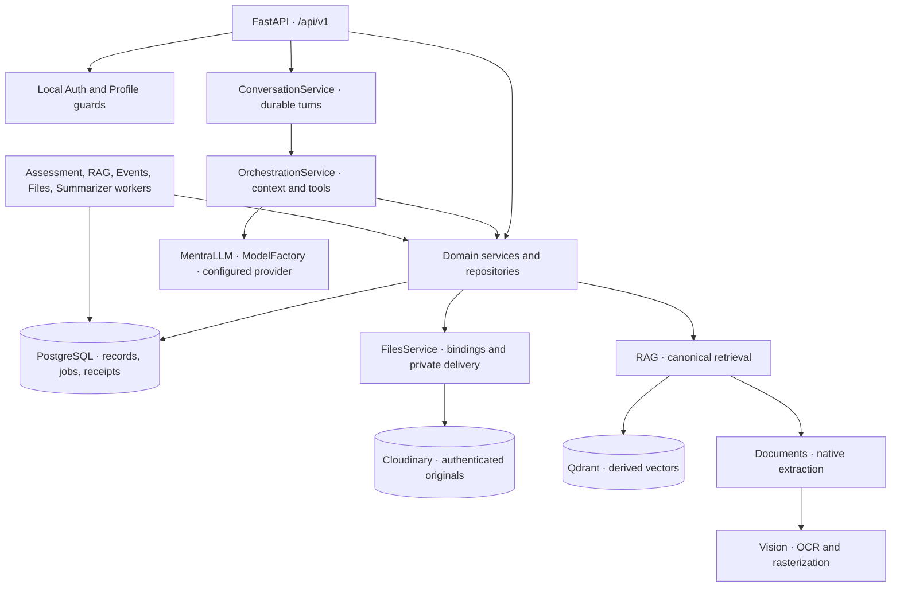

# Mentra · Backend Atlas

> **A backend field guide:** product decisions, modules, dependencies, directories, important files, APIs, models, libraries, storage and workers.
>
> **Updated:** 25 October 2026 · **Scope:** current checked-out backend and its deployment/build definitions.
>
> Grounded in executable code, registered routes, table mappings, migrations and pinned manifests. Local model settings are identified separately from code defaults. This is a static source map, not verification of a running deployment or provider capability. Paths are relative to the repository root.

## Start here

| Find… | Jump to |
| :--- | :--- |
| How the backend fits together | [Architecture](#architecture) |
| What changed since the earlier atlas | [Recent changes](#recent-changes) |
| Every backend directory and its purpose | [Directory guide](#directory-guide) |
| What each module owns | [Module directory](#module-directory) |
| Why key product behaviors work this way | [Product design decisions](#product-design-decisions) |
| Which feature calls which other feature | [Feature relationships](#feature-relationships) |
| Model identities and workflow usage | [Models and model selection](#models-and-model-selection) |
| Frameworks and important dependencies | [Libraries and frameworks](#libraries-and-frameworks) |
| Module APIs and file responsibilities | [Module reference](#module-reference) |
| Canonical records and original bytes | [Storage and ownership](#storage-and-ownership) |
| Process/queue responsibilities | [Processes and queues](#processes-and-queues) |
| Request-to-result behavior | [End-to-end flows](#end-to-end-flows) |
| Schema history | [Migration ledger](#migration-ledger) |
| Build, scripts, fixtures and tests | [Support files](#support-files) |
| Where to start a change | [Change navigation](#change-navigation) |

## Architecture

| Layer | Owns | Start reading here |
| :--- | :--- | :--- |
| Application composition | Creates shared Files, Auth, Learner, Profile, RAG, History, Events, Notifications, Assessment and orchestration services; closes resources | [`backend/app/main.py`](../backend/app/main.py) |
| HTTP boundary | Validated contracts, trusted identity, request limits, threadpool dispatch, public responses | [`backend/app/api/router.py`](../backend/app/api/router.py), `api/routes/` |
| Domains | Business rules, lifecycle, ownership, revisions, records and source/evidence provenance | Feature services and `repositories/` |
| AI coordination | Context/tool selection, prompt source, provider invocation, recovery, budgets, public activity | `langchain/` |
| Shared processing | Private files, document reading, OCR/images, speech and summary execution | `files/`, `documents/`, `vision/`, `speech/`, `summarization/` |
| Persistence/infrastructure | SQL sessions, metadata, migrations, owner transactions, admission and tracing | `db/`, `core/` |

The ordinary model workflow calls domain capabilities. Repositories retain SQL and business commit ownership. Files is a deliberate special boundary: its `service.py` directly owns the registry SQL, rather than having a separate `repositories/` directory. Cross-domain projection/transaction adapters also exist; use their actual code rather than assuming imports are perfectly one-way.

## Recent changes

| Area | Current design / addition | Main evidence |
| :--- | :--- | :--- |
| Retrieval reranking | Selected local multilingual mMARCO MiniLM CrossEncoder with bounded CPU reranking, diagnostics and hybrid fallback. | RAG reranker/service, bake script, settings and deployment contracts. |
| Solve on paper | Private answer-free question PDF plus reviewed PDF/TXT/image answer preparation through the standard grading/evidence pipeline. | Assessment question_paper.py, source/submission routes and answer-sheet regression suite. |
| File originals | One multipart upload API and private Cloudinary registry; domains bind file IDs. Original byte columns/local Library blob storage are retired. | `files/`, migration `20261020_0028`, consuming domain source routes. |
| Background compaction | Dedicated summarizer process handles both durable chat and admitted-memory summary queues. | `summarization/`, `chat/repositories/summary_jobs.py`, memory summary repository. |
| Practice follow-ups | Paged mistake history, selected-mistake practice and generated revision practice preserve root question/exposure lineage. | Assessment repository practice/list/view adapters; migrations 0026–0027. |
| Progress explanations | Deterministic explanation per concept includes bounded support and assessment-source availability. | `learner/progress_explanation.py`, learning understanding detail route. |
| Saved chats | Owned search and saved exchange windows complement exact history and summary discovery. | Conversation search/window routes, ChatReadFacade. |
| Page read projections | Library, Progress, Agenda, Memories and Assessments expose aggregate page reads; scoped sessions reduce repeated reads. | Domain `/page` handlers, `db/reads.py`, Learner read scopes. |
| Identity | Current-password-verified password change; local sessions only. External/EduVerse routes and implementation removed; legacy tables retained. | Auth service/routes and removed-platform regression tests. |
| Provider behavior | Streaming preview/protocol validation, stable assessment prompt prefixes and provider cache-usage reporting. | `provider_invocation.py`, `provider_protocol.py`, `provider_usage.py`, `assessment_payloads.py`. |
| Calendar export | Owned RFC 5545 export uses short-lived Files assets and current event revision authorization. | Events calendar route, `events/calendar.py`, `files/exports.py`. |
| Release support | Pinned transitive dependency lock, offline production preflight and disposable launch/recovery harnesses. | `requirements.lock`, `scripts/validate_production.py`, `testing/launch_*.py`. |

## Directory guide

Every current source/support directory under `backend/` is listed below. Generated cache/log directories are identified explicitly; their changing contents are not application modules. There is no current production `services/` or `integrations/` directory.

| Directory | Purpose |
| :--- | :--- |
| `backend/` | Backend application, schema history, runtime image, test suites and operator tools. |
| `backend/.cache/` | Generated local runtime/development cache; not production source. |
| `backend/.cache/tokenizers/` | Cached tokenizer vocabulary used for offline token counting. |
| `backend/alembic/` | Alembic environment and new-migration template. |
| `backend/alembic/versions/` | Ordered immutable schema revisions; current repository head is listed in the migration ledger. |
| `backend/app/` | Production Python application package; main.py is the composition root. |
| `backend/app/api/` | Shared FastAPI router and API package boundary. |
| `backend/app/api/routes/` | Domain HTTP adapters and health routes; all public feature paths mount under /api/v1. |
| `backend/app/assessments/` | Papers, attempts, grading, chat drafts, question/marks policy and worker consumers. |
| `backend/app/assessments/repositories/` | Assessment SQL, chat drafts, generation/evidence jobs, list/mistake views and practice lineage. |
| `backend/app/auth/` | Local accounts, Argon2id passwords, cookie/session transport, authentication and password changes. |
| `backend/app/auth/repositories/` | Account/session SQL and retained legacy identity table mappings. |
| `backend/app/chat/` | Durable conversation execution, attachments, prompt context, titles and summary consumers. |
| `backend/app/chat/repositories/` | Canonical transcript/turn/sync/activity SQL, owned history/search reads and summary jobs. |
| `backend/app/core/` | Validated settings, public exceptions, HTTP/privacy limits, logging and read-cache primitives. |
| `backend/app/core/observability/` | Workflow/request correlation, steps, timings, sanitization, log formatting and bounded output. |
| `backend/app/db/` | Engine/session configuration, migration runner, capacity/rate admission, owner transactions and scoped reads. |
| `backend/app/db/models/` | Legacy package marker; actual domain table mappings live with their owners. |
| `backend/app/documents/` | Reusable format detection, reader facade, extraction contracts and killable parser processes. |
| `backend/app/documents/readers/` | Native PDF, Office, HTML, text/code and image document engines. |
| `backend/app/files/` | Unified file registry, Cloudinary adapter, domain bindings, private delivery, transient speech/export and cleanup. |
| `backend/app/history_management/` | Canonical history recovery, persistent memories, tool budgets and composition of nested Events. |
| `backend/app/history_management/events/` | Event domain, temporal rules, proposal capture/admission, calendar rendering and reminder worker. |
| `backend/app/history_management/memory/` | Memory admission validation and bounded incremental summary generation/contracts. |
| `backend/app/history_management/repositories/` | Memory SQL, revisions/suppression/receipts, summary state/change capture and queue ownership. |
| `backend/app/history_management/repositories/events/` | Event/proposal SQL, revisions/evidence, operation receipts, reminder ledger and sync changes. |
| `backend/app/interactions/` | Shared native choice/feedback contracts used by chat and assessments. |
| `backend/app/langchain/` | AI workflow/model coordination, tool adapters, budgets, recovery, protocol and usage normalization. |
| `backend/app/langchain/graphs/` | Bounded tool-coordinator and durable event-confirmation LangGraph state machines. |
| `backend/app/langchain/prompts/` | Versioned workflow-specific instructions plus explicit PromptSource registry. |
| `backend/app/langchain/repositories/` | PostgreSQL LangGraph checkpoint adapter and durable chat-evidence extraction jobs. |
| `backend/app/learner/` | Provider-independent concepts, contexts, evidence/state policy, progress, recommendations and facade. |
| `backend/app/learner/repositories/` | Learner persistence protocols and composed PostgreSQL adapter. |
| `backend/app/learner/repositories/postgres_parts/` | Focused SQL mixins for concepts, contexts, evidence, decisions, states, retrieval and ontology lifecycle. |
| `backend/app/learner/repositories/tables/` | Granular Learner table mappings and native PostgreSQL column helpers. |
| `backend/app/learner/scoring/` | Replaceable/versioned mastery, confidence, retention and evidence-supported prediction policies. |
| `backend/app/notifications/` | Independent notification publication, inbox edits/preferences and sync facade. |
| `backend/app/notifications/repositories/` | Inbox/receipt/preference/change SQL; no scheduler ownership. |
| `backend/app/rag/` | Material lifecycle, ingestion, chunking, embeddings, canonical retrieval, vector store and optional reranker. |
| `backend/app/rag/repositories/` | Canonical source/version/generation/chunk metadata, ownership checks and ingestion job SQL. |
| `backend/app/schemas/` | Shared public API error envelopes; feature contracts stay near their modules. |
| `backend/app/speech/` | Local reusable CPU Whisper process, audio validation and transcription. |
| `backend/app/student_profile/` | User-owned teaching facts, onboarding, broad estimates, profile evidence and service ports. |
| `backend/app/student_profile/calibration/` | Curated screening items, deterministic scoring and calibration lifecycle. |
| `backend/app/student_profile/repositories/` | Profile/calibration/evidence SQL and conservative accepted-learning projection. |
| `backend/app/summarization/` | Shared summary execution policy and bounded dual-queue summarizer process. |
| `backend/app/vision/` | OCR/rasterization facade, image preparation and reviewed multimodal answer extraction. |
| `backend/app/vision/providers/` | Local Tesseract image OCR and Poppler PDF-page rasterizer implementations. |
| `backend/app/web_search/` | Bounded search/research providers, source normalization, dates, citations and scope rules. |
| `backend/app/web_search/repositories/` | Cross-process usage reservations and separate owner-scoped result cache SQL. |
| `backend/logs/` | Local backend log artifact parent directory. |
| `backend/logs/backend/` | Local daily operational logs where generated; Compose normally mounts repository logs/backend at /var/log/mentra. |
| `backend/scripts/` | Explicit operator, preflight, benchmark and opt-in verification CLIs. |
| `backend/testing/` | Test-only providers/fixtures, disposable schema/server setup and live/runtime/launch verification harnesses. |
| `backend/tests/` | Automated regression suite including cross-domain persistence, workflow and operational tests. |
| `backend/tests/auth/` | Local identity/session/password and retired-platform contract regressions. |
| `backend/tests/documents/` | Standalone format-reader and extraction behavior tests. |
| `backend/tests/learner/` | Contracts, scoring/evidence engine, integrations, persistence and synthetic learning scenarios. |
| `backend/tests/rag/` | Material API, indexing, parsing, chunking, reranking and ingestion/retrieval workflows. |
| `backend/tests/student_profile/` | Profile/calibration/evaluator, owned transactions and projection tests. |
| `backend/tests/vision/` | OCR and rasterization capability/provider tests. |

`__pycache__/` and `.pytest_cache/`, when present, contain generated Python bytecode/test cache at any depth. They do not define architecture or persistent product records.

## Module directory

| Module | Owns | Main home |
| :--- | :--- | :--- |
| [Identity and sessions](#module-auth) | Local accounts, session issuance/validation/logout and current-password-verified password changes. | `backend/app/auth/` |
| [Student Profile and calibration](#module-profile) | User-entered teaching facts, onboarding, curated calibration and broad estimates. | `backend/app/student_profile/` |
| [Persistent chat and attachments](#module-chat) | Canonical conversations, turns, Stop/recovery, attachments, saved-message search, private rolling context. | `backend/app/chat/` |
| [AI orchestration, tools and prompts](#module-orchestration) | Context planning, tool coordination, prompt registry, model invocation/recovery and educational AI workflows. | `backend/app/langchain/` |
| [Assessments and revision practice](#module-assessments) | Saved/private papers, drafts, attempts/answer revisions, grading, learning outbox and mistake/revision practice lineage. | `backend/app/assessments/` |
| [Learner Engine and Progress](#module-learner) | Concept identities/contexts/goals, accepted evidence, mastery/confidence/retention, rankings and explanations. | `backend/app/learner/` |
| [RAG and materials](#module-rag) | Material versions/generations/jobs, extracted chunks, current source eligibility, retrieval and citations. | `backend/app/rag/` |
| [Unified private files](#module-files) | Original upload/verification, registry, typed bindings, private streaming, transient assets and cleanup. | `backend/app/files/` |
| [Shared document reading](#module-documents) | Format detection, native/isolated extraction, document blocks and warnings. | `backend/app/documents/` |
| [Vision and answer transcription](#module-vision) | OCR/rasterization interfaces, chat image preparation and reviewed multimodal assessment transcription. | `backend/app/vision/` |
| [Speech transcription](#module-speech) | Audio decoding/validation, local CPU inference and reusable killable worker process. | `backend/app/speech/` |
| [History and persistent memories](#module-history) | Exact/keyword history, summary discovery, evidence-backed memories/preferences and supported memory summaries. | `backend/app/history_management/` |
| [Events, proposals and reminders](#module-events) | Agenda, temporal validation, chat capture/proposals, reminder ledger, calendar export and review decisions. | `backend/app/history_management/events/` |
| [Notification inbox](#module-notifications) | Inbox publication/receipts, read/dismiss changes, preferences, unread counts and synchronization. | `backend/app/notifications/` |
| [Web search and research](#module-web) | Source-scoped provider calls, dates, quota accounting, bounded cache/results and citations. | `backend/app/web_search/` |
| [Background summarization](#module-summarization) | Shared summary generation lifecycle and bounded dual-queue process; domains retain prompts and validity rules. | `backend/app/summarization/` |
| [Runtime, transport and persistence](#module-infrastructure) | Configuration/errors/privacy/limits/tracing, shared interaction contracts, SQL lifecycle, reads, owner locks and admission. | `backend/app/core/` |

## Product design decisions

These are observable product contracts enforced by the backend. The rationale explains their effect; it does not claim an undocumented historical motive.

| Decision | Backend behavior / product consequence | Implementation evidence |
| :--- | :--- | :--- |
| Publish grades before background learning | Grades and learning outbox commit together; separate evidence processing cannot delay results. Pending learning is explicit. | `assessments/worker.py`, `repositories/evidence.py`, `evidence_worker.py`. |
| Preserve original attempts and provenance | Corrections/regrading retain revision identity, private keys and source/question lineage; stale jobs are fenced. | Assessment repository, grade alignment, grading signature and evidence jobs. |
| Treat repeated/exposed practice honestly | Derivative and revision practice retain root item IDs and known exposure; retaining a question cannot create fresh independent evidence. | `mistake_practice.py`, `revision_practice.py`, assessment evidence workflow. |
| Confirmation is not mastery | Accepting a concept establishes identity/context inclusion, not demonstrated understanding. | Learner concept review and evidence submission boundaries. |
| Keep uncertainty explicit | Mastery, confidence, retention and difficulty coverage remain distinct; unsupported review targets are filtered for Progress. | Learner scoring, retrieval and progress explanation. |
| Separate broad teaching context from concept knowledge | Profile facts/calibration/estimates are not Learner concept state; accepted observations have a conservative projection. | Student Profile schemas/policy and learning_projection.py. |
| Keep preferred name user-owned | Name-only edits preserve calibration/estimates; omitted name fields do not overwrite an existing preferred name. | StudentProfileService.update_details; profile schemas. |
| Make chat durable and explicitly stoppable | HTTP disconnect does not cancel a turn; Stop fences the exact owner/conversation/attempt before cancellation. | ConversationService and ChatRepository. |
| Keep transcript canonical | Private chat summaries and memory summaries are lossy context, not replacement transcript or independent evidence. | ChatReadFacade, summary consumers and supported summary schemas. |
| Summaries must track current support | Memory blocks cite eligible memory IDs/revisions; edits/removals/expiry invalidate support, and jobs publish only when their claim is current. | MemorySummaryRepository, MemorySummaries and summary schemas. |
| Keep expensive compaction off interactive requests | Chat/memory summary queues have independent deadlines, retries and worker concurrency. | ChatSummaryJobs, summarization worker/execution. |
| Paper answers use the same grading contract | A paper upload prepares a reviewed answer map keyed to immutable question IDs. Explicit confirmation and the normal submission route precede grading; no grades/evidence are created by upload alone. | Assessment source/submission APIs, store_extraction and Vision/Document extraction. |
| Preserve typed work during paper extraction | Only nonblank extracted answers override saved drafts in the review map; recognized printed letters/option text normalize to immutable choice IDs. Unrecognized choices remain editable and must pass submission validation. | AssessmentRepository.store_extraction and normalize_answers/validate_mcq_answers. |
| Download questions without exposing answers | A4 PDF rendering takes the public Assessment DTO only; an unsaved owned chat draft can be downloaded without publishing it or creating an attempt. Private model answers/rubrics are not input to rendering. | question_paper.py, chat repository question_paper and owner-guarded PDF route. |
| Reranking refines retrieval without changing evidence | Rank only eligible hydrated candidates, cap CPU work and preserve original retrieval order on failure. Changing the reranker does not change embedding identity or require a vector rebuild. | RAGService.search, LocalReranker and build-time reranker assets. |
| Store originals once, bind by purpose | Domains associate JSON file references; chat-to-Library/assessment reuse the original asset through typed bindings. | FilesService.bind/release and domain attachment/source adapters. |
| Keep file delivery private and current | No provider URL in public metadata; reads recheck domain ownership/binding/lifecycle, with range-aware streamed delivery and leases. | Files delivery/provider/service. |
| Give transient files limited lives | Speech originals expire after 15 minutes and successful transcription schedules deletion; transcript receipts last 24 hours. Calendar exports expire after one hour. | Files transient/export lifecycle. |
| Make selected-source grounding authoritative | Retrieval must hydrate currently eligible owned source content; speculative prefetch alone cannot publish passages/citations. | RAGService.search and orchestration preparation/tool adapters. |
| Preserve material versions and source references | New originals/index generations retain versioned citation provenance rather than overwriting source identity. | RAG tables, ingestion publication and source APIs. |
| Separate events, memory and learning | A first-party event announcement can save an event or require proposal review; it does not imply mastery or automatically request a practice quiz. | Event capture/admission, proposals and Events facade. |
| Keep reminders separate from inbox state | Events owns due schedules and delivery ledger; Notifications owns delivered inbox/read/dismiss state. | EventRepository.deliver_reminders and NotificationsService. |
| Use explicit temporal meaning | Date-only values and timezone-aware instants remain distinct; DST ambiguity/gaps are surfaced and host timezone is not used. | `events/temporal.py` and temporal-preview API. |
| Make calendar export a projection | ICS export does not mutate an event or export private evidence/reminder inbox data; delivery rechecks event revision. | Events calendar renderer, Files exports and delivery authorization. |
| Keep local authentication self-contained | Password changes verify the current password, preserve that session and revoke others. Retired platform identities are not authenticated; legacy records remain. | Auth service/repository and retired-platform tests. |
| Bound AI work and report uncertain outcomes | Provider/tool/model costs, result size, retries and deadlines are bounded; uncertain writes rely on domain receipts rather than blind replays. | ToolExecutor, workflow budget, token policy and domain repositories. |
| Keep provider control text out of answers | Raw tool-control markup is rejected; streamed previews are cleared for tool calls/protocol failure. | provider_protocol.py and provider_invocation.py. |
| Keep operational logs content-free | Trace timing/parameter shapes and sanitized failures, not user prompts, full answers, SQL values or credentials. | core/observability and db/timing.py. |

## Feature relationships

| Consumer feature | Provider capability used | Boundary / result |
| :--- | :--- | :--- |
| Protected domain APIs | Auth identity + Profile readiness | require_identity / require_onboarded_identity bind the trusted owner. |
| Persistent chat | Orchestration → configured LLM + domain tools | ConversationService owns turn lifecycle; orchestration coordinates feature reads/writes. |
| Personalized chat | Profile packet + Learner packet + supported memory-summary context | Independent bounded preparations supply broad and concept-specific context. |
| Older chat recovery | History → ChatReadFacade search/window/summary discovery | Exact originals remain available behind owned search; summary is only a discovery/context aid. |
| Chat files | Files bindings → materialize → Documents/Vision | Metadata belongs to Chat, original lifecycle/delivery to Files. |
| Promote chat original | AttachmentService → RAG + Files reuse | Adds an authorized domain binding without uploading/copying the original again. |
| Source-grounded chat/practice | RAG → Learner scope + eligible SQL metadata + Qdrant | Current hydration/consent applies after vector/lexical candidate selection. |
| Material ingestion | RAG worker → Files → Documents → Vision when needed → embeddings → Qdrant | Fenced generation publication keeps canonical provenance in PostgreSQL. |
| Adaptive assessment | AssessmentWorkflows → Learner targets/concepts + Profile + optional RAG | Generation uses requested scope; private keys and marks are validated before saving. |
| Answer-sheet submission | Assessment → Files → Vision for eligible PDF/images, otherwise Documents/native/OCR fallback → review map | Merge saved drafts, normalize valid choice IDs, keep pending_transcription; explicit confirmed submission uses the standard grading/evidence pipeline. |
| Question-paper download | Assessment public detail or authorized unsaved chat draft → ReportLab renderer | Private no-store PDF with numbered parts/options/marks/instructions; no attempt creation or draft publication. |
| Reranking | Hydrated authorized RAG candidates → local multilingual CrossEncoder → final result budget | Default cap 20; reranker scores/ranks on success, original dense/hybrid order with fallback diagnostics on failure. |
| Mistake/revision practice | Assessment history → practice adapters + generation jobs | Known exposure, immutable snapshots and root item/source lineage are preserved. |
| Grading completion | AssessmentWorker → result/outbox transaction → AssessmentEvidenceWorker | Results publish first; accepted evidence and profile projection follow. |
| Chat demonstrations | ChatEvidenceWorker → Learner evidence + profile projection | Allowed concepts, exact quotes and confidence gates precede an owner transaction. |
| Progress explanation | Learner deterministic support → assessment source-availability check | Public explanation exposes bounded evidence links, not raw policy metadata. |
| Aggregate page reads | Domain repositories + db.read_sessions / Learner read_scope | Returns related bounded projections with scoped read reuse; writes remain separate. |
| Memory change | MemoryRepository → capture change → memory-summary job | Current admitted memories remain canonical; summary support tracks revisions/expiry. |
| Completed exchange | ChatRepository → ChatSummaryJobs → summarizer | Private chat context is compacted asynchronously, independently of user latency. |
| Both summary queues | Summarizer → domain consumers + shared generation policy | One configured LLM and bounded slots alternate queue checks; domains validate publication. |
| Chat event capture | Orchestration → proposal admission → Events | Complete unambiguous events may save; uncertain details produce a durable reviewable proposal. |
| Event review | Proposal service → confirmation graph + domain transaction | Workflow checkpoint is not the event business record. |
| Due reminder | Events worker → reminder ledger → Notifications.publish | Schedule and inbox remain separate domain state. |
| Calendar download | Events renderer → Files export → authenticated delivery | Short-lived asset binds to the current event revision. |
| Speech transcription | Speech route → Files.transient → CPU Whisper | Processor-only original and replay receipt; no direct multipart speech route. |
| Current information | Web tools → WebSearchService → free MCP / authenticated research | Separate quota/cache semantics and dated source/citation registry. |
| All expensive operations | DB admission + model/tool/token budget | Cross-process capacity and per-workflow deadlines with bounded failure recovery. |

## Models and model selection

**Configuration evidence:** repository defaults come from Settings, bake scripts and Compose. The local `.env` model-name fields were inspected on 25 October 2026 without copying credentials or provider URLs. These values are not proof of the running container configuration or a successful model invocation.

| Model / engine | Code default / local selection | Used for | Execution and selection |
| :--- | :--- | :--- | :--- |
| Main chat/structured-output LLM | No hard-coded AI_MODEL default; local `AI_MODEL=deepseek-flash`, `AI_PROVIDER=openai_compatible`, temperature 0.2. | Chat/tools, assessment design/targets/generation/grading, semantic concept matching, memory validation, event admission, profile evaluation and chat evidence. | Remote configured OpenAI-compatible endpoint via ModelFactory/MentraLLM; same model family is reused across prompt sources. |
| Assessment transcription model | `AI_VISION_MODEL` defaults empty and is empty locally. | Structured extraction of uploaded handwritten/image/PDF answer sheets. | MentraLLM requests the override for ASSESSMENT_TRANSCRIPTION; empty falls back to AI_MODEL. Image compatibility still depends on the configured provider/model. |
| Chat image model | Configured AI_MODEL, with request-scoped OCR recovery where applicable. | Image questions attached to chat. | Prepared raster inputs go to the model; OCR fallback is a separate path, not a second default remote model. |
| Chat summary LLM | Same configured AI_MODEL; default limits 600 context tokens / 2,400 characters. | Private per-conversation rolling context. | Dedicated summarizer process; CHAT_SUMMARY prompt and durable ChatSummaryJobs. |
| Memory summary LLM | Same configured AI_MODEL; default limits 800 context tokens / 3,200 characters; MEMORY_SUMMARY_ENABLED defaults true. | Supported compaction of admitted current memories. | Dedicated summarizer; MEMORY_SUMMARY prompt, memory ID/revision supports and independent generation limits. |
| Multilingual E5 embeddings | `intfloat/multilingual-e5-small`; local selection matches; CPU. | RAG document vectors and query vectors, including grounded practice/search. | SentenceTransformers/PyTorch local-only baked assets; normalized vectors, role prefixes and metadata-bound dimension/revision. Default E5-small vectors are 384-dimensional; runtime validates actual model dimension. |
| Multilingual cross-encoder reranker | Local selection and `.env.example`: `cross-encoder/mmarco-mMiniLMv2-L12-H384-v1`, path `/opt/mentra/models/reranker`, timeout 5 seconds, candidate cap 20. Settings/Compose still permit disabling it with an empty path. | Reranks currently owned, hydrated E5/hybrid candidates for chat/source retrieval and grounded assessments. | CPU-only PyTorch CrossEncoder; build-time resolved revision, local-only inference, batches of 8, 512-token pairs, plain query/passage text; no ONNX path or E5 vector/index change. Local configuration is verified, not live model execution. |
| Multilingual Whisper | `SPEECH_MODEL=base` by default and locally; `tiny` and `small` also accepted. | Speech-to-text with language detection. | Faster Whisper/CTranslate2, CPU INT8, local_files_only; baked assets and reusable killable process. |
| Speech activity detector | Faster Whisper bundled VAD via get_speech_timestamps/VadOptions. | Reject/segment non-speech audio before transcription. | Local auxiliary detector; not a separate configured chat model. |
| OCR language model | Tesseract English language data (`tesseract-ocr-eng`). | Shared local image/scanned-page OCR. | System OCR runtime; currently English-only, separate from multimodal transcription and multilingual embeddings/speech. |
| Token vocabulary | `cl100k_base` via tiktoken; baked at image build. | Provider-independent conservative token accounting. | Local accounting vocabulary, not an inference or embedding model. |
| Calibration and learner estimates | Curated question banks + deterministic/versioned policies. | Screening scores, mastery/confidence/retention, recommendations and evidence-supported explanations. | No separate hidden ML model: profiles may have structured AI evaluation, while Learner policy/state calculations are explicit Python. |

### Workflow prompt inventory

Each prompt file below is a workflow using the selected model, rather than evidence of another separately configured model. PromptSource in the registry controls which instructions can be chosen by trusted server code.

| Prompt file | Purpose |
| :--- | :--- |
| [`backend/app/langchain/prompts/assessment_design.py`](../backend/app/langchain/prompts/assessment_design.py) | Stores versioned system instructions for assessment design. |
| [`backend/app/langchain/prompts/assessment_generation.py`](../backend/app/langchain/prompts/assessment_generation.py) | Stores versioned system instructions for assessment generation. |
| [`backend/app/langchain/prompts/assessment_grading.py`](../backend/app/langchain/prompts/assessment_grading.py) | Stores versioned system instructions for assessment grading. |
| [`backend/app/langchain/prompts/assessment_selection.py`](../backend/app/langchain/prompts/assessment_selection.py) | Stores versioned system instructions for assessment selection. |
| [`backend/app/langchain/prompts/assessment_targets.py`](../backend/app/langchain/prompts/assessment_targets.py) | Stores versioned system instructions for assessment concept target selection. |
| [`backend/app/langchain/prompts/assessment_transcription.py`](../backend/app/langchain/prompts/assessment_transcription.py) | Stores versioned system instructions for assessment transcription. |
| [`backend/app/langchain/prompts/chat.py`](../backend/app/langchain/prompts/chat.py) | Stores versioned system instructions for chat. |
| [`backend/app/langchain/prompts/chat_assessment.py`](../backend/app/langchain/prompts/chat_assessment.py) | Stores versioned system instructions for chat practice tool usage and question delivery. |
| [`backend/app/langchain/prompts/chat_attachments.py`](../backend/app/langchain/prompts/chat_attachments.py) | Stores versioned system instructions for chat attachments. |
| [`backend/app/langchain/prompts/chat_summary.py`](../backend/app/langchain/prompts/chat_summary.py) | Stores versioned system instructions for chat summary. |
| [`backend/app/langchain/prompts/chat_title.py`](../backend/app/langchain/prompts/chat_title.py) | Stores versioned system instructions for chat title. |
| [`backend/app/langchain/prompts/concept_identity.py`](../backend/app/langchain/prompts/concept_identity.py) | Stores versioned system instructions for concept identity. |
| [`backend/app/langchain/prompts/event_admission.py`](../backend/app/langchain/prompts/event_admission.py) | Stores versioned system instructions for event admission. |
| [`backend/app/langchain/prompts/evidence.py`](../backend/app/langchain/prompts/evidence.py) | Stores versioned system instructions for chat demonstration evidence extraction. |
| [`backend/app/langchain/prompts/history_management.py`](../backend/app/langchain/prompts/history_management.py) | Stores versioned system instructions for history management. |
| [`backend/app/langchain/prompts/learner_context.py`](../backend/app/langchain/prompts/learner_context.py) | Stores versioned system instructions for learner context. |
| [`backend/app/langchain/prompts/memory_summary.py`](../backend/app/langchain/prompts/memory_summary.py) | Stores versioned system instructions for supported incremental memory compaction. |
| [`backend/app/langchain/prompts/memory_validation.py`](../backend/app/langchain/prompts/memory_validation.py) | Stores versioned system instructions for memory validation. |
| [`backend/app/langchain/prompts/rag_context.py`](../backend/app/langchain/prompts/rag_context.py) | Stores versioned system instructions for rag context. |
| [`backend/app/langchain/prompts/student_profile.py`](../backend/app/langchain/prompts/student_profile.py) | Stores versioned system instructions for broad teaching-profile evidence evaluation. |
| [`backend/app/langchain/prompts/tool_recovery.py`](../backend/app/langchain/prompts/tool_recovery.py) | Stores versioned system instructions for tool recovery. |
| [`backend/app/langchain/prompts/web_search.py`](../backend/app/langchain/prompts/web_search.py) | Stores versioned system instructions for web search. |

### Important domain models and contracts

| Model group | Meaning | Definition |
| :--- | :--- | :--- |
| Account / AuthenticatedIdentity | Local account and trusted session principal; learner UUID scopes owned records. | auth/models.py |
| StudentProfile / ProfileDetails / Estimates | Explicit user facts and broad uncertain teaching estimates, separate from concept mastery. | student_profile/schemas.py |
| Concept / LearningContext / LearningEvidence / LearnerConceptState | Canonical topic/context identities, immutable observations and derived per-owner state. | learner/models.py |
| LearningProgressPage / ProgressExplanation | Bounded understanding projections, coverage and accepted evidence support. | learner/schemas.py |
| GenerationRequest / GeneratedAssessment / Assessment / Attempt | Private generation contracts and public papers/attempts with revision/evidence status. | assessments/schemas.py |
| MistakePracticeRequest / RevisionPracticeRequest / PracticeSource | Known-exposure follow-up scope and source/revision lineage. | assessments/schemas.py |
| SendTurn / ChatResponse / SavedExchange | Durable turn inputs, validated result/reference projection and saved original-message windows. | chat/schemas.py; chat/response.py |
| FileReference / file_asset / file_binding | Public association reference and canonical original/binding lifecycle. | files/schemas.py; files/tables.py |
| SourceReference / RetrievedChunk / RetrievalResult | Version/generation/chunk provenance and bounded retrieval diagnostics. | rag/schemas.py |
| MemorySummary and supports | Bounded memory blocks attributable to current source memory IDs/revisions. | history_management/memory/summary_schemas.py |
| EventDraft / EventRecord / EventOutcome / EventProposal | Schedule intent, canonical owned event, replay outcome and reviewable proposal. | history_management/events/schemas.py; proposals.py |
| SearchInput / WebSource / SearchResult | Bounded query/source scope, dated evidence and citation payload. | web_search/schemas.py |

## Libraries and frameworks

Versions below are repository pins, not an installed-environment audit. Direct dependencies live in requirements.txt; requirements.lock constrains the resolved transitive stack during image builds. System binaries and service images have separate version policies.

| Area | Pinned libraries | Why they matter |
| :--- | :--- | :--- |
| HTTP/application | `fastapi==0.162.0`, `starlette==1.10.0`, `uvicorn==0.31.1` | API/router/dependency lifecycle, ASGI serving, responses, middleware and async transport. |
| Contracts/config | `pydantic==2.14.1`, `pydantic-settings==2.3.4`, `python-dotenv==1.2.4` | Typed validation, structured outputs and runtime environment configuration. |
| Database | `SQLAlchemy==2.0.54`, `psycopg==3.3.6`, `psycopg-pool==3.3.3`, `alembic==1.20.0` | PostgreSQL tables/queries, connection pools, owned transactions and migration lifecycle. |
| Passwords | `argon2-cffi==25.1.0` | Argon2id hashing/verification; passwords are not sent to repositories as plaintext. |
| AI provider | `langchain-openai==1.7.0`, `langchain-core==1.6.9`, `openai==3.37.0` | Configured compatible provider calls, typed tools/messages and structured model responses. |
| Graph/checkpoints | `langgraph==1.2.14`, `langgraph-checkpoint==4.3.0`, `langgraph-checkpoint-postgres==3.1.3` | Bounded tool and confirmation graphs with durable PostgreSQL checkpoints. |
| Embeddings/reranker | `sentence-transformers==5.7.0`, `transformers==5.20.2`, `torch==2.14.1+cpu` | Local E5 embeddings and optional CrossEncoder; CPU PyTorch is explicitly installed in Dockerfile. |
| Model assets/tokenization | `huggingface_hub==2.3.0`, `tokenizers==0.23.3`, `tiktoken==0.14.0` | Build-time model snapshots/tokenizers and offline token-budget accounting. |
| Vector store | `qdrant-client==1.15.1` | Qdrant collection/model identity, vector upsert/search/delete and payload filters. |
| Private originals | `cloudinary==1.46.3` | The production storage adapter for authenticated original upload/verification/deletion. |
| Transport/uploads | `httpx==0.28.1`, `httpx2==2.13.1`, `python-multipart==0.0.32`, `sse-starlette==3.0.3` | Provider/MCP HTTP transport, bounded multipart intake and event-stream support. |
| Document readers | `pypdf==6.21.2`, `python-docx==1.2.0`, `python-pptx==1.0.2`, `beautifulsoup4==4.15.0` | PDF, Word, PowerPoint and offline HTML extraction. |
| Raster handling | `pillow==13.0.0` | Bounded raster preparation, orientation, image inspection and transcription input. |
| Question-paper PDF | `reportlab==4.4.9` | Deterministic A4 rendering from public assessment fields, escaped content, bundled Vera font, numbered questions/parts and page footers. |
| Speech | `faster-whisper==1.2.1`, `ctranslate2==4.8.3`, `av==19.0.2`, `onnxruntime==1.31.0` | Local CPU transcription, audio decoding and bundled speech-activity support. |
| Web tools | `mcp==2.3.0`, `idna==3.20` | Fixed MCP search transport and hostname/domain normalization. |
| Markdown/citations | `markdown-it-py==4.0.0` | Markdown-aware web-reference parsing rather than naive text substitution. |
| Locking/serialization | `filelock==4.2.4`, `ormsgpack==1.13.0` | Shared log/file coordination and checkpoint serialization dependencies. |

| Runtime / external service | Repository selection | Role |
| :--- | :--- | :--- |
| Python | `python:3.12-slim` backend image | Production application/worker runtime. |
| PostgreSQL | Hosted DATABASE_URL or optional `postgres:17` Compose profile | Canonical relational records, jobs, leases, quota/receipts and graph checkpoints. |
| Qdrant | Configured service/collection; server version not pinned by this Compose file | Derived vector index; model/dimension identity checked by application. |
| Cloudinary | Configured private namespace; credentials server-only | Original storage behind FilesService; no production fallback local/blob store. |
| Tesseract + English data | System packages in Dockerfile | Local English image OCR. |
| Poppler utilities | System packages in Dockerfile | PDF-page rasterization and answer-sheet preparation. |
| You.com | Fixed free MCP search and separately authenticated research | Current-knowledge providers, source metadata and separately budgeted research. |
| Docker Compose / GitHub Actions | Root Compose and backend/migration workflows | Role-specific runtime settings, process orchestration, verification and migration gates. |

A dependency present in requirements.lock is not necessarily a product capability. For example, retained transitive packages do not restore removed external authentication routes.

## Module reference

All production Python files are indexed once below, including package markers. API paths are relative to **`/api/v1`**; GET and HEAD are listed independently. Exact body/query/response fields remain in linked route/schema code and generated OpenAPI. No application startup or external call is needed to read this map.

### 01 · Identity and sessions

| Aspect | Responsibility / relationship |
| :--- | :--- |
| Owns | Local accounts, session issuance/validation/logout and current-password-verified password changes. |
| Consumers | Every authenticated feature, profile onboarding guards. |
| Depends on | Identity repository, Argon2id, DB admission, cookie-origin policy. |

**HTTP · [`backend/app/api/routes/auth.py`](../backend/app/api/routes/auth.py)**

| Method | Path after /api/v1 | Operation / handler |
| :--- | :--- | :--- |
| `POST` | `/auth/register` | Register an account · `register` |
| `POST` | `/auth/login` | Authenticate account credentials · `login` |
| `GET` | `/auth/me` | Read the authenticated identity · `identity` |
| `POST` | `/auth/logout` | Revoke the current session · `logout` |
| `POST` | `/auth/change-password` | Verify current password, update hash and revoke other sessions · `change_password` |

**Files**

| File | One-line responsibility |
| :--- | :--- |
| [`backend/app/api/routes/auth.py`](../backend/app/api/routes/auth.py) | Registers HTTP handlers for auth; validates request data and binds server-owned identity before delegation. |
| [`backend/app/auth/__init__.py`](../backend/app/auth/__init__.py) | Mentra account authentication, separate from the Learner Engine. |
| [`backend/app/auth/cookies.py`](../backend/app/auth/cookies.py) | HTTP-only session transport. Cookie requests require a trusted browser origin. |
| [`backend/app/auth/dependencies.py`](../backend/app/auth/dependencies.py) | Resolves the configured AuthService, extracts cookie/bearer session tokens and requires a valid local identity. |
| [`backend/app/auth/errors.py`](../backend/app/auth/errors.py) | Defines domain-specific failures for identity and sessions. |
| [`backend/app/auth/factory.py`](../backend/app/auth/factory.py) | Assembles local AuthService with its identity repository, Argon2id password hasher and admission controls. |
| [`backend/app/auth/models.py`](../backend/app/auth/models.py) | Defines local accounts and authenticated session identities; provider fields remain for legacy compatibility. |
| [`backend/app/auth/passwords.py`](../backend/app/auth/passwords.py) | Argon2id password handling. Plaintext is never passed to repositories. |
| [`backend/app/auth/ports.py`](../backend/app/auth/ports.py) | Defines local identity/session persistence and atomic password-change/revocation contracts. |
| [`backend/app/auth/repositories/__init__.py`](../backend/app/auth/repositories/__init__.py) | Authentication persistence adapters. |
| [`backend/app/auth/repositories/postgres.py`](../backend/app/auth/repositories/postgres.py) | Transactional identity provisioning and sessions through SQLAlchemy 2.x. |
| [`backend/app/auth/repositories/tables.py`](../backend/app/auth/repositories/tables.py) | Declares PostgreSQL tables: `learner`, `mentra_account`, `external_identity`, `auth_session`. |
| [`backend/app/auth/schemas.py`](../backend/app/auth/schemas.py) | Defines registration/login, identity/session responses and current/new password-change contracts. |
| [`backend/app/auth/service.py`](../backend/app/auth/service.py) | Coordinates local registration/login, session validation/logout and current-password-verified password changes; rejects platform sessions. |

### 02 · Student Profile and calibration

| Aspect | Responsibility / relationship |
| :--- | :--- |
| Owns | User-entered teaching facts, onboarding, curated calibration and broad estimates. |
| Consumers | Chat/assessment teaching context and profile readiness checks. |
| Depends on | Auth, profile repository/evaluator; accepted-learning projection adapter. |

**HTTP · [`backend/app/api/routes/student_profile.py`](../backend/app/api/routes/student_profile.py)**

| Method | Path after /api/v1 | Operation / handler |
| :--- | :--- | :--- |
| `GET` | `/student-profile` | Read profile/onboarding state · `get_profile` |
| `PUT` | `/student-profile/details` | Update profile facts · `update_profile` |
| `GET` | `/student-profile/calibration` | Read calibration state · `get_calibration` |
| `POST` | `/student-profile/calibration` | Start calibration · `start_calibration` |
| `POST` | `/student-profile/calibration/skip` | Skip optional calibration · `skip_calibration` |
| `POST` | `/student-profile/calibration/evaluate` | Retry profile evaluation · `evaluate_calibration` |
| `PATCH` | `/student-profile/calibration/{attempt_id}/answers` | Save calibration answers · `save_answer` |
| `POST` | `/student-profile/calibration/{attempt_id}/complete` | Complete calibration · `complete_calibration` |

**Files**

| File | One-line responsibility |
| :--- | :--- |
| [`backend/app/api/routes/student_profile.py`](../backend/app/api/routes/student_profile.py) | Registers HTTP handlers for student profile; validates request data and binds server-owned identity before delegation. |
| [`backend/app/student_profile/__init__.py`](../backend/app/student_profile/__init__.py) | Defines the Student Profile package boundary for broad teaching context, separate from concept knowledge. |
| [`backend/app/student_profile/calibration/__init__.py`](../backend/app/student_profile/calibration/__init__.py) | Controlled calibration content and deterministic extraction. |
| [`backend/app/student_profile/calibration/blueprints.py`](../backend/app/student_profile/calibration/blueprints.py) | Curated English, level-relative screening items. Never generated by an LLM. |
| [`backend/app/student_profile/calibration/domains.py`](../backend/app/student_profile/calibration/domains.py) | Controlled field variants: two familiarity items, never generated on request. |
| [`backend/app/student_profile/calibration/scoring.py`](../backend/app/student_profile/calibration/scoring.py) | Scores curated calibration items and projects a public attempt without private answer keys. |
| [`backend/app/student_profile/calibration/service.py`](../backend/app/student_profile/calibration/service.py) | Manages calibration start/answers/completion/skip and deferred evaluation retry. |
| [`backend/app/student_profile/dependencies.py`](../backend/app/student_profile/dependencies.py) | Retrieves Profile service and combines authentication with onboarding-completion checks. |
| [`backend/app/student_profile/errors.py`](../backend/app/student_profile/errors.py) | Defines profile conflicts, missing-information responses, and unavailable-evaluation errors. |
| [`backend/app/student_profile/evidence_service.py`](../backend/app/student_profile/evidence_service.py) | Persist evidence first; evaluate outside DB locks; apply once under ownership lock. |
| [`backend/app/student_profile/factory.py`](../backend/app/student_profile/factory.py) | Constructs the student profile and calibration service with its concrete repository and adapters. |
| [`backend/app/student_profile/policy.py`](../backend/app/student_profile/policy.py) | Centralized, bounded adaptation of estimates. Never writes profile facts. |
| [`backend/app/student_profile/ports.py`](../backend/app/student_profile/ports.py) | Defines profile transaction/store and structured evaluator adapter interfaces. |
| [`backend/app/student_profile/repositories/__init__.py`](../backend/app/student_profile/repositories/__init__.py) | Persistence adapters, kept outside profile services and AI orchestration. |
| [`backend/app/student_profile/repositories/learning_projection.py`](../backend/app/student_profile/repositories/learning_projection.py) | Builds conservative broad teaching estimates from accepted learning evidence while accounting for corrections. |
| [`backend/app/student_profile/repositories/postgres.py`](../backend/app/student_profile/repositories/postgres.py) | Provides owned profile reads and transaction-bound access to the profile store. |
| [`backend/app/student_profile/repositories/store.py`](../backend/app/student_profile/repositories/store.py) | Transaction-bound, learner-scoped profile queries. No scoring/AI logic here. |
| [`backend/app/student_profile/repositories/tables.py`](../backend/app/student_profile/repositories/tables.py) | Declares PostgreSQL tables: `student_profile`, `student_calibration_attempt`, `student_profile_evidence`. |
| [`backend/app/student_profile/schemas.py`](../backend/app/student_profile/schemas.py) | High-level teaching context. These contracts never describe concept mastery. |
| [`backend/app/student_profile/service.py`](../backend/app/student_profile/service.py) | Reads/updates owned profile facts and teaching packets; name-only edits preserve estimates and calibration. |

### 03 · Persistent chat and attachments

| Aspect | Responsibility / relationship |
| :--- | :--- |
| Owns | Canonical conversations, turns, Stop/recovery, attachments, saved-message search, private rolling context. |
| Consumers | Orchestration, history recovery, durable chat evidence and summary queues. |
| Depends on | PostgreSQL, admission, shared Files, Documents/Vision and AI generation adapter. |

**HTTP · [`backend/app/api/routes/conversations.py`](../backend/app/api/routes/conversations.py)**

| Method | Path after /api/v1 | Operation / handler |
| :--- | :--- | :--- |
| `GET` | `/conversations/search` | Search saved original chat messages · `search_saved` |
| `GET` | `/conversations/{conversation_id}/messages/{message_id}/window` | Read an owned original exchange window · `saved_exchange` |
| `GET` | `/conversations/sync` | Read incremental changes · `sync` |
| `GET` | `/conversations` | List recent conversations · `recent` |
| `POST` | `/conversations/turns` | Accept or resume a durable turn · `send` |
| `POST` | `/conversations/{conversation_id}/turns/{turn_id}/stop` | Stop the specified turn attempt · `stop` |
| `GET` | `/conversations/{conversation_id}/turns/{turn_id}/events` | Stream public turn activity · `activity_events` |
| `GET` | `/conversations/{conversation_id}/messages` | Page canonical messages · `messages` |
| `GET` | `/conversations/{conversation_id}/status` | Read authoritative turn state · `status` |
| `PATCH` | `/conversations/{conversation_id}` | Rename with a revision check · `rename` |
| `DELETE` | `/conversations/{conversation_id}` | Remove the owned record · `remove` |

**HTTP · [`backend/app/api/routes/chat_attachments.py`](../backend/app/api/routes/chat_attachments.py)**

| Method | Path after /api/v1 | Operation / handler |
| :--- | :--- | :--- |
| `POST` | `/chat-attachments` | Associate a staged file ID with a chat attachment · `upload` |
| `DELETE` | `/chat-attachments/{identifier}` | Remove the owned record · `remove` |
| `GET` | `/chat-attachments/{identifier}` | Read owned detail · `detail` |
| `POST` | `/chat-attachments/{identifier}/library` | Promote attachment to Library · `library` |
| `GET` | `/chat-attachments/{identifier}/source` | Read authenticated source content · `source` |

**HTTP · [`backend/app/api/routes/chat.py`](../backend/app/api/routes/chat.py)**

| Method | Path after /api/v1 | Operation / handler |
| :--- | :--- | :--- |
| `POST` | `/chat` | Run deprecated stateless chat · `chat` |

**Files**

| File | One-line responsibility |
| :--- | :--- |
| [`backend/app/api/routes/chat.py`](../backend/app/api/routes/chat.py) | Registers HTTP handlers for chat; validates request data and binds server-owned identity before delegation. |
| [`backend/app/api/routes/chat_attachments.py`](../backend/app/api/routes/chat_attachments.py) | Registers HTTP handlers for chat attachments; validates request data and binds server-owned identity before delegation. |
| [`backend/app/api/routes/conversations.py`](../backend/app/api/routes/conversations.py) | Registers HTTP handlers for conversations; validates request data and binds server-owned identity before delegation. |
| [`backend/app/chat/__init__.py`](../backend/app/chat/__init__.py) | Account-owned conversation persistence, independent of model providers. |
| [`backend/app/chat/attachments.py`](../backend/app/chat/attachments.py) | Binds uploaded Files assets to chat, materializes originals for extraction/images and reuses assets for Library promotion. |
| [`backend/app/chat/context.py`](../backend/app/chat/context.py) | Model input selection is separate from immutable user-visible history. |
| [`backend/app/chat/generation.py`](../backend/app/chat/generation.py) | Forwards persistent and legacy chat generation callers into the shared OrchestrationService. |
| [`backend/app/chat/interactions.py`](../backend/app/chat/interactions.py) | Validates and resolves native choice cards stored in assistant-message metadata. |
| [`backend/app/chat/langchain_history.py`](../backend/app/chat/langchain_history.py) | Read the canonical transcript as LangChain messages without a second store. |
| [`backend/app/chat/repositories/__init__.py`](../backend/app/chat/repositories/__init__.py) | PostgreSQL storage for account-owned conversations. |
| [`backend/app/chat/repositories/activity.py`](../backend/app/chat/repositories/activity.py) | Bounded durable activity projections fenced by the canonical chat attempt. |
| [`backend/app/chat/repositories/attachments.py`](../backend/app/chat/repositories/attachments.py) | Persists chat attachment metadata/extraction and manages shared Files bindings; originals are not database byte columns. |
| [`backend/app/chat/repositories/history_reader.py`](../backend/app/chat/repositories/history_reader.py) | Provides canonical exact history, saved-message search, exchange windows and summary discovery with owned/live-chat checks. |
| [`backend/app/chat/repositories/postgres.py`](../backend/app/chat/repositories/postgres.py) | Persists canonical chats/messages, turn admission/publication/Stop, sync revisions, deletion and queued summary/evidence work. |
| [`backend/app/chat/repositories/summaries.py`](../backend/app/chat/repositories/summaries.py) | Private summaries, with durable single-flight leases and fenced publication. |
| [`backend/app/chat/repositories/summary_jobs.py`](../backend/app/chat/repositories/summary_jobs.py) | Coalesces completed exchanges into owner-first chat-summary jobs with leases, retry and diagnostics. |
| [`backend/app/chat/repositories/tables.py`](../backend/app/chat/repositories/tables.py) | Declares PostgreSQL tables: `chat_conversation`, `chat_message`, `chat_turn`, `chat_sync_state`, `chat_change`, `chat_summary`, `chat_summary_job`, `chat_activity`, `chat_attachment`. |
| [`backend/app/chat/response.py`](../backend/app/chat/response.py) | Defines the public chat response and validates source/web/assessment reference projections. |
| [`backend/app/chat/schemas.py`](../backend/app/chat/schemas.py) | Defines send, stop, rename, and turn-status request contracts, including timezone validation. |
| [`backend/app/chat/service.py`](../backend/app/chat/service.py) | Owns disconnect-safe durable turns, Stop/cancellation, bounded context loading, model execution and fenced result publication. |
| [`backend/app/chat/summaries.py`](../backend/app/chat/summaries.py) | Builds/validates private rolling chat context and implements ChatSummaryConsumer for durable background compaction. |
| [`backend/app/chat/titles.py`](../backend/app/chat/titles.py) | Validates model-generated first-turn titles and supplies a provisional fallback. |

### 04 · AI orchestration, tools and prompts

| Aspect | Responsibility / relationship |
| :--- | :--- |
| Owns | Context planning, tool coordination, prompt registry, model invocation/recovery and educational AI workflows. |
| Consumers | Chat, assessment generation/grading, semantic concept/memory/event/profile adapters. |
| Depends on | Domain facades, LangChain/LangGraph, configured provider and checkpoint/evidence adapters. |

**HTTP:** no dedicated public router; reached through owning feature routes, internal adapters or worker consumers.

**Files**

| File | One-line responsibility |
| :--- | :--- |
| [`backend/app/langchain/__init__.py`](../backend/app/langchain/__init__.py) | LangChain orchestration module. |
| [`backend/app/langchain/activity.py`](../backend/app/langchain/activity.py) | Public execution updates. No prompts, tool arguments or reasoning are published. |
| [`backend/app/langchain/assessment_concepts.py`](../backend/app/langchain/assessment_concepts.py) | Resolve generated concept labels through the learner facade, never invent IDs. |
| [`backend/app/langchain/assessment_design.py`](../backend/app/langchain/assessment_design.py) | Request-led outlines, separate from content generation and grading keys. |
| [`backend/app/langchain/assessment_payloads.py`](../backend/app/langchain/assessment_payloads.py) | Builds compact batch-generation inputs with a stable shared prefix while preserving the current questions and revision content. |
| [`backend/app/langchain/assessment_selection.py`](../backend/app/langchain/assessment_selection.py) | Choose omissions using the same owner-bound read tools as chat. |
| [`backend/app/langchain/assessment_workflows.py`](../backend/app/langchain/assessment_workflows.py) | Runs assessment generation/grading and maps published grades into learner evidence and profile projections. |
| [`backend/app/langchain/attachment_selection.py`](../backend/app/langchain/attachment_selection.py) | Keep uploads scoped to their turn; retain explicit references to older files. |
| [`backend/app/langchain/chat_service.py`](../backend/app/langchain/chat_service.py) | Builds chat prompt input and invokes the model/tool coordinator with trusted context and response contracts. |
| [`backend/app/langchain/concept_identity.py`](../backend/app/langchain/concept_identity.py) | Bounded model assistance for the learner domain's canonical identity resolver. |
| [`backend/app/langchain/concurrent_reads.py`](../backend/app/langchain/concurrent_reads.py) | Fetch independent reads together, publish their scope changes in call order. |
| [`backend/app/langchain/event_tools.py`](../backend/app/langchain/event_tools.py) | Exposes owned event lookup and proposal-aware event mutation capabilities to model workflows. |
| [`backend/app/langchain/evidence_schemas.py`](../backend/app/langchain/evidence_schemas.py) | Defines structured chat-demonstration extraction with bounded scores, confidence, and source quotes. |
| [`backend/app/langchain/evidence_worker.py`](../backend/app/langchain/evidence_worker.py) | Extracts qualifying chat demonstrations and commits provenance-bound Learner evidence plus profile projection. |
| [`backend/app/langchain/generation_recovery.py`](../backend/app/langchain/generation_recovery.py) | Bounded repair of generated assessments before any assessment is saved. |
| [`backend/app/langchain/grading_batches.py`](../backend/app/langchain/grading_batches.py) | Plan at most two complete grading packets without trimming student work. |
| [`backend/app/langchain/graphs/event_confirmation.py`](../backend/app/langchain/graphs/event_confirmation.py) | Minimal durable interrupt; Events owns decisions and business commits. |
| [`backend/app/langchain/graphs/tool_coordinator.py`](../backend/app/langchain/graphs/tool_coordinator.py) | Runs the bounded LangGraph model/tool cycle while durable effects stay in domain repositories. |
| [`backend/app/langchain/history_orchestration.py`](../backend/app/langchain/history_orchestration.py) | Bounded LangGraph coordinator over trusted domain tools. |
| [`backend/app/langchain/image_fallback.py`](../backend/app/langchain/image_fallback.py) | Request-scoped OCR recovery without replaying orchestration or tool writes. |
| [`backend/app/langchain/learner_tools.py`](../backend/app/langchain/learner_tools.py) | Learner tools usable by LangChain or LangGraph, bound to trusted workflow scope. |
| [`backend/app/langchain/llm.py`](../backend/app/langchain/llm.py) | Shared LangChain invocation component with mandatory prompt-source selection. |
| [`backend/app/langchain/model_factory.py`](../backend/app/langchain/model_factory.py) | Reuses configured OpenAI-compatible models; applies DeepSeek thinking/tool settings and cache-usage normalization for that endpoint. |
| [`backend/app/langchain/orchestration_service.py`](../backend/app/langchain/orchestration_service.py) | Prepares trusted context including memory summaries, coordinates tools/events/files and assembles the final validated chat response. |
| [`backend/app/langchain/decision_schemas.py`](../backend/app/langchain/decision_schemas.py) | Typed semantic final decisions and response outcomes. |
| [`backend/app/langchain/task_outcomes.py`](../backend/app/langchain/task_outcomes.py) | Receipt-backed fulfillment and legacy outcome projection. |
| [`backend/app/langchain/recovery_receipts.py`](../backend/app/langchain/recovery_receipts.py) | Private completed-write continuity across read-context refresh. |
| [`backend/app/langchain/profile_bridge.py`](../backend/app/langchain/profile_bridge.py) | Re-exports deterministic learning-to-profile projection for use inside an existing owner transaction. |
| [`backend/app/langchain/profile_evaluator.py`](../backend/app/langchain/profile_evaluator.py) | Specialized structured evaluator, using Mentra's configured model factory. |
| [`backend/app/langchain/prompts/__init__.py`](../backend/app/langchain/prompts/__init__.py) | Exports PromptSource and the versioned prompt lookup functions. |
| [`backend/app/langchain/prompts/assessment_design.py`](../backend/app/langchain/prompts/assessment_design.py) | Stores versioned system instructions for assessment design. |
| [`backend/app/langchain/prompts/assessment_generation.py`](../backend/app/langchain/prompts/assessment_generation.py) | Stores versioned system instructions for assessment generation. |
| [`backend/app/langchain/prompts/assessment_grading.py`](../backend/app/langchain/prompts/assessment_grading.py) | Stores versioned system instructions for assessment grading. |
| [`backend/app/langchain/prompts/assessment_selection.py`](../backend/app/langchain/prompts/assessment_selection.py) | Stores versioned system instructions for assessment selection. |
| [`backend/app/langchain/prompts/assessment_targets.py`](../backend/app/langchain/prompts/assessment_targets.py) | Stores versioned system instructions for assessment concept target selection. |
| [`backend/app/langchain/prompts/assessment_transcription.py`](../backend/app/langchain/prompts/assessment_transcription.py) | Stores versioned system instructions for assessment transcription. |
| [`backend/app/langchain/prompts/chat.py`](../backend/app/langchain/prompts/chat.py) | Stores versioned system instructions for chat. |
| [`backend/app/langchain/prompts/chat_assessment.py`](../backend/app/langchain/prompts/chat_assessment.py) | Stores versioned system instructions for chat practice tool usage and question delivery. |
| [`backend/app/langchain/prompts/chat_attachments.py`](../backend/app/langchain/prompts/chat_attachments.py) | Stores versioned system instructions for chat attachments. |
| [`backend/app/langchain/prompts/chat_summary.py`](../backend/app/langchain/prompts/chat_summary.py) | Stores versioned system instructions for chat summary. |
| [`backend/app/langchain/prompts/chat_title.py`](../backend/app/langchain/prompts/chat_title.py) | Stores versioned system instructions for chat title. |
| [`backend/app/langchain/prompts/concept_identity.py`](../backend/app/langchain/prompts/concept_identity.py) | Stores versioned system instructions for concept identity. |
| [`backend/app/langchain/prompts/event_admission.py`](../backend/app/langchain/prompts/event_admission.py) | Stores versioned system instructions for event admission. |
| [`backend/app/langchain/prompts/evidence.py`](../backend/app/langchain/prompts/evidence.py) | Stores versioned system instructions for chat demonstration evidence extraction. |
| [`backend/app/langchain/prompts/history_management.py`](../backend/app/langchain/prompts/history_management.py) | Stores versioned system instructions for history management. |
| [`backend/app/langchain/prompts/learner_context.py`](../backend/app/langchain/prompts/learner_context.py) | Stores versioned system instructions for learner context. |
| [`backend/app/langchain/prompts/memory_summary.py`](../backend/app/langchain/prompts/memory_summary.py) | Stores versioned system instructions for supported incremental memory compaction. |
| [`backend/app/langchain/prompts/memory_validation.py`](../backend/app/langchain/prompts/memory_validation.py) | Stores versioned system instructions for memory validation. |
| [`backend/app/langchain/prompts/rag_context.py`](../backend/app/langchain/prompts/rag_context.py) | Stores versioned system instructions for rag context. |
| [`backend/app/langchain/prompts/registry.py`](../backend/app/langchain/prompts/registry.py) | Maps server-selected PromptSource values to versioned system prompts. |
| [`backend/app/langchain/prompts/student_profile.py`](../backend/app/langchain/prompts/student_profile.py) | Stores versioned system instructions for broad teaching-profile evidence evaluation. |
| [`backend/app/langchain/prompts/tool_recovery.py`](../backend/app/langchain/prompts/tool_recovery.py) | Stores versioned system instructions for tool recovery. |
| [`backend/app/langchain/prompts/web_search.py`](../backend/app/langchain/prompts/web_search.py) | Stores versioned system instructions for web search. |
| [`backend/app/langchain/provider_activity.py`](../backend/app/langchain/provider_activity.py) | Observe the SDK's existing retries; never add a second retry loop. |
| [`backend/app/langchain/provider_invocation.py`](../backend/app/langchain/provider_invocation.py) | Enforces provider deadlines, aggregates streaming chunks/previews, clears tool/protocol previews and records content-free timings. |
| [`backend/app/langchain/provider_protocol.py`](../backend/app/langchain/provider_protocol.py) | Rejects raw provider tool-control markup returned as answer text before public publication. |
| [`backend/app/langchain/provider_usage.py`](../backend/app/langchain/provider_usage.py) | Normalizes compatible-provider prompt-cache hit counters for ordinary and streaming model responses. |
| [`backend/app/langchain/rag_tools.py`](../backend/app/langchain/rag_tools.py) | Read-only study tools with identity and consent bound by server orchestration. |
| [`backend/app/langchain/repositories/checkpoint_tables.py`](../backend/app/langchain/repositories/checkpoint_tables.py) | Declares PostgreSQL tables: `checkpoint_migrations`, `checkpoints`, `checkpoint_blobs`, `checkpoint_writes`. |
| [`backend/app/langchain/repositories/checkpointer.py`](../backend/app/langchain/repositories/checkpointer.py) | Provides pooled PostgreSQL LangGraph checkpoints with schema lifecycle delegated to Alembic. |
| [`backend/app/langchain/repositories/evidence.py`](../backend/app/langchain/repositories/evidence.py) | Queues/claims/completes/retries chat-evidence jobs using the canonical turn and answer source. |
| [`backend/app/langchain/repositories/evidence_tables.py`](../backend/app/langchain/repositories/evidence_tables.py) | Declares PostgreSQL tables: `chat_evidence_job`. |
| [`backend/app/langchain/response_style.py`](../backend/app/langchain/response_style.py) | Translate saved preference enums into bounded, server-owned reply guidance. |
| [`backend/app/langchain/token_policy.py`](../backend/app/langchain/token_policy.py) | Provider-independent guards; payloads are never truncated silently. |
| [`backend/app/langchain/tool_activity.py`](../backend/app/langchain/tool_activity.py) | Pydantic-validated pre-tool announcements with no private argument disclosure. |
| [`backend/app/langchain/tool_cache.py`](../backend/app/langchain/tool_cache.py) | One key contract for admission, batch coalescing and turn-local tool reuse. |
| [`backend/app/langchain/tool_execution.py`](../backend/app/langchain/tool_execution.py) | Bounded read recovery; writes retain domain-owned replay/receipts. |
| [`backend/app/langchain/tool_policy.py`](../backend/app/langchain/tool_policy.py) | Small, explicit capability metadata shared by selection and discovery. |
| [`backend/app/langchain/tool_selection.py`](../backend/app/langchain/tool_selection.py) | Defines module discovery and operation-level capability selection for the model tool cycle. |
| [`backend/app/langchain/web_tools.py`](../backend/app/langchain/web_tools.py) | Thin adapter: bounded evidence, staged citations, dated reuse and public website progress. |
| [`backend/app/langchain/workflow_budget.py`](../backend/app/langchain/workflow_budget.py) | One cost/deadline envelope shared by nested model invocations. |
| [`backend/app/langchain/workflow_tools.py`](../backend/app/langchain/workflow_tools.py) | Narrow domain adapters. Identity and source consent stay server-bound. |

### 05 · Assessments and revision practice

| Aspect | Responsibility / relationship |
| :--- | :--- |
| Owns | Saved/private papers, drafts, attempts/answer revisions, grading, learning outbox and mistake/revision practice lineage. |
| Consumers | Practice generation, graded results, learner evidence, source-attributed progress explanations. |
| Depends on | AI workflows, Learner, RAG grounding, Profile, Files and reviewed Vision extraction. |

**HTTP · [`backend/app/api/routes/assessments.py`](../backend/app/api/routes/assessments.py)**

| Method | Path after /api/v1 | Operation / handler |
| :--- | :--- | :--- |
| `GET` | `/assessments/page` | Read bounded assessment cards and attempt summaries · `assessment_page` |
| `GET` | `/assessments/mistakes` | Page/filter owned mistake history · `mistake_history` |
| `POST` | `/assessments/mistakes/practice` | Queue a lineage-preserving revision assessment · `revision_practice` |
| `POST` | `/assessments/generation-jobs` | Queue durable paper generation · `queue_generation` |
| `GET` | `/assessments/generation-jobs/{identifier}` | Read generation job progress/result · `generation_job` |
| `POST` | `/assessments/generation-jobs/{identifier}/retry` | Retry failed generation · `retry_generation` |
| `PUT` | `/assessments/attempts/{identifier}/draft` | Save attempt draft answers · `save_draft` |
| `GET` | `/assessments/preferences` | Read preferences · `preferences` |
| `PATCH` | `/assessments/preferences` | Update preferences · `update_preferences` |
| `GET` | `/assessments/chat-drafts/{identifier}` | Read a chat practice draft · `chat_draft` |
| `POST` | `/assessments/chat-drafts/{identifier}/publish` | Publish a chat draft as a saved assessment · `publish_chat_draft` |
| `POST` | `/assessments` | Generate an assessment synchronously · `generate` |
| `GET` | `/assessments` | List saved assessments · `list_assessments` |
| `GET` | `/assessments/attempts/{identifier}` | Read an attempt and processing status · `attempt` |
| `POST` | `/assessments/attempts/{identifier}/practice` | Create practice from selected attempt mistakes · `practise_mistakes` |
| `POST` | `/assessments/attempts/{identifier}/submission` | Submit answers for grading · `submit` |
| `POST` | `/assessments/attempts/{identifier}/source` | Prepare reviewed paper answers from file_id + expected_revision; no grading yet · `source` |
| `GET` | `/assessments/{identifier}/paper.pdf` | Download an owner-authorized answer-free question PDF; accepts saved assessment or unsaved draft payload ID · `question_paper` |
| `POST` | `/assessments/attempts/{identifier}/retry` | Retry grading · `retry` |
| `POST` | `/assessments/attempts/{identifier}/corrections` | Record corrected answers for regrading · `correct` |
| `GET` | `/assessments/{identifier}` | Read owned detail · `detail` |
| `GET` | `/assessments/{identifier}/attempts` | List assessment attempts · `attempts` |
| `POST` | `/assessments/{identifier}/attempts` | Start an assessment attempt · `start` |
| `DELETE` | `/assessments/{identifier}` | Remove the owned record · `remove` |

**Files**

| File | One-line responsibility |
| :--- | :--- |
| [`backend/app/api/routes/assessments.py`](../backend/app/api/routes/assessments.py) | Registers HTTP handlers for assessments; validates request data and binds server-owned identity before delegation. |
| [`backend/app/assessments/blueprint.py`](../backend/app/assessments/blueprint.py) | Deterministic question/part and marks plans; AI supplies educational content. |
| [`backend/app/assessments/chat.py`](../backend/app/assessments/chat.py) | Re-exports the chat assessment persistence adapter for compatibility. |
| [`backend/app/assessments/choice_answers.py`](../backend/app/assessments/choice_answers.py) | Canonical option mapping shared by validation, grading and handwritten review. |
| [`backend/app/assessments/evidence_worker.py`](../backend/app/assessments/evidence_worker.py) | Learning updates never delay publication of assessment results. |
| [`backend/app/assessments/generation_worker.py`](../backend/app/assessments/generation_worker.py) | Durable paper generation, independent of the 150-second chat-turn deadline. |
| [`backend/app/assessments/question_paper.py`](../backend/app/assessments/question_paper.py) | Renders public assessment fields as a numbered, answer-free A4 PDF with marks/options/instructions and page footers. |
| [`backend/app/assessments/grade_alignment.py`](../backend/app/assessments/grade_alignment.py) | Aligns model grades to immutable question identities, canonical concepts, and server-owned mark limits. |
| [`backend/app/assessments/grading_progress.py`](../backend/app/assessments/grading_progress.py) | Bind private grading checkpoints to an exact immutable assessment/answer revision. |
| [`backend/app/assessments/repositories/chat.py`](../backend/app/assessments/repositories/chat.py) | Persists chat practice drafts/publishing and reads authorized public question papers without publishing a draft or creating an attempt. |
| [`backend/app/assessments/repositories/evidence.py`](../backend/app/assessments/repositories/evidence.py) | Revision-fenced durable outbox for learning updates after results publish. |
| [`backend/app/assessments/repositories/generation.py`](../backend/app/assessments/repositories/generation.py) | Owner-scoped, lease-fenced generation with private per-batch checkpoints. |
| [`backend/app/assessments/repositories/list_view.py`](../backend/app/assessments/repositories/list_view.py) | Returns bounded assessment-card projections and latest attempt summaries without loading full papers. |
| [`backend/app/assessments/repositories/mistake_practice.py`](../backend/app/assessments/repositories/mistake_practice.py) | Creates follow-ups from selected mistakes and preserves immutable snapshots, root question identity and known-exposure lineage. |
| [`backend/app/assessments/repositories/mistake_view.py`](../backend/app/assessments/repositories/mistake_view.py) | Pages/filter mistake history in PostgreSQL without transferring every question, paper and submitted answer. |
| [`backend/app/assessments/repositories/postgres.py`](../backend/app/assessments/repositories/postgres.py) | Persists papers/attempts/results/outbox/practice; merges nonblank extracted answers with saved drafts, normalizes choices and fences confirmed submissions. |
| [`backend/app/assessments/repositories/revision_practice.py`](../backend/app/assessments/repositories/revision_practice.py) | Collects owned mistake history and queues revision assessments with server-owned lineage and evidence provenance. |
| [`backend/app/assessments/repositories/tables.py`](../backend/app/assessments/repositories/tables.py) | Declares PostgreSQL tables: `assessment_practice_operation`, `assessment`, `assessment_attempt`, `assessment_evidence_job`, `assessment_generation_claim`, `chat_assessment_draft`, `assessment_preferences`, `assessment_generation_job`. |
| [`backend/app/assessments/schemas.py`](../backend/app/assessments/schemas.py) | Defines validated request/result contracts for assessment workflows. |
| [`backend/app/assessments/service.py`](../backend/app/assessments/service.py) | Prepares file-referenced paper answers through Vision/native/OCR fallback, requires review confirmation, and shares standard generation/submission workflows. |
| [`backend/app/assessments/worker.py`](../backend/app/assessments/worker.py) | Durable grading worker; model calls happen outside owner transactions. |

### Paper-answer preparation and question-paper downloads

| Stage | Backend contract / behavior | Ownership and state |
| :--- | :--- | :--- |
| Download questions | `GET /assessments/{identifier}/paper.pdf` resolves owned saved detail, or falls back on ASSESSMENT_NOT_FOUND to an authorized chat draft by public assessment payload ID. | Authenticated/onboarded; public DTO only; draft remains unsaved and no attempt is created. |
| Render PDF | ReportLab writes A4 questions/parts, sections, options, marks, available duration/instructions and paper-answer numbering guidance. | Escaped text and bundled font; response is application/pdf with attachment, no-store and nosniff headers. It is generated in the request, separate from Files-managed calendar exports. |
| Prepare an attempt | Use the ordinary assessment attempt flow, then upload the original once through `/files/uploads` with purpose assessment. | Shared Files receipts/bindings preserve ownership and upload retry behavior. |
| Associate answers | `POST /assessments/attempts/{identifier}/source` accepts JSON file_id and expected_revision under parse admission. | Only draft/pending_transcription revisions can change; the same source in pending_transcription replays its current preparation. |
| Extract | Eligible PDF/PNG/JPEG bytes try configured Vision when enabled; failures/disabled Vision use shared Documents native extraction or OCR. TXT uses numbered native text extraction. | Printed question/part references map to immutable question IDs; incomplete/unreadable extraction yields review warnings, not invented answers. |
| Preserve/normalize | store_extraction copies saved draft answers, overlays nonblank extracted answers, and converts recognized letters/option text to canonical option IDs. | Original draft answers remain saved separately; unrecognized choices remain available for correction. File is bound to this attempt, extraction saved, revision incremented, state pending_transcription. |
| Review and confirm | Review/correct every required answer and send transcription_confirmed=true with a complete answers map to the ordinary `/submission` route. | Both service and repository require confirmation; completeness and MCQ validation still apply. Upload alone never means submitted/graded. |
| Grade and learn | Standard grading job/checkpoints → grade/outbox publication → independent learner-evidence worker. | Same canonical question IDs, normalization, scoring and evidence rules as answers entered directly; results precede background learning. |
| Reuse a regular chat upload | Assessment answer tool passes an owned selected chat attachment through upload_paper_with_vision(from_chat=True). | Reuses the chat original with an authorized assessment binding; prepares the same reviewed attempt rather than uploading/copying bytes again. |

The declared paper-answer surface is PDF, TXT and PNG/JPEG across interactive, written and saved assessment workflows. Detailed supported extraction warnings and format capabilities remain authoritative. Implementation tests demonstrate native TXT/PDF mapping and controlled image-transcription plumbing; they are not a handwriting-quality benchmark.

### 06 · Learner Engine and Progress

| Aspect | Responsibility / relationship |
| :--- | :--- |
| Owns | Concept identities/contexts/goals, accepted evidence, mastery/confidence/retention, rankings and explanations. |
| Consumers | Adaptive practice, RAG context scope, chat learning and progress/evidence support. |
| Depends on | Repository protocols/PostgreSQL, deterministic policies and optional concept-resolution assistance. |

**HTTP · [`backend/app/api/routes/learning.py`](../backend/app/api/routes/learning.py)**

| Method | Path after /api/v1 | Operation / handler |
| :--- | :--- | :--- |
| `GET` | `/learning/page` | Read overview, contexts, candidates and initial understanding together · `progress_page` |
| `GET` | `/learning/concept-candidates` | List owned concept candidates · `pending_concepts` |
| `POST` | `/learning/concept-candidates/{identifier}` | Confirm or discard a concept candidate · `review_concept` |
| `GET` | `/learning` | Read context, recommendations and verification · `overview` |
| `GET` | `/learning/understanding` | Search/page concept understanding · `understanding` |
| `GET` | `/learning/understanding/{identifier}` | Read deterministic concept support and source availability · `explanation` |

**Files**

| File | One-line responsibility |
| :--- | :--- |
| [`backend/app/api/routes/learning.py`](../backend/app/api/routes/learning.py) | Registers HTTP handlers for learning; validates request data and binds server-owned identity before delegation. |
| [`backend/app/learner/__init__.py`](../backend/app/learner/__init__.py) | Public, provider-independent contracts for the Mentra Learner Engine. |
| [`backend/app/learner/assessment.py`](../backend/app/learner/assessment.py) | Maps graded question/concept observations into provenance-preserving learner evidence and assessment targets. |
| [`backend/app/learner/calibration.py`](../backend/app/learner/calibration.py) | Selects progressively challenging concept targets for learner-level calibration consumers. |
| [`backend/app/learner/concepts.py`](../backend/app/learner/concepts.py) | Resolves/registers canonical concepts through exact lookup and optional bounded semantic assistance; manages candidate review. |
| [`backend/app/learner/contexts.py`](../backend/app/learner/contexts.py) | Resolves, selects and validates owned learning contexts; tracks activation/activity and active/dormant lifecycle. |
| [`backend/app/learner/engine.py`](../backend/app/learner/engine.py) | Composes concept/context/evidence/state/retrieval services into the public Learner facade, including scoped reads and progress explanations. |
| [`backend/app/learner/evaluation.py`](../backend/app/learner/evaluation.py) | Offline evaluation hooks; they never mutate production learner beliefs. |
| [`backend/app/learner/evidence.py`](../backend/app/learner/evidence.py) | Validates/deduplicates evidence, applies acceptance/correction decisions and atomically updates/replays learner state. |
| [`backend/app/learner/exceptions.py`](../backend/app/learner/exceptions.py) | Domain exceptions raised by Learner Engine services. |
| [`backend/app/learner/factory.py`](../backend/app/learner/factory.py) | Application composition; infrastructure imports are deliberately lazy. |
| [`backend/app/learner/generated_concepts.py`](../backend/app/learner/generated_concepts.py) | Resolve AI-selected practice targets without treating them as learner evidence. |
| [`backend/app/learner/models.py`](../backend/app/learner/models.py) | Provider- and persistence-independent Learner Engine domain objects. |
| [`backend/app/learner/normalization.py`](../backend/app/learner/normalization.py) | Conservative lookup normalization; canonical IDs never depend on labels. |
| [`backend/app/learner/progress_explanation.py`](../backend/app/learner/progress_explanation.py) | Builds bounded deterministic estimate explanations, difficulty coverage and accepted-evidence support without exposing raw internal metadata. |
| [`backend/app/learner/ranking.py`](../backend/app/learner/ranking.py) | Explainable, configurable priority policies; bounded top-K output. |
| [`backend/app/learner/repositories/__init__.py`](../backend/app/learner/repositories/__init__.py) | Persistence ports used internally by Learner Engine services. |
| [`backend/app/learner/repositories/postgres.py`](../backend/app/learner/repositories/postgres.py) | Composes focused Learner SQL stores into one repository with owned transactions and scoped reads. |
| [`backend/app/learner/repositories/postgres_parts/base.py`](../backend/app/learner/repositories/postgres_parts/base.py) | Per-operation SQLAlchemy sessions and scoped PostgreSQL transaction locks. |
| [`backend/app/learner/repositories/postgres_parts/concepts.py`](../backend/app/learner/repositories/postgres_parts/concepts.py) | Persists concept identities, aliases, relations, redirects, candidates, and canonical lookup. |
| [`backend/app/learner/repositories/postgres_parts/contexts.py`](../backend/app/learner/repositories/postgres_parts/contexts.py) | Persists owned learning contexts, concept links, activity, and per-context goals. |
| [`backend/app/learner/repositories/postgres_parts/decisions.py`](../backend/app/learner/repositories/postgres_parts/decisions.py) | Persists acceptance/supersession decisions, effective-evidence lookup, and learner audit events. |
| [`backend/app/learner/repositories/postgres_parts/evidence.py`](../backend/app/learner/repositories/postgres_parts/evidence.py) | Appends immutable evidence and stores/queries misconceptions with source deduplication support. |
| [`backend/app/learner/repositories/postgres_parts/lifecycle.py`](../backend/app/learner/repositories/postgres_parts/lifecycle.py) | Ontology changes preserve immutable evidence and every learner's ownership. |
| [`backend/app/learner/repositories/postgres_parts/retrieval.py`](../backend/app/learner/repositories/postgres_parts/retrieval.py) | Bounded SQLAlchemy queries for owned context, state and graph retrieval. |
| [`backend/app/learner/repositories/postgres_parts/states.py`](../backend/app/learner/repositories/postgres_parts/states.py) | Loads and saves per-learner concept-state projections in batches or individually. |
| [`backend/app/learner/repositories/protocols.py`](../backend/app/learner/repositories/protocols.py) | Database-agnostic repository interfaces for learner domain objects. |
| [`backend/app/learner/repositories/tables/__init__.py`](../backend/app/learner/repositories/tables/__init__.py) | Collects Learner table exports and the shared metadata for repository and migration consumers. |
| [`backend/app/learner/repositories/tables/common.py`](../backend/app/learner/repositories/tables/common.py) | Native PostgreSQL column helpers used only by repositories. |
| [`backend/app/learner/repositories/tables/concepts.py`](../backend/app/learner/repositories/tables/concepts.py) | Declares PostgreSQL tables: `concept`, `concept_alias`, `concept_relation`, `concept_redirect`, `candidate_concept`. |
| [`backend/app/learner/repositories/tables/contexts.py`](../backend/app/learner/repositories/tables/contexts.py) | Declares PostgreSQL tables: `learning_context`, `context_concept`. |
| [`backend/app/learner/repositories/tables/evidence.py`](../backend/app/learner/repositories/tables/evidence.py) | Declares PostgreSQL tables: `learning_evidence`, `evidence_decision`, `misconception`, `learner_audit`. |
| [`backend/app/learner/repositories/tables/states.py`](../backend/app/learner/repositories/tables/states.py) | Declares PostgreSQL tables: `learner_concept_state`. |
| [`backend/app/learner/retrieval.py`](../backend/app/learner/retrieval.py) | Builds compact learner context, Progress projections, ranked practice recommendations and verification targets. |
| [`backend/app/learner/schemas.py`](../backend/app/learner/schemas.py) | Defines validated request/result contracts for learner knowledge. |
| [`backend/app/learner/scoring/__init__.py`](../backend/app/learner/scoring/__init__.py) | Replaceable policies and evidence-supported skill projections. |
| [`backend/app/learner/scoring/confidence.py`](../backend/app/learner/scoring/confidence.py) | Calculates heuristic confidence from the supported evidence statistics. |
| [`backend/app/learner/scoring/contracts.py`](../backend/app/learner/scoring/contracts.py) | Defines interchangeable mastery, confidence, and retention policy interfaces. |
| [`backend/app/learner/scoring/mastery.py`](../backend/app/learner/scoring/mastery.py) | Bounded recent evidence, independent capability, and challenge coverage. |
| [`backend/app/learner/scoring/retention.py`](../backend/app/learner/scoring/retention.py) | Calculates time-based retention with the exponential retention policy. |
| [`backend/app/learner/scoring/signals.py`](../backend/app/learner/scoring/signals.py) | Read-only skill diagnostics; uncertainty is explicit, never fabricated certainty. |
| [`backend/app/learner/services.py`](../backend/app/learner/services.py) | Declares public LearnerService capabilities for targets, evidence, progress explanations, concept identity and context lifecycle. |
| [`backend/app/learner/state.py`](../backend/app/learner/state.py) | Loads/refreshes versioned learner state, computes uncertainty diagnostics and predicts challenge-specific performance. |

### 07 · RAG and materials

| Aspect | Responsibility / relationship |
| :--- | :--- |
| Owns | Material versions/generations/jobs, extracted chunks, current source eligibility, retrieval and citations. |
| Consumers | Source-grounded chat/practice and material lifecycle. |
| Depends on | Files originals, Documents/Vision, Learner, local E5 embeddings, Qdrant and optional reranker. |

**HTTP · [`backend/app/api/routes/rag.py`](../backend/app/api/routes/rag.py)**

| Method | Path after /api/v1 | Operation / handler |
| :--- | :--- | :--- |
| `GET` | `/learning-contexts` | List owned learning contexts · `list_contexts` |
| `POST` | `/learning-contexts` | Create/resolve a learning context · `create_context` |
| `PATCH` | `/learning-contexts/{context_id}` | Change context lifecycle state · `transition_context` |
| `GET` | `/rag/capabilities` | Read extraction/retrieval capabilities · `get_capabilities` |
| `GET` | `/documents/page` | Read materials and owned contexts together · `library_page` |
| `GET` | `/documents` | List owned materials · `list_documents` |
| `POST` | `/documents` | Bind a file ID and queue material ingestion · `upload_document` |
| `POST` | `/documents/{document_id}/versions` | Bind a file ID and queue a new source version · `replace_document` |
| `GET` | `/documents/{document_id}` | Read material metadata and jobs · `get_document` |
| `GET` | `/documents/{document_id}/versions` | Page retained source versions · `list_versions` |
| `PATCH` | `/documents/{document_id}` | Edit title/archive/context metadata · `update_document` |
| `DELETE` | `/documents/{document_id}` | Request source deletion · `delete_document` |
| `POST` | `/documents/{document_id}/concepts` | Resolve and attach concept labels · `tag_document` |
| `POST` | `/documents/{document_id}/reindex` | Queue a new indexing generation · `reindex_document` |
| `GET` | `/rag/jobs/{job_id}` | Read ingestion job state · `get_job` |
| `POST` | `/rag/jobs/{job_id}/retry` | Retry ingestion · `retry_job` |
| `POST` | `/rag/search` | Retrieve authorized source passages · `search` |
| `GET` | `/rag/chunks/{chunk_id}` | Read an authorized source chunk · `get_chunk` |
| `GET` | `/documents/{document_id}/versions/{version_id}/source` | Read authenticated source content · `source` |
| `GET` | `/documents/{document_id}/versions/{version_id}/chunks` | Page version/generation source chunks · `source_chunks` |

**Files**

| File | One-line responsibility |
| :--- | :--- |
| [`backend/app/api/routes/rag.py`](../backend/app/api/routes/rag.py) | Registers HTTP handlers for rag; validates request data and binds server-owned identity before delegation. |
| [`backend/app/rag/__init__.py`](../backend/app/rag/__init__.py) | RAG and document intelligence module. |
| [`backend/app/rag/embedding_process.py`](../backend/app/rag/embedding_process.py) | Reusable local embedding process with hard, restartable native deadlines. |
| [`backend/app/rag/embeddings.py`](../backend/app/rag/embeddings.py) | Defines embedding contracts and local SentenceTransformer inference with role prefixes, token limits, and model identity. |
| [`backend/app/rag/errors.py`](../backend/app/rag/errors.py) | Defines RAG not-found/conflict errors and document-extraction failure translation. |
| [`backend/app/rag/evaluation.py`](../backend/app/rag/evaluation.py) | Portable held-out retrieval metrics; judgments refer to sources, not chunk IDs. |
| [`backend/app/rag/factory.py`](../backend/app/rag/factory.py) | Wires RAGRepository, Learner, embeddings, vector store, shared FilesService and admission into RAGService. |
| [`backend/app/rag/learner_scope.py`](../backend/app/rag/learner_scope.py) | Builds retrieval scope from owned learning contexts and canonical concept metadata. |
| [`backend/app/rag/parsers.py`](../backend/app/rag/parsers.py) | Thin RAG adapter over shared Mentra Documents; no format-reader implementation. |
| [`backend/app/rag/ports.py`](../backend/app/rag/ports.py) | Defines the document-parser interface; original storage is provided by the shared Files module. |
| [`backend/app/rag/processing.py`](../backend/app/rag/processing.py) | Deterministic block-aware chunks with recoverable normalized source offsets. |
| [`backend/app/rag/qdrant_store.py`](../backend/app/rag/qdrant_store.py) | Implements Qdrant collection identity validation, chunk indexes, vector search, and vector lifecycle operations. |
| [`backend/app/rag/repositories/__init__.py`](../backend/app/rag/repositories/__init__.py) | Canonical RAG persistence. |
| [`backend/app/rag/repositories/postgres.py`](../backend/app/rag/repositories/postgres.py) | Persists material/version/generation/chunk metadata, scoped eligibility/hydration, ingestion claims and fenced publication. |
| [`backend/app/rag/repositories/tables.py`](../backend/app/rag/repositories/tables.py) | Declares PostgreSQL tables: `rag_document`, `rag_document_context`, `rag_document_version`, `rag_generation`, `rag_chunk`, `rag_chunk_concept`, `rag_document_concept`, `rag_job`. |
| [`backend/app/rag/reranker.py`](../backend/app/rag/reranker.py) | Reuses a killable CPU-only CrossEncoder process; fits plain-text pairs to token limits and validates scores with bounded fallback. |
| [`backend/app/rag/schemas.py`](../backend/app/rag/schemas.py) | Public RAG contracts; ownership is always bound by the caller, never HTTP data. |
| [`backend/app/rag/service.py`](../backend/app/rag/service.py) | Coordinates file-reference ingestion, owned source lifecycle and scoped retrieval with canonical source hydration. |
| [`backend/app/rag/vector_store.py`](../backend/app/rag/vector_store.py) | Defines VectorStore, vector chunk/match contracts, and vector-store errors for replaceable retrieval adapters. |
| [`backend/app/rag/worker.py`](../backend/app/rag/worker.py) | Claims ingestion jobs, materializes Files originals, extracts/chunks/embeds and publishes/reconciles index generations. |

### Local multilingual reranking

| Concern | Current implementation |
| :--- | :--- |
| Position in retrieval | Dense E5 and optional lexical retrieval → fusion → current owned hydration → candidate cap → reranker → deduplication/per-document/token budget → source references. Hydration and eligibility remain authoritative. |
| Selected model | Local `.env` selects cross-encoder/mmarco-mMiniLMv2-L12-H384-v1; `.env.example` supplies the same optional configuration. Build script pins a resolved revision and saves model-metadata.json. |
| Enablement | RAG_RERANKER_MODEL provisions build-time assets; nonempty RAG_RERANKER_PATH enables runtime inference. API and assessment-worker receive runtime path/timeout/candidate budget. Empty path disables the capability. |
| CPU budget | RAG_RERANKER_MAX_CANDIDATES defaults 20, valid 1–40; model.predict batches 8 plain query/passage pairs. Query budget is 240 tokenizer tokens; pair budget is 512, fitting the passage while preserving the query. |
| Process lifecycle | One reusable spawned process and nonblocking single-flight lock per LocalReranker; CPU, local_files_only, trust_remote_code=false. Cold load allowance is at least 30 seconds; warm timeout defaults 5 seconds. Hangs terminate the process; later calls may recreate it. |
| Success/failure | Finite, cardinality-matched scores replace candidate order and expose reranker score/rank diagnostics. Busy/error/timeout/invalid scores fall back to the original retrieval ranking with diagnostics.reranking=fallback and a warning. |
| Embeddings and scope | No E5 prefixes passed to CrossEncoder; no new embedding dimension or vector rebuild. All languages remain accepted; English/Urdu/Arabic are priority regression fixtures, not a language allowlist. |
| Deployment | Rebuild backend assets and recreate API/assessment-worker after changing model/path; restart alone cannot bake weights. Exact commands and settings are in docs/SETUP.md and the RAG README. |
| Verification references | Unit contracts cover CPU/model reuse, pair fitting, finite scores, timeout/restart and bake metadata; opt-in real test uses isolated PostgreSQL, local E5/reranker assets and local Qdrant. Historical report results do not establish current deployment health. |

### 08 · Unified private files

| Aspect | Responsibility / relationship |
| :--- | :--- |
| Owns | Original upload/verification, registry, typed bindings, private streaming, transient assets and cleanup. |
| Consumers | Chat, Library, assessment answer sheets, speech and calendar exports. |
| Depends on | Cloudinary, PostgreSQL file registry, domain authorization and document/type detection. |

**HTTP · [`backend/app/api/routes/files.py`](../backend/app/api/routes/files.py)**

| Method | Path after /api/v1 | Operation / handler |
| :--- | :--- | :--- |
| `POST` | `/files/uploads` | Upload/verify one original for a typed purpose (only multipart intake) · `upload` |
| `GET` | `/files/uploads/{operation_key}` | Recover an owned upload receipt · `receipt` |
| `DELETE` | `/files/uploads/{file_id}` | Cancel an unbound upload · `cancel` |
| `GET` | `/files/{file_id}` | Read sanitized private file metadata · `metadata` |
| `GET` | `/files/{file_id}/content` | Stream an authorized bound original with range/HEAD support · `content` |
| `HEAD` | `/files/{file_id}/content` | Stream an authorized bound original with range/HEAD support · `content` |

**Files**

| File | One-line responsibility |
| :--- | :--- |
| [`backend/app/api/routes/files.py`](../backend/app/api/routes/files.py) | Registers files HTTP contracts, identity checks and application delegation. |
| [`backend/app/files/__init__.py`](../backend/app/files/__init__.py) | Unified private file intake, original access and lifecycle. |
| [`backend/app/files/delivery.py`](../backend/app/files/delivery.py) | Authorizes current domain bindings and serves authenticated GET/HEAD originals with streaming, range and disposition policy. |
| [`backend/app/files/exports.py`](../backend/app/files/exports.py) | Creates/reuses short-lived private calendar assets bound to an event revision. |
| [`backend/app/files/factory.py`](../backend/app/files/factory.py) | Builds FilesService from the session factory, server-only Cloudinary adapter and validated runtime settings. |
| [`backend/app/files/provider.py`](../backend/app/files/provider.py) | Implements private Cloudinary upload/verify/stream/delete with namespace checks; keeps provider URLs server-side. |
| [`backend/app/files/schemas.py`](../backend/app/files/schemas.py) | Defines the typed file_id reference accepted by domain association/processing APIs. |
| [`backend/app/files/service.py`](../backend/app/files/service.py) | Owns upload receipts, original verification, asset metadata, domain bindings, read leases, temporary access and cleanup lifecycle. |
| [`backend/app/files/tables.py`](../backend/app/files/tables.py) | Declares PostgreSQL tables: `file_asset`, `file_speech_operation`, `file_export`, `file_binding`, `file_read_lease`. |
| [`backend/app/files/transient.py`](../backend/app/files/transient.py) | Materializes processor-only speech files, records transcription receipts and schedules successful originals for deletion. |
| [`backend/app/files/upload_limit.py`](../backend/app/files/upload_limit.py) | Bounds the single multipart upload endpoint before form-parser spooling. |
| [`backend/app/files/worker.py`](../backend/app/files/worker.py) | Runs model-free expiry, deletion retry and orphan reconciliation for private assets. |

### 09 · Shared document reading

| Aspect | Responsibility / relationship |
| :--- | :--- |
| Owns | Format detection, native/isolated extraction, document blocks and warnings. |
| Consumers | RAG ingestion and one-off chat/document processing. |
| Depends on | Format libraries, shared Vision OCR and bounded subprocess runtime. |

**HTTP:** no dedicated public router; reached through owning feature routes, internal adapters or worker consumers.

**Files**

| File | One-line responsibility |
| :--- | :--- |
| [`backend/app/documents/__init__.py`](../backend/app/documents/__init__.py) | Mentra Documents public API for Chat, RAG and other document consumers. |
| [`backend/app/documents/detection.py`](../backend/app/documents/detection.py) | Content signatures first, with bounded streaming UTF-8 validation for text. |
| [`backend/app/documents/errors.py`](../backend/app/documents/errors.py) | Defines domain-specific failures for document extraction. |
| [`backend/app/documents/factory.py`](../backend/app/documents/factory.py) | Assembles native format readers and the shared Vision adapter into DocumentReader. |
| [`backend/app/documents/formats.py`](../backend/app/documents/formats.py) | Maps supported file suffixes and format identifiers to media types. |
| [`backend/app/documents/isolation.py`](../backend/app/documents/isolation.py) | Killable extraction process, shared by every document-reading consumer. |
| [`backend/app/documents/ports.py`](../backend/app/documents/ports.py) | Defines the format-reader adapter contract used by DocumentReader. |
| [`backend/app/documents/readers/__init__.py`](../backend/app/documents/readers/__init__.py) | Independent format engines composed by the document-reader facade. |
| [`backend/app/documents/readers/docx.py`](../backend/app/documents/readers/docx.py) | Extracts Word content into document blocks through the DOCX reader. |
| [`backend/app/documents/readers/html.py`](../backend/app/documents/readers/html.py) | Offline HTML extraction; never execute scripts or fetch referenced URLs. |
| [`backend/app/documents/readers/images.py`](../backend/app/documents/readers/images.py) | Document image-to-Vision handoff with request-local duplicate OCR reuse. |
| [`backend/app/documents/readers/pdf.py`](../backend/app/documents/readers/pdf.py) | Extracts PDF text and routes pages requiring OCR through the shared image helpers. |
| [`backend/app/documents/readers/pptx.py`](../backend/app/documents/readers/pptx.py) | Extracts PowerPoint content through the native slide reader. |
| [`backend/app/documents/readers/text.py`](../backend/app/documents/readers/text.py) | Reads plain text and code files with bounded UTF-8 decoding. |
| [`backend/app/documents/schemas.py`](../backend/app/documents/schemas.py) | Defines validated request/result contracts for document extraction. |
| [`backend/app/documents/service.py`](../backend/app/documents/service.py) | One document facade over independent engines, without consuming-domain imports. |
| [`backend/app/documents/worker.py`](../backend/app/documents/worker.py) | Private subprocess entry point; no RAG, database or model initialization. |

### 10 · Vision and answer transcription

| Aspect | Responsibility / relationship |
| :--- | :--- |
| Owns | OCR/rasterization interfaces, chat image preparation and reviewed multimodal assessment transcription. |
| Consumers | Documents, image chat and uploaded answer sheets. |
| Depends on | Tesseract/Poppler, Pillow and configured AI transcription workflow. |

**HTTP:** no dedicated public router; reached through owning feature routes, internal adapters or worker consumers.

**Files**

| File | One-line responsibility |
| :--- | :--- |
| [`backend/app/vision/__init__.py`](../backend/app/vision/__init__.py) | Mentra Vision public API. Consumers should not import provider internals. |
| [`backend/app/vision/assessment_extractor.py`](../backend/app/vision/assessment_extractor.py) | Bounded multimodal answer extraction; transcription always requires review. |
| [`backend/app/vision/chat_images.py`](../backend/app/vision/chat_images.py) | Bounded raster preparation for direct chat vision, independent of OCR. |
| [`backend/app/vision/errors.py`](../backend/app/vision/errors.py) | Defines domain-specific failures for vision processing. |
| [`backend/app/vision/factory.py`](../backend/app/vision/factory.py) | Assembles the configured local image-OCR and PDF-page-rasterizer adapters. |
| [`backend/app/vision/ports.py`](../backend/app/vision/ports.py) | Defines independent image OCR and PDF page rasterization interfaces. |
| [`backend/app/vision/providers/__init__.py`](../backend/app/vision/providers/__init__.py) | Local implementations of Mentra Vision capability ports. |
| [`backend/app/vision/providers/local.py`](../backend/app/vision/providers/local.py) | Wraps English Tesseract OCR and Poppler PDF page rendering with capability and asset-version reporting. |
| [`backend/app/vision/schemas.py`](../backend/app/vision/schemas.py) | Defines validated request/result contracts for vision processing. |
| [`backend/app/vision/service.py`](../backend/app/vision/service.py) | Stateless shared vision facade; no RAG, identity, database or job dependency. |

### 11 · Speech transcription

| Aspect | Responsibility / relationship |
| :--- | :--- |
| Owns | Audio decoding/validation, local CPU inference and reusable killable worker process. |
| Consumers | File-referenced transcription API. |
| Depends on | Faster Whisper/CTranslate2, bundled VAD and Files transient receipt/lifecycle adapter. |

**HTTP · [`backend/app/api/routes/speech.py`](../backend/app/api/routes/speech.py)**

| Method | Path after /api/v1 | Operation / handler |
| :--- | :--- | :--- |
| `POST` | `/speech/transcriptions` | Transcribe an existing speech file ID (JSON reference) · `transcribe` |

**Files**

| File | One-line responsibility |
| :--- | :--- |
| [`backend/app/api/routes/speech.py`](../backend/app/api/routes/speech.py) | Registers HTTP handlers for speech; validates request data and binds server-owned identity before delegation. |
| [`backend/app/speech/__init__.py`](../backend/app/speech/__init__.py) | CPU speech input, independent of chat and the LLM. |
| [`backend/app/speech/engine.py`](../backend/app/speech/engine.py) | Validates/decodes audio, detects speech regions, and runs the CPU Faster Whisper transcription engine. |
| [`backend/app/speech/service.py`](../backend/app/speech/service.py) | One reusable CPU worker per API process. Hard deadlines can stop native inference. |

### 12 · History and persistent memories

| Aspect | Responsibility / relationship |
| :--- | :--- |
| Owns | Exact/keyword history, summary discovery, evidence-backed memories/preferences and supported memory summaries. |
| Consumers | Chat personalization/history recovery and memory management. |
| Depends on | ChatReadFacade, memory repository/validator, Profile, nested Events and summarizer consumers. |

**HTTP · [`backend/app/api/routes/memories.py`](../backend/app/api/routes/memories.py)**

| Method | Path after /api/v1 | Operation / handler |
| :--- | :--- | :--- |
| `GET` | `/memories/preferences` | Read preferences · `preferences` |
| `GET` | `/memories/page` | Read memories and preferences together · `memory_page` |
| `PATCH` | `/memories/preferences` | Change memory preferences · `change_preferences` |
| `GET` | `/memories/history/{conversation_id}` | Read an owned historical reference window · `history` |
| `GET` | `/memories` | List persistent memories · `memories` |
| `POST` | `/memories` | Create an evidence-backed memory · `create` |
| `GET` | `/memories/{memory_id}` | Read owned detail · `detail` |
| `PATCH` | `/memories/{memory_id}` | Edit owned state with domain validation · `edit` |
| `DELETE` | `/memories/{memory_id}` | Remove the owned record · `remove` |

**Files**

| File | One-line responsibility |
| :--- | :--- |
| [`backend/app/api/routes/memories.py`](../backend/app/api/routes/memories.py) | Registers HTTP handlers for memories; validates request data and binds server-owned identity before delegation. |
| [`backend/app/history_management/__init__.py`](../backend/app/history_management/__init__.py) | Owned, on-demand history retrieval and persistent user memory. |
| [`backend/app/history_management/budgets.py`](../backend/app/history_management/budgets.py) | Bounds tool calls and admitted result size within a workflow. |
| [`backend/app/history_management/contracts.py`](../backend/app/history_management/contracts.py) | Provider-independent read/write boundaries for other Mentra modules. |
| [`backend/app/history_management/factory.py`](../backend/app/history_management/factory.py) | Connects canonical chat reads, memory validation, profile/learner context, and Events to HistoryManagement. |
| [`backend/app/history_management/maintenance.py`](../backend/app/history_management/maintenance.py) | Bounded per-owner maintenance; no always-running additional worker required. |
| [`backend/app/history_management/memory/__init__.py`](../backend/app/history_management/memory/__init__.py) | Defines the package entry point and any public exports for memory. |
| [`backend/app/history_management/memory/summaries.py`](../backend/app/history_management/memory/summaries.py) | Incrementally summarizes admitted memories with supported memory IDs/revisions, independent limits and fenced publication. |
| [`backend/app/history_management/memory/summary_schemas.py`](../backend/app/history_management/memory/summary_schemas.py) | Defines summary blocks/supports and validates independent character/token bounds and context envelopes. |
| [`backend/app/history_management/memory/validation.py`](../backend/app/history_management/memory/validation.py) | Conservative admission: exact owned evidence, then bounded semantic entailment. |
| [`backend/app/history_management/repositories/__init__.py`](../backend/app/history_management/repositories/__init__.py) | Defines the package entry point and any public exports for repositories. |
| [`backend/app/history_management/repositories/memory_summaries.py`](../backend/app/history_management/repositories/memory_summaries.py) | Captures memory changes atomically; owns summary state/jobs, revision-aware reads, eligibility, expiry sweeps and retry. |
| [`backend/app/history_management/repositories/postgres.py`](../backend/app/history_management/repositories/postgres.py) | Persists owned memories, preferences, revisions, evidence links, receipts/suppression and atomic summary-change capture. |
| [`backend/app/history_management/repositories/tables.py`](../backend/app/history_management/repositories/tables.py) | Declares PostgreSQL tables: `hm_memory`, `hm_memory_evidence`, `hm_memory_revision`, `hm_preferences`, `hm_suppression`, `hm_tool_receipt`, `hm_memory_summary_state`, `hm_memory_summary_change`, `hm_memory_summary_job`. |
| [`backend/app/history_management/schemas.py`](../backend/app/history_management/schemas.py) | Defines validated request/result contracts for history, memories and events. |
| [`backend/app/history_management/service.py`](../backend/app/history_management/service.py) | Coordinates exact history/summary discovery, supported memory tools, current memory-summary context and optional profile/events facades. |
| [`backend/app/history_management/tools.py`](../backend/app/history_management/tools.py) | Exposes trusted, scope-bound history lookup and memory capabilities as model tools. |

### 13 · Events, proposals and reminders

| Aspect | Responsibility / relationship |
| :--- | :--- |
| Owns | Agenda, temporal validation, chat capture/proposals, reminder ledger, calendar export and review decisions. |
| Consumers | Owned schedules, reminder publication and event tools. |
| Depends on | Learner context validation, Notifications, Files export, admission model and confirmation/checkpoint adapter. |

**HTTP · [`backend/app/api/routes/events.py`](../backend/app/api/routes/events.py)**

| Method | Path after /api/v1 | Operation / handler |
| :--- | :--- | :--- |
| `POST` | `/events/temporal-preview` | Validate/preview local event times · `temporal_preview` |
| `GET` | `/events/preferences` | Read preferences · `preferences` |
| `GET` | `/events/page` | Read bounded agenda page and related context · `agenda_page` |
| `PATCH` | `/events/preferences` | Update domain preferences · `set_preferences` |
| `GET` | `/events/summary` | Read agenda summary · `summary` |
| `GET` | `/events/operations/{client_request_id}` | Read an event operation receipt · `operation` |
| `GET` | `/events/sync` | Read incremental changes · `sync` |
| `GET` | `/events` | List/page owned events · `events` |
| `POST` | `/events` | Create an event and reminder schedule · `create` |
| `GET` | `/events/{event_id}` | Read owned detail · `detail` |
| `GET` | `/events/{event_id}/calendar` | Create/deliver a revision-bound private ICS export · `calendar_export` |
| `PATCH` | `/events/{event_id}` | Edit owned state with domain validation · `edit` |
| `DELETE` | `/events/{event_id}` | Remove the owned record · `remove` |

**HTTP · [`backend/app/api/routes/event_proposals.py`](../backend/app/api/routes/event_proposals.py)**

| Method | Path after /api/v1 | Operation / handler |
| :--- | :--- | :--- |
| `GET` | `/event-proposals` | List durable event proposals · `proposals` |
| `GET` | `/event-proposals/{identifier}` | Read owned detail · `detail` |
| `POST` | `/event-proposals/{identifier}/decisions` | Confirm/edit/reject an event proposal · `decide` |

**Files**

| File | One-line responsibility |
| :--- | :--- |
| [`backend/app/api/routes/event_proposals.py`](../backend/app/api/routes/event_proposals.py) | Registers HTTP handlers for event proposals; validates request data and binds server-owned identity before delegation. |
| [`backend/app/api/routes/events.py`](../backend/app/api/routes/events.py) | Registers HTTP handlers for events; validates request data and binds server-owned identity before delegation. |
| [`backend/app/history_management/events/__init__.py`](../backend/app/history_management/events/__init__.py) | Provider-independent event management; events never write learner mastery. |
| [`backend/app/history_management/events/calendar.py`](../backend/app/history_management/events/calendar.py) | Renders read-only RFC 5545 event exports while excluding private evidence and inbox reminders. |
| [`backend/app/history_management/events/capture.py`](../backend/app/history_management/events/capture.py) | Cheap candidate detection only; semantic admission decides actual personal events. |
| [`backend/app/history_management/events/contracts.py`](../backend/app/history_management/events/contracts.py) | Public persistence port. Domain callers never receive SQL sessions or tables. |
| [`backend/app/history_management/events/factory.py`](../backend/app/history_management/events/factory.py) | Builds EventsService over its PostgreSQL repository and optional Learner context validator. |
| [`backend/app/history_management/events/proposal_service.py`](../backend/app/history_management/events/proposal_service.py) | Captures/adjudicates chat event candidates and coordinates durable proposal review with Events. |
| [`backend/app/history_management/events/proposals.py`](../backend/app/history_management/events/proposals.py) | Defines event candidates, tool mutations, admission results, proposals, and review decisions. |
| [`backend/app/history_management/events/schemas.py`](../backend/app/history_management/events/schemas.py) | Defines validated request/result contracts for history, memories and events. |
| [`backend/app/history_management/events/service.py`](../backend/app/history_management/events/service.py) | Validates event operations, owned contexts, preferences, and temporal previews before repository calls. |
| [`backend/app/history_management/events/temporal.py`](../backend/app/history_management/events/temporal.py) | Explicit local dates and UTC instants. Never consult the host timezone. |
| [`backend/app/history_management/events/worker.py`](../backend/app/history_management/events/worker.py) | Lightweight reminder producer. No model, embedding or document initialization. |
| [`backend/app/history_management/repositories/events/__init__.py`](../backend/app/history_management/repositories/events/__init__.py) | Events persistence adapters, separate from memory persistence. |
| [`backend/app/history_management/repositories/events/errors.py`](../backend/app/history_management/repositories/events/errors.py) | Map known persistence races/timeouts without hiding unexpected SQL failures. |
| [`backend/app/history_management/repositories/events/postgres.py`](../backend/app/history_management/repositories/events/postgres.py) | Persists agenda/revisions/evidence, operation receipts, reminder scheduling/delivery, preferences and incremental changes. |
| [`backend/app/history_management/repositories/events/proposal_tables.py`](../backend/app/history_management/repositories/events/proposal_tables.py) | Declares PostgreSQL tables: `hm_event_proposal`. |
| [`backend/app/history_management/repositories/events/proposals.py`](../backend/app/history_management/repositories/events/proposals.py) | Persists proposal creation, claims, decisions, event commits, and detached chat references. |
| [`backend/app/history_management/repositories/events/tables.py`](../backend/app/history_management/repositories/events/tables.py) | Declares PostgreSQL tables: `hm_event`, `hm_event_evidence`, `hm_event_revision`, `hm_event_preferences`, `hm_event_receipt`, `hm_event_suppression`, `hm_event_reminder`, `hm_event_sync`, `hm_event_change`. |

### 14 · Notification inbox

| Aspect | Responsibility / relationship |
| :--- | :--- |
| Owns | Inbox publication/receipts, read/dismiss changes, preferences, unread counts and synchronization. |
| Consumers | Events reminder delivery. |
| Depends on | PostgreSQL notification repository; no scheduler/model/Events dependency in service. |

**HTTP · [`backend/app/api/routes/notifications.py`](../backend/app/api/routes/notifications.py)**

| Method | Path after /api/v1 | Operation / handler |
| :--- | :--- | :--- |
| `GET` | `/notifications` | Read inbox entries · `inbox` |
| `GET` | `/notifications/preferences` | Read preferences · `preferences` |
| `GET` | `/notifications/unread` | Read lightweight unread notification count · `unread` |
| `PATCH` | `/notifications/preferences` | Update domain preferences · `set_preferences` |
| `GET` | `/notifications/sync` | Read incremental changes · `sync` |
| `PATCH` | `/notifications/{identifier}` | Change inbox read/dismiss state · `edit` |

**Files**

| File | One-line responsibility |
| :--- | :--- |
| [`backend/app/api/routes/notifications.py`](../backend/app/api/routes/notifications.py) | Registers HTTP handlers for notifications; validates request data and binds server-owned identity before delegation. |
| [`backend/app/notifications/__init__.py`](../backend/app/notifications/__init__.py) | Reusable owned inbox and transactional producer API. |
| [`backend/app/notifications/factory.py`](../backend/app/notifications/factory.py) | Builds NotificationsService over the PostgreSQL notification repository. |
| [`backend/app/notifications/repositories/__init__.py`](../backend/app/notifications/repositories/__init__.py) | Defines the package entry point and any public exports for repositories. |
| [`backend/app/notifications/repositories/postgres.py`](../backend/app/notifications/repositories/postgres.py) | Persists inbox publication/receipts, preferences, read/dismiss edits, removal, and sync changes. |
| [`backend/app/notifications/repositories/tables.py`](../backend/app/notifications/repositories/tables.py) | Declares PostgreSQL tables: `notification_inbox`, `notification_receipt`, `notification_preferences`, `notification_sync`, `notification_change`. |
| [`backend/app/notifications/schemas.py`](../backend/app/notifications/schemas.py) | Defines validated request/result contracts for notification delivery. |
| [`backend/app/notifications/service.py`](../backend/app/notifications/service.py) | No dependency on Events, Chat, Learner, a model, or a scheduler. |

### 15 · Web search and research

| Aspect | Responsibility / relationship |
| :--- | :--- |
| Owns | Source-scoped provider calls, dates, quota accounting, bounded cache/results and citations. |
| Consumers | Orchestration web_search/web_research tools. |
| Depends on | You.com free MCP and separate authenticated research transport, PostgreSQL usage/cache. |

**HTTP:** no dedicated public router; reached through owning feature routes, internal adapters or worker consumers.

**Files**

| File | One-line responsibility |
| :--- | :--- |
| [`backend/app/web_search/__init__.py`](../backend/app/web_search/__init__.py) | Public web knowledge boundary. No learner evidence or Library writes. |
| [`backend/app/web_search/citations.py`](../backend/app/web_search/citations.py) | Markdown-aware W citation extraction and historical prompt projection. |
| [`backend/app/web_search/factory.py`](../backend/app/web_search/factory.py) | Builds WebSearchService with separate free-search/research providers and durable quota/cache storage. |
| [`backend/app/web_search/normalization.py`](../backend/app/web_search/normalization.py) | Bounded provenance normalization. Retrieval time never substitutes for source age. |
| [`backend/app/web_search/provider.py`](../backend/app/web_search/provider.py) | Defines the provider-neutral search adapter and provider error contract. |
| [`backend/app/web_search/repositories/__init__.py`](../backend/app/web_search/repositories/__init__.py) | Persistence failures exposed without leaking database implementation details. |
| [`backend/app/web_search/repositories/postgres.py`](../backend/app/web_search/repositories/postgres.py) | Reserves and accounts provider usage across workers and stores bounded owner-scoped cached results. |
| [`backend/app/web_search/repositories/tables.py`](../backend/app/web_search/repositories/tables.py) | Declares PostgreSQL tables: `web_search_guard`, `web_search_call`, `web_search_cache`. |
| [`backend/app/web_search/schemas.py`](../backend/app/web_search/schemas.py) | Dated provider-independent search contracts. |
| [`backend/app/web_search/service.py`](../backend/app/web_search/service.py) | Bounded web search with dated outcomes and charged ambiguous deliveries. |
| [`backend/app/web_search/urls.py`](../backend/app/web_search/urls.py) | Public hostname and URL validation; never fetch model-selected URLs. |
| [`backend/app/web_search/you_mcp.py`](../backend/app/web_search/you_mcp.py) | Official SDK Streamable HTTP client, fixed keyless search-only endpoint. |
| [`backend/app/web_search/you_research.py`](../backend/app/web_search/you_research.py) | Authenticated research, separate from the keyless search transport. |

### 16 · Background summarization

| Aspect | Responsibility / relationship |
| :--- | :--- |
| Owns | Shared summary generation lifecycle and bounded dual-queue process; domains retain prompts and validity rules. |
| Consumers | Chat summary and admitted-memory summary jobs. |
| Depends on | One configured LLM instance, domain repositories/consumers and retry/deadline policy. |

**HTTP:** no dedicated public router; reached through owning feature routes, internal adapters or worker consumers.

**Files**

| File | One-line responsibility |
| :--- | :--- |
| [`backend/app/summarization/__init__.py`](../backend/app/summarization/__init__.py) | Shared execution for private chat and memory summaries. |
| [`backend/app/summarization/execution.py`](../backend/app/summarization/execution.py) | Provides shared summary-call deadlines, lease/retry constants and generation scopes independent of interactive budgets. |
| [`backend/app/summarization/worker.py`](../backend/app/summarization/worker.py) | Runs a bounded worker pool alternating chat/memory summary queues, with expiry maintenance, diagnostics and scoped retry CLI. |

### 17 · Runtime, transport and persistence

| Aspect | Responsibility / relationship |
| :--- | :--- |
| Owns | Configuration/errors/privacy/limits/tracing, shared interaction contracts, SQL lifecycle, reads, owner locks and admission. |
| Consumers | All domains and worker roles. |
| Depends on | FastAPI/Starlette, Pydantic, SQLAlchemy/PostgreSQL and Python runtime. |

**HTTP · [`backend/app/api/routes/health.py`](../backend/app/api/routes/health.py)**

| Method | Path after /api/v1 | Operation / handler |
| :--- | :--- | :--- |
| `GET` | `/health` | Read lightweight liveness · `health_check` |
| `GET` | `/health/ready` | Check database/model configuration/embedding/Qdrant readiness · `readiness_check` |

**Files**

| File | One-line responsibility |
| :--- | :--- |
| [`backend/app/__init__.py`](../backend/app/__init__.py) | Mentra backend package. |
| [`backend/app/api/__init__.py`](../backend/app/api/__init__.py) | API package for Mentra. |
| [`backend/app/api/router.py`](../backend/app/api/router.py) | Mounts all domain routers under the shared /api/v1 prefix. |
| [`backend/app/api/routes/__init__.py`](../backend/app/api/routes/__init__.py) | Marks the package containing the domain HTTP route definitions. |
| [`backend/app/api/routes/health.py`](../backend/app/api/routes/health.py) | Registers HTTP handlers for health; validates request data and binds server-owned identity before delegation. |
| [`backend/app/core/__init__.py`](../backend/app/core/__init__.py) | Core backend configuration and utilities. |
| [`backend/app/core/config.py`](../backend/app/core/config.py) | Defines validated runtime settings for database, identity, models, processing, quotas, and operational limits. |
| [`backend/app/core/exception_handlers.py`](../backend/app/core/exception_handlers.py) | Registers consistent HTTP/domain/validation/database exception-to-response handlers. |
| [`backend/app/core/exceptions.py`](../backend/app/core/exceptions.py) | Defines AppError with a stable public code, message, HTTP status, and optional details. |
| [`backend/app/core/http_limits.py`](../backend/app/core/http_limits.py) | Bound JSON bytes before framework parsing, including chunked requests. |
| [`backend/app/core/http_privacy.py`](../backend/app/core/http_privacy.py) | Private API responses, including streamed and framework error responses. |
| [`backend/app/core/identifiers.py`](../backend/app/core/identifiers.py) | Canonical UUID identifiers without persistence or authentication dependencies. |
| [`backend/app/core/logging.py`](../backend/app/core/logging.py) | Compatibility entry point and one-connection workflow logging API. |
| [`backend/app/core/observability/__init__.py`](../backend/app/core/observability/__init__.py) | Backend execution observability; no domain or provider dependencies. |
| [`backend/app/core/observability/context.py`](../backend/app/core/observability/context.py) | Maintains workflow collectors, parent/child correlation, and validated persisted log envelopes. |
| [`backend/app/core/observability/errors.py`](../backend/app/core/observability/errors.py) | Bounded server-error deduplication without changing exception objects. |
| [`backend/app/core/observability/events.py`](../backend/app/core/observability/events.py) | Emits structured workflow events and injects correlation context into logs. |
| [`backend/app/core/observability/files.py`](../backend/app/core/observability/files.py) | Daily JSON logs shared safely by API and worker processes. |
| [`backend/app/core/observability/formatters.py`](../backend/app/core/observability/formatters.py) | Formats operational events for configured logging output. |
| [`backend/app/core/observability/middleware.py`](../backend/app/core/observability/middleware.py) | Wraps FastAPI requests with request tracing and observed middleware execution. |
| [`backend/app/core/observability/payloads.py`](../backend/app/core/observability/payloads.py) | Parameter shape diagnostics, never request/response content or credentials. |
| [`backend/app/core/observability/registration.py`](../backend/app/core/observability/registration.py) | Implements operation/module decorators that connect domain execution to shared tracing. |
| [`backend/app/core/observability/sanitization.py`](../backend/app/core/observability/sanitization.py) | Explicitly selected operational metadata only. Never stringify domain objects. |
| [`backend/app/core/observability/steps.py`](../backend/app/core/observability/steps.py) | Implements workflow/step scopes, outcomes, task linkage, and execution summaries. |
| [`backend/app/core/observability/timing.py`](../backend/app/core/observability/timing.py) | Content-free timings for the waits surrounding domain operations. |
| [`backend/app/core/read_cache.py`](../backend/app/core/read_cache.py) | Conservative read keys and bounded, copy-isolated process-local reuse. |
| [`backend/app/db/__init__.py`](../backend/app/db/__init__.py) | Database configuration for Mentra. |
| [`backend/app/db/admission.py`](../backend/app/db/admission.py) | Declares PostgreSQL tables: `work_admission`, `request_rate`. |
| [`backend/app/db/database.py`](../backend/app/db/database.py) | Application database lifecycle. Repositories own all domain persistence. |
| [`backend/app/db/errors.py`](../backend/app/db/errors.py) | Infrastructure-only SQL failure translation; write outcomes remain uncertain. |
| [`backend/app/db/health.py`](../backend/app/db/health.py) | Declares PostgreSQL tables: `worker_health`. |
| [`backend/app/db/metadata.py`](../backend/app/db/metadata.py) | Defines the shared SQLAlchemy metadata registry used by table mappings and migrations. |
| [`backend/app/db/migrate.py`](../backend/app/db/migrate.py) | Explicit Alembic entry point shared by deployment and isolated test fixtures. |
| [`backend/app/db/models/__init__.py`](../backend/app/db/models/__init__.py) | Marks the database-model package; Alembic explicitly imports actual domain table mappings. |
| [`backend/app/db/owner_transactions.py`](../backend/app/db/owner_transactions.py) | Shared owner-first write boundary, compatible with existing chat serialization. |
| [`backend/app/db/reads.py`](../backend/app/db/reads.py) | Reuses a short explicitly scoped read session across related projections while keeping domain writes in their own transactions. |
| [`backend/app/db/timing.py`](../backend/app/db/timing.py) | SQL latency without statements, bind values, credentials, or user data. |
| [`backend/app/db/urls.py`](../backend/app/db/urls.py) | Provider-neutral PostgreSQL URL handling; preserve host, SSL and driver options. |
| [`backend/app/interactions/__init__.py`](../backend/app/interactions/__init__.py) | Defines the package entry point and any public exports for interactions. |
| [`backend/app/interactions/schemas.py`](../backend/app/interactions/schemas.py) | Defines shared native choice/question/feedback contracts reused by chat and assessment controls. |
| [`backend/app/main.py`](../backend/app/main.py) | Creates FastAPI, assembles app.state services, installs middleware, and manages startup/shutdown resources. |
| [`backend/app/schemas/__init__.py`](../backend/app/schemas/__init__.py) | Shared API schemas. |
| [`backend/app/schemas/errors.py`](../backend/app/schemas/errors.py) | Defines the public error envelope and validation-detail response contracts. |

## Storage and ownership

| Store | What it owns | Important boundary |
| :--- | :--- | :--- |
| PostgreSQL | Canonical accounts/sessions, profiles, chat/attachments metadata, learning evidence/state, source metadata/chunks, assessments/jobs, memory/events/notifications, file registry/bindings, summaries and checkpoints. | No current original-file byte columns: originals live in private provider storage. |
| Private Cloudinary originals | Single verified immutable uploaded original per asset, typed shared bindings and transient exports/speech. | Files owns lifecycle/provider access; domain authorization is rechecked before authenticated original delivery. |
| Qdrant | Derived chunk vectors/search payloads plus reserved embedding identity marker. | Search results require current PostgreSQL ownership/eligibility hydration; vectors are not the canonical source. |
| Temporary files/process memory | Bounded upload spools, leased processor materialization, decode/rasterization inputs and local inference state. | Temporary processing is not a permanent original mirror or backup store. |
| Image-baked models | Embedding/speech weights, optional reranker and token vocabulary. | Downloaded during image build; runtime inference is local-only where configured. |
| Operational logs | Sanitized request/workflow/job/tool/provider timings and outcomes. | Bounded diagnostic state, not transcript/evidence storage; retention controls apply. |

| Owning mapping | Current PostgreSQL tables |
| :--- | :--- |
| [`backend/app/assessments/repositories/tables.py`](../backend/app/assessments/repositories/tables.py) | `assessment_practice_operation`, `assessment`, `assessment_attempt`, `assessment_evidence_job`, `assessment_generation_claim`, `chat_assessment_draft`, `assessment_preferences`, `assessment_generation_job` |
| [`backend/app/auth/repositories/tables.py`](../backend/app/auth/repositories/tables.py) | `learner`, `mentra_account`, `external_identity`, `auth_session` |
| [`backend/app/chat/repositories/tables.py`](../backend/app/chat/repositories/tables.py) | `chat_conversation`, `chat_message`, `chat_turn`, `chat_sync_state`, `chat_change`, `chat_summary`, `chat_summary_job`, `chat_activity`, `chat_attachment` |
| [`backend/app/db/admission.py`](../backend/app/db/admission.py) | `work_admission`, `request_rate` |
| [`backend/app/db/health.py`](../backend/app/db/health.py) | `worker_health` |
| [`backend/app/files/tables.py`](../backend/app/files/tables.py) | `file_asset`, `file_speech_operation`, `file_export`, `file_binding`, `file_read_lease` |
| [`backend/app/history_management/repositories/events/proposal_tables.py`](../backend/app/history_management/repositories/events/proposal_tables.py) | `hm_event_proposal` |
| [`backend/app/history_management/repositories/events/tables.py`](../backend/app/history_management/repositories/events/tables.py) | `hm_event`, `hm_event_evidence`, `hm_event_revision`, `hm_event_preferences`, `hm_event_receipt`, `hm_event_suppression`, `hm_event_reminder`, `hm_event_sync`, `hm_event_change` |
| [`backend/app/history_management/repositories/tables.py`](../backend/app/history_management/repositories/tables.py) | `hm_memory`, `hm_memory_evidence`, `hm_memory_revision`, `hm_preferences`, `hm_suppression`, `hm_tool_receipt`, `hm_memory_summary_state`, `hm_memory_summary_change`, `hm_memory_summary_job` |
| [`backend/app/langchain/repositories/checkpoint_tables.py`](../backend/app/langchain/repositories/checkpoint_tables.py) | `checkpoint_migrations`, `checkpoints`, `checkpoint_blobs`, `checkpoint_writes` |
| [`backend/app/langchain/repositories/evidence_tables.py`](../backend/app/langchain/repositories/evidence_tables.py) | `chat_evidence_job` |
| [`backend/app/learner/repositories/tables/concepts.py`](../backend/app/learner/repositories/tables/concepts.py) | `concept`, `concept_alias`, `concept_relation`, `concept_redirect`, `candidate_concept` |
| [`backend/app/learner/repositories/tables/contexts.py`](../backend/app/learner/repositories/tables/contexts.py) | `learning_context`, `context_concept` |
| [`backend/app/learner/repositories/tables/evidence.py`](../backend/app/learner/repositories/tables/evidence.py) | `learning_evidence`, `evidence_decision`, `misconception`, `learner_audit` |
| [`backend/app/learner/repositories/tables/states.py`](../backend/app/learner/repositories/tables/states.py) | `learner_concept_state` |
| [`backend/app/notifications/repositories/tables.py`](../backend/app/notifications/repositories/tables.py) | `notification_inbox`, `notification_receipt`, `notification_preferences`, `notification_sync`, `notification_change` |
| [`backend/app/rag/repositories/tables.py`](../backend/app/rag/repositories/tables.py) | `rag_document`, `rag_document_context`, `rag_document_version`, `rag_generation`, `rag_chunk`, `rag_chunk_concept`, `rag_document_concept`, `rag_job` |
| [`backend/app/student_profile/repositories/tables.py`](../backend/app/student_profile/repositories/tables.py) | `student_profile`, `student_calibration_attempt`, `student_profile_evidence` |
| [`backend/app/web_search/repositories/tables.py`](../backend/app/web_search/repositories/tables.py) | `web_search_guard`, `web_search_call`, `web_search_cache` |

Legacy `external_identity` and `worker_health` mappings remain for schema/data compatibility. They do not imply external login is accepted or worker heartbeats are currently monitored. Files migration 0028 refuses legacy-byte removal if old file data remains; schema history is not an instruction to discard production data.

## Processes and queues

| Process | Entrypoint | Work / dependencies |
| :--- | :--- | :--- |
| API backend | `app.main:app` after migration runner | HTTP/domain composition; owns active chat turn execution and local speech/embedding processes. DB init verifies migration head; does not create schema. |
| rag-worker | `python -m app.rag.worker` | Durable ingestion and reconciliation; Files original access, Documents/Vision, E5, Qdrant and PostgreSQL. |
| assessment-worker | `python -m app.assessments.worker` | Four independent loops: paper generation, grading, chat demonstration evidence, assessment evidence. Configured LLM + domain facades. |
| events-worker | `python -m app.history_management.events.worker` | Reminder publication plus bounded session/unsent-attachment/memory maintenance; no model/embedding initialization. |
| summarizer | `python -m app.summarization.worker` | Memory-summary and chat-summary queues; one model instance, bounded slots, alternating queue priority, expiry sweep and retry/diagnostics CLI. |
| files-worker | `python -m app.files.worker` | Private-file expiry/deletion/orphan reconciliation and retry; no model/OCR/embedding initialization. |
| Optional local PostgreSQL | Compose `local-db` profile, postgres:17 | Alternative to external DATABASE_URL; application records persist in the explicitly configured database. |

| Durable queue / work | Producer → consumer | Publication / recovery behavior |
| :--- | :--- | :--- |
| Chat turn | ConversationService admission → API-owned generation task | Turn/attempt records, explicit Stop and fenced completion; disconnect does not stop work. No separate chat-worker service. |
| RAG job | Source association/reindex/delete → IngestionWorker | Lease and generation checks govern publication/reconciliation; Files controls original lifecycle. |
| Assessment generation | Generation request/revision practice → AssessmentGenerationWorker | Owned durable checkpoints, exact source/revision provenance, retries and saved paper linkage. |
| Assessment grading | Attempt submission/correction → AssessmentWorker | Revision-bound grading checkpoints; aligned grades and evidence job publish atomically. |
| Assessment learning | Grading outbox → AssessmentEvidenceWorker | Results already available; evidence and profile projection fenced against stale jobs. |
| Chat learning | Eligible turn completion → ChatEvidenceWorker | Only allowed concepts/quoted/confident demonstrations reach accepted evidence and profile projection. |
| Chat summary | Completed exchange → ChatSummaryJobs → ChatSummaryConsumer | Target sequence coalescing, owner-first claims, bounded retry and private summary publication. |
| Memory summary | Canonical memory mutation/change capture → MemorySummaries | Source revisions, current eligible supports and independent output limits govern publication; removals/expiry invalidate context. |
| Reminder | Event schedule → Events reminder batch → Notifications | Transactional delivery/receipt state; domain reminders are separate from summary/file maintenance. |
| File cleanup | Upload/binding release/expiry/orphan intent → Files worker | Fenced deletion retries and read leases preserve active/surviving references. |

### Runtime configuration groups

| Group | Important settings | Effect |
| :--- | :--- | :--- |
| Database | DATABASE_URL, DATABASE_POOL_SIZE/OVERFLOW/TIMEOUT, WORKER_DATABASE_POOL_SIZE/OVERFLOW, role statement/lock/connect limits | API Compose pool defaults 5+0; worker pool defaults 1+0 per process. Scoped read reuse does not remove the need to budget all replicas. |
| Models | AI_MODEL/BASE_URL/API_KEY, AI_VISION_MODEL, AI_TIMEOUT/MAX_RETRIES, chat/assessment token limits | Provider factory, supported structured tool behavior and nested workflow budgets. |
| Files | CLOUDINARY_URL, FILES_NAMESPACE, FILES_ENVIRONMENT, concurrency/stream/lease limits | Namespace/account isolation, shared original binding and bounded private delivery; API and consuming workers need consistent settings. |
| Retrieval | EMBEDDING_MODEL/DEVICE, QDRANT_*, RAG_* | Model/index identity, upload/source limits, hybrid retrieval, reranker, parser and ingestion leases. |
| Compaction | CHAT_SUMMARY_*, MEMORY_SUMMARY_*, SUMMARIZER_CONCURRENCY | Independent summary context/output limits and durable worker slots; summary generation is not charged to interactive chat budgets. |
| Local speech | SPEECH_MODEL/PATH, CPU_THREADS, MAX_SECONDS, MAX_UPLOAD_BYTES, TIMEOUT_SECONDS | CPU-only bounded transcription and process restart behavior. |
| Identity/security | AUTH_SESSION_SECONDS, AUTH_PERSISTENT_SESSION_SECONDS, AUTH_COOKIE_*, APP_ENV, configured browser origins | Local session lifetime, cookie/origin checks and production preflight. |
| Admission/logging/search | AUTH_*/WORK_*/PARSE_* capacities, LOG_*, WEB_SEARCH_*/WEB_RESEARCH_* | Cross-process bounded work, content-free diagnostics and independent provider quotas. |

## End-to-end flows

| Operation | Backend path | Key result / invariant |
| :--- | :--- | :--- |
| Send/Stop a turn | conversations route → identity/profile guard → ConversationService → durable begin → context/model/tools → finish; Stop fences then cancels | Current attempt wins publication; answer/reference contracts validate before commit. |
| Use an original file | POST files/uploads multipart → verify original/receipt → JSON file_id to domain → transactional binding → materialize or authenticated delivery | Only Files receives multipart originals; purpose/owner/binding checks apply through cleanup. |
| Ingest a material | Files upload → documents JSON association/version → rag_job → leased original materialization → extraction/chunks/vectors → publish generation | Original asset and material/version/index lifecycle are distinct but linked. |
| Ground a model answer | Source selection → scope checks → requested RAG tool → dense/lexical candidates → optional rerank → authorized hydration → citations | Prefetch may warm candidates but does not itself publish model passages. |
| Solve on paper | Authorized question PDF → solve offline → Files upload → source extraction/review → explicit confirmed standard submission | Download is read-only; incomplete extraction preserves drafts, and grading/evidence behavior matches direct answers. |
| Generate and grade practice | Generation job → targets/design/content validation → paper → attempt → submit → grading → result/outbox → evidence worker | Grade first; evidence later; corrected/exposed sources retain identity and provenance. |
| Practice mistakes | Owned mistake page/attempt selection → snapshot/grade revision checks → derivative practice or durable revision generation → new attempt | Root identity and exposure context prevent misleading evidence from recycled questions. |
| Explain understanding | Learning route → Learner read/explanation → accepted support/coverage → assessment source-availability lookup | Bounded deterministic explanation; no extra explanatory LLM call required. |
| Compact histories | Completed exchange or memory mutation → respective durable queue → summarizer → validated source-bound publication | Original transcript/memories remain canonical; private summaries are derived context. |
| Create/remind/export event | Manual or admitted proposal → temporal/context validation → event/reminder commit → worker/inbox; optional calendar projection → Files export | Explicit timezone semantics, idempotent event outcome and separate private delivery. |
| Change password | Local principal → old-password Argon2id verification → new hash + other-session revocation in one transaction | Current session retained; removed platform identities remain rejected. |
| Transcribe audio | Speech-purpose file upload → JSON reference → leased original read → CPU Whisper → transcript receipt → deletion scheduled | No direct multipart speech endpoint; unsuccessful processing can retry inside the expiry window. |

### API conventions

| Convention | Contract |
| :--- | :--- |
| Trusted owner | Identity is resolved from a Mentra local session; clients/tools do not select arbitrary learner IDs for private data. |
| Files and bodies | Multipart bytes enter /files/uploads only. Domain APIs accept JSON references; GET/HEAD file/content and domain source routes delegate delivery. |
| Optimistic writes | expected_revision and domain-specific grade/source revisions reject stale writes. |
| Replay | client_request_id, upload operation_key and other idempotency keys bind to a validated domain payload/outcome; not all POSTs are interchangeable. |
| Jobs/status | Accepted material/generation work and async turn acknowledgements need the corresponding job/turn/attempt status read. |
| Streaming | Turn SSE carries public activity and supported previews; canonical final message publication remains authoritative. |
| Errors | Central AppError/validation/HTTP/database handlers normalize the public error envelope; logs retain sanitized operational context. |
| Page reads | Bounded /page endpoints assemble related projections without returning every full underlying paper/answer/source. |
| Health | Liveness is cheap; readiness checks configured dependencies without a paid model call. It is not proof every queue is draining. |
| OpenAPI | /docs and /openapi.json on a running API expose exact current schemas. Root / is a hidden welcome endpoint outside /api/v1. |

## Migration ledger

**Repository head: `20261021_0030`.** This is checked-out schema history, not verification of an applied database. Alembic migration definitions, including destructive-cutover refusal guards, remain authoritative.

| Revision | Parent | Migration | Purpose |
| :--- | :--- | :--- | :--- |
| `20261007_0001` | `base` | [`backend/alembic/versions/20261007_0001_initial_postgresql_learner_and_identity_.py`](../backend/alembic/versions/20261007_0001_initial_postgresql_learner_and_identity_.py) | Initial postgresql learner and identity |
| `20261007_0002` | `20261007_0001` | [`backend/alembic/versions/20261007_0002_persistent_browser_sessions.py`](../backend/alembic/versions/20261007_0002_persistent_browser_sessions.py) | Persistent browser sessions |
| `20261007_0003` | `20261007_0002` | [`backend/alembic/versions/20261007_0003_student_profile.py`](../backend/alembic/versions/20261007_0003_student_profile.py) | Student profile |
| `20261008_0004` | `20261007_0003` | [`backend/alembic/versions/20261008_0004_rag_materials.py`](../backend/alembic/versions/20261008_0004_rag_materials.py) | Rag materials |
| `20261008_0005` | `20261008_0004` | [`backend/alembic/versions/20261008_0005_persistent_chat.py`](../backend/alembic/versions/20261008_0005_persistent_chat.py) | Persistent chat |
| `20261008_0006` | `20261008_0005` | [`backend/alembic/versions/20261008_0006_history_management.py`](../backend/alembic/versions/20261008_0006_history_management.py) | History management |
| `20261009_0007` | `20261008_0006` | [`backend/alembic/versions/20261009_0007_events.py`](../backend/alembic/versions/20261009_0007_events.py) | Events |
| `20261009_0008` | `20261009_0007` | [`backend/alembic/versions/20261009_0008_event_reminder_retention.py`](../backend/alembic/versions/20261009_0008_event_reminder_retention.py) | Event reminder retention |
| `20261009_0009` | `20261009_0008` | [`backend/alembic/versions/20261009_0009_chat_activity.py`](../backend/alembic/versions/20261009_0009_chat_activity.py) | Chat activity |
| `20261009_0010` | `20261009_0009` | [`backend/alembic/versions/20261009_0010_notifications.py`](../backend/alembic/versions/20261009_0010_notifications.py) | Notifications |
| `20261009_0011` | `20261009_0010` | [`backend/alembic/versions/20261009_0011_event_proposals.py`](../backend/alembic/versions/20261009_0011_event_proposals.py) | Event proposals |
| `20261009_0012` | `20261009_0011` | [`backend/alembic/versions/20261009_0012_assessments.py`](../backend/alembic/versions/20261009_0012_assessments.py) | Assessments |
| `20261009_0013` | `20261009_0012` | [`backend/alembic/versions/20261009_0013_chat_evidence.py`](../backend/alembic/versions/20261009_0013_chat_evidence.py) | Chat evidence |
| `20261010_0014` | `20261009_0013` | [`backend/alembic/versions/20261010_0014_workflow_log_context.py`](../backend/alembic/versions/20261010_0014_workflow_log_context.py) | Workflow log context |
| `20261010_0015` | `20261010_0014` | [`backend/alembic/versions/20261010_0015_assessment_workflow_guards.py`](../backend/alembic/versions/20261010_0015_assessment_workflow_guards.py) | Assessment workflow guards |
| `20261010_0016` | `20261010_0015` | [`backend/alembic/versions/20261010_0016_chat_answer_provenance.py`](../backend/alembic/versions/20261010_0016_chat_answer_provenance.py) | Chat answer provenance |
| `20261011_0017` | `20261010_0016` | [`backend/alembic/versions/20261011_0017_web_search_usage.py`](../backend/alembic/versions/20261011_0017_web_search_usage.py) | Web search usage |
| `20261013_0018` | `20261011_0017` | [`backend/alembic/versions/20261013_0018_chat_summary.py`](../backend/alembic/versions/20261013_0018_chat_summary.py) | Chat summary |
| `20261014_0019` | `20261013_0018` | [`backend/alembic/versions/20261014_0019_admission.py`](../backend/alembic/versions/20261014_0019_admission.py) | Admission |
| `20261014_0020` | `20261014_0019` | [`backend/alembic/versions/20261014_0020_reminder_retry.py`](../backend/alembic/versions/20261014_0020_reminder_retry.py) | Reminder retry |
| `20261014_0021` | `20261014_0020` | [`backend/alembic/versions/20261014_0021_grading_retry.py`](../backend/alembic/versions/20261014_0021_grading_retry.py) | Grading retry |
| `20261014_0022` | `20261014_0021` | [`backend/alembic/versions/20261014_0022_worker_health.py`](../backend/alembic/versions/20261014_0022_worker_health.py) | Worker health |
| `20261014_0023` | `20261014_0022` | [`backend/alembic/versions/20261014_0023_assessment_papers.py`](../backend/alembic/versions/20261014_0023_assessment_papers.py) | Assessment papers |
| `20261014_0024` | `20261014_0023` | [`backend/alembic/versions/20261014_0024_assessment_preferences.py`](../backend/alembic/versions/20261014_0024_assessment_preferences.py) | Assessment preferences |
| `20261015_0025` | `20261014_0024` | [`backend/alembic/versions/20261015_0025_assessment_evidence_jobs.py`](../backend/alembic/versions/20261015_0025_assessment_evidence_jobs.py) | Assessment evidence jobs |
| `20261017_0026` | `20261015_0025` | [`backend/alembic/versions/20261017_0026_assessment_practice_lineage.py`](../backend/alembic/versions/20261017_0026_assessment_practice_lineage.py) | Assessment practice lineage |
| `20261017_0027` | `20261017_0026` | [`backend/alembic/versions/20261017_0027_practice_deployment_fences.py`](../backend/alembic/versions/20261017_0027_practice_deployment_fences.py) | Practice deployment fences |
| `20261020_0028` | `20261017_0027` | [`backend/alembic/versions/20261020_0028_unified_files.py`](../backend/alembic/versions/20261020_0028_unified_files.py) | Unified files |
| `20261021_0029` | `20261020_0028` | [`backend/alembic/versions/20261021_0029_memory_summary.py`](../backend/alembic/versions/20261021_0029_memory_summary.py) | Memory summary |
| `20261021_0030` | `20261021_0029` | [`backend/alembic/versions/20261021_0030_chat_summary_jobs.py`](../backend/alembic/versions/20261021_0030_chat_summary_jobs.py) | Chat summary jobs |

## Support files

### Build, configuration and module documentation

| File | Purpose |
| :--- | :--- |
| [`backend/Dockerfile`](../backend/Dockerfile) | Python 3.12 non-root image; OS OCR tools, constrained dependencies, offline assets and migration-before-Uvicorn startup. |
| [`backend/.dockerignore`](../backend/.dockerignore) | Excludes development/test/cache/log artifacts from the backend build context. |
| [`backend/requirements.txt`](../backend/requirements.txt) | Direct pinned runtime dependencies; the readable entry point for intentional dependency choices. |
| [`backend/requirements.lock`](../backend/requirements.lock) | Resolved dependency constraints used by image builds, including CPU torch and transitive versions. |
| [`backend/alembic.ini`](../backend/alembic.ini) | Alembic discovery/configuration and migration logging. |
| [`backend/alembic/env.py`](../backend/alembic/env.py) | Loads domain metadata and applies offline/online migration contexts with drift comparisons. |
| [`backend/alembic/script.py.mako`](../backend/alembic/script.py.mako) | Template for creating a new schema revision. |
| [`backend/bake_embedding_model.py`](../backend/bake_embedding_model.py) | Downloads/pins embedding snapshot and model revision metadata at build time. |
| [`backend/bake_reranker_model.py`](../backend/bake_reranker_model.py) | Bakes the selected reranker/tokenizer at a resolved model revision and records identity metadata; skips when no model is selected. |
| [`backend/bake_speech_model.py`](../backend/bake_speech_model.py) | Downloads the selected multilingual Whisper assets at build time; rejects unsupported model sizes. |
| [`backend/standards.md`](../backend/standards.md) | Backend contributor conventions for boundaries, provenance, transactions, processing and verification. |
| [`backend/app/chat/SUMMARIES.md`](../backend/app/chat/SUMMARIES.md) | Private chat summary behavior and durable compaction/context contracts. |
| [`backend/app/documents/README.md`](../backend/app/documents/README.md) | Shared extraction engines, capabilities and document-reader boundary. |
| [`backend/app/files/README.md`](../backend/app/files/README.md) | Unified private-original configuration, lifecycle, bindings, delivery and migration constraints. |
| [`backend/app/history_management/events/CAPTURE.md`](../backend/app/history_management/events/CAPTURE.md) | First-party event capture/admission and proposal review contracts. |
| [`backend/app/langchain/README.md`](../backend/app/langchain/README.md) | AI coordination, tools, prompts, budgets and provider workflow structure. |
| [`backend/app/learner/README.md`](../backend/app/learner/README.md) | Learner evidence/policy/service contracts; executable code supersedes historical passages. |
| [`backend/app/rag/README.md`](../backend/app/rag/README.md) | Embedding/index identity and RAG setup/operator notes; verify storage details against current Files code. |
| [`backend/app/vision/README.md`](../backend/app/vision/README.md) | Shared OCR/rasterization capability and consumer contracts. |
| [`backend/testing/rag_corpus.json`](../backend/testing/rag_corpus.json) | Fixed retrieval corpus/judgments used by RAG verification. |
| [`backend/testing/web_search.Dockerfile`](../backend/testing/web_search.Dockerfile) | Disposable web-provider verification image, separate from production startup. |
| [`docker-compose.yml`](../docker-compose.yml) | API, five worker processes, optional local database and shared role/configuration definitions. |
| [`.github/workflows/backend-tests.yml`](../.github/workflows/backend-tests.yml) | Backend verification CI with dedicated test infrastructure. |

### Operator and verification scripts

**Operator/preflight tools**

| File | Purpose / execution boundary |
| :--- | :--- |
| [`backend/scripts/benchmark_speech.py`](../backend/scripts/benchmark_speech.py) | Run with PYTHONPATH=backend; install psutil only for this benchmark tool. |
| [`backend/scripts/rag_admin.py`](../backend/scripts/rag_admin.py) | Operator CLI only; never exposed through ordinary learner HTTP. |
| [`backend/scripts/validate_production.py`](../backend/scripts/validate_production.py) | Read-only, offline release preflight. Never prints secret values or connects. |
| [`backend/scripts/verify_files_cloudinary.py`](../backend/scripts/verify_files_cloudinary.py) | Opt-in Cloudinary + PostgreSQL contract check using a disposable schema. |
| [`backend/scripts/verify_http_readiness.py`](../backend/scripts/verify_http_readiness.py) | Offline ASGI integration checks for request budgets and file delivery failures. |
| [`backend/scripts/verify_learner.py`](../backend/scripts/verify_learner.py) | Reproducible offline synthetic evaluation and persistent workflow verification. |
| [`backend/scripts/verify_logging.py`](../backend/scripts/verify_logging.py) | Generate safe execution examples and measure local logger overhead. |
| [`backend/scripts/verify_multilingual_embeddings.py`](../backend/scripts/verify_multilingual_embeddings.py) | Real CPU E5 and local Qdrant retrieval; no external corpus or credentials needed. |
| [`backend/scripts/verify_runtime_hardening.py`](../backend/scripts/verify_runtime_hardening.py) | Non-root image acceptance using synthetic files and offline baked assets. |

**Fixtures and runtime harnesses**

| File | Purpose / execution boundary |
| :--- | :--- |
| [`backend/testing/__init__.py`](../backend/testing/__init__.py) | Isolated database infrastructure for local tests and synthetic verification. |
| [`backend/testing/assessment_workers.py`](../backend/testing/assessment_workers.py) | Explicitly drain both durable phases in end-to-end domain tests. |
| [`backend/testing/browser_auth_server.py`](../backend/testing/browser_auth_server.py) | Browser tests use real auth endpoints and an isolated migrated PostgreSQL schema. |
| [`backend/testing/chat_runtime.py`](../backend/testing/chat_runtime.py) | Smoke-test rebuilt production images using disposable PostgreSQL resources. |
| [`backend/testing/documents_real.py`](../backend/testing/documents_real.py) | Real standalone document facade and Office/HTML image-to-Vision verification. |
| [`backend/testing/event_dependencies.py`](../backend/testing/event_dependencies.py) | Run only in a disposable backend container; never installs on application startup. |
| [`backend/testing/files.py`](../backend/testing/files.py) | Test-only byte provider; production has no filesystem/object-store fallback. |
| [`backend/testing/history_model.py`](../backend/testing/history_model.py) | Deterministic tool-capable inference for integration/browser tests only. |
| [`backend/testing/history_performance.py`](../backend/testing/history_performance.py) | Reproducible indexed retrieval measurement using synthetic isolated histories. |
| [`backend/testing/history_runtime.py`](../backend/testing/history_runtime.py) | Actual rebuilt image, OpenAI tool protocol, PostgreSQL and restart verification. |
| [`backend/testing/identities.py`](../backend/testing/identities.py) | Builds isolated test identities and ownership fixtures. |
| [`backend/testing/latency_benchmark.py`](../backend/testing/latency_benchmark.py) | Controlled before/after dispatch benchmark; no external requests or user records. |
| [`backend/testing/launch_dependencies.py`](../backend/testing/launch_dependencies.py) | HTTP acceptance while the operator stops/starts only disposable dependencies. |
| [`backend/testing/launch_faults.py`](../backend/testing/launch_faults.py) | Private HTTP provider faults and real PostgreSQL admission checks, not unit tests. |
| [`backend/testing/launch_load.py`](../backend/testing/launch_load.py) | Bounded HTTP integration/load drill; no unit framework or external AI calls. |
| [`backend/testing/launch_migrations.py`](../backend/testing/launch_migrations.py) | Exercise populated storage migration refusal in unique disposable schemas. |
| [`backend/testing/launch_provider.py`](../backend/testing/launch_provider.py) | Isolated OpenAI HTTP fault fixture. Never register in the production app. |
| [`backend/testing/launch_recovery.py`](../backend/testing/launch_recovery.py) | Recovery drill for the explicitly named disposable launch-gate database only. |
| [`backend/testing/memory_summary_verification.py`](../backend/testing/memory_summary_verification.py) | Opt-in live same-model verification with synthetic facts in a disposable schema. |
| [`backend/testing/postgres.py`](../backend/testing/postgres.py) | Each test uses a unique schema; TEST_DATABASE_URL is always explicit. |
| [`backend/testing/profile_evaluator.py`](../backend/testing/profile_evaluator.py) | Predictable AI test double. Production always uses LangChainProfileEvaluator. |
| [`backend/testing/rag.py`](../backend/testing/rag.py) | Deterministic inference for browser tests; auth, persistence and RAG stay real. |
| [`backend/testing/rag_real.py`](../backend/testing/rag_real.py) | Real baked embedding, server Qdrant, local OCR and isolated PostgreSQL smoke/evaluation. |
| [`backend/testing/rag_runtime.py`](../backend/testing/rag_runtime.py) | Verify production API/worker processes and private Cloudinary originals. |
| [`backend/testing/run_recovery_checks.py`](../backend/testing/run_recovery_checks.py) | Run checks against the existing local test container, never the app database. |
| [`backend/testing/run_workflow_regressions.py`](../backend/testing/run_workflow_regressions.py) | Run selected suites with verbose workflow logs captured, showing failures only. |
| [`backend/testing/speech_real.py`](../backend/testing/speech_real.py) | Opt-in real authenticated HTTP/worker/model check against a local public-audio manifest. |
| [`backend/testing/tool_schema_snapshot.py`](../backend/testing/tool_schema_snapshot.py) | Offline schema/context estimates; no provider or domain execution. |
| [`backend/testing/vision_real.py`](../backend/testing/vision_real.py) | Verify standalone Mentra Vision with the existing real OCR fixtures in Docker. |
| [`backend/testing/web_search_probe.py`](../backend/testing/web_search_probe.py) | Explicit manual live gate; never runs on startup or in routine tests. |
| [`backend/testing/web_search_provider.py`](../backend/testing/web_search_provider.py) | Deterministic external search double for browser tests only. |

### Automated regression files

This is a test-navigation index, not a claim these tests were run for this documentation update. Persistence tests require an explicit disposable TEST_DATABASE_URL and isolated schemas. Opt-in provider/model harnesses are distinct from ordinary tests.

| Test file | Coverage area |
| :--- | :--- |
| [`backend/tests/__init__.py`](../backend/tests/__init__.py) | Backend behavior and PostgreSQL integration tests. |
| [`backend/tests/auth/__init__.py`](../backend/tests/auth/__init__.py) | Test package marker. |
| [`backend/tests/auth/test_auth.py`](../backend/tests/auth/test_auth.py) | Real PostgreSQL identity, session, and learner integration checks. |
| [`backend/tests/auth/test_removed_platform_routes.py`](../backend/tests/auth/test_removed_platform_routes.py) | Retired platform contracts must stay absent from the production API surface. |
| [`backend/tests/documents/__init__.py`](../backend/tests/documents/__init__.py) | Test package marker. |
| [`backend/tests/documents/test_readers.py`](../backend/tests/documents/test_readers.py) | Regression coverage for readers. |
| [`backend/tests/learner/__init__.py`](../backend/tests/learner/__init__.py) | Learner tests are included in recursive backend unittest discovery. |
| [`backend/tests/learner/test_contracts.py`](../backend/tests/learner/test_contracts.py) | Regression coverage for contracts. |
| [`backend/tests/learner/test_engine.py`](../backend/tests/learner/test_engine.py) | Regression coverage for engine. |
| [`backend/tests/learner/test_integrations.py`](../backend/tests/learner/test_integrations.py) | Regression coverage for integrations. |
| [`backend/tests/learner/test_persistence.py`](../backend/tests/learner/test_persistence.py) | Regression coverage for persistence. |
| [`backend/tests/learner/test_realistic_learning.py`](../backend/tests/learner/test_realistic_learning.py) | Synthetic end-to-end regressions through the real persistent facade. |
| [`backend/tests/rag/__init__.py`](../backend/tests/rag/__init__.py) | Test package marker. |
| [`backend/tests/rag/test_api.py`](../backend/tests/rag/test_api.py) | Regression coverage for api. |
| [`backend/tests/rag/test_index_initialization.py`](../backend/tests/rag/test_index_initialization.py) | Regression coverage for index initialization. |
| [`backend/tests/rag/test_parsers.py`](../backend/tests/rag/test_parsers.py) | Regression coverage for parsers. |
| [`backend/tests/rag/test_processing.py`](../backend/tests/rag/test_processing.py) | Regression coverage for processing. |
| [`backend/tests/rag/test_reranker_real.py`](../backend/tests/rag/test_reranker_real.py) | Opt-in real CPU E5/reranker/Qdrant ingestion/search regression; requires disposable DB plus local model assets, not routine network startup. |
| [`backend/tests/rag/test_reranker.py`](../backend/tests/rag/test_reranker.py) | Regression coverage for reranker. |
| [`backend/tests/rag/test_workflows.py`](../backend/tests/rag/test_workflows.py) | Regression coverage for workflows. |
| [`backend/tests/student_profile/__init__.py`](../backend/tests/student_profile/__init__.py) | Test package marker. |
| [`backend/tests/student_profile/test_evaluator.py`](../backend/tests/student_profile/test_evaluator.py) | Regression coverage for evaluator. |
| [`backend/tests/student_profile/test_profile.py`](../backend/tests/student_profile/test_profile.py) | Real PostgreSQL scope, workflow, evidence, concurrency and migration checks. |
| [`backend/tests/test_admission.py`](../backend/tests/test_admission.py) | Regression coverage for admission. |
| [`backend/tests/test_assessment_evaluation_latency.py`](../backend/tests/test_assessment_evaluation_latency.py) | Bounded concurrent grading and results-before-learning regression checks. |
| [`backend/tests/test_assessment_flexibility.py`](../backend/tests/test_assessment_flexibility.py) | Regression coverage for assessment flexibility. |
| [`backend/tests/test_assessment_intent.py`](../backend/tests/test_assessment_intent.py) | Regression coverage for assessment intent. |
| [`backend/tests/test_assessment_recovery.py`](../backend/tests/test_assessment_recovery.py) | Regression coverage for assessment recovery. |
| [`backend/tests/test_answer_sheet_flow.py`](../backend/tests/test_answer_sheet_flow.py) | Checks shared grading for TXT/native PDF/controlled image answers, chat attachment reuse, draft/choice preservation and private answer-free PDF access. |
| [`backend/tests/test_assessments.py`](../backend/tests/test_assessments.py) | Regression coverage for assessments. |
| [`backend/tests/test_attachment_maintenance.py`](../backend/tests/test_attachment_maintenance.py) | Regression coverage for attachment maintenance. |
| [`backend/tests/test_chat_assessments.py`](../backend/tests/test_chat_assessments.py) | Regression coverage for chat assessments. |
| [`backend/tests/test_chat_endpoint.py`](../backend/tests/test_chat_endpoint.py) | Regression coverage for chat endpoint. |
| [`backend/tests/test_chat_evidence_jobs.py`](../backend/tests/test_chat_evidence_jobs.py) | Regression coverage for chat evidence jobs. |
| [`backend/tests/test_chat_images.py`](../backend/tests/test_chat_images.py) | Regression coverage for chat images. |
| [`backend/tests/test_chat_interactions.py`](../backend/tests/test_chat_interactions.py) | Regression coverage for chat interactions. |
| [`backend/tests/test_chat_summaries.py`](../backend/tests/test_chat_summaries.py) | Regression coverage for chat summaries. |
| [`backend/tests/test_chat_titles.py`](../backend/tests/test_chat_titles.py) | Regression coverage for chat titles. |
| [`backend/tests/test_chat_watch.py`](../backend/tests/test_chat_watch.py) | Regression coverage for chat watch. |
| [`backend/tests/test_database_budgets.py`](../backend/tests/test_database_budgets.py) | Regression coverage for database budgets. |
| [`backend/tests/test_deployment_config.py`](../backend/tests/test_deployment_config.py) | Regression coverage for deployment config. |
| [`backend/tests/test_embedding_process.py`](../backend/tests/test_embedding_process.py) | Regression coverage for embedding process. |
| [`backend/tests/test_embeddings.py`](../backend/tests/test_embeddings.py) | Regression coverage for embeddings. |
| [`backend/tests/test_event_capture.py`](../backend/tests/test_event_capture.py) | Regression coverage for event capture. |
| [`backend/tests/test_event_proposals.py`](../backend/tests/test_event_proposals.py) | Regression coverage for event proposals. |
| [`backend/tests/test_events.py`](../backend/tests/test_events.py) | Regression coverage for events. |
| [`backend/tests/test_events_api.py`](../backend/tests/test_events_api.py) | Real event persistence behind the HTTP boundary and production auth dependencies. |
| [`backend/tests/test_files.py`](../backend/tests/test_files.py) | Regression coverage for files. |
| [`backend/tests/test_generation_recovery.py`](../backend/tests/test_generation_recovery.py) | Regression coverage for generation recovery. |
| [`backend/tests/test_history_management.py`](../backend/tests/test_history_management.py) | Regression coverage for history management. |
| [`backend/tests/test_http_limits.py`](../backend/tests/test_http_limits.py) | Regression coverage for http limits. |
| [`backend/tests/test_latency_observability.py`](../backend/tests/test_latency_observability.py) | Regression coverage for latency observability. |
| [`backend/tests/test_learning_progress.py`](../backend/tests/test_learning_progress.py) | Regression coverage for learning progress. |
| [`backend/tests/test_log_files.py`](../backend/tests/test_log_files.py) | Regression coverage for log files. |
| [`backend/tests/test_mcq_assessments.py`](../backend/tests/test_mcq_assessments.py) | Regression coverage for mcq assessments. |
| [`backend/tests/test_memory_summaries.py`](../backend/tests/test_memory_summaries.py) | Regression coverage for memory summaries. |
| [`backend/tests/test_migration_concurrency.py`](../backend/tests/test_migration_concurrency.py) | Concurrent schema rehearsals must not block concurrent-index snapshots. |
| [`backend/tests/test_model_factory.py`](../backend/tests/test_model_factory.py) | Regression coverage for model factory. |
| [`backend/tests/test_notifications.py`](../backend/tests/test_notifications.py) | Regression coverage for notifications. |
| [`backend/tests/test_observability.py`](../backend/tests/test_observability.py) | Regression coverage for observability. |
| [`backend/tests/test_orchestration.py`](../backend/tests/test_orchestration.py) | Regression coverage for orchestration. |
| [`backend/tests/test_parameter_diagnostics.py`](../backend/tests/test_parameter_diagnostics.py) | Regression coverage for parameter diagnostics. |
| [`backend/tests/test_persistent_chat.py`](../backend/tests/test_persistent_chat.py) | Regression coverage for persistent chat. |
| [`backend/tests/test_product_followups.py`](../backend/tests/test_product_followups.py) | Regression boundaries between new practice shortcuts and existing durable workflows. |
| [`backend/tests/test_profile_async_transactions.py`](../backend/tests/test_profile_async_transactions.py) | Regression coverage for profile async transactions. |
| [`backend/tests/test_prompt_efficiency.py`](../backend/tests/test_prompt_efficiency.py) | Regression coverage for prompt efficiency. |
| [`backend/tests/test_qdrant_store.py`](../backend/tests/test_qdrant_store.py) | Regression coverage for qdrant store. |
| [`backend/tests/test_rag_prefetch.py`](../backend/tests/test_rag_prefetch.py) | Regression coverage for rag prefetch. |
| [`backend/tests/test_rag_refinements.py`](../backend/tests/test_rag_refinements.py) | Regression coverage for rag refinements. |
| [`backend/tests/test_readiness.py`](../backend/tests/test_readiness.py) | Regression coverage for readiness. |
| [`backend/tests/test_real_adapters.py`](../backend/tests/test_real_adapters.py) | Regression coverage for real adapters. |
| [`backend/tests/test_response_latency.py`](../backend/tests/test_response_latency.py) | Regression coverage for response latency. |
| [`backend/tests/test_response_style.py`](../backend/tests/test_response_style.py) | Regression coverage for response style. |
| [`backend/tests/test_revision_practice.py`](../backend/tests/test_revision_practice.py) | Regression coverage for revision practice. |
| [`backend/tests/test_saved_chat_search.py`](../backend/tests/test_saved_chat_search.py) | Regression coverage for saved chat search. |
| [`backend/tests/test_speech.py`](../backend/tests/test_speech.py) | Regression coverage for speech. |
| [`backend/tests/test_streaming.py`](../backend/tests/test_streaming.py) | Regression coverage for streaming. |
| [`backend/tests/test_summarizer.py`](../backend/tests/test_summarizer.py) | Regression coverage for summarizer. |
| [`backend/tests/test_tool_cache.py`](../backend/tests/test_tool_cache.py) | Regression coverage for tool cache. |
| [`backend/tests/test_tool_protocol.py`](../backend/tests/test_tool_protocol.py) | Regressions for discovery exhausting result space and provider control text. |
| [`backend/tests/test_tool_recovery.py`](../backend/tests/test_tool_recovery.py) | Regression coverage for tool recovery. |
| [`backend/tests/test_topic_assessments.py`](../backend/tests/test_topic_assessments.py) | Regression coverage for topic assessments. |
| [`backend/tests/test_web_research.py`](../backend/tests/test_web_research.py) | Regression coverage for web research. |
| [`backend/tests/test_web_search.py`](../backend/tests/test_web_search.py) | Regression coverage for web search. |
| [`backend/tests/test_web_search_persistence.py`](../backend/tests/test_web_search_persistence.py) | Real PostgreSQL usage races, restart ambiguity, migration and chat publication. |
| [`backend/tests/test_workflow_guards.py`](../backend/tests/test_workflow_guards.py) | Regression coverage for workflow guards. |
| [`backend/tests/vision/__init__.py`](../backend/tests/vision/__init__.py) | Test package marker. |
| [`backend/tests/vision/test_ocr.py`](../backend/tests/vision/test_ocr.py) | Regression coverage for ocr. |

## Change navigation

| Change | Start here | Preserve / inspect downstream |
| :--- | :--- | :--- |
| Account/session/password | Auth service/repository/cookies/routes | Trusted local user, current-password check, current-session preservation, other-session revocation and origin policy. |
| Teaching facts/calibration | Student Profile service/calibration/policy | User-owned facts, name-only update behavior, broad estimate uncertainty and Learner separation. |
| Chat reliability/Stop/search | ConversationService, ChatRepository, ChatReadFacade | Owner/attempt fencing, disconnect behavior, original transcript, saved exchange ownership and activity projections. |
| AI/tool/provider behavior | Orchestration, tool coordinator/selection/executor, ModelFactory | Required source failures, receipt-aware writes, protocol/stream preview validation and shared budgets. |
| Generation/prompt cost | AssessmentWorkflows, design/blueprint, assessment_payloads | Exact questions/keys/marks, stable shared prefix, provenance and checkpoint compatibility. |
| Mistake/revision practice | Mistake/revision/list-view assessment repositories | Root item identity, known exposure, grade/source revisions, deleted outcomes and replay receipts. |
| Results/learning | Grading worker/repository completion/evidence outbox | Atomic grade publication and independent revision-fenced Learner/Profile updates. |
| Knowledge/progress explanations | Learner evidence/state/scoring/progress_explanation | Accepted source evidence, correction replay, uncertainty/coverage and source availability. |
| Original storage/delivery | Files service/provider/delivery/bindings | Purpose/namespace/owner, exact original verification, current binding policy, read leases and safe GC. |
| Parsing/vision/speech | Documents readers, Vision, Speech engine/service | Shared consumer behavior, killable processing, limits, local assets and transcription review. |
| Retrieval/index identity | RAG service/repository/processing/vector adapters | Eligible hydration, model revision/dimension, source versions, archived consent and evidence-backed citations. |
| History/memory summaries | History facade, memory summary repository/consumer, ChatSummaryJobs | Canonical records vs lossy derived context, current supports, atomic change capture, independent retries/deadlines. |
| Events/export/inbox | Events/proposals/temporal/calendar, Notifications, Files exports | Explicit temporal modes, domain receipts, revision-bound export and separate reminder/inbox lifecycle. |
| Performance/ops/schema | Scoped reads, admission, database settings, observability, Alembic | Read/write boundaries, all-process connection budget, sanitized timing, migration chain/refusal guards and schema preservation. |

## Maintenance and verification scope

| When this changes | Refresh these sections |
| :--- | :--- |
| A module/directory/file is added | Directory guide, module directory, relationships and owning file table. |
| A public contract changes | Module API rows, body/file conventions, model/domain contract references and affected flows. |
| A model/provider/dependency changes | Model selection/defaults, library pins and relevant product constraints; distinguish config from live verification. |
| Storage/queue/schema changes | Storage mappings, processes/queues, migration ledger and relevant product decisions. |
| A product rule changes | Decision rationale/consequence and code evidence, plus source/evidence/ownership regressions. |

**Static coverage:** all 535 non-generated backend files, including 356 production Python files; 120 registered method/path operations (including explicit GET/HEAD); 30 migrations; 19 table-mapping files covering 84 table names; 61 current non-bytecode backend directories; 88 automated test/package files. Important backend build/doc/script/fixture files are indexed separately. Source links, directory/file/route coverage, table formatting, dependency pins and migration-chain consistency are checked for this update. No migrations, model calls, running-service probes or application tests were executed.
