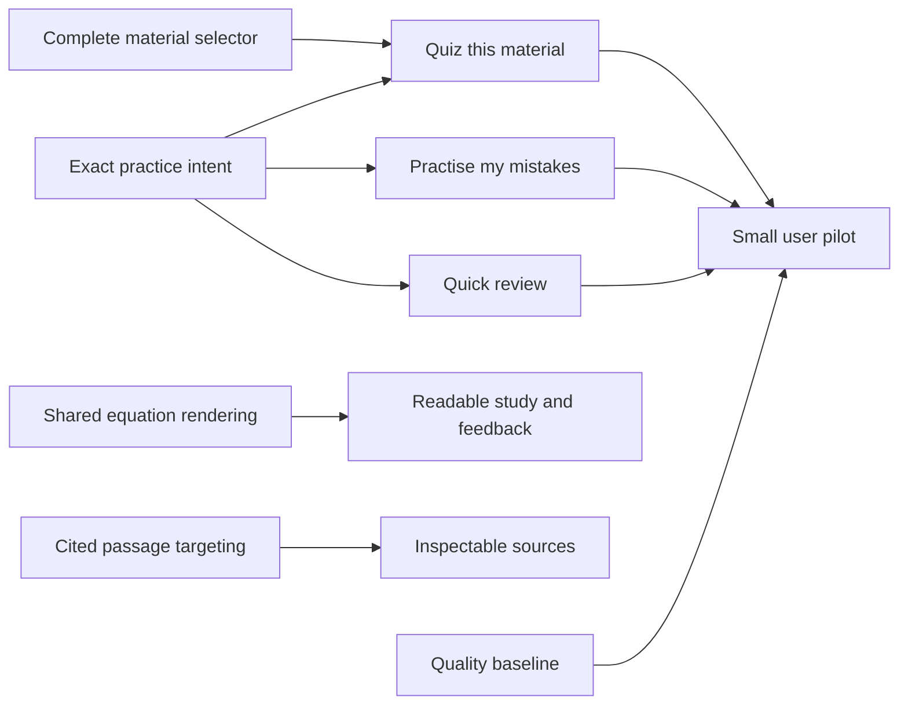

# Mentra: high-value additions and improvements

**Research date:** 17 October 2026 · **Status:** recommendations for review; implementation is not authorized by this document.

**Code baseline:** `5c43e05edd2788cc0d7b631472aba2dbc1e3a43f`, plus the working tree inspected during research. Concurrent frontend/backend edits were present during the review; this task does not modify them. Revalidate source findings against the implementation baseline before making changes. This is a source-based product review, not a production audit or a fresh runtime verification.

## Recommendation

**Make Mentra easier to return to, practise with, and trust.** Its existing chat, Library, assessment, learner, events and notification systems already provide most of the infrastructure needed. The best next investment is a small set of connected workflows:

1. Fix equation rendering, complete assessment source selection, and preserve context when starting recommended practice.
2. Add **Quiz this material**, **Practise my mistakes**, and a short **Quick review** session using the existing assessment lifecycle.
3. Make citations open the relevant passage and add search for saved chats/materials.

If funding only one feature after those fixes, choose **Practise my mistakes**. It turns feedback into the next learning action and reuses questions, grading and evidence that Mentra already owns. If funding only the smallest addition, choose **Quiz this material**.

Do not start a broad platform expansion to implement these recommendations. Keep existing screen positions and shared controls. Treat adoption and learning gains as hypotheses to test with Mentra users.

## Navigation

| Section | Purpose |
| --- | --- |
| [Current capabilities](#current-capabilities-and-actual-gaps) | What already exists, and what is genuinely missing |
| [Research](#what-the-external-research-supports) | Learning evidence, product comparisons and limitations |
| [Priorities](#ranked-backlog) | Value, effort, cost and confidence |
| [Fixes](#fix-existing-features-first) | Concrete source findings and acceptance checks |
| [Additions](#recommended-additions) | Bounded feature specifications |
| [Delivery](#delivery-plan) | First batch, dependencies and later work |
| [Measurement](#validation-and-measurement) | Technical and product evidence needed to ship |
| [Deferred work](#what-to-defer) | Attractive ideas that fail the low-effort test |
| [Sources](#source-register) | Repository evidence and external references |

## Current capabilities and actual gaps

The README, operational feature docs, frontend consumers and backend contracts were checked together. Historical implementation plans were used only for orientation; a plan alone was not counted as an implemented feature.

| Area | Already implemented | Opportunity identified in current source |
| --- | --- | --- |
| Chat | Durable conversations, Stop/recovery, history lookup, summaries, attachments, voice input, citations and interactive cards | Sidebar browsing has no user-facing search; generic starter prompts do not expose a personal review action |
| Teaching | Latest profile preferences and learner context can inform responses | A named topic handoff loses the exact concept/context selected on Progress; a dedicated hint workflow needs explicit assistance tracking |
| Library | Ingestion, OCR, multilingual hybrid retrieval, versions, context filters, archival controls and original/extracted views | Library has no title/filename search; source detail offers Study in chat but no direct quiz shortcut |
| Assessments | Mixed question formats, mock papers, optional configuration, source grounding, drafts, revisions, saved written work, retryable grading, attempt history and evidence outbox | Creation sees only the first material page; result review lacks targeted mistake practice |
| Progress | Searchable/paginated understanding, recommendations, supported reviews, mastery/reliability/recall estimates | Ranking is present, but a bounded review session and a useful explanation of an individual estimate are missing |
| Events | Timezone-aware records, agenda, proposals, editing and reminders | No calendar-file export; exam dates are not a complete exam-preparation scheduler |
| Notifications | Independent inbox, unread/read/dismiss state, preferences and reminder publication | In-app reminders should not be presented as guaranteed device notifications when Mentra is closed |
| Rendering | Shared Markdown, code highlighting, tables, plain-text copying and blank-paper printing | Shared Markdown pipeline has no math parser/renderer |
| Reliability | Durable jobs, ownership checks, checkpoints, grade revisions and observability | Quality/latency measurement should focus on complete study journeys, using the existing infrastructure |

**Avoid duplicating existing work:** do not propose basic quizzes, generic progress tracking, voice input, persistent chat, dark mode, assessment printing, grading retry or a second reminder engine as new features. These already exist.

## What the external research supports

### Learning evidence

| Evidence | Finding relevant to Mentra | Product implication | Limit |
| --- | --- | --- | --- |
| [Dunlosky et al., 2013][S1] | Practice testing and distributed practice received high utility ratings across the reviewed conditions | Prioritize answering and revisiting questions over producing more passive summaries | Does not validate a particular app, review interval or retention formula |
| [Agarwal, Nunes & Blunt, 2021][S2] | Review of 50 classroom experiments, involving 5,374 learners, found retrieval benefits across varied settings; 57% of effects were medium or large | A short repeatable practice loop has stronger support than a feature justified only by novelty | Only 6% of experiments were outside WEIRD countries; local language/context validation matters |
| [Bastani et al., 2025][S3] | A classroom mathematics RCT distinguishes assisted task success from subsequent unassisted performance; unrestricted answer assistance could impair learning, while a more structured tutor mitigated the harm | Evaluate independent follow-up performance; track hints/revealed answers as assistance | One school/context, older GPT-4 deployment and short-term outcomes; this does not prove all AI tutoring harms learning |
| [Google Learn Your Way research, 2025][S4] | A small experiment found benefits from a package of personalized, multimodal learning transformations | Multimodal learning merits later investigation | A bundled intervention and small study do not establish which format caused the benefit or justify an expensive media roadmap |

**Inference for Mentra:** its strongest opportunity is a repeatable cycle of attempt → feedback → targeted practice → later independent check. Neither the research nor this review proves that another dashboard, streak, flashcard format or AI model will improve Mentra outcomes.

### Comparable products, including 2026 updates

| Product / primary source | Pattern observed | What to adopt selectively |
| --- | --- | --- |
| [NotebookLM study tools, September 2025][S5] | Source-based quizzes/flashcards and explanations linked back to sources | Make grounded practice a visible action beside the material; make evidence easy to inspect |
| [Quizlet most-missed/starred study, current help page][S6] | Users can focus a session on selected difficult material | Let students revisit their own mistakes without rebuilding a quiz manually |
| [RemNote exam scheduler, August 2026][S7] | Distinguishes long-term retention scheduling from preparation for a particular exam date | Treat exam preparation as a separate, bounded later scope; a review button is not an exam scheduler |
| [Khan Academy product experiments, May 2026][S8] | Reports benefits from structured recent performance/prerequisite context, and measures latency, engagement and next-item correctness | Preserve precise learning context; measure independent follow-up performance and wait time together |
| [Khanmigo math engineering, 2025][S9] | Uses calculation tools, exercise context and tutoring-quality evaluation | Equation appearance and mathematical correctness need separate checks; rendering alone does not make answers correct |

These are product patterns and vendor reports, not proof that copying a feature will produce the same gains. In particular, the Khan experiments concern its own content, traffic and measurement system. The recommendation here does not depend on reproducing its reported percentages.

### How priorities were chosen

An item ranks highly when it removes an observed obstacle, reuses existing services, has a small independently useful release, and adds little operational cost. Priority is an engineering/product judgment, not a calculated ROI or an estimate of user demand.

**Effort convention:** focused developer-days for one engineer familiar with Mentra, including targeted checks. Ranges are preliminary and overlap where work shares infrastructure. “Low” means roughly up to two days; “medium” means approximately three to five days. No calendar date or production outcome is promised.

## Ranked backlog

| Order / ID | Recommendation | Type | Expected value | Effort | Extra AI / infrastructure cost | Confidence |
| --- | --- | --- | --- | --- | --- | --- |
| 1 · F1 | Render equations consistently | Fix | Very high for STEM workflows | 1–2 d | No model calls; frontend assets | High: missing pipeline is verified |
| 2 · F2 | Select materials beyond the first 25 in assessment creation | Fix | High for growing libraries | 0.5–1.5 d | Ordinary paginated reads | High: first-page-only consumer is verified |
| 3 · F3 | Preserve concept ID and context in practice handoffs | Fix | High for reliable personalization | 1–2 d | No extra model call required for handoff | High: name-only link is verified |
| 4 · A1 | Quiz this material | Addition | High: quickest path from upload to practice | 0.5–1 d after F2 | Existing generation/grading cost, only on user action | High reuse; adoption unmeasured |
| 5 · A2 | Practise my mistakes | Addition | Very high learning-workflow potential | 3–5 d | Replay selection: no generation call; grading as today | High reuse; learning benefit needs validation |
| 6 · A3 | Quick review from existing recommendations | Improvement / addition | High repeat-use potential | 2–4 d after F3 | Existing generation cost; no background generation | Medium: ranking exists, session UX is new |
| 7 · F4 | Open the cited passage directly | Fix / improvement | High for source trust and long documents | 1–2 d | Owner-checked source reads | High: viewer always starts at offset zero |
| 8 · A4 | Search saved chats and Library metadata | Addition | High as saved work grows | 3–5 d total, split into two releases | PostgreSQL reads/indexes; no AI | Medium-high: chat search primitives exist |
| 9 · F5 | Explain an individual progress estimate | Improvement | Medium-high for user understanding | 2–4 d | Bounded evidence reads; no AI summary required | Medium: public projection needs extension |
| 10 · A5 | Download an event as a calendar file | Addition | Medium; high for calendar users | 1–2 d | No provider/API subscription | Medium: demand needs validation |
| Parallel · Q1 | Small tutoring-quality and journey benchmark | Improvement | High risk reduction for all changes | 2–3 d initial | Bounded evaluation calls if live models are used | High need; this is validation work |

**Smallest worthwhile batch:** F1 + F2 + F3 + A1, approximately **3–6.5 developer-days** before contingency. Reserve **4–8 days** for delivery and review. Choose the lower or upper bound after inspecting the shared picker and rendering integration. A2 and A3 are valuable follow-ons; they are not one-afternoon features.

## Fix existing features first

### F1 — Equations across chat, questions, feedback and print

**Observed:** `MarkdownContent.tsx` imports `remark-gfm` and passes remark plugins only. The dependency manifest contains neither a math parser nor a math renderer. Many learning surfaces reuse this component. This verifies missing equation support, not the frequency of affected real conversations. [C1]

**Proposed change:** add a shared math pipeline using the supported `react-markdown` integration, `remark-math` and `rehype-katex`. Load the needed styles/fonts locally. Use the documented KaTeX restrictions for untrusted input. [S10] [S11]

| Scope | Acceptance |
| --- | --- |
| Inline and display math | Fractions, powers, roots, matrices and aligned working display correctly in chat, MCQs, written questions, answer review and feedback |
| Delimiters | Establish supported `$...$` / `$$...$$` syntax; handle model-produced `\(...\)` / `\[...\]` structurally if supported, excluding code spans/blocks; currency and literal dollar text remain readable |
| Existing content | Code, source citations, links and tables retain their current behavior; malformed TeX falls back to readable source without breaking the message |
| Safety/performance | Keep `trust: false`, bound expansion/size, avoid shared mutable macros across messages, and measure added route assets |
| Accessibility/layout | Preserve MathML where supported; long equations scroll within content rather than expanding the page; test dark/light/mobile and keyboard reading |
| Print/copy | Blank assessment printing waits for math fonts/styles; copying yields useful text/TeX without duplicating accessibility text |

**Boundary:** this fixes presentation. It does not validate arithmetic, proofs or grading. Numeric/symbolic correctness belongs in Q1 and, if errors justify it, a later restricted calculation capability.

### F2 — Complete source selection in assessment creation

**Observed:** `AssessmentWorkspace.tsx` calls `listMaterials(0, false, ...)`, retains only `materials.items`, then builds its source selector from that array. `/documents` defaults to 25 items. There is no load-more path for this selector. The chat picker already supports later pages. [C2]

**Impact example:** a student with 40 materials cannot select an older ready document outside the first page in the assessment creation form. This is a source-confirmed reachability defect; it has not been reproduced against a live account in this review.

**Change:** extract/reuse a domain-neutral paginated material selector. Bind loading to the selected learning context, preserve selected IDs when their page is not visible, and hydrate preselected IDs through the existing owner-checked detail API. Initially, load-more is sufficient. Add server-side search under A4 rather than silently downloading an entire large library.

**Acceptance:** with 60 materials, select a ready item from page three, change filters, and retain intentional selections. Archived/unready/unowned IDs cannot enter grounded generation. Rapid context changes cannot display a stale page as current. The 20-document generation limit remains explicit. Empty and unavailable states are distinct.

### F3 — Exact practice handoff

**Observed:** both recommendation/review links encode only `item.name`. `ChatPage.tsx` turns it into a generic draft asking for one question at a time. The source concept ID, chosen Progress context and verification/practice intent do not survive as structured state. [C3]

**Impact:** the same label in two learning contexts can initiate practice without the scope the student selected. This is a loss of specificity; it is not evidence of an authorization bypass or a proven wrong answer.

**Change:** introduce one typed practice request shared by Progress, A1, A2 and A3. Carry an owned context and canonical target identity, with human-readable labels for display. Prefer a direct assessment-creation intent for deterministic study actions; retain a separate Discuss in chat action. Validate all URL/session inputs on the server, resolve current recommendations/difficulty there, and preserve explicit choices. Existing assessment contracts use concept names, so exact-ID targeting needs a real contract/service extension; query parameters alone are insufficient.

**Minimum request shape:** `origin`, optional `context_id`, `concept_ids`, optional `document_ids`, `purpose`, and optional `source_attempt_id` / `source_question_ids`. Generate the existing operation ID on explicit submission. Add further fields only when a consumer needs them.

**Acceptance:** identical labels in two contexts remain distinct; verification links retain their purpose; stale/deleted targets get an actionable response; forged ownership fails. Navigation/back/refresh does not create an assessment. A double click/retry creates one generation job. No evidence is written by following a link.

### F4 — Citation opens the passage that was cited

**Observed:** `SourceViewer.tsx` always fetches source chunks from offset zero. It labels matching passages if they occur in the fetched group, but does not first load/scroll to `source.chunk_id`. Later content requires manual loading. The backend already exposes an owner-checked chunk endpoint. [C4]

**Change:** open the cited chunk first, show its location and excerpt, then offer nearby/full source content. Keep the full-source browsing path for version links that have no chunk ID. Use immutable version/generation identity; revalidate archives/ownership through the RAG facade. Add a PDF page jump where available, with a graceful fallback because browser PDF viewers vary.

**Acceptance:** a citation beyond the first 100 chunks is immediately inspectable without paging from the beginning. Reopening a second citation within the same document updates the target. Replaced sources do not silently show another version. Deleted/archived/unavailable sources retain accurate messaging and authorization. Keyboard focus returns to the citation trigger.

### F5 — Progress estimates with inspectable evidence

**Observed:** the understanding table presents three percentages and a status, with a general explanation. It has no per-concept evidence/detail action. Backend diagnostics already distinguish independent items and uncertainty, while the public progress projection would need to expose a bounded explanation. The retention policy uses a configured exponential heuristic, including a 30-day base half-life. [C5]

**Change:** add a compact What is this based on? detail panel: last qualifying practice date, independent item count, relevant difficulty coverage, recent owned assessment links, uncertainty and the suggested next check. Use deterministic text from domain diagnostics. Explain that recall is an estimate; do not call a heuristic percentage a calibrated probability or predicted exam grade.

**Acceptance:** confirmed-but-unpractised concepts stay unknown; assisted/repeated work is explained without implying independent mastery. A correction updates the explanation and retains historical provenance. Withdrawn/deleted sources are represented accurately. Counts and links are owner-scoped, bounded and do not expose private rubrics or raw policy JSON. Do not hide useful existing values solely to simplify the screen.

### Q1 — Quality and complete-journey measurements

Mentra already has regression tests, timing traces and dated verification reports. Extend that infrastructure with a small repeatable product-quality corpus rather than building a separate observability system. [C6]

Start with approximately 30–50 synthetic or permissioned cases: objective correctness, written grading agreement, ambiguous source support, unanswerable questions, cited passage accuracy, conflicting concept labels, assisted vs independent attempts, long documents, and multilingual/mixed-language usage. Include English, Urdu and a third script as regression examples while retaining support for other languages.

Have a qualified reviewer validate the subject-matter cases before treating them as a gold set. Record model/prompt/configuration, rubric version and latency. Keep deterministic contract checks separate from model-quality checks; a schema-valid answer can still be wrong.

**Release rule:** no unresolved high-impact wrong-answer, cross-owner, answer-key exposure or evidence-attribution failures in the candidate set. Compare the remaining quality results with a recorded baseline; agree thresholds after that baseline exists. Measure end-to-end visible response time and completed job time, not just provider latency. Do not reduce evidence or change the canonical publication model merely to improve a timing number.

## Recommended additions

### A1 — Quiz this material

**Entry:** beside Study in chat on a ready material's detail page, with a secondary action in the Library row if space allows. Keep ingestion and maintenance controls where they are.

**Flow:** select Quiz this material → open the existing Create assessment view with the document and suitable owned context preselected, grounding enabled, and a small editable default such as three questions → student selects Generate → existing generation job, attempt, grading and learner-update flow.

The direct entry removes configuration work without generating anything during navigation. With multiple contexts, show the selected one and let the student change it; do not silently guess a different scope. If the source changed since the page opened, revalidate and show what will be used.

**Reuse:** material metadata/RAG eligibility, F2 picker, F3 intent, `queue_generation`, existing generation cards and assessment widgets. Preserve current defaults unless the shortcut explicitly sets a small quick-practice preset.

**Acceptance:** generation receives the chosen document identity and grounding flag; available source receipts back generated content. An unavailable source is an actionable failure, not an ungrounded fallback. Double clicks/retry are idempotent. The user can adjust settings before generating. Uploading alone never creates a quiz or mastery evidence.

**Success signal:** more students move from a ready upload to a completed grounded attempt; measure generation cost and early abandonment alongside it. NotebookLM provides a useful source-to-practice pattern, not a benefit estimate for Mentra. [S5]

### A2 — Practise my mistakes

**Entry:** results summary after a graded attempt. Display the eligible count and offer incorrect questions plus an optional Include partially correct toggle. Keep existing Start new attempt and Correct answers/transcription semantics distinct.

**MVP:** create a bounded follow-up assessment from a selected subset of the original question snapshots and private grading keys, server-side. This avoids a generation call and focuses on exactly what the student missed. Preserve required passages, paper parent context and nested question references. Use new child question IDs with explicit links to original assessment/question/grade revision; do not mutate the original paper or create a fake grading correction.

This needs a real derivative-assessment contract and persistence work. Existing attempt submission expects an assessment's questions, so submitting an arbitrary partial map is not a complete implementation.

| Concern | Decision |
| --- | --- |
| Selection | Derive eligible questions from current server-owned grades; never accept client-provided answer keys or correctness |
| No eligible mistakes | Show a useful empty state and offer fresh practice through the existing generator |
| Answer exposure | The original results may already reveal the answer. Record this follow-up as a repeat with known exposure; it is practice, not an independent mastery demonstration |
| Learning evidence | Retain lineage to the original item so a new child UUID cannot inflate independent-item counts. Replay alone must not increase independent mastery |
| Fresh verification | A separate Try similar new questions action can later call existing generation for genuinely new items; assess independence conservatively |
| Corrections/deletion | Snapshot the source grade revision and question identity; refuse creation from unavailable source records. Existing follow-ups retain their own valid history under domain deletion policy |
| Idempotency/capacity | Bind the operation fingerprint to parent attempt, grade revision and selected IDs; preserve owner quotas without requiring deletion of important history |

**Acceptance:** three wrong and two partial questions yield exactly the requested subset. No private solution reaches the client before the normal feedback stage. Original attempts/grades remain intact. Repeated questions are identified downstream as repeats even with fresh UUIDs. Nested context remains complete. Refresh/retry yields the same derivative, and stale grade revisions cannot create mismatched practice.

**Why this ranks highly:** it connects feedback to action using existing durable records. Retrieval research supports active practice; Quizlet demonstrates the focused-review pattern. Neither establishes that replaying an exposed question demonstrates transfer. [S1] [S2] [S6]

### A3 — Quick review

**Entry:** a small card above the existing Progress learning overview; optionally surface it on empty chat after the workflow is validated. Avoid a new top-level dashboard or navigation item.

**MVP flow:** show up to three evidence-supported concepts from the existing ranking with a plain-language reason → student chooses Start quick review → generate a short assessment using F3 and existing learner/RAG facades → complete → show the next relevant action.

Use **Quick review**, not a guaranteed five-minute promise. Existing systems cap question counts, but written responses and generation time vary. Suggested copy can say “3 short questions” and allow adjustment.

**Scope rules:** keep supported review candidates distinct from new-topic bootstrap recommendations. No-evidence accounts see a first-practice action. Do not invent a new forgetting algorithm, claim that the existing retention heuristic is scientifically calibrated, or call every ranked item overdue. No background model call, automatic daily assessment, streak obligation or notification is needed for the first release.

**Cross-context handling:** for the smallest release, use the selected context or one visibly named context. Multi-context review requires explicit supported attribution, so defer it until the shared intent can represent it correctly. Read-only ranking is recomputed when opened; starting creates one ordinary job. Completion comes from saved attempts, not a checkbox or source opening.

**Acceptance:** reasons reflect real evidence, each question retains target attribution, unsupported reviews remain filtered, and reloads do not manufacture attempts. Corrected/deleted evidence changes future candidates appropriately. Repeated practice does not bypass independence rules. Generic ranking and verification are not silently mixed.

**Later, if adopted:** add an owned daily session record for resume/history and optional review reminders through Notifications. This is extra scope beyond the ranked MVP estimate; it needs timezone/day-boundary and deduplication checks.

### A4 — Find saved work

Split this into two independently useful releases:

| Release | MVP | Reuse / constraints |
| --- | --- | --- |
| Library metadata search | Search titles and filenames with context/archive filters and server pagination | Extend `/documents` and its repository filter; reuse in F2/chat picker. Do not scan every page in the browser as the permanent search solution |
| Chat search | Search owned titles/message text; show bounded snippets and jump to the matching exchange | Extend the canonical Chat read facade. It already has full-text/trigram lookup and a message-window read, but its tool contract assumes an active chat/sequence and small context windows; add a UI-specific contract rather than fabricating that context |

Keep search lexical for the MVP. PostgreSQL already supports the required query patterns; `pg_trgm` is documented for indexed similarity matching. Verify actual indexes/query plans against realistic fixture sizes. [S12]

**Acceptance:** find an old item not loaded in the sidebar/list, open the matching exchange rather than merely the newest messages, preserve search/paging on Back, and respect deletion/ownership. Include Unicode and mixed-language queries without introducing a language allowlist. Settle prefix/subword behavior explicitly; avoid advertising semantic search. Debounce, abort stale requests, bound snippets and avoid retaining search text in diagnostic logs.

**Value confidence:** high plausibility for growing workspaces, but no search-demand telemetry was available. Ship Library search first if source selection is the more frequent obstacle; choose chat first if small user sessions demonstrate history-retrieval pain.

### A5 — Add event to calendar

**MVP:** download one `.ics` file from an owned event's detail view. This is a small export feature, with no OAuth connection or bidirectional synchronization. Follow iCalendar semantics. [S13]

Use a stable UID, revision/sequence, proper escaping/folding and a truthful event summary. Timed events can export UTC instants; all-day events use `VALUE=DATE` and an exclusive end date. Include a description/link only when appropriate; exclude chat evidence quotes by default. Do not invent a duration when only a deadline/date is known. Cancelled events should have deliberate handling rather than being exported as active appointments.

**Acceptance:** an Asia/Karachi timed event and an all-day date import correctly in two calendar applications; UTF-8, line breaks and commas survive; output is owner-checked. Warn in the export UI that the file is a snapshot and later Mentra changes do not update the imported calendar. Avoid promising calendar notification delivery or duplicate-free behavior across every client's repeated imports. Defer alarms until user expectations are validated.

**Priority:** useful, cheap interoperability. It should follow the learning-workflow fixes unless calendar export is a frequent request.

## Delivery plan

| Batch | Deliverable | Exit condition | Planning budget |
| --- | --- | --- | --- |
| 0 | Record baseline journeys and confirm source findings using synthetic fixtures | Math, >25 materials, duplicate topic labels, distant citation and current latency have reproducible observations | 0.5–1 d; credited toward subsequent feature checks |
| 1 | F1, F2, F3, A1 | A learner can select any eligible source and explicitly launch a correctly scoped, readable quiz | 4–8 d reserved including contingency |
| 2 | A2, with provenance/evidence checks | A learner can practise selected mistakes without losing original records or inflating mastery | 3–5 d, extend if lineage requires broader migration |
| 3 | A3 and F4 | Reviews use supported targets; source verification opens the cited material immediately | 3–6 d; evaluate after Batch 2 |
| Parallel | Q1 fixtures/quality baseline, then focused user sessions | No critical regressions; usability observations documented | 2–3 d initial plus bounded pilot time |
| Next, demand-led | A4, F5, A5 | Pick one based on observed retrieval, trust or calendar friction | Individual estimates above |

Do not commit the entire backlog as a two-week scope. Shared work reduces some cost, but migrations, model behavior and user feedback can expand it. Re-estimate A2 after the lineage design is reviewed. A1 does not need A2, A3 or a new dashboard to ship.

### Ownership and persistence

| Concern | Owner | Implementation rule |
| --- | --- | --- |
| Practice intent | Assessment application contracts; existing UI clients | Server validates identity, targets, purpose and operation fingerprint |
| Question selection / derivatives | Assessments | Questions, attempts, private keys, grade revisions and parent lineage remain durable and owned |
| Mastery / repeat exposure | Learner | Consume correct provenance via public facade; no UI or orchestration writes to learner tables |
| Sources | RAG | Hydrate/re-authorize through `RAGService`; preserve version/generation identity and archive consent |
| Saved message search | Chat | Search canonical owned transcripts through a bounded read facade |
| Review ranking | Learner | Reuse current ranking/policy; expose enough explanation without leaking internal mutable state |
| Calendar export | Events | Serialize an authorized event; Notifications keeps delivery ownership |
| Rendering | Shared frontend content | One equation pipeline across routes and print |

The first batch can largely avoid new durable state. A2 probably needs a migration or an explicit persisted metadata contract for lineage. Do not encode that lineage only in prompt text. Reusing existing JSON columns is acceptable only if the schema, reads, correction/deletion rules and evidence consumer all enforce it.

## Validation and measurement

### Engineering checks when implementation is approved

| Area | Necessary evidence |
| --- | --- |
| Rendering | Browser fixtures for math/currency/code/citations, dark/light/mobile, keyboard and printable paper; frontend build/theme/UI checks |
| F2 / F3 / A1 | Fixtures with 60 materials and two contexts sharing a topic label; inspect actual generation request and source receipts; stale/owner/idempotency cases |
| A2 | Isolated PostgreSQL checks for derivatives, immutable parents, replay, grade revision conflicts, exposed-answer/repeat attribution, nested context and learner receipts |
| A3 | Fixed-clock ranking cases, supported-evidence filtering, empty states, precise target/difficulty attribution and no writes on navigation |
| F4 | Citation target after chunk 100, two citations in one document, old versions, archive/deletion and focus restoration |
| A4 | Owner/deletion/pagination checks, Unicode queries and bounded database work; direct message jump across unloaded windows |
| F5 | Evidence source links, independent/repeated/assisted distinction, corrected/withdrawn evidence and unknown estimates |
| A5 | Parse exported calendar files and manually import synthetic events into two calendar clients |

Use disposable test databases. Never use a student's real account as a fixture. Run suites appropriate to changed contracts, then whole-route checks for affected journeys. Live provider samples validate model behavior separately from deterministic tests. A local build or synthetic model fixture does not establish deployed quality.

### Product pilot

Start with roughly 5–8 representative learners, including someone with a larger Library, a mobile user, a returning user and multilingual use. Observe task completion before leading users toward the recommended actions. A small pilot is for discovering friction, not proving learning effectiveness.

| Hypothesis | Measure | Guardrail |
| --- | --- | --- |
| A1 makes uploaded material useful sooner | Ready upload → started/completed grounded attempt; time to first meaningful action | Unsupported-source rate, abandoned generation, model calls/cost per completed attempt |
| A2 closes the feedback loop | Eligible results → mistake practice start/completion; later distinct-item correctness where comparable | Replays never count as new independent items; grade corrections and answer exposure are recorded |
| A3 reduces decision effort | Review card viewed → started → completed; return for another session | No automatic evidence, notification fatigue or unsupported overdue claims |
| F4 improves verification | Citation opened → target passage available; observed time to find support | Wrong-version/authorization failures remain zero in test corpus |
| A4 improves retrieval | Successful find-and-open tasks; time to locate old work | No private snippet leakage; no logging of query content |
| Overall quality holds | Independent follow-up performance, subject review and p50/p95 visible wait time | Quality, completion and cost considered together |

Use minimal event metadata: feature origin, pseudonymous owner/session ID, job/attempt identifier, counts, duration and outcome. Avoid analytics payloads containing answers, prompts, document text or search strings. Define retention and access before collecting new analytics. Existing traces may supply technical timing without adding a third-party SDK.

Establish baseline rates first. Predefine pilot success criteria before comparing releases; an increase in clicks or time spent alone is insufficient. At low traffic, report counts and observed task failures instead of unstable percentages. For learning gains, use distinct matched follow-up items after a delay and a suitable comparison; do not compare raw scores across easier/harder generated quizzes.

## What to defer

| Idea | Assessment | Revisit when |
| --- | --- | --- |
| Full flashcard product with FSRS and imports | Potentially useful, but introduces item authoring/editing, scheduling, exposure/self-rating and another evidence path; it is not merely a flip animation | Quick review is used, and learners show a clear memorization need that current assessments do not serve |
| Hint-first guided practice | High potential, medium effort (roughly 4–7 d plus evaluation). Add a Help me think action to an existing question, log hints/reveals server-side and follow with a distinct independent check | Core practice handoff/evidence attribution is reliable and Q1 includes answer-leakage cases; do not change every chat into mandatory Socratic dialogue |
| Exam preparation plan | Worth exploring: explicitly connect an owned exam event to context/materials and propose bounded study actions. Full scheduling/adaptation is larger than a calendar link | Learners use events and reviews together; validate desired workload and available study days before writing a calendar |
| AI podcasts/video avatars | Generation, playback, accessibility and verification add cost; learning evidence does not isolate these formats as the best next investment | Active practice is reliable and users demonstrate a repeated audio/video need |
| Broad autonomous study agent | Harder to bound, explain, retry and evaluate; can multiply writes and model calls | Several manually initiated workflows are proven and their automation boundary is clear |
| Social feeds, public sharing or leaderboards | New permissions/moderation/collaboration scope; weak fit for the immediate gap | There is explicit collaboration demand and a privacy model |
| Streaks and badges | Easy surface work, but app visits do not establish learning; coercive streak recovery adds friction | An evidence-based review habit already exists; reward completed effort without manufacturing mastery |
| Google Calendar OAuth / two-way sync | Token lifecycle, conflict resolution, rate limits and external writes turn a small export into an integration project | Calendar-file export has sustained use and snapshot limitations cause real pain |
| Browser push/native offline application | Service workers, delivery/subscriptions, offline conflicts and attachment/model behavior expand scope | In-app/mobile journeys are measured and closed-app delivery/offline use is a demonstrated requirement |
| Wholesale frontend redesign | Existing shared theme/UI renovation is already implemented | Observed route-specific problems warrant movement; otherwise preserve familiar positions |
| Replace OCR or embeddings immediately | Accuracy is workload/provider dependent; retrieval infrastructure already exists | A representative quality benchmark identifies a reproducible failure and a tested replacement improves it |

### Smaller maintenance items

- **Written-work save clarity:** the written answer sheet has Save progress, while interactive quiz choices intentionally stay local until final submission. Make the save status/lifetime understandable and warn on leaving unsaved written work if needed. Do not introduce per-question server writes or persistent MCQ selections as an incidental fix. Any change to that persistence contract needs a separate product decision. [C7]
- **Readable job states:** several assessment/event views still display raw state names alongside useful status copy. Map these to shared learner-facing language where exposed; retain exact states in diagnostics. This is polish, not a new status subsystem. [C7]
- **Documentation drift:** README names migration `20261013_0018`, while the checked-out migration chain includes `20261015_0025`. Correct the repository-head description separately and keep deployed revision distinct. This discrepancy does not prove a production migration failure. [C8]
- **Capacity policy:** assessment creation has a 200-record guard and attempts have a 20-attempt guard. These are deliberate bounds, not evidence of a current outage. Before encouraging habitual review, define capacity behavior that preserves important attempts/evidence rather than presenting deletion of study history as the normal long-term solution. This may increase A2/A3 scope for heavy users. [C9]

## Source register

### Repository evidence

Line references describe the inspected source and can drift after concurrent edits. Links are relative to this document for repository portability.

| Ref | Evidence / inspected paths |
| --- | --- |
| C1 | [Shared renderer](../frontend/src/components/content/MarkdownContent.tsx), lines 1–20; [frontend dependencies](../frontend/package.json); [assessment print](../frontend/src/components/assessments/printAssessment.tsx); [answer content](../frontend/src/components/content/AnswerContent.tsx) |
| C2 | [Assessment workspace](../frontend/src/components/assessments/AssessmentWorkspace.tsx), lines 57–58 and 101; [document route](../backend/app/api/routes/rag.py), lines 66–71; [chat source picker](../frontend/src/components/chat/SourceSelector.tsx) |
| C3 | [Practice links](../frontend/src/components/learning/LearningSuggestions.tsx), lines 14 and 23; [chat handoff consumer](../frontend/src/pages/ChatPage.tsx); [assessment contracts](../backend/app/assessments/schemas.py); [learning overview route](../backend/app/api/routes/learning.py) |
| C4 | [Source viewer](../frontend/src/components/library/SourceViewer.tsx), lines 39, 49 and 100–110; [RAG source/chunk policy](../backend/app/rag/service.py), lines 200–217; [chunk HTTP routes](../backend/app/api/routes/rag.py), lines 150–166 |
| C5 | [Understanding table](../frontend/src/components/learning/UnderstandingTable.tsx), lines 58–69; [learner diagnostics](../backend/app/learner/scoring/signals.py); [retention policy](../backend/app/learner/scoring/retention.py); [learner public schemas](../backend/app/learner/schemas.py); [ranking/retrieval](../backend/app/learner/retrieval.py) |
| C6 | [Latency implementation/evidence](Response_Latency_Fixes.md); [assessment engine](Assessment_Engine.md); [learning progress contract](learning-progress.md); [frontend renovation report](Frontend_Renovation_Report.md); [backend atlas](Mentra_Backend_Map.md) |
| C7 | [Written answer sheet](../frontend/src/components/assessments/AssessmentWorkspace.tsx); [interactive quiz](../frontend/src/components/assessments/MCQAssessment.tsx); [session draft store](../frontend/src/stores/assessmentSession.ts); [event agenda](../frontend/src/components/events/EventAgenda.tsx) |
| C8 | [README](../README.md); [migration 0025](../backend/alembic/versions/20261015_0025_assessment_evidence_jobs.py); [readiness implementation](../backend/app/api/routes/health.py) |
| C9 | [Assessment repository](../backend/app/assessments/repositories/postgres.py), creation/start guards and public/private question projection; [assessment routes](../backend/app/api/routes/assessments.py); [learner independent evidence policy](../backend/app/learner/scoring/mastery.py) |
| C10 | [Result review](../frontend/src/components/assessments/AssessmentFeedback.tsx); [Library list](../frontend/src/pages/LibraryPage.tsx); [material detail](../frontend/src/pages/MaterialDetailPage.tsx); [conversation sidebar](../frontend/src/components/chat/ConversationList.tsx); [canonical chat search/window facade](../backend/app/chat/repositories/history_reader.py) |
| C11 | [Events](events.md); [Notifications](notifications.md); [notification preferences UI](../frontend/src/components/notifications/NotificationSettings.tsx); [chat starter state](../frontend/src/components/chat/ChatEmptyState.tsx); [response style](Chat_Feedback_and_Response_Style.md) |

### External sources

Opened or searched on 17 October 2026. Dates below are publication/update dates where explicitly available; “current help/docs” means the page was checked on the research date. Learning papers support mechanisms, product sources support feature/engineering observations, and technical docs support implementation options. None measures Mentra's users or deployed performance.

| Ref | Primary source | Use in this plan |
| --- | --- | --- |
| S1 | [Dunlosky et al., Improving Students' Learning With Effective Learning Techniques, 2013][S1] | Retrieval/distributed practice priority |
| S2 | [Agarwal et al., Retrieval Practice Consistently Benefits Student Learning, 2021][S2] | Classroom evidence and population limitations |
| S3 | [Bastani et al., Generative AI without guardrails can harm learning, PNAS, 2025][S3] | Separate assisted success from independent learning; study-specific limits |
| S4 | [Google Research, Learn Your Way, 16 September 2025][S4] | Later multimodal exploration; avoid attributing bundled gains to one feature |
| S5 | [Google, NotebookLM student study features, 8 September 2025][S5] | Source-to-practice and cited explanations |
| S6 | [Quizlet, Studying most-missed terms with stars, current help][S6] | Focused-review interaction pattern |
| S7 | [RemNote, Understanding the Exam Scheduler, 3 August 2026][S7] | Exam scheduling is distinct from long-term review |
| S8 | [Khan Academy, How Khan Academy Is Building a Better AI Tutor, May 2026][S8] | Structured history, independent next-item outcome and latency guardrails |
| S9 | [Khan Academy, Khanmigo Math Computation and Tutoring Updates, 2025][S9] | Separate math correctness tools/evaluation from presentation |
| S10 | [react-markdown official repository: math integration][S10] | Shared remark/rehype math pipeline |
| S11 | [KaTeX official options][S11] and [security guidance][S14] | Untrusted content, bounded macros and safe rendering |
| S12 | [PostgreSQL official pg_trgm documentation][S12] | Lexical/similarity search option |
| S13 | [RFC 5545: iCalendar][S13] | Calendar export semantics |

[S1]: https://www.psychologicalscience.org/journals/pspi/1529100612453266/
[S2]: https://remix.berklee.edu/faculty-works/12/
[S3]: https://doi.org/10.1073/pnas.2422633122
[S4]: https://research.google/blog/learn-your-way-reimagining-textbooks-with-generative-ai/
[S5]: https://blog.google/innovation-and-ai/models-and-research/google-labs/notebooklm-student-features/
[S6]: https://help.quizlet.com/hc/en-us/articles/360031172312-Studying-most-missed-terms-with-stars
[S7]: https://help.remnote.com/en/articles/9102040-understanding-the-exam-scheduler
[S8]: https://blog.khanacademy.org/how-khan-academy-is-building-a-better-ai-tutor-our-most-recent-learnings/
[S9]: https://blog.khanacademy.org/khanmigo-math-computation-and-tutoring-updates/
[S10]: https://github.com/remarkjs/react-markdown#use-remark-and-rehype-plugins-math
[S11]: https://katex.org/docs/options
[S12]: https://www.postgresql.org/docs/current/pgtrgm.html
[S13]: https://www.rfc-editor.org/rfc/rfc5545
[S14]: https://katex.org/docs/security
