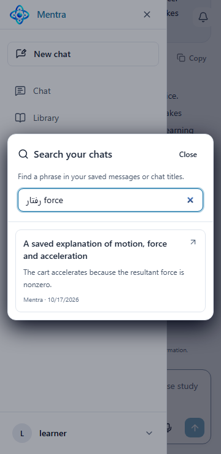
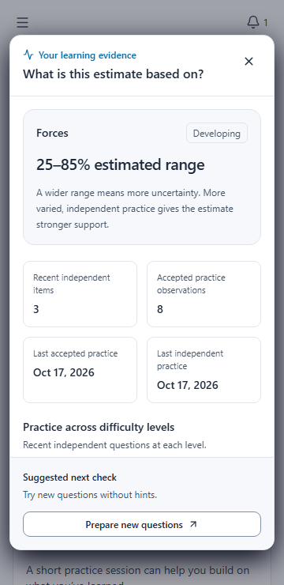
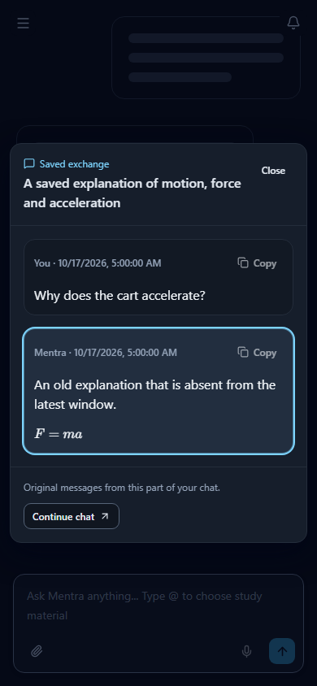

# Product deployment hardening — 18 October 2026

The implemented product features now include saved-chat search, bounded frontend
selection, conservative repeat-practice evidence and durable deployment fences.
The [remaining recommendation plan](Mentra_Product_Recommendations_2026-10-17.md)
contains only unfinished recommendations; completed entries were removed.

## Changes and reasons

| Area | Final behavior |
| --- | --- |
| Saved chats | Owner-scoped literal title/message search; bounded snippets, 20/page and 200-result cap; exact read-only message window and Back restoration |
| Search privacy | Private no-store API responses; search SQL timeout; Nginx server access logs omit query strings and referrers, including the inherited-default log path |
| Practice retries | Permanent owner-scoped operation receipts prevent duplicate follow-ups and return an explicit deleted-result outcome |
| Exposure evidence | Database trigger qualifies exposed attempts as assisted even for older workers; UI does not offer false independent recall claims |
| Chat deletion | Unpublished drafts and generation jobs removed atomically; enqueue/retry rechecks the owned live chat |
| Materials | Hydrate only missing selections, at most four concurrent requests; bound known results and preserve/remove unavailable selections explicitly |
| Selection races | Generation enabled only after eligibility matches the exact current context and selected IDs |
| Rendering | Original-paper reference Markdown mounts on expansion; stable citation plugin references avoid unnecessary Markdown reparsing |
| Grading payload | Deduplicate repeated reference context strings while retaining full text, question prompts, instructions and private grading contracts |
| Frontend | Shared dialogs, inputs, buttons and semantic surfaces; mobile practice cards; evidence view with bounded scrolling and sticky controls; existing shell placement retained |
| Runtime | Node 24 build stage; pinned unprivileged Nginx runtime, UID 101, internal 8080, read-only root, dropped capabilities and no-new-privileges |
| Assets | Revalidated HTML/theme bootstrap, immutable hashed assets, gzip, explicit missing-asset 404 and security headers |
| Dependency fixes | Patched KaTeX across dependency tree, updated Vite and compatible dependency patches; selector-parser override |

Search details: [saved-chat search](saved-chat-search.md).
Evidence/retry details: [mistake practice](mistake-practice.md).

## Verification evidence

| Check | Result and scope |
| --- | --- |
| Backend regression | 282 tests passed in built Python 3.12 with isolated real PostgreSQL schemas |
| Final chat cleanup regression | 13 intent tests passed, including one additional case after the broad run: 283 distinct backend cases across both runs |
| Browser regression | 48 cases passed against the rebuilt Nginx image; API responses are deterministic fixtures, not live provider grading |
| Frontend standards | Theme and UI checks passed; production image build includes TypeScript checks and Vite production compilation |
| Visual review | Mobile saved-chat search, dark exchange, practice selection and progress evidence reviewed; route matrix covers light/dark and widths 320–1440 |
| Search index | 10,000 synthetic rows, GIN pending-list maintenance and ANALYZE; planner uses existing message trigram index for selective phrase |
| HTTP runtime | HTML/deep links 200, hashed assets 200, missing assets 404; MIME, cache, gzip and security headers passed |
| Query privacy | A synthetic search sentinel was absent from final container logs after an actual HTTP request |
| API startup rehearsal | Disposable production-mode backend started through migration 0027; readiness 200 with real packaged E5 model and isolated Qdrant collection |
| Dependency audit | Production npm dependency audit: zero vulnerabilities. Full audit: five high build-tool findings rooted in unpatched braces stack exhaustion |

The backend readiness rehearsal used a placeholder provider URL and no model calls.
These checks establish local behavior, persistence contracts and packaged runtime
readiness. They do not establish production deployment, load capacity, subject
accuracy, actual provider quality or learner learning gains.

Local diagnostic files are under `.cache/`: `hardening-backend-final.log`,
`hardening-chat-delete-final.log`, `hardening-browser-nginx-final.log`,
`hardening-backend-rebuild.log`, `hardening-frontend-rebuild.log`,
`hardening-npm-audit-final.json`, and `hardening-npm-audit-full.json`.
These ignored logs are local evidence, not portable release artifacts.

## Final rebuilt images

Both `latest` and `product-hardened-20261017` tags point to the same final image
for each service. Tags are local; record registry digests when publishing.

| Image | Local image ID | Runtime user |
| --- | --- | --- |
| mentra-backend | `sha256:b45e7f151531381a9b5db59764cfc8364797817d9184b79506758aabe1f28f01` | `10001:10001` |
| mentra-frontend | `sha256:a2b977f82766bfa30c5b43e6f348e4b93811c7e1c55ffc055a986196b6e1848f` | `101` |

Frontend was built with `VITE_API_URL=http://localhost:8000`, suitable for local
use. Rebuild with the target origin before remote deployment.

## Deployment and rollback

1. Back up PostgreSQL and preserve material/log volumes. Record the current deployed
   revision and image digests. Check UID/GID 10001 ownership and total API/worker
   database pool capacity against the deployment budget.
2. Pause/drain old assessment workers before applying the new migration. Use the
   normal migration runner with the complete target database URL and apply through
   **20261017_0027** (including 0026). Do not delete history or reset volumes.
3. Deploy the same backend artifact to API, assessment, RAG and event workers.
   Verify schema revision and readiness, then resume workers. The database exposure
   trigger protects older attempt writes but is not a substitute for coordinated
   rollout or cancellation of stale in-flight operations.
4. Deploy frontend with internal port 8080 and existing external port 5173; retain
   read-only/capability/tmpfs settings. Confirm target API origin, TLS, secure-cookie
   settings, owner-isolated search and a synthetic follow-up retry.
5. Preserve migration 0027 receipts and exposure lineage on rollback. Downgrades
   deliberately refuse unsafe erasure. Prefer forward repair; an application
   rollback must remain compatible with retained evidence. Never remove learner
   records simply to bypass a downgrade guard.

## Cleanup and remaining limits

Removed the eight stopped prior Mentra application/validation containers and the
isolated validation network. The temporary final frontend verifier was removed after
checks. Old superseded image references are gone; retain the two current Mentra
images and reusable PostgreSQL/Qdrant/Python dependencies. Unrelated n8n and all
persistent volumes are preserved. No dangling images remain. Pruning unused build
cache older than 24 hours reclaimed **2.102 GB**. Current images and recent build
cache were retained. No application stack was restarted or deployed.

The remaining npm advisory is confined to build tooling through Tailwind 3,
chokidar/fast-glob/micromatch and braces. There is no patched compatible braces
release in the checked registry. Treat build inputs as trusted; resolve this with
a separately validated toolchain upgrade. Those Node packages are absent from the
static Nginx runtime. Zero production npm findings is not a complete OS/container
vulnerability scan.

The quality corpus/learner pilot and two-client calendar import validation remain
open. External reverse proxies need equivalent private query/referrer logging rules.

## Upstream references

- [KaTeX advisory](https://github.com/advisories/GHSA-238p-pmpm-9mq7)
- [Official unprivileged Nginx image and runtime requirements](https://github.com/nginx/docker-nginx-unprivileged)
- [Node release lifecycle](https://nodejs.org/en/about/previous-releases)

## Reviewed interface captures

