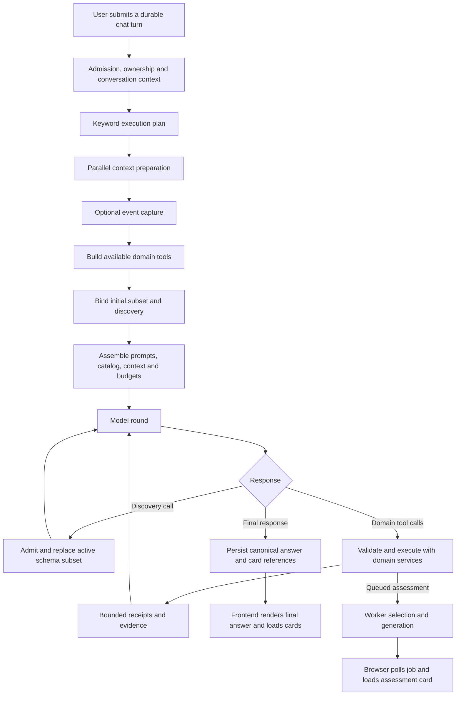

# Mentra capability discovery, frictionless interaction, and response latency

**Research date:** 26 October 2026 · **Status:** research and proposed upgrades; application behavior has not been changed.

**Revision 2 — product policy:** Users should express what they want to accomplish in ordinary language. Mentra should discover the applicable capabilities, choose the appropriate experience, and surface useful controls without requiring feature names, special phrases or advance knowledge of the product. Sections 1.1–1.8 and the revised rollout/acceptance plan make this a system requirement. Original measurements remain baseline evidence, not measurements of the proposed design.

Implementation follow-through: [changes, measurements, verification and deployment limits](Tool_Optimization_Implementation_2026-10-27.md). The findings below describe the researched baseline; consult that record for current implementation status.

## 1. Findings and recommended direction

Mentra already has bounded tool discovery, domain-owned execution, schema validation, read caching, concurrency, provider usage accounting, durable assessment jobs, and native interactive controls. The problem is how these parts are selected and composed. Adding more instructions everywhere would leave several concrete defects untouched.

| Finding | Evidence | Recommended change |
|---|---|---|
| Interactive practice is not the default policy | `chat_assessment` explicitly permits a plain quiz to use a written answer sheet and requires explicit interactive wording for native controls | Make interactive delivery the chat default, with explicit printable/written exceptions |
| Delivery is entangled with question type and paper structure | `ChatAssessmentCard` chooses its interactive component from question properties and absence of `paper`; there is no separate delivery field in the chat tool | Separate `delivery` from question format and structure, then propagate it through generation and rendering |
| Initial selection misses ordinary assessment phrasing | Offline runs of “Give me one MCQ on fractions” and an Urdu quiz request bind only discovery | Improve candidate recall using capability descriptions, multilingual retrieval, and conversation state; retain discovery as fallback |
| Practice requests can trigger event handling | `event_candidate` accepts `me` plus `quiz` without a temporal statement; a bare quiz receives `event_manage` | Disambiguate practice intent from actual scheduled obligations before event capture |
| Small requests can take a large workflow | Chat forwards the full request as nonempty `instructions`, which triggers the outline designer; targets, selection and generation can add more model calls | Introduce a validated small-assessment path that combines optional model stages and uses deterministic structure where sufficient |
| Much latency can be outside the provider | Two historical chat workflows took 7.02 and 8.21 seconds despite single provider calls of 2.39 and 2.47 seconds | Measure admission, preparation, persistence, activity writes, job wait and UI readiness separately |
| Streaming does not currently make answers appear progressively | `ChatActivity` deliberately discards token deltas from UI state until the canonical answer/cards are ready | Offer validated text previews and independently published durable card receipts |
| Copyable-block rendering already exists | Fenced Markdown reaches `CodeBlock`, which copies the raw payload through the clipboard API | Add a short universal copyable-artifact rule; verify content preservation |
| Discovery has inconsistent retention semantics | Newly enabled tools are not added to `pending`; a second discovery can evict an unexecuted tool from the first | Track initial, requested, used, pinned and evictable schemas explicitly |

**Recommended architecture:** ordinary-language goals and contextual actions feed the same request contract; a server-owned capability registry supplies available outcomes and rendering contracts; high-recall selection binds a small relevant schema set; domain workflows execute and publish validated results; completion checks verify the intended user experience; contextual controls make the next useful capability visible. Optimize successful completion with little user effort, together with total task cost and time to usable UI.

### 1.1 Product requirements: the user should not have to discover the implementation

| Requirement | Observable behavior | Failure to prevent |
|---|---|---|
| Understand outcomes | “Test whether I understand fractions” starts the appropriate assessment experience | Requiring “interactive UI,” “MCQ tool,” or the assessment feature name |
| Choose the right presentation | Practice gets answer controls; reusable text gets a Copy block; sources get inspectable references | Correct-looking prose that omits the usable interaction |
| Use what is already known | Carry the current topic, selected document, assessment version and unfinished attempt into the next step | Asking the learner to re-enter information already available and relevant |
| Start with sensible defaults | Omitted nonessential settings do not block a valid request; important defaults can be changed in context | A settings questionnaire before a one-question quiz |
| Reveal useful capability in context | A relevant control appears beside the result or object it acts on | A feature tour, command vocabulary or buried page is required to continue |
| Make actions predictable | Labels describe the next visible result, such as “Practice these mistakes” or “Continue question 3” | A vague “Try this” button with hidden side effects |
| Preserve control | Explicit choices win; corrections apply to the current task; scope-changing actions wait for intent | Turning every explanation into a quiz or every exam mention into new work |
| Finish the user-visible task | A quiz is ready only when the question is answerable; a queued job is visibly pending | Treating a tool return or model promise as completed UX |
| Handle limits in place | If the requested experience is unavailable, explain the relevant limit and offer a supported path | Advertising unsupported controls or silently downgrading an interactive request to prose |

There are **two discovery systems** to design. Model discovery determines which domain capability can fulfill a request. User discovery determines which useful action or interface becomes visible while learning. Both must read the same capability facts. Improving only the tool shortlist does not make the product discoverable; adding UI suggestions does not fix a model that fails to execute the requested workflow.

The design follows recognition-over-recall and progressive disclosure: make the relevant action visible, and defer specialist settings until needed. These are general UX principles; the specific controls and limits below are Mentra design proposals. [NN/g recognition and recall](https://www.nngroup.com/articles/recognition-and-recall/), [NN/g progressive disclosure](https://www.nngroup.com/articles/progressive-disclosure/).

### 1.2 Discovery through complete learning journeys

The desired behavior is discovering a useful capability by using it. This table defines default outcomes and contextual opportunities across the existing domains. New controls are proposed; it does not assert that every control already exists.

| Situation in the learner's words | Primary experience | Contextual capability that becomes visible | Information carried forward |
|---|---|---|---|
| “Give me 1 question quiz” | One answerable native question, without a configuration form | Relevant adjustment such as difficulty after the question is available | Current topic, exact count, requested type and delivery |
| “I don't understand this step” | Explain the referenced step using the visible context | A small “Try a similar question” action when useful to the learning goal | The actual step and topic; no invented weakness |
| “Help me study this document” | Use the selected readable document; explain or present a small goal choice only if the request is materially open-ended | “Practice this section” beside the relevant passage | Owned document/section references and grounding requirement |
| Learner receives graded feedback | Show feedback and preserve the submitted attempt | “Practice these mistakes” when mistakes actually exist | Relevant question/concept IDs, source assessment and revision provenance |
| Learner returns to unfinished work | Show the current attempt and saved position | “Continue question 3,” when that position is known | Canonical attempt, answers and revision; no empty replacement attempt |
| “What should I work on?” | Ground the recommendation in available learner evidence, or state the absence of such evidence simply | Start the suggested practice directly | Ranked target and context references, not raw mastery internals |
| “Help me prepare for my exam” | Begin relevant preparation using known subject/time constraints; ask only for a decisive missing detail | A suitable practice action or owned schedule/review entry | Current goal and actual known exam details |
| “My exam is tomorrow” | Respect the existing event policy and distinguish an announcement from a practice request | A preparation action may be offered contextually; it does not start a quiz by itself | The actual event reference, if created/available |
| “Where did we discuss that proof?” | Retrieve relevant history and original wording when needed | Open the original exchange | Owned conversation/message references |
| “Write a message / give me the command” | Deliver the reusable artifact in a labeled, copyable block | Copy is immediately visible, including for one line | Exact artifact payload and appropriate language |
| “Check whether this information is current” | Use available external verification and cite supporting sources | Inspect the sources used | Current-turn validated citations and dates |
| A handwritten answer is attached for evaluation | Prepare the recognized answers for review | Correct transcription and submit for evaluation in place | Original upload, immutable question mapping and confirmation state |
| Empty/new chat | A few usable starting actions, plus ordinary free text | Practice, study-material selection, concept help or resuming owned work when applicable | Available current context; no fabricated personalized history |

“Show itself” does not mean run every potentially helpful feature. Deliver the requested outcome automatically when intent is clear. Present adjacent capabilities as controls when they materially advance the same goal. Do not make the user discover the same feature again by typing a special phrase.

### 1.3 Interaction policy: act, default, offer or clarify

| Situation | Policy |
|---|---|
| Clear requested outcome, known inputs | Execute the authorized workflow and show the appropriate native result |
| Missing count/type for a valid practice request | Choose reasonable domain defaults and begin; keep adjustment available |
| No topic, but current conversation or explicit selection identifies it | Use that scope without asking again |
| No useful topic/history at all | Use the existing supported general baseline for a bare quiz; label its topic honestly; a topic change remains available |
| Two plausible assessment versions or source scopes would change the result | Ask one concise disambiguation, preferably with existing native choices and a free-text escape |
| “Make it harder” immediately follows one quiz | Revise that quiz through the existing revision workflow, preserving the original |
| User wants printable/written/raw output | Honor the explicit presentation request over the interactive/copy-block default |
| A potentially useful action changes the current scope | Offer it without executing; an optional control must not become a requirement to finish the current task |
| Evidence, permission or required source is missing | Request only the missing requirement; preserve completed work and existing input |
| An inferred presentation default is wrong | Support correction directly; do not force a restart or a new feature name |

Do not ask questions whose answers are already supplied, whose choice is easily reversible, or whose omission the domain already supports. Do not infer consent for a separate write from mere engagement with a suggestion. Automatic event admission, memory writes, transcription confirmation and assessment submission retain their existing domain-specific boundaries. This is targeted control, not a generic approval dialog on every action.

Presentation preferences may persist only through an authorized existing preference mechanism. A click or repeated behavior is not permission to write a durable personal memory. Within a task, carry relevant context without persisting a speculative profile.

### 1.4 One capability registry, with distinct model and UI projections

Extend the proposed registry into a contract shared by routing, orchestration and discovery controls. Keep the full metadata server-side; send only the small projection needed for the next model decision.

| Registry field group | Purpose | Runtime owner |
|---|---|---|
| Stable capability ID, version and domain | Connect tool, outcome and UI without drifting names | Backend capability registration |
| User outcomes, semantic examples and negative examples | Recognize everyday goals without hard keyword gates | Local candidate index and evaluated selection policy |
| Service requirements and operation-specific availability | Distinguish available, missing selection, temporarily unavailable and unsupported | Domain availability adapters |
| Effect class, required permission and evidence | Choose execute/clarify/offer correctly | Existing domain validation, not an LLM declaration |
| Input schema and context resolver | Resolve current topic/document/attempt and validate the action | Domain facade and orchestrator |
| Default presentation and supported controls | Render a result appropriately without relying on “interactive UI” wording | Typed response renderer registry |
| Completion evidence | Identify the receipt, object state and render contract that prove success | Domain result plus response checks |
| Optional next-action candidates | Reveal a supported follow-on task with validated scope | Server/context policy and feature UI |
| Cost/latency class and fallback policy | Avoid heavy workflows for small requests | Execution policy and instrumentation |

Do not make one giant generic registry replace all domain logic. Register domain capabilities through their public facades; renderers, permissions, source policy and grading stay with their existing owners. Compile the small tool catalog and UI action descriptors from those registrations. Schema definitions and operation bindings are trusted code; document content and model prose cannot create new executable capabilities.

Availability must be checked at invocation, even if a button was eligible when rendered. Do not run live network health probes for every visible suggestion. Use configured state and recent domain status for eligibility, then handle a changed condition safely on click. Historical cards keep their original records; a revoked/deleted target gets an honest disabled state or recovery path rather than disappearing or being replaced with another target.

### 1.5 Response contracts and contextual actions

Add a small internal request contract, derived from explicit input, validated UI action/context, and the current model decision. This is an extension of the existing execution plan, not a new mandatory LLM planning call. Separate obligations from optional opportunities.

| Contract element | Example | Enforcement |
|---|---|---|
| Required outcome | Create one practice question | An assessment result/queued receipt is required, not just prose |
| Presentation | Native interactive, unless explicitly overridden | Typed card delivery and supported input controls |
| Constraints | One main question, fractions, single choice | Existing generation validation plus delivery checks |
| Trusted context | Selected document or referenced attempt | Server resolves and checks ownership/revision |
| Result state | Pending, ready, needs input, failed or completion unknown | Receipt state mapped truthfully into UI |
| Optional action | Practice a similar question | Offered only after eligibility checks; not included in completion requirements |

Every required outcome in a compound request needs a state and receipt. A successful calendar action must not make a missing quiz count as complete. Before finalization, verify known obligations against domain receipts; when budget remains, permit one bounded recovery for a missed required capability. Otherwise publish the supported results and a clear unresolved state. Do not apply a “must call a tool” heuristic to every occurrence of the word quiz; a definition or rewrite is still a text task. Where intent is genuinely unresolved, one clarification is better than an unrequested write.

The backend verifies that an owned result and valid render descriptor exist; the frontend verifies mounted controls, readiness and answerability. Instrument both. A server cannot claim the learner has a usable quiz solely because a component name was emitted.

**Contextual actions should use typed, validated action descriptors.** Suggested shape: action ID, registered action kind, bounded label, owned object references, expected revision, context binding, effect class and expiry where appropriate. Navigation and Copy can remain local UI actions. A mutation click enters the existing authorized domain workflow with replay protection. If an action becomes a chat turn, store a readable intent and the validated action reference, so the model need not rediscover which operation was clicked. Never execute arbitrary model-written JavaScript, URLs or an unconstrained tool/argument blob.

This preserves context and avoids “button click → vague generated prompt → classify again → ask for the same topic.” Existing `ChoiceCard` remains appropriate for real clarification/selection; it is not a universal wrapper that must add a second Submit click to every direct navigation or one-step action.

### 1.6 Where features appear, without clutter

| Surface | Proposed behavior | Friction budget |
|---|---|---|
| Empty chat | Replace incomplete prompt starters with complete, available intents or the necessary picker; preserve free typing | Three or four clear choices, no compulsory tour |
| Completed answer | Primary requested artifact/card is directly usable; one relevant optional follow-on control may appear | Zero optional actions is normal; never append a feature menu to every answer |
| Assessment/feedback card | Keep core answer, submit, review, resume and correction controls next to their state | Core workflow controls are not counted as promotional suggestions |
| Study source/document | Contextual practice or study action carries the selected source | Do not require rediscovering `@` syntax or selecting the document again |
| Existing sidebar/pages | Preserve stable access to capabilities and settings | Contextual discovery supplements predictable navigation |
| Error/recovery state | Show the action that resolves this failure, preserving drafts and references | No generic tour, repeated setup or fake Retry for uncertain writes |

Optional suggestions are ranked by current-goal relevance, actual readiness and likely effort saved. Novelty alone is not enough. Start with at most one optional next action per completed response and at most one unsolicited discovery suggestion per ongoing task; this is an initial policy to validate with users, not an evidence-backed universal number. Subsequent controls should come from task progress or expressed intent. Dismissal suppresses repeat promotion in that task; respect an explicit request to stop suggestions. Concise replies retain concise prose; adding a control must not become permission for a paragraph of unsolicited offers.

Use already loaded state or a bounded local projection to choose suggestions. Do not search private history, inspect extra documents or call another model merely to populate optional buttons. Optional discovery must not extend the critical path. Unknown context should suppress speculative personalization, not produce invented recommendations. Labels should identify the result and, when material, the scope: “Practice this section” is clearer than “Explore.”

Keep controls keyboard/touch accessible and screen-reader labeled. Do not steal focus, move the composer, interrupt reading with a modal, reorder an active answer or gate functionality behind animation. Preserve the existing shell, component primitives and reduced-motion behavior.

### 1.7 Current UI gaps and deliberate compatibility decisions

The following additional sources were inspected for this revision:

| Source-verified behavior | Design implication |
|---|---|
| `ChatEmptyState` has four fixed suggestions, including `Quiz me on ` and `Help me study ` | They expose broad ideas but leave incomplete setup; convert to complete actions or contextual pickers rather than claiming discovery is absent |
| Composer exposes attachments, voice and a study-source picker; placeholder teaches `@` | Reuse visible controls and object context; natural language and relevant object actions must work without learning syntax |
| `ChatMessage` already mounts choices, assessment cards, event proposals, source viewers and reference links from typed metadata | Extend this composition; do not add a parallel generated-UI platform |
| `ChoiceCard` stores selected option IDs and submits a durable conversation interaction | Reuse for material ambiguity; direct actions need a distinct validated action contract |
| Current frontend standards require canonical answer reveal and suppress token deltas; completed-answer reveal animation is 900 ms | Progressive text previews change an explicit existing convention. Prefer early durable cards first; separately evaluate safe preview and shorten/skip reveal for immediately actionable small results |
| The core chat prompt discourages unsolicited next steps for concise profiles | Define optional contextual controls narrowly, keep prose concise and suppress them when requested; do not globally encourage follow-up offers |

Update [frontend standards](../frontend/standards.md) alongside any approved UI implementation so future work has one consistent convention. No standards or application behavior are changed by this research revision. The user's new product policy is the governing design direction; existing visual and persistence conventions constrain how it should be implemented well.

Microsoft's human–AI guidance emphasizes context relevance, efficient invocation, correction and user control. Mentra should expose capabilities where they help and make mistaken inferences easy to correct; these principles support the proposed interaction policy without establishing that a particular suggestion will benefit every learner. [Microsoft Research human–AI interaction guidance](https://www.microsoft.com/en-us/research/blog/guidelines-for-human-ai-interaction-design/).

### 1.8 Completion and measurement from the learner's perspective

The north-star outcome is **a user who does not know the feature names can complete the intended task with ordinary language and minimal correction**. Token savings and tool precision support that outcome; they do not replace it.

| Acceptance requirement | How to evaluate |
|---|---|
| No special wording is necessary | Compare ordinary goals against explicit feature/UI wording; both reach equivalent usable outcomes |
| Discovery does not require a manual or tour | Give new users task goals without feature names; observe completion and help requests |
| A useful control is immediately understandable | Check whether users predict its effect and scope before clicking |
| Known context is carried forward | Count repeated topic/source/version questions and re-entry of existing information |
| Native results really work | Test answering, submission, copying, source inspection, resuming and revision after refresh |
| Proactivity is helpful and quiet | Track dismissal/repetition, accidental actions, distraction and reported usefulness; do not optimize click-through alone |
| One-question tasks feel small | Measure send-to-answerable question and clicks to answer, including animation and hydration |
| Discoverability survives omissions and failure | Exercise cold start, unavailable service, stale action, no learner evidence and interrupted jobs |
| New features integrate consistently | Each new registered capability must define eligibility, normal-language outcomes, presentation, completion and a relevant discovery surface |

All quality gates in the later evaluation matrix remain required. Add task-based usability sessions with learners unfamiliar with Mentra. The plan is not complete merely because a model selected the right function in a test.

## 2. Scope and evidence limits

This audit inspected the current repository, ran synthetic offline coordinator measurements, read selected historical content-free timing records, and consulted primary provider/Markdown documentation. It covers normal chat, first-turn title output, tool discovery and dispatch, learner/history/RAG/events/web tools, assessment selection/generation, response rendering and related budgets. Revision 2 additionally inspected the empty chat, composer, typed choice/message rendering and frontend standards, and consulted primary UX guidance to turn the user's discoverability policy into concrete product requirements.

It does **not** establish the exact cause of the reported one-question quiz incident. There is no identified incident trace in this research. The local Docker daemon was unavailable, so no current end-to-end runtime benchmark was possible. No live provider call, real quiz generation, learner-data mutation, deployment or application prompt change was performed.

The offline model returns synthetic responses and does not choose tools intelligently: these measurements establish what schemas/context the real coordinator supplies, not actual provider selection accuracy. Historical log samples establish timings for those workflows only. They are not a representative latency distribution or confirmed quiz examples.

Artifacts:

- [Machine-readable measurements](Tool_Discovery_Research_Evidence_2026-10-26.json): 11 routing snapshots, a web-enabled variant, prompt sizes, proposed rule sizes, discovery retention reproduction and selected historical timing metadata.
- Existing focused regression checks: **16 passed in 1.685 seconds** across prompt efficiency, tool protocol and discovery tests. These establish current invariants, not proposed-fix effectiveness.
- Existing [prompt-efficiency report](prompt-efficiency.md) provides historical context; its older size figures and live results are not treated as current measurements.

## 3. Current request path



### 3.1 Planning is heuristic, not semantic tool search

[`planning.py`](../backend/app/langchain/planning.py) builds an `ExecutionPlan` from English regular expressions, attachments, selected sources and recent assistant metadata. It chooses modules, token allocations and exact initial tool names. Despite the module's statement that selection remains model-driven, these heuristics determine the model's first available actions and the context preparation paid before it runs.

| Plan signal | Initial behavior |
|---|---|
| Greetings and certain stable explanation forms | `direct_candidate=True`, subject to a second model/server eligibility check |
| Memory/history wording | History search, original lookup and memory tool candidates |
| Event wording or event candidate | Agenda lookup or event mutation candidate |
| Learning wording or assessment intent | Learner context preparation and learner read candidates |
| Sources/attachments | RAG/document preparation; explicit sources receive stronger requirements |
| Assessment wording | Generation, revision, answer or discussion tools selected by further regexes |
| Recent assessment/event card plus selected follow-up words | Related workflow candidates retained |

Consequences: synonyms, Urdu, Roman Urdu, ambiguous follow-ups and incidental words can produce very different initial subsets for equivalent requests. `web` is not a planning module; its tools are added separately when configured. The planner's `confirmation_required` and allocated step metadata must not be confused with domain authorization enforcement.

### 3.2 Preparation happens before model tool choice

[`orchestration_service.py`](../backend/app/langchain/orchestration_service.py:80) prepares applicable context concurrently:

| Preparation | When it happens | Optimization consideration |
|---|---|---|
| Recent chat assessments | Assessment module selected | Useful for follow-ups; may be unnecessary for a clearly new quiz |
| RAG prefetch | RAG module selected | Warms candidates only; retrieved evidence is deliberately discarded until the model calls the real tool |
| Profile | Profile step; normally included | Small relevant presentation preferences are valuable; repeated database loading may be avoidable |
| Memory summary | History service supports it and owner exists | Runs even without explicit personal-history intent; relevant durable preferences must remain available |
| Relevant learner context | Learner module selected | Can duplicate downstream assessment reads |
| Attachment image/extraction preparation | Applicable attachments | Required ownership and extraction checks remain essential |
| Automatic event capture | Supported durable chat | Called after preparation; its own candidate/preferences checks can lead to a separate model call |

Parallel preparation does not mean zero preparation latency: the slowest required read still gates the first model call. Optional work needs a bounded completion policy and relevant caching; merely adding `gather` does not solve database round-trip cost.

### 3.3 Tool construction and availability

[`history_orchestration.py`](../backend/app/langchain/history_orchestration.py:16) builds real tools from available services. Missing services omit capabilities rather than granting the model fictional access. [`tool_policy.py`](../backend/app/langchain/tool_policy.py) maps names to domains, declares mutation classification and generates the catalog.

The fully provisioned synthetic snapshot contains **20 domain tools**, plus discovery; real availability depends on injected services and feature configuration.

| Domain | Actual chat-facing tools | Intended use |
|---|---|---|
| History | `history_lookup`, `conversation_summary_search` | Original conversations versus discovery through lossy summaries |
| Memory | `user_memory` | Relevant saved facts or evidence-backed preference proposals |
| Learner | `get_active_learning_contexts`, `get_relevant_learner_context`, `get_study_recommendations`, `get_verification_candidates`, `resolve_student_concept` | Actual learning state, practice targets and canonical identities |
| RAG | `search_study_material` | Approved Library passages with registered citation tokens |
| Events | `event_lookup`, `event_manage` | Read agenda or prepare/admit authorized event changes |
| Assessment | `assessment_generate`, `assessment_lookup`, `assessment_revise`, `assessment_question`, `assessment_answer`, `assessment_status` | Durable drafts, discussion, revisions, student answers and grading status |
| Chat | `present_choices` | Typed clarification/preferences controls; not a graded quiz |
| Web | `web_search`, `web_research` | External verification or multi-source public research |
| Discovery | `enable_workflow_tools` | Bind schemas; does not execute the underlying action |

The policy map also mentions names such as `get_study_source_chunk` and `memory_summary_context`; presence in that map is not proof of a registered chat tool. `get_student_weaknesses` is deliberately excluded as a duplicate of recommendations. `record_learning_evidence` is only produced by the learner factory with authorized provenance; the ordinary coordinator does not request it. Profile/document preparation is not equivalent to exposing general profile/file mutation tools.

### 3.4 What is actually bound

[`tool_selection.py`](../backend/app/langchain/tool_selection.py:16) intersects `plan.tool_names` with constructed tools. Without a plan, it falls back to workflow-module filtering. Configured `web_search` and `web_research` are always added to the initial subset. A nonempty memory summary additionally activates `user_memory`. Discovery is always appended.

Every round receives a compact catalog of all constructed capabilities, including names for tools whose schemas are not currently bound. This is **progressive schema loading**, not a semantic search index. Catalog visibility, schema binding, service health and permission are separate concepts.

### 3.5 Discovery protocol

`enable_workflow_tools` accepts at most three module names and six exact tool names, plus `catalog_only` and `all_tools` flags.

| Step | Current behavior |
|---|---|
| Inspect | `catalog_only` returns the existing catalog, which is already in system context |
| Request | Exact names or all tools in requested modules are resolved against constructed tools |
| Admit | Schema/context fit is checked, reserving discovery/lookup result room; recovery input allowance can be used |
| Bind | Active set becomes `wanted ∪ pending`, rather than always accumulating every previously bound schema |
| Reply | Returns newly/already enabled names, unavailable domains and rejected names |
| Execute | A subsequent model call must choose a domain tool using its real schema |

The upfront reservation for a real lookup is an existing protection worth preserving. Discovery cannot make evidence-backed claims by itself.

**Retention defect:** `pending` is initialized from the initial subset, and `complete` removes names after execution. Newly discovered names are never added to `pending`. The reproduction enabled `assessment_lookup`, then enabled `assessment_status` before any lookup: the second active set contained only `assessment_status`. Conversely, unused initial candidates remain protected. This favors heuristic guesses over deliberate discovery and can cause repeated binding or confusing availability. `all_tools` also records that it was requested once; after later pruning, its `already_enabled` response need not mean the full catalog is still bound. Treat that as a state-model inconsistency to test, not a reason to keep all tools forever.

### 3.6 Prompts and direct answers

The coordinator loads the universal `chat` prompt plus `tool_recovery`, applicable domain fragments, runtime JSON, conversation history and bound schemas. Assessment guidance loads when assessment tools/cards need it. History guidance loads with personal tools or references. Web guidance is added when web tools are constructed, even for a request that does not need the web.

Direct candidates use a final-answer function with `general_query`, `needs_tools` and `uncertain`. First turns can combine these fields with a title. This avoids a separate title call, but it adds schemas and buffering. Server validation checks both these fields and heuristic content restrictions. This is useful defense, not calibrated certainty.

For non-direct requests, a plain model answer without tool calls can still end the coordinator. There is no universal postcondition that an explicit quiz request must produce an assessment card. Therefore a routing miss or ambiguous prompt can silently become a text quiz even though an assessment capability exists. The proposed request/response contract in section 1.5 addresses this gap. It still needs broad semantic evaluations: a regex-generated obligation list alone would reproduce the current routing blind spots. Capture intent in the existing main-model decision when needed, reconcile it with explicit input/context, and verify outcomes without introducing a mandatory second evaluator call.

### 3.7 Execution, budgets and concurrency

| Existing mechanism | Current behavior / protection |
|---|---|
| Coordinator limit | Five model rounds, with tools disabled on the final round; other budget/deadline/failure conditions can force finalization earlier |
| Default tool budget | Six physical calls, at most two writes; result limits of 3,200 tokens and 12,800 bytes |
| RAG allocation | Can raise call allowance to eight and results to 4,800 tokens/19,200 bytes before context-fit adjustment |
| Chat input defaults | 8,192 tokens, with a 12,288-token recovery allowance; actual deployment overrides were not verified |
| Nested model envelope | Normally 150 seconds, twelve model calls, 65,536 cumulative input tokens, 98,304 reserved total tokens |
| Generation worker | Uses separate, much larger selection/generation envelopes; small chat budgets do not bound the whole queued job |
| Read concurrency | Adjacent independent reads run concurrently, with isolated staging and ordered citation/reference commits |
| Dependency barriers | Writes and discovery remain ordering barriers; dependent IDs must come from prior results |
| Duplicate reads | Schema-normalized keys coalesce identical adjacent reads and support turn-local reuse |
| Revalidation | RAG, live assessment status, summary search and similar reads retain eligibility/freshness checks |
| Writes | Single execution attempt, domain validation, compact committed receipts and replay/idempotency mechanisms |
| Failures | Read retry/backoff, dependency outage suppression, bounded protocol repair and honest effect certainty |

These mechanisms already solve important correctness problems. Changing limits globally or running all tools concurrently would risk correctness and still leave the small-task critical path inefficient.

## 4. Measured prompt and routing overhead

Counts below are current offline `cl100k_base`-based conservative estimates from the real coordinator, using empty synthetic context and mocked services. They exclude actual profile/learner/history payloads and real provider serialization differences. They are not DeepSeek billing counts. The tokenizer vocabulary was available locally.

| Request | Initially bound schemas, including output/discovery | Schema tokens | Estimated first input |
|---|---:|---:|---:|
| `Hello` | 2 | 273 | 2,505 |
| `Explain photosynthesis` | 2 | 273 | 2,513 |
| `What is my agenda tomorrow?` | 2 | 704 | 2,946 |
| `Give me a quiz` | 7 | 1,801 | 4,715 |
| `Give me 1 question quiz` | 7 | 1,801 | 4,719 |
| `Give me one MCQ on fractions` | 1: discovery only | 169 | 2,412 |
| `مجھے ایک سوال کا کوئز دیں` | 1: discovery only | 169 | 2,427 |
| `Practice fractions with me` | 3: learner reads and discovery | 325 | 2,567 |
| First-turn `Hello`, title included | 2 | 344 | 2,756 |
| One-question quiz, web and research enabled | 9 | 2,051 | 5,887 |

The Roman Urdu example containing the English word `quiz` prebinds assessment tools; the Urdu-script request does not. This is evidence of lexical coverage differences, not a reason to create a supported-language allowlist.

The agenda request binds `event_manage` rather than `event_lookup`, another consequence of treating a temporal candidate as a scheduled-event mutation hint. No action executes in these snapshots, but the initial opportunity is wrong and discovery may be needed to read the agenda.

| Static prompt fragment | Current exact text tokens |
|---|---:|
| Universal chat, `chat-v16` | 646 |
| Tool recovery, `tool-recovery-v3` | 699 |
| Assessment chat guidance | 507 |
| History management | 559 |
| Web policy | 639 |
| Assessment selection | 400 |
| Concept target selection | 203 |
| Assessment designer | 489 |
| Question generator | 704 |

Universal chat plus recovery is 1,345 tokens before runtime context, schemas or conversation. The recovery fragment is larger than the core chat prompt. There is room to remove repeated wording while retaining every distinct behavioral requirement.

In the web-enabled quiz variant, estimated first input rises by **1,168 tokens**. This includes 250 additional schema tokens and the applicable policy/catalog/clock context. That is a synthetic comparison for this setup, not a production savings promise.

### 4.1 Use the right cost model

```text
total_task_input = sum(actual provider input tokens for every routing,
                       discovery, repair, selection, design and generation call)

expected_cost = common_path_cost + probability_of_miss * recovery_cost

visible_latency = admission + preparation + critical-path model/tool work
                  + durable publication + delivery/refresh + rendering
```

Parallel spans overlap; these expressions describe critical-path accounting, not permission to add every measured duration. A smaller first prompt can cost more overall if it adds discovery and replays the context. Conversely, binding every schema increases input, distracts selection and can break admission. Measure both sides.

## 5. Why an ordinary quiz can become text

There are several distinct failures that must be measured separately:

| Failure mode | Current evidence | Proposed contract |
|---|---|---|
| No assessment tool called | Plain completion is allowed for non-direct routes; some quiz phrasings miss initial assessment binding | A confident create-practice request must return an assessment receipt/card or a truthful failure/needed clarification |
| Assessment exists but uses paper-like delivery | Chat prompt explicitly allows this; card routing depends on format and `paper` | Default chat delivery to interactive independently of question content |
| Native UI exists but is hidden behind an action | Written assessment initially renders a paper; answering requires another step | Interactive delivery should show the intended input flow directly |
| Tool returns success but response repeats questions in prose | Synchronous receipt includes question previews | Return compact status/card references; avoid asking the model to duplicate UI content |
| Model uses clarification buttons as a quiz | `present_choices` is a different workflow | Graded assessment must use assessment tools and validated attempts |

The prompt's explicit distinction explains why specifying “interactive UI” helps. The catalog and tool description emphasize create/revise/evaluate and unsaved drafts, but do not clearly advertise the default end-user experience. Conditional assessment instructions also cannot help the first selection decision if that fragment has not loaded yet.

### 5.1 Proposed delivery contract

Add a small, explicit delivery field such as `interactive | written | printable`, separate from `question_format`, count, marking and `paper`. Exact enum design should follow existing export capabilities; unsupported printable behavior must not be advertised as implemented.

| User request | Desired behavior |
|---|---|
| “Quiz me on fractions” | Native interactive practice; appropriate question types and length |
| “Give me 1 question quiz” | Exactly one main question in interactive UI; use current topic or supported fallback |
| “Give me one MCQ on fractions” | One single-choice question with native options |
| “Ask me one at a time” | Interactive progression; do not impose MCQ if another answer type was requested |
| “Make an essay practice question” | Interactive text entry can still be appropriate; question type and UI delivery are independent |
| “Make a written answer sheet / printable mock paper” | Preserve explicitly requested paper/written experience |
| “Explain what a quiz is” | Explanation without creating an assessment |
| “My exam is tomorrow” | Actual event handling when authorized, without automatically generating practice |
| “My exam is tomorrow; quiz me on fractions” | Handle both intents with their separate receipts |

Propagation must include chat tool, intent/selection/generation schemas, job payloads/checkpoints, revisions, public assessment/card types and renderer. Add a backward-compatible default for old records and consider replay fingerprints before changing serialized defaults. Explicit requests outrank saved preferences and defaults. Keep counts, immutable question IDs, private keys, answer provenance and grading/evidence semantics intact.

### 5.2 Proposed compact prompt changes

Revision 1 proposed a 40-token quiz-specific rule. Revision 2 replaces it with this **74-token** outcome/discoverability contract, measured with the same local tokenizer:

> Fulfill the intended outcome with the best available native experience; users need not name features. Default requested quizzes to interactive controls, preserving question type and count. Use relevant context and reversible defaults; clarify only material ambiguity or missing permission. Surface useful next actions contextually, without interrupting completion. Honor explicit format and scope. Never imply unavailable features or unfinished actions are ready.

Place the contract where first-round selection can see it. Replace the conflicting written-default paragraph in conditional assessment guidance. Retain the conditional distinction between graded practice and clarification choices. Update selection and generation descriptions consistently; do not leave competing defaults at different layers. Server normalization/rendering, contextual-action eligibility and completion checks must implement the policy rather than relying on the model's wording alone. The full journey matrix and UI policies belong in code, registry metadata and tests, not in every model prompt.

## 6. Copyable text and Prism rendering

The requested triple-backtick form is a **fenced Markdown block**. Prism performs syntax highlighting after Markdown rendering; it is not a separate Markdown syntax. The info string identifies the language, and a block can contain a single line. [CommonMark fenced blocks](https://spec.commonmark.org/0.31.2/#fenced-code-blocks), [Prism usage](https://prismjs.com/#basic-usage).

Current path: `MarkdownContent` maps Markdown `pre` nodes to `CodeBlock`; language classes feed `resolveLanguage`; highlighting is handled separately; the Copy button writes `code`, not highlighted HTML or gutter numbers. Inline backticks do not create this standalone copy UI.

### 6.1 Proposed universal rule

The following candidate is **66 tokens**, covering prose artifacts and one-line commands:

> Put every standalone artifact intended for copying in a fenced Markdown block, even one line. Use text for prose and the actual language for code or commands (bash, powershell, etc.). Keep explanations outside; omit shell prompts and decorative quotes. Use longer fences when the content contains backticks. Respect an explicit request for another format.

This rule belongs in the universal chat contract, so ordinary drafting and direct answers receive it without discovery or another model call. It applies to reusable output, not every factual sentence or an inline identifier mentioned in an explanation.

| Output | Fence label | Copy expectation |
|---|---|---|
| Reusable sentence, message or prompt | `text` | Exact standalone wording |
| Bash command, even one line | `bash` | No leading `$`, prompt prefix or prose |
| Windows PowerShell command | `powershell` | Shell-correct syntax; no Bash substitution |
| JSON/config/code | Actual language | Literal valid payload without commentary mixed in |
| Content containing triple backticks | Longer outer fence | No accidental truncation/nesting break |
| Several independent commands | Separate blocks when independently copyable | Copy only the intended step |
| A single dependent script | One coherent block | Preserve order, line breaks and indentation |

Example intended outputs:

```text
Please send the revised timetable by Friday.
```

```bash
git status --short
```

The original quiz-specific and copy rules totaled **106 tokens**. Revision 2 totals **140 tokens**: the 74-token broader contract plus this same 66-token copy rule. This is 34 tokens more than the first proposal. Some wording can replace existing instructions. Actual net prompt cost must be measured after rewriting, across every round and any new response schemas. Full feature catalogs and UI action metadata should not be added to every model call.

### 6.2 Renderer improvements and checks

| Improvement | Reason / scope |
|---|---|
| Label plain blocks “Text” and action “Copy text” | Current plain fallback displays “Code”; existing copy behavior can be reused |
| Verify trailing newlines | `MarkdownCode` strips one terminal newline; define whether a literal artifact's final newline must survive |
| Preserve Unicode and exact whitespace | Required for prose, scripts, YAML, Python and copied mathematical/code content |
| Keep unsupported languages copyable | Highlighting failure must not remove content or block copying |
| Parse fences structurally | Regex-based rewriting can corrupt nested Markdown or reinterpret quoted content |
| Optional typed artifact segments later | Deterministic copy payloads are useful if prompt compliance remains insufficient; avoid adding a bulky output schema to every reply initially |
| No automatic execution | Copyable commands remain text artifacts |

A deterministic formatter should operate only on an explicit artifact segment with a known language/payload. Inferring which arbitrary paragraph deserves wrapping after generation is unreliable. Evaluate the small prompt change first; add typed segments only if observed failures justify their cost.

## 7. Why one question can take more than ten seconds

The user's report is credible in the architecture, but its exact stage breakdown is unverified. “One question” reduces generation output; it does not currently remove most setup stages.

### 7.1 Source-traced critical path

| Stage | Current behavior | Avoidable work to investigate |
|---|---|---|
| Durable admission | Replay checks, work reservation and turn creation precede generation | Repeated owner/session checks and separate round trips within the same trusted boundary |
| Context preparation | Profile, memory, learner and recent assessments can load before routing | Reuse current scoped facts; omit broad learner work for explicit topic/type requests when unnecessary |
| Event capture | “me” + “quiz” can qualify as a candidate | A separate preferences/read/model sequence can occur for a practice request, depending on user settings |
| Routing model | Chooses assessment tool; may discover it first | Prebind likely exact capability; avoid irrelevant event/web schemas |
| Missing-field selection | Missing topic or `auto` format queues an intent; selection reads contexts/priorities/verification/learner/profile | Skip semantic selection where explicit data and policy defaults are sufficient |
| Topic targets | Missing concept labels can cause `ASSESSMENT_TARGETS` call | Combine target suggestions with final question generation, then resolve/validate attribution |
| Outline designer | Triggered by mixed/paper/unspecified count/selected formats **or any nonempty instructions** | Chat always passes current message as instructions; a simple explicit one-question request therefore commonly enters this stage |
| Question generation | Structured content, private answer/rubric, validation, potential repair | One necessary quality-preserving generation call; bound output proportionally to complexity |
| Concept identity | Resolution can require additional domain work | Batch and reuse canonical matches; preserve ambiguity and ownership |
| Persistence | Claim, save, job/checkpoint updates and release | Consolidate appropriate transactions; retain replay and lease safety |
| Final chat model | Usually runs after the tool result | A validated card can often use a deterministic acknowledgment without a final prose call |
| UI reveal | Chat waits for canonical message/cards | Publish durable pending/ready receipts before optional prose finishes |
| Worker/browser polling | Worker loop waits two seconds between iterations; job card waits 1.5 seconds after requests before polling again | Notification-driven wakeup and completion events, with fallback polling |

The worker has independent queue consumers, but each consumer currently processes one job at a time. A busy generation consumer can create head-of-line delay beyond the idle two-second poll wait. Raising concurrency requires provider/database capacity and per-owner fairness checks.

For an explicit topic and concrete format, a source-consistent path can include routing → targets → designer → generator → final chat. An `auto`/topicless queued path can add selection. Repairs, concept resolution or automatic event extraction can add work. This is a conditional call graph, **not a measured fixed number of calls for every quiz**. A queued job overlaps some chat work, so model durations cannot all be added blindly.

### 7.2 Historical timing evidence

Selected records from `logs/backend/backend-2026-10-25.log`:

| Historical workflow | Chat generation wall time | Provider call | Context preparation | Final persistence |
|---|---:|---:|---:|---:|
| `25f3ee…` | 7,020.643 ms | 2,386.873 ms | 1,179.127 ms | 1,269.377 ms |
| `4bb38f…` | 8,208.376 ms | 2,468.307 ms | 2,909.228 ms | 1,128.531 ms |

Both have one logged coordinator round. The first used 4,626 provider input tokens, 204 output tokens and 2,944 cached input tokens; the second used 4,916 input, 159 output and 512 cached input tokens. These small outputs still accompanied substantial total work.

One preparation span spent 1,165.849 ms loading memory-summary context; the other includes a 2,901.443 ms attachment image-input span. Multiple activity persistence spans are hundreds of milliseconds. Separate historical admission workflows in the same file took approximately 2.63–2.69 seconds; their durations should not be automatically added to the table without matching the lifecycle and overlap.

Database timing aggregates and nested spans overlap, particularly under concurrent preparation, so they do not yield independent percentages. The evidence supports investigating non-provider overhead; it does not prove these two requests were small quizzes or reproduce today's runtime.

### 7.3 Proposed small-assessment path

Eligibility should depend on **complexity**, not count alone: one multipart proof grounded in uploaded notes may be expensive. Begin with explicit-topic, one-to-three simple questions; no complex paper layout, exact external structure, revision preservation constraints, image extraction or unresolved source requirement.

1. Preserve original instructions and ownership. Normalize count/topic/type/delivery without overwriting explicit preferences.
2. Resolve only essential context; reuse an owner-scoped, revision-valid context snapshot when available.
3. Use a deterministic blueprint for known simple structures. The full original request remains available to content generation; skip the designer only when its constraints are representable and validated.
4. Generate questions, private grading information and proposed concept labels together. Resolve labels and validate attribution before publication; naming a concept must not create mastery evidence.
5. Apply existing count/type/options/answer/rubric/citation/domain checks. If unsupported or invalid, fall back to the current comprehensive workflow under a bounded deadline.
6. Persist through existing generation/draft repositories, request IDs, claims and replay semantics. Publish the typed card receipt.
7. Use a short server-owned acknowledgment when the whole request is satisfied by the card. Keep the response model for compound explanations or additional tasks. Derive optional contextual actions from already available state; do not add a model call to decorate the ready card.

This can remove optional model stages and polling from the common path while retaining the domain's correctness boundary. It requires implementation and live quality evaluation; it is not safe to bypass the workflow by inventing a temporary frontend quiz or returning unvalidated raw model JSON.

### 7.4 Real versus perceived speed

| Real latency reduction | Perceived latency reduction |
|---|---|
| Fewer model stages, fewer DB round trips, bounded retries, cache reuse, worker wakeups | Early pending card and meaningful activity |
| Skip unnecessary designer/selection calls | Progressive validated text preview |
| Compact receipts and avoid redundant final model call | Reveal a ready card independently of optional narration |
| Event-driven job completion | Show actual saved progress and recover after refresh |

Both matter. A spinner is not a latency fix. Streaming private answer keys, unvalidated tool arguments, control markup or partially valid assessment JSON is unacceptable. Current provider code deliberately buffers or rejects unsafe protocol output; preserve it when enabling previews. Early durable card publication is the first presentation priority. Progressive text preview is a separately evaluated change to current frontend standards, not an automatic reversal of their canonical-reveal convention. Include the existing 900 ms answer-reveal animation and card hydration in measured readiness; actionable controls should not wait for decorative animation.

## 8. Optimization options and tradeoffs

Primary research supports progressive loading, clear boundaries, compact meaningful results and workload-specific evaluations. Anthropic's tool-design guidance recommends evaluating real tasks, improving descriptions, and returning useful bounded data; its advanced-tool-use work describes deferred discovery and examples. These principles transfer to Mentra, but Claude-specific APIs and published benchmark improvements do not establish DeepSeek support or Mentra savings. [Tool design](https://www.anthropic.com/research/writing-tools-for-agents), [advanced tool use](https://www.anthropic.com/research/advanced-tool-use).

### 8.1 Selection and discovery

| Option | Token/latency effect | Applicability and decision |
|---|---|---|
| Load all schemas | No discovery round; larger prompts and more ambiguity | Benchmark as an ablation; poor default as the catalog grows |
| Existing keyword routing | No model-routing cost | Retain as cheap signals, fix false positives and expand tested semantic coverage |
| Compact capability cards | Small recurring input; improves discoverability | Recommended: describe outcome, when to use, when not to use and effect class |
| Local lexical/BM25 retrieval over cards | No additional model call | Good first candidate layer; include synonyms and public intent examples |
| Local multilingual embedding retrieval | No provider tokens; CPU/index cost | Useful for paraphrases and languages; reuse embedding infrastructure, benchmark cold/warm latency |
| Hybrid lexical + semantic selection | Better recall at modest local compute | Recommended experiment; shortlist a few candidates, preserve exact discovery |
| Learned/lightweight classifier | Low cost at scale; training/maintenance | Consider once labeled failures justify it; no hidden language allowlist |
| Separate LLM router for every request | Extra full network/model pass | Avoid as default; cheap first-stage routing plus the main model is preferable |
| Main-model routing and output combined | No separate router call | Recommended; existing tool/function mechanism already supports this |
| Confidence-based candidate expansion | More schemas only for uncertainty | Recommended, using measured retrieval/routing thresholds rather than model “certainty” claims |
| Query-based discovery tool | Reduces need to know exact internal names | Add only if catalog growth warrants it; resolve to registered IDs/schemas before execution |
| Catalog-only fetch | Repeats existing catalog and consumes a round | Keep as compatibility fallback; discourage when current catalog is already supplied |
| Exact-name discovery | Smallest schema acquisition | Keep for known capabilities and low-confidence initial misses |
| Whole-domain enablement | Easier requests, potentially many schemas | Keep bounded, prefer exact names for common tasks |
| `all_tools` escape hatch | Largest overhead and possible admission failure | Last resort; fix full-set state semantics and measure use |
| Pin relevant schemas across a task | Fewer repeated discoveries | Use within current scoped state; expire/revalidate on capability changes and new turns |
| Immediate autoexecute after fuzzy discovery | Might remove a round but arguments are ungrounded | Do not execute guessed operations or unseen argument schemas |
| Provider-native tool search | Potential lower discovery overhead | Only after feature/adapter tests; Mentra's portable current mechanism remains baseline |

A registry should be the single source for names, domain, effect class, argument schema, description, examples, prerequisite services, availability, output contract and applicable discovery controls, as specified in section 1.4. Current metadata is distributed across `DOMAINS`, `WRITES`, `CAPABILITIES`, planning regexes, tool factories and activity labels. Generate distinct model/UI projections from that registry and validate registration coverage to reduce drift. The visible UI does not need to fetch or render every backend schema, and the model does not need the entire frontend action definition.

Capability metadata should advertise outcomes, for example: “Create native interactive practice with validated grading; written/paper delivery when requested.” Include negative examples such as defining the word quiz. Keep service health/permission server-enforced; a catalog is not a promise of success.

### 8.2 Schema and prompt optimization

| Option | Recommended treatment |
|---|---|
| Remove redundant explanations | Deduplicate chat/recovery/domain policies by semantic requirement; do not delete protections just because similar words appear |
| Move specialized details to fragments | Continue existing conditional loading; keep the universal default/outcome description needed to select the capability |
| Narrow tool parameters | Keep optional defaults server-side, omit null placeholders, remove server-owned identity/provenance fields from model input |
| Separate simple/complex schema variants | Consider a compact practice tool plus discoverable advanced paper options; avoid a confusing family of near-duplicate tools |
| Hide bulky `paper_sections` from ordinary practice | Significant candidate for schema savings; retain full explicit paper support through an advanced schema or validated alternate operation |
| Merge tools | Only where the same user task and validation boundary align; a generic `execute(anything)` sacrifices schema guidance |
| Shorten names aggressively | Not a priority: opaque identifiers can hurt reliability more than they save tokens |
| Add examples | A few carefully selected local examples for repeated errors; avoid global example dumps |
| Tool-specific error hints | Return compact actionable correction information; do not include full schema copies already bound |
| Token-efficient serialization | Compact JSON, meaningful field projection, source registries and short citation references; preserve type/status/uncertainty |
| History compression | Keep summary coverage and exact-original lookup; never compress pending tool call/result pairs into orphan messages |
| Output token budgets | Size by expected question complexity and request, with bounded repair room; lowering a ceiling does not itself reduce actual generation length |
| Prompt optimization automation | Evaluate candidate changes against held-out tasks, including educational correctness; avoid optimizing a single token score |

Prompt requirements should have one authoritative home and a traceable test. Universal contract: requested outcome, interaction default, copyable artifacts, evidence honesty, explicit-request precedence. Capability cards: selection cues. Bound schemas: arguments and constraints. Conditional fragments: workflow-specific behavior. Domain code: ownership, validity, provenance and writes.

### 8.3 Execution and results

| Opportunity | Proposed change / invariant |
|---|---|
| Eliminate model micromanagement | Put fixed assessment sequences in trusted server workflows; main model supplies request intent, not every internal repository step |
| Parallel reads | Extend only for independent known arguments; current staging and citation ordering already provide a good base |
| Batch domain reads | Retrieve relevant profile/learner/assessment context in fewer public facade operations; retain module ownership |
| Turn-local memoization | Reuse normalized owner-scoped reads and snapshots; preserve invalidation after uncertain writes |
| Cross-turn cache | Key by owner, authorization scope, relevant revisions, source status and expiry; never share personal data across owners |
| Result projection | Deliver requested fields, relevant rows, exact snippets and continuation handles; do not cut blindly through JSON/evidence |
| Repeated result references | Keep current deduplication, but retain status/freshness where it matters |
| Stop after complete outcome | Return a card/receipt immediately when it fulfills the request; do not add optional lookup/model work |
| Retry discipline | Share deadlines, avoid stacked adapter/tool/model retries, retry only safe transient reads, retain write replay safety |
| Optional dependency failure | Continue supported work, with truthful limitations; avoid blocking a valid topic quiz on missing learner history |
| Schema retention | Pin explicitly requested unexecuted tools; evict used/unneeded ones under a documented policy |
| Discovery budgeting | Consider separate discovery/domain-call sublimits within a shared total deadline; never let discovery consume all action/result room |
| Provider transport | Reuse clients/connections; current `ModelFactory` already caches model clients, so inspect evidence before rebuilding this |

Anthropic's context-engineering guidance treats tool definitions, history and observations as a shared finite attention budget. For Mentra, the practical interpretation is to preserve the smallest sufficient packet for the next decision, with an explicit path to recover missing detail. This supports targeted results and selective fragments, not lossy removal of critical grading or source evidence. [Context engineering](https://www.anthropic.com/research/effective-context-engineering-for-ai-agents).

### 8.4 Caching and provider-specific options

DeepSeek's documented context cache is automatic and prefix-based. Arrange stable prompts and schemas consistently and place changing context later where the protocol permits. Keep recording cached and uncached provider usage. Cache hits do not remove the requirement to send necessary input or make it disappear from context; no fixed hit rate or speedup should be promised. [DeepSeek caching](https://api-docs.deepseek.com/guides/kv_cache/).

DeepSeek documents native tool calls and beta strict mode with endpoint/schema restrictions. Strict mode can improve argument shape, but does not decide whether a quiz should be interactive, establish ownership or prove correctness. Gate it behind provider capability tests rather than enabling it blindly for every nested schema. The current factory already disables thinking for the exact DeepSeek host; do not propose that as an unimplemented latency fix. Other gateways/hosts need their own verified behavior. [DeepSeek tool calls](https://api-docs.deepseek.com/guides/tool_calls/).

Other options worth benchmarking after structural fixes: a smaller/faster model for simple quiz generation, region/transport placement closer to database/provider, adaptive queue concurrency, and a validated reusable question bank where appropriate. Each has costs: quality variation, infrastructure changes, contention or reduced freshness. Do not cache complete learner-specific responses as a substitute for current evidence or silently reuse exposed questions as independent mastery tests.

## 9. Proposed implementation plan

| Phase | Concrete work | Main files | Exit evidence |
|---|---|---|---|
| 0: baseline and outcome contracts | Define the ordinary-language journey fixtures and required-versus-optional outcomes; add stage timing and user-effort telemetry | Existing plan/response schemas, logging, frontend performance hooks | Trace send to usable result; record corrections, clarification and required clicks; baseline provider usage |
| 1: correctness and compact policy | Universal outcome/copy rules; remove conflicting guidance; fix practice/event disambiguation, agenda reads, MCQ/assessment recall and discovery retention; introduce minimal domain-owned capability registrations | Prompts, planning, event capture, tool selection/policy | Ordinary phrasing produces correct native outcomes without irrelevant writes; current tool invariants retained |
| 2: delivery and completion | Propagate delivery contract; verify required outcome receipts; add compatibility/replay treatment and renderer readiness checks | Assessment/chat/job schemas, adapters, response assembly and cards | Interactive default across answer types; written overrides; no prose-only success for required native results |
| 3: contextual discovery | Typed next-action descriptors, complete starter actions/pickers, object-scoped continuations, suppression/availability rules and same-workflow click handling | Empty chat, message/cards, composer/source entry points, existing interaction/domain services | A new learner can complete the journey without feature names, repeated input, dead controls or a compulsory tour |
| 4: small-task speed | Complexity gate, deterministic simple blueprint, combined targets/generation, context reuse, compact receipt and appropriate deterministic acknowledgment | Assessment service/workflows, concept resolution, chat completion | Fewer provider calls and lower answerable-card latency with quality parity; optional suggestions add no blocking calls |
| 5: discovery efficiency | Complete registry projections, evaluate hybrid candidate ranking, request pinning and budget-aware schemas | Tool factories/policy/selection/planning | Higher multilingual candidate recall and lower cumulative cost; model and UI availability stay consistent |
| 6: publication and runtime | Early durable cards, completion events, measured DB/activity-write reduction, fair queue concurrency; separately gate safe text previews and reveal timing | Activity/chat persistence and transport, workers, frontend job cards and standards | Lower first-usable time without private leaks, duplicate actions, animation delay or recovery regressions |
| 7: task-based acceptance | Test with learners unfamiliar with features, remedy friction, then stage rollout and refresh conventions | Usability fixtures, telemetry, documentation | High successful completion with ordinary language; acceptable correction/dismissal rates, quality and latency |

Phases describe dependencies, not a requirement to defer all performance work until every discovery control is built. After the shared outcome/delivery contract, small-task speed and contextual UI can ship in independently measured increments. Implement the registry only to support current capabilities, then consolidate existing metadata into it. Do not make all changes together: separate experiments are necessary to attribute quality, token and latency effects.

### 9.1 Success measures

| Metric | Definition | Proposed acceptance direction |
|---|---|---|
| Candidate recall@k | Needed tool is in initial shortlist | Improve across English, Urdu, Roman Urdu and broader multilingual cases |
| Initial selection precision | Bound tools actually relevant to the request | Remove event tools from pure practice and web schemas from stable tasks when safely deferred |
| Action/UI success | Required card/receipt produced and usable | Target 100% on deterministic acceptance fixtures; track stochastic live rate separately |
| Tool necessity precision | Tools used only where needed | Explanations, rewrites and pasted questions avoid unrelated reads/actions |
| Outcome success without feature names | Learner completes the same task with ordinary goal wording as with explicit feature wording | No material success gap; zero special-phrase requirements in acceptance journeys |
| User effort | Avoidable clarifications, repeated fields and clicks before first useful interaction | No configuration questionnaire for simple practice; no repeated known topic/source/attempt selection |
| Contextual action integrity | Offered action is eligible, understandable, scoped and invokes the intended workflow | No unregistered/dead actions, duplicated writes or silent target substitution |
| Suggestion burden | Repetition, dismissal, accidental clicks and reported distraction | Enforce suppression/visibility limits; engagement alone is not success |
| Discovery efficiency | Discovery rounds, schema admission failures and rediscovery rate | Zero discovery in well-understood common cases; bounded recovery for genuine misses |
| Total provider input | Sum across coordinator and queued/nested workflows | No material regression for simple replies; reduce common-task cumulative input |
| Actual time to usable quiz | Send → first answerable validated question | Initial warm simple-quiz goal: p50 ≤5 s, p95 ≤8 s, subject to provider baseline; targets, not measured promises |
| Feedback latency | Send → useful progress/accepted receipt | Track separately from completion; aim for prompt acknowledgment without fake progress |
| Quality | Correct questions/keys, appropriate difficulty and preserved constraints | No regression versus current workflow under expert/domain review |
| Safety/data integrity | Ownership, immutable IDs, provenance, write replay and private-answer leakage | Zero tolerated acceptance regressions |

For “without compromising input tokens too much,” begin with a proposed ≤150-token net universal-contract increase, then require representative cumulative-input measurements. Record the revised candidate size explicitly; remove duplicate/conflicting wording before judging net growth. Contextual UI discovery should require no extra provider call and no additional private retrieval solely to populate optional controls. Its full action metadata stays out of ordinary prompts; an accepted action passes only the minimal validated intent and context. Percent thresholds for cumulative cost should be agreed from actual baseline variance; do not hide a large per-task increase behind a smaller first prompt.

### 9.2 Evaluation matrix

| Dimension | Required cases |
|---|---|
| Quiz wording | Bare quiz; one question; one MCQ; test me; practice; one at a time; no current topic |
| Unknown feature vocabulary | “See if I understand this”; “help me learn from these mistakes”; “pick up where I stopped”; tasks assigned without product labels |
| Discovery journeys | New-chat starter to usable result; document to grounded practice; feedback to revision; pending attempt to resume; reusable one-line artifact to exact clipboard payload |
| Context carry-forward | Same topic/section/attempt preserved through click and natural-language follow-up; source/version changes revalidated |
| Optional-action behavior | No extra blocking model call; useful/no-action cases; dismissal; concise mode; no unsolicited mutations; bounded repetition |
| Action lifecycle | Service becomes unavailable; target deleted/revised; stale action after logout; double click; retry; keyboard/mobile activation; no focus stealing |
| Languages | English, Urdu script, Roman Urdu, other supported languages, typos and code-switching |
| Negative intent | Define quiz, rewrite pasted questions, explain answer, plan a quiz without creating it |
| Delivery | Interactive default; explicit written/paper; essay text input; mixed; multiple select; revisions |
| Count/structure | One main question versus multipart; selected question types incompatible with count; exact marks and sections |
| Context | Empty profile/history, known topic, selected sources, missing sources, attachments, multiple existing assessments |
| Events | “Quiz me”; agenda tomorrow; actual exam announcement; quoted/hypothetical exam; combined schedule and practice |
| Discovery | Missed initial tool, unknown name, missing service, two discoveries before use, pruning, repeated full-toolbox request |
| Budgets | Constrained input/result space, lookup reservation, long current request, protocol repair, deadline, queued workflow limits |
| Copy blocks | One-line prose, one-line Bash, PowerShell, code/config, backticks inside payload, Unicode, blank lines and clipboard failure |
| Recovery | Refresh, reconnect, worker lease loss, cancellation, retry replay, already-committed write, saved card with failed narration |
| Latency | Warm/cold, provider retry, database RTT, queue load, attachments, first turn/title, web on/off |

Use offline route/state tests first; then configured-provider synthetic tests that parse real tool arguments and assert domain invariants; then browser tests of real cards and clipboard contents. Inspect educational correctness and raw copy payloads, not only JSON validity. Run held-out paraphrases and several repetitions per stochastic case; report sample sizes, failures and p50/p95 rather than a single best run.

For call/latency ablations compare: current subset; all tools; corrected heuristic subset; registry/semantic subset; no redundant designer; combined targets/generation; deterministic acknowledgment; event-driven card publication. Keep model/version, region, input context, load and cache warmth controlled, and separate provider input/output usage from local estimates.

### 9.3 Rollout, rollback and cleanup

Feature-gate delivery defaults, contextual discovery actions, candidate selection, fast generation and early publication separately. Start with synthetic users and a limited cohort; retain the existing comprehensive generation path. Compare correctness, task completion, user effort and completed-task cost before expanding. Gate rollout on journey results as well as function-call tests.

For delivery persistence, deploy additive readers/writers with legacy fallback before changing defaults. Preserve historical assessments, attempts, answer keys, evidence, source provenance and operation replay. If fast-path validation fails, route to the established path; do not silently downgrade the requested UI to prose. If early preview fails, restore canonical publication without losing the durable turn/card.

Rollback prompt versions and routing flags independently. Disabling contextual suggestions must leave existing assessment/choice/source controls and durable records usable. Keep backward-compatible readers for any newly stored field or accepted action reference. Do not roll back by deleting learner records or generated drafts. After stability, remove duplicate metadata sources, obsolete conflicting prompt rules and unused flags, and refresh the measured prompt/schema snapshots. Update frontend standards for any new action convention, early-card publication or changed preview/reveal behavior.

## 10. Source navigation and verification ledger

| Source | Verified responsibility |
|---|---|
| [`planning.py:26`](../backend/app/langchain/planning.py:26) | Direct eligibility and heuristic execution plan |
| [`orchestration_service.py:80`](../backend/app/langchain/orchestration_service.py:80) | Preparation, event capture and domain-service injection |
| [`tool_policy.py`](../backend/app/langchain/tool_policy.py) | Domain/effect metadata, catalog and direct output contracts |
| [`tool_selection.py:16`](../backend/app/langchain/tool_selection.py:16) | Active/pending schemas and discovery |
| [`history_orchestration.py:87`](../backend/app/langchain/history_orchestration.py:87) | Conditional prompts, catalog, budgeting, model rounds and dispatch |
| [`graphs/tool_coordinator.py`](../backend/app/langchain/graphs/tool_coordinator.py) | Bounded LangGraph model/tool loop |
| [`tool_execution.py`](../backend/app/langchain/tool_execution.py) | Admission, validation, retry, effect certainty, cache invalidation |
| [`tool_cache.py`](../backend/app/langchain/tool_cache.py) | Normalized keys and freshness-sensitive reads |
| [`workflow_budget.py`](../backend/app/langchain/workflow_budget.py) | Shared nested model budget |
| [`token_policy.py`](../backend/app/langchain/token_policy.py) | Offline estimates, schema cost and actual provider usage logging |
| [`model_factory.py`](../backend/app/langchain/model_factory.py) | Client reuse, provider settings and thinking behavior |
| [`provider_invocation.py`](../backend/app/langchain/provider_invocation.py) | Streaming, protocol guards and timing |
| [`prompts/chat.py:47`](../backend/app/langchain/prompts/chat.py:47) | Universal tool-use rules; no current copyable-artifact rule |
| [`prompts/chat_assessment.py:11`](../backend/app/langchain/prompts/chat_assessment.py:11) | Written versus explicitly interactive behavior |
| [`prompts/tool_recovery.py`](../backend/app/langchain/prompts/tool_recovery.py) | Always-added selection/recovery policy |
| [`workflow_tools.py:19`](../backend/app/langchain/workflow_tools.py:19) | Chat assessment schemas and domain adapters |
| [`assessments/service.py:68`](../backend/app/assessments/service.py:68) | Intent queue versus direct generation |
| [`assessment_selection.py:11`](../backend/app/langchain/assessment_selection.py:11) | Missing-field selection and learner reads |
| [`assessment_workflows.py:15`](../backend/app/langchain/assessment_workflows.py:15) | Targets, design, content generation and concept attribution |
| [`assessment_design.py`](../backend/app/langchain/assessment_design.py) | Outline and requested-constraint validation |
| [`assessments/generation_worker.py`](../backend/app/assessments/generation_worker.py) | Durable intent resolution, claims, checkpoints and completion |
| [`assessments/worker.py:79`](../backend/app/assessments/worker.py:79) | Two-second consumer waits |
| [`events/capture.py:8`](../backend/app/history_management/events/capture.py:8) | Practice/event candidate overlap |
| [`events/proposal_service.py:62`](../backend/app/history_management/events/proposal_service.py:62) | Conditional semantic capture and preferences |
| [`ChatActivity.tsx:56`](../frontend/src/components/chat/ChatActivity.tsx:56) | Canonical reveal and token-delta suppression |
| [`ChatAssessmentCard.tsx:71`](../frontend/src/components/assessments/ChatAssessmentCard.tsx:71) | Format-dependent native controls |
| [`AssessmentGenerationCard.tsx:34`](../frontend/src/components/assessments/AssessmentGenerationCard.tsx:34) | Browser polling and completion rendering |
| [`MarkdownContent.tsx`](../frontend/src/components/content/MarkdownContent.tsx) | Fenced block conversion and newline handling |
| [`CodeBlock.tsx:24`](../frontend/src/components/content/CodeBlock.tsx:24) | Raw clipboard payload, one-line support and copy errors |
| [`codeLanguages.ts`](../frontend/src/lib/codeLanguages.ts) | Prism aliases and plain-language fallback |
| [`ChatEmptyState.tsx`](../frontend/src/components/chat/ChatEmptyState.tsx) | Four fixed prompt starters, including incomplete quiz/study text |
| [`ChatComposer.tsx`](../frontend/src/components/chat/ChatComposer.tsx) | Visible source, attachment and voice entry points |
| [`ChatMessage.tsx`](../frontend/src/components/chat/ChatMessage.tsx) | Existing typed card/reference composition |
| [`ChoiceCard.tsx`](../frontend/src/components/chat/ChoiceCard.tsx) | Validated option submission through the durable chat flow |
| [`chat/interactions.py`](../backend/app/chat/interactions.py) | Server-owned choice IDs and interaction validation |
| [`frontend/standards.md`](../frontend/standards.md) | Canonical reveal, 900 ms reveal motion, component/accessibility and UX conventions |

All code findings above are source-verified. Baseline token tables and retention behavior were reproduced offline in the initial research. Two historical workflow samples were inspected without emitting user text. Revision 2 adds source inspection and a measured revised policy candidate; it does not rerun or claim new runtime/provider results. Proposed benefits, latency goals, semantic-routing accuracy, quality parity and user discoverability remain to be validated during implementation.
