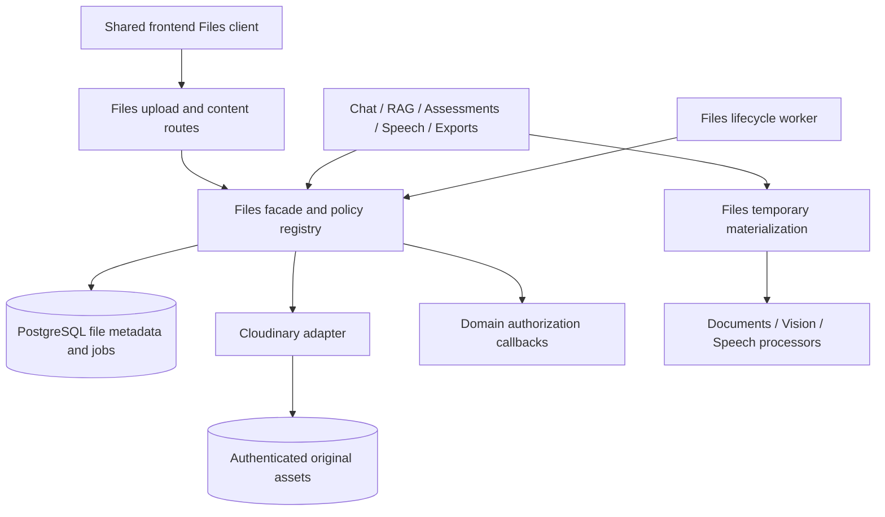

# Unified Cloudinary file migration plan

Date: 2026-10-20

Status: Implemented; PostgreSQL cleanup migration `20261020_0028` applied. Local deployment validation completed on 2026-10-21; acceptance results are recorded in the Files module README.

Approved implementation decisions supersede the historical rollout sections below:
no backfill or legacy adapter; remove only authorized disposable file records;
configure server-only `CLOUDINARY_URL`; isolate assets in `mentra/<APP_ENV>/`.
The registry embeds durable lifecycle intents rather than adding separate rollout
and backfill tables. The current interface and operational contract live in
[`backend/app/files/README.md`](../../backend/app/files/README.md).

Scope: All current user upload entry points, stored originals, internal file reads, previews, downloads, and generated server file delivery.

## 1. Outcome and decisions

Mentra will have one Files module that owns file intake, validation, storage, metadata, delivery, temporary materialization, retention, and physical deletion. Cloudinary will hold every accepted uploaded original. PostgreSQL will hold file identities, ownership, references, hashes, processing state, and domain data. Chat, RAG, Assessments, and Speech will consume the Files facade and retain their domain workflows.

| Decision | Proposed implementation |
| --- | --- |
| Canonical original storage | Cloudinary; no permanent upload bytes in PostgreSQL or shared local volumes after migration completes |
| Public upload/download surface | `/api/v1/files`; one frontend file client and one backend delivery service |
| Upload transport | Authenticated, backend-mediated multipart upload initially; no unsigned browser uploads or client-supplied remote URLs |
| Cloudinary access | Explicit `type=authenticated`; credentials and provider URLs stay on the server |
| Download transport | Same-origin authenticated streaming proxy, including inline previews; no public Cloudinary URLs in domain payloads |
| Original preservation | Immutable original asset, no incoming transformation, no overwrite; SHA-256 verification of downloaded original |
| Storage types | Explicit adapter mapping: raster images → `image`; speech audio → `video`; PDFs, Office, source/text and other supported documents → `raw` |
| Domain links | Typed, owner-constrained file bindings; storage identity is independent of a conversation, document or attempt |
| Add to Library | Add a reference to the existing original instead of copying the asset |
| Transient voice uploads | Use the same Cloudinary-backed intake, then delete after processing; this intentionally changes today's no-external-retention path |
| Existing data | Additive schema, resumable copy/verify/link, temporary legacy read support, verified cutover, delayed legacy removal |
| Generated downloads | Calendar exports become short-lived generated assets delivered through the same Files service |

File bytes will still exist as bytes in Cloudinary and transient processing memory. The migration removes durable database blobs and scattered storage logic. Base64 required by an AI provider remains a temporary request representation, never the canonical file format.

## 2. Current inventory and migration coverage

This inventory is based on repository source, not an inspection of deployed data. Counts, applied migrations, live Cloudinary capabilities, and actual production configuration must be measured before rollout.

| Flow | Current intake / storage | Current read or delivery | Target |
| --- | --- | --- | --- |
| Chat images and documents | `POST /chat-attachments`; `chat_attachment.data` is `LargeBinary`; extraction JSONB | Owner/conversation checked `/chat-attachments/{id}/source`; raw byte response; extraction and vision read DB bytes | Unified upload → chat binding → shared internal read and delivery |
| Library initial uploads | `POST /documents`; `FileStorage` writes generated keys into `RAG_STORAGE_DIR` | Document-version source route returns `FileResponse`; parser uses local paths | Unified upload → immutable version binding; materialize Cloudinary original only when needed |
| Library replacement versions | `POST /documents/{id}/versions`; same filesystem backend | Historical versions and citation viewer use version-specific source paths | Same Files path, with document revision checks and immutable original identity |
| Chat → Library | Copies attachment DB bytes through `accept_extracted` into RAG filesystem storage | Separate originals after copying | Same file asset, separate chat and version bindings; preserve existing extraction snapshot |
| Assessment answer sheets | `POST /assessments/attempts/{id}/source`; `assessment_attempt.source` binary column | OCR/vision consumes bytes; filename/extraction exposed as attempt data; no standalone original-download GET found | Unified upload → revision-fenced attempt-source binding; shared original delivery when shown by assessment UI |
| Speech recordings | `POST /speech/transcriptions`; multipart audio read into bounded processing memory; no durable original | CPU transcription service; transcript response, no audio download route | Unified intake with transient policy → transcription → immediate deletion request |
| Calendar export | `/events/{id}/calendar` generates ICS bytes in route | Route sets its own attachment headers; frontend creates download blob | Generated export binding → Files delivery; short TTL, current event authorization |
| Image model input | Chat vision resizes/encodes JPEG; assessment vision creates page images/base64 | Internal AI request construction | Read original through Files; keep transient model conversion in Vision |
| Embedded document images / PDF pages | Extracted locally during Documents/OCR processing | Temporary files and in-process bytes | Remain bounded temporary derivatives under shared materialization lifecycle; no independent durable upload store |
| Browser attachment previews | Local `File`, object URLs; chat uploads on Send | Chat and Library each manage blob preview/download handling | Shared upload/download client and object URL lifecycle hook; keep local previews before Send |
| Assessment print | Client iframe and browser print, no uploaded/stored file | Browser print dialog | Retain browser printing; any future server PDF/export must register with Files |

All formats accepted by today's domain readers remain supported. Cloudinary storage support does not imply Mentra can parse or safely preview a new format. Future avatars, videos, spreadsheets, archives or imports must register a policy in Files instead of adding a new storage implementation.

### Current source map

| Area | Source files |
| --- | --- |
| Chat intake, image reads, promotion | [`attachments.py`](../../backend/app/chat/attachments.py), [`attachment repository`](../../backend/app/chat/repositories/attachments.py), [`chat tables`](../../backend/app/chat/repositories/tables.py), [`routes`](../../backend/app/api/routes/chat_attachments.py) |
| Library originals and lifecycle | ``storage.py`` (historical source path; removed), [`service.py`](../../backend/app/rag/service.py), [`worker.py`](../../backend/app/rag/worker.py), [`tables`](../../backend/app/rag/repositories/tables.py), [`repository`](../../backend/app/rag/repositories/postgres.py), [`routes`](../../backend/app/api/routes/rag.py) |
| Assessment uploads | [`service.py`](../../backend/app/assessments/service.py), [`tables`](../../backend/app/assessments/repositories/tables.py), [`repository`](../../backend/app/assessments/repositories/postgres.py), [`routes`](../../backend/app/api/routes/assessments.py) |
| Speech | [`routes`](../../backend/app/api/routes/speech.py), [`service`](../../backend/app/speech/service.py), [`engine`](../../backend/app/speech/engine.py) |
| Existing transport limits | ``RAG middleware`` (historical source path; removed), ``speech middleware`` (historical source path; removed), [`configuration`](../../backend/app/core/config.py) |
| Documents and Vision | [`Documents contract`](../../backend/app/documents/README.md), [`chat image preparation`](../../backend/app/vision/chat_images.py), [`assessment extractor`](../../backend/app/vision/assessment_extractor.py) |
| Composition and workers | [`main.py`](../../backend/app/main.py), [`router.py`](../../backend/app/api/router.py), [`RAG factory`](../../backend/app/rag/factory.py), [`Compose`](../../docker-compose.yml) |
| Frontend | [`chatAttachments.ts`](../../frontend/src/services/chatAttachments.ts), [`rag.ts`](../../frontend/src/services/rag.ts), [`assessments.ts`](../../frontend/src/services/assessments.ts), [`useVoiceInput.ts`](../../frontend/src/components/chat/useVoiceInput.ts), [`ChatAttachmentCard.tsx`](../../frontend/src/components/chat/ChatAttachmentCard.tsx), [`SourceViewer.tsx`](../../frontend/src/components/library/SourceViewer.tsx) |
| Exports | [`events route`](../../backend/app/api/routes/events.py), [`EventAgenda.tsx`](../../frontend/src/components/events/EventAgenda.tsx), [`browser assessment printing`](../../frontend/src/components/assessments/printAssessment.tsx) |

## 3. Architecture and module boundaries

| Owner | Responsibilities | Boundary |
| --- | --- | --- |
| Files | Byte validation, provider mapping, hashing, quotas/reservations, immutable objects, shared delivery, leases, retention, provider retries | Does not grade, transcribe, index, publish a material or award mastery |
| Chat | Conversation ownership, message binding, attachment selection, send lifecycle, promotion intent | Never reads DB byte columns or calls Cloudinary directly after cutover |
| RAG | Context authorization, versions, extraction/chunk provenance, indexing, archive/delete policy | Gets an authorized stream/path from Files; Qdrant remains derived |
| Assessments | Attempt ownership/revision, transcription review, immutable question IDs, grades and evidence | File upload cannot submit answers, confirm transcription or create mastery |
| Speech | Authenticated transcription operation, decode/duration limits, transcript response | Files handles the audio lifecycle; speech handles inference |
| Events/export producer | Generate current authorized ICS content and export revision identity | Files handles storage, expiry and response construction |

### Proposed backend structure

| Path under `backend/app/files/` | Purpose |
| --- | --- |
| `facade.py`, `schemas.py`, `errors.py` | Stable domain-facing API, public DTOs and normalized errors |
| `service.py`, `policies.py`, `authorization.py` | Intake, purpose registry, quotas, typed access checks and lifecycle |
| `ports.py`, `providers/cloudinary.py` | Streaming provider contract; the only production Cloudinary SDK consumer |
| `repositories/tables.py`, `repositories/postgres.py` | Registry, typed bindings, upload receipts, quota reservations and durable jobs |
| `delivery.py`, `materialization.py`, `upload_limit.py` | Shared download/preview headers, bounded temporary files, transport limits |
| `worker.py`, `factory.py` | Leased reconciliation/deletion and composition for API/worker processes |

Add `backend/app/api/routes/files.py`, `frontend/src/services/files.ts`, `frontend/src/types/files.ts`, and shared frontend upload/source hooks. Use an in-memory or temporary-directory fake provider in tests only; production has one Cloudinary adapter.

## 4. Cloudinary contract and readiness gates

Cloudinary exposes `image`, `video` and `raw` resource types. Audio belongs to the video type; raw originals support document storage without transformations. Delivery defaults to public unless a restricted type is explicitly selected. These capabilities and defaults are documented in [upload parameters](https://cloudinary.com/documentation/upload_parameters).

The adapter must set the resource and delivery type on every upload/read/delete. It must not use `auto` classification, incoming conversions, automatic optimization or filename-derived public IDs for canonical originals. Use an opaque generated ID under an environment namespace; raw IDs include a safe extension, with an explicitly tested `.bin` storage suffix for extensionless originals. Keep the actual user-visible filename in PostgreSQL.

| Provider rule | Implementation / release gate |
| --- | --- |
| Immutable identity | Persist `asset_id`, `public_id`, `resource_type`, delivery `type`, version and provider environment; enforce unique asset identity |
| Byte preservation | Fetch original without transformations and compare size + SHA-256; explicitly exercise PNG/JPEG/GIF/WebP, audio containers and raw documents |
| Retry safety | Generate public ID before upload; `overwrite=false`; reconcile an ambiguous timeout by looking up that exact identity and verifying content |
| Restricted delivery | `authenticated` assets; test denial for unsigned original URLs and attempted derivations; do not assume ordinary signed CDN URLs expire |
| Server fetch | Use a short-lived signed original-download API URL inside the adapter; verify support for every resource type in the selected account/SDK |
| Account capability | Exercise PDFs, Office ZIP containers, raw source files, extensionless names, audio and configured maximum sizes in the actual product environment |
| Environment isolation | Separate dev/staging/production environments and secrets; namespace protection on reconciliation and deletion |
| Account settings | Confirm PDF/archive delivery controls, asset-size limits, storage/bandwidth allowances, request quotas, backup configuration and required region before rollout |
| Egress and costs | Measure upload + validation fetch + processing fetch + proxy delivery bandwidth; include repeated transcription/image use and migration verification |

The [Upload API](https://cloudinary.com/documentation/image_upload_api_reference) documents identity, overwrite control and original download operations. [Access control documentation](https://cloudinary.com/documentation/control_access_to_media) describes expiring download URLs; those downloads have bandwidth implications, so the proposed proxy must be costed with actual usage. No claim is made that the target account has passed these checks.

PDF/archive delivery settings must be tested explicitly; see [account security controls](https://cloudinary.com/documentation/developer_onboarding_faq_account_security). A failure is a provider readiness blocker, not permission to silently drop a currently supported Mentra format.

## 5. Registry, references and schema migration

Exact Alembic revision names must be allocated against the current repository head during implementation; repository head does not establish the deployed revision.

| Table / change | Required fields and invariants |
| --- | --- |
| `file_asset` | UUID, learner ID, provider/environment, provider identity tuple, SHA-256, byte size, detected MIME, resource type, original storage suffix, state, timestamps, verified timestamp; no file contents or signed URLs |
| `file_upload_operation` | UUID, owner, purpose, request key, request fingerprint, deterministic asset identity, expected target/revision, upload lease, expiry, error, quota reservation; unique owner + request key |
| `file_binding` | UUID, owner, file ID, purpose, original display filename, typed domain target, active/released state, retention policy, expiry; exactly one typed target for each binding |
| `file_job` | Kind, file/operation ID, state, attempts, retry time, lease/fencing token, deduplication key and bounded error code; supports verification, uncertain upload reconciliation and deletion |
| `file_quota_reservation` | Owner, operation, purpose, reserved bytes, expiry and committed state; serialize with existing owner transaction conventions |
| `file_migration_item` | Legacy kind + key, owner, captured source revision/hash/size, target file ID, state, attempts, checkpoint and verification evidence; unique legacy identity |
| `file_speech_operation`, `file_export` | Minimal owned targets for transient recordings and generated exports; export includes producer kind, event ID/revision, expiry; speech includes operation receipt and processing lease |
| Domain additions | Nullable `chat_attachment.file_id`, `rag_document_version.file_id`, and `assessment_attempt.source_file_id`; add owner-composite FKs and public binding IDs |

Use owner-composite foreign keys from bindings to assets and to domain targets. Typed binding targets include chat attachment, RAG version, assessment attempt, speech operation and export record; enforce kind/target consistency with CHECK constraints. Do not rely on an unconstrained polymorphic string ID for deletion or authorization. Domain file pointers and bindings are written in the same transaction with consistency checks.

Bindings hold the filename and usage policy because one original can have multiple domain associations. Generic asset access is never granted solely because another binding is visible. Content requests select a specific binding; authorization evaluates that binding's current domain state.

Initial additive migrations keep existing byte columns/storage keys readable and make the chat byte column nullable for new Cloudinary-only writes. Final migrations require file references for retained originals, then drop legacy byte columns and storage-key dependencies after the rollback window. Preserve legacy migration keys in the audit manifest, not as active storage paths.

Existing source files missing before migration are recorded as unavailable; never fabricate originals from extracted text. Such records remain an explicit exception and prevent a claim of 100% original migration. Their retained text/citations remain available under current authorization.

## 6. Unified APIs and lifecycle

### Public file endpoints

All paths below are under `/api/v1`. Final request schemas should use strict Pydantic models, UUIDs, bounded lengths and normal cookie/origin/CSRF protections.

| Endpoint | Contract |
| --- | --- |
| `POST /files/uploads` | Multipart `file` plus purpose, operation key, and typed target metadata where available; authentication and purpose eligibility checked before intake; returns stable file/operation IDs and staged state |
| `GET /files/uploads/{operation_id}` | Owner-scoped receipt/status for lost-response recovery; sanitized metadata, no provider credentials or URLs |
| `DELETE /files/uploads/{operation_id}` | Cancel unbound intake; idempotent; cancel/release reservations and schedule provider deletion if necessary |
| `GET /files/{file_id}` | Owner metadata only when staging receipt or a current authorized binding permits it; never exposes bytes or provider URLs |
| `GET` / `HEAD /files/{file_id}/content` | Required `binding_id`, optional `disposition` (`inline` or `attachment`) and explicit `include_archived` for Library policy; shared authorization, original streaming, MIME/disposition policy and download accounting |

Domain association operations remain domain APIs, but accept `file_id` and upload-operation identity instead of multipart bytes. They delegate all file work to Files. Uploading a file does not itself publish a domain record.

| Domain operation | Target request / behavior |
| --- | --- |
| Create chat attachment | JSON `file_id` + receipt; create existing attachment DTO/ID and staged binding; message send retains conversation bind rules |
| Create Library document / replacement | JSON file reference, title, contexts, idempotency key and expected document revision for replacement; create version binding and ingestion job atomically |
| Add chat attachment to Library | Authorize both source and destination; same asset gets another binding; reuse trusted extraction; no byte upload or copy |
| Upload assessment source | JSON file reference, request key, expected attempt revision; preserve existing extraction/review state machine |
| Transcribe speech | JSON transient file reference + operation key; existing authentication eligibility, duration limits and transcript shape; shared internal file read |
| Request calendar export | Authorize event, generate current revision, register short-lived export file; return file/binding metadata for shared delivery |

### Intake sequence

1. Authenticate before consuming multipart bytes where the ASGI stack permits; bound request bytes before spooling, including chunked bodies and multipart overhead. Enforce route-specific policies during compatibility mode.
2. Validate purpose and current target eligibility. Reserve storage capacity under an owner transaction; unknown lengths reserve the purpose maximum, then settle to measured size. A lost connection cannot retain a reservation indefinitely.
3. Bounded spool to private ephemeral storage, sanitize filename, detect signatures/MIME, hash bytes, and apply purpose limits. Never trust filename or browser MIME alone. Existing format detection and archive/decompression protections remain.
4. Commit an upload-operation intent and deterministic Cloudinary identity. Perform network upload outside DB locks; set authenticated type, explicit resource type and no overwrite.
5. Fetch/stream the original for checksum verification. Reconcile ambiguous provider responses before retrying. Record Cloudinary identity and `STAGED` state; release temporary files in `finally` paths.
6. Return the same receipt for the same operation/payload. Changed payload under the same key returns `409`. Return `202` with operation status when verification must resume asynchronously.
7. The domain association transaction reauthorizes the target, consumes the matching staged receipt and binds the asset. Reject cross-owner, wrong-purpose, expired or stale-revision attachment attempts. Initial binding consumes a staged upload once; intentional reuse happens through an authorized server facade.
8. Unbound uploads expire, release quota and enter deletion. Browser cancellation schedules cleanup; a provider success arriving after cancellation is still reconciled and deleted.

Asset state: `UPLOADING → VERIFYING → STAGED → ACTIVE → DELETE_PENDING → DELETED`; terminal rejected/failed operations retain bounded diagnostic receipts. `ACTIVE` only describes file availability; it does not mean RAG is indexed or assessment transcription is confirmed. A released last binding starts retention/deletion policy; transient files may have an absolute expiry in addition to binding state.

### Internal facade

Provide `stage_upload`, `bind_in_transaction`, `release_binding_in_transaction`, `open_original`, `materialize_original`, `deliver`, `create_generated`, and `get_receipt`. Background reads use a typed domain/job capability checked against the current owner, revision, lease and source binding. No arbitrary owner-free `read(file_id)` helper.

Temporary materialization uses bounded bytes, timeouts, per-process concurrency and private directories. It always unlinks on completion/failure/cancellation and has a startup/maintenance sweep for crash leftovers. Filesystem paths never leave this internal context manager. Do not introduce a permanent local mirror or mandatory shared volume.

## 7. Centralized downloads and previews

The public content endpoint is the only final byte-delivery implementation. Legacy routes can temporarily call it through an internal facade while preserving their URL and response shape.

| Concern | Shared behavior |
| --- | --- |
| Authorization | Resolve the explicit binding and current domain policy on each request; missing/foreign/deleted resources return a consistent unavailable response |
| Chat | Enforce conversation ownership, matching conversation association and non-deleted conversation; private staging never becomes a general download entitlement |
| Library | Preserve document owner, version association, context/archive policy and explicit `include_archived` semantics; never bypass `RAGService` authorization with a file ID |
| Assessments | Enforce attempt ownership and source association; original download never includes answer keys or grade-private payloads |
| Speech | No user audio-download entitlement by default; only authorized transcription job reads while its lease is live |
| Export | Recheck current event availability/authorization; stale export revision regenerates or returns a refresh-required result |
| Headers | `Cache-Control: private, no-store`, `X-Content-Type-Options: nosniff`, safe UTF-8 `Content-Disposition`; explicit MIME and CSP appropriate to preview |
| Inline policy | Recognized safe raster images and supported PDF preview; active HTML/SVG or executable/text source never executes inline on the application origin |
| Text/source preview | Bounded fetch rendered as escaped text in React; shared truncation and object URL cleanup; original download retains all bytes |
| Streaming | Backpressure, configured timeout, cancellation propagation and bounded concurrency; release provider connection on disconnect |
| Range / HEAD | Implement and test single byte ranges, `206`/`416`, correct lengths and HEAD; prove upstream support or bounded spool fallback for current size caps |
| Cloudinary fetch failure | Sanitized retryable dependency error; do not start `200` before upstream validation; if failure occurs midstream, terminate rather than return a truncated success |
| URLs | Never persist expiring URLs in DB, chat history, citations, job payloads, browser storage or logs; provider request URLs are redacted server-side |

Keep provider download URLs internal and short-lived. Signed CDN URLs are not automatically equivalent to expiring authorization. The proxy preserves current domain authorization for every new request. A stream already delivered cannot be recalled; enforce bounded stream duration and document this revocation boundary.

## 8. Domain-specific changes and preservation rules

### Chat

Replace direct `row['data']` access with Files reads in extraction, image preparation and original delivery. Keep the existing 25 MiB per-upload cap, 100 MiB per-owner chat quota, at-most-three-images-per-message check, one-day unsent expiry and conversation association rules initially. Image counting must use validated stored media metadata instead of SQL `substr(data, ...)`.

Message/transcript metadata retains stable attachment IDs. Keep deferred upload on Send, recovery after lost responses, unsent cancellation, filename display and older-attachment selection. Deleting a conversation removes its access immediately and releases its bindings through a durable transaction/outbox path, including physical-delete cascades. A surviving Library reference prevents deletion of the shared original.

### Library/RAG

Replace `storage.path`, `store`, `remove` and filesystem sweeps in the service/worker with Files operations. Existing context validation, hash/idempotency semantics, duplicates, immutable version history, job leases, generation publication checks, archive policy, citations and retained-extraction recovery must remain intact.

Workers materialize only if parsing needs the original. Resumed chunks or trusted extraction can avoid downloading it. Retry transient Cloudinary failures without publishing partial generations. Verify that provider dependency errors are not classified by existing broad `AppError` handling as permanent parse failures. Release bindings on material purge; only Files physically deletes an unreferenced asset. Qdrant cleanup remains RAG-owned and independent.

Storage-only backfill never re-parses content, recreates chunks, re-embeds, changes published generations, or modifies citation locations. Reindexing continues through the existing explicit domain operation.

### Assessments

Replace `source=data` writes with a verified file reference in the transaction that records extraction. Preserve revision conflict checks both before expensive processing and at final commit. Lost retries replay the same extraction/association operation rather than re-running vision or overwriting a newer source.

Retain OCR/vision confidence, warnings, user review, confirmation requirements, answer drafts, grades, evidence and provenance. Preserve source history for newly replaced uploads in versioned bindings under the attempt; backfill can only recover the source blob currently retained, not already overwritten historical bytes. Retention/deletion must follow assessment evidence policy rather than the chat unsent timer.

### Speech

All recording uploads pass through Files with a dedicated transient purpose. Preserve current default 4 MiB transport cap, configurable upper bound, 30-second decoded duration cap, supported MIME/container checks and CPU worker deadlines. Check decoded duration after shared materialization, not merely container metadata.

After transcription or terminal failure, deny further processing/read access and enqueue Cloudinary deletion immediately. Add a proposed maximum 15-minute crash-recovery TTL, with job leases bounded below that deadline; expired operations fail and request a fresh recording. Retain only the minimal retry receipt and transcript needed to recover a lost response for a bounded period, then expire them. No durable recording library or public replay URL is added.

This introduces external transient audio storage and a provider outage dependency. Update the voice privacy documentation and user disclosure accordingly. Cloudinary backup settings and provider retention must be reviewed for transient audio; application deletion is not a guarantee of immediate erasure from provider backups. The TTL limits application access; cleanup latency is measured separately. There is no historical speech audio to backfill.

### Generated exports and temporary derivatives

Calendar exports use the same generated-file registration, provider adapter, bindings and delivery service, with a proposed one-hour TTL. Key export reuse by event revision and generator revision; deleting or changing an event revokes stale binding access. ICS generation remains in Events.

Documents/OCR embedded images, page rasters, thumbnails and AI request encodings remain transient processing outputs. If a derivative becomes a reusable stored asset or user download, it must be registered with Files and linked to its original. LangGraph checkpoint blobs, application logs, model weights, static repository assets and database backups are not user uploads and are outside this migration. Browser printing remains local and does not create a server download path.

## 9. Quotas, security and deletion

| Area | Required policy |
| --- | --- |
| Quotas | Preserve current per-purpose behavior: chat 100 MiB/owner and Library 512 MiB/owner by default, with existing 25 MiB original caps; speech uses its current configured cap. Do not invent a new assessment quota in this migration |
| Shared asset accounting | Meter chat/Library logical usage separately to preserve existing limits; adding a Library reference checks Library capacity even without new provider bytes. Track physical unique bytes separately for cost reporting |
| Staging abuse | Bounded active operations, rate limits, expiry and reserved staged bytes per owner/purpose; reserve before accepting provider work |
| Privilege separation | Speech keeps `require_identity` eligibility; chat/Library/assessments retain onboarding requirements. Generic uploads must not grant access to a stricter purpose |
| Content safety | Existing document signature/archive limits retained, no fetching user-supplied URLs, no browser execution of uploaded active content; optional scanner integration must fail closed if enabled |
| Credential handling | Server-only API secret, redacted URLs/provider payloads, scoped environments, normal secret rotation and audit controls |
| Sharing | No cross-owner asset deduplication; same-owner sharing through authorized domain actions. Existing duplicate-content semantics must remain context-aware |
| Immediate logical deletion | Revoke a binding transactionally; content authorization denies it before provider cleanup completes |
| Physical deletion | Only after last retained binding and active read/processing lease are gone; asset-level serialization prevents bind-vs-delete races |
| Retention holds | Assessment/evidence holds block physical deletion but never grant content access to a deleted binding |
| Retry / drift | Idempotent destroy, resource/delivery type recorded, lease fencing, exponential backoff, dead-letter state and operator repair command |

Reference release and a deletion job/outbox record must commit in the same transaction as domain deletion. Do not depend on a cascade deleting the last binding without scheduling cleanup. A reconciler also checks zero-reference assets as a safety net, using a grace period and fresh reference/lease check under lock.

Cloudinary deletion and cache invalidation are separate concerns; apply supported invalidation on destroy and verify provider absence. Provider backups have their own lifecycle. See [cache invalidation](https://cloudinary.com/documentation/invalidate_cached_media_assets_on_the_cdn) and [backup/version management](https://cloudinary.com/documentation/backups_and_version_management). Maintain an explicit deletion status for active asset, cached copies and backup handling; do not advertise complete erasure merely because the DB binding disappeared.

## 10. Existing-data migration runbook

### Preflight

1. Record deployed DB revision, application image/version and actual storage configuration. Count chat bytes/rows, current assessment source bytes/rows, all retained Library versions, missing original paths, pending ingestion/deletion jobs, and soft-deleted data still within retention.
2. Take verified recoverable DB and materials-volume snapshots at a recorded cut point. Test restoration of a representative original from each store. Record retention so legacy backups are not forgotten after cutover.
3. Run the Cloudinary fixture matrix in an isolated environment; collect byte hashes, unsigned-access denial, deletion results and actual limits/cost measurements. No production migration starts before this passes.
4. Deploy additive schema and shared legacy readers. Pause physical legacy cleanup during per-batch capture/verification where needed; continue immediate logical access revocation. Do not hold DB transactions over provider requests.

### Resumable copy, verify and link

| Step | Requirement |
| --- | --- |
| Enumerate | Keyset pagination by stable domain/version identity; include every retained version and archived original, not only active Library documents |
| Capture | Read bounded bytes or a stable private source snapshot, owner, legacy key, size/hash and source revision; capture one item per operation |
| Reserve intent | Durable migration item and deterministic provider public ID prevent duplicate uploads after crashes |
| Copy | Upload authenticated immutable asset without transformation; bounded concurrency below provider/DB quotas |
| Verify | Download the Cloudinary original and recompute SHA-256 + byte count; provider ETag alone is insufficient |
| Link | Recheck current source identity and deletion/retention state; compare-and-set file pointer and create matching binding in one owner transaction |
| Handle races | Changed assessment source becomes a fresh item; deleted source is not resurrected; already migrated item replays; a lost migration lease cannot commit |
| Repair | Missing/corrupt originals enter an explicit exception report; preserve extracted content, citations, grades and source metadata |
| Reconcile | Compare row counts, byte totals, hash coverage and retained references; validate a fresh delta scan after the historical pass |

Use owner-scoped SHA-256 + size checks to identify possible existing chat/Library copies. Deduplication is optional for backfill correctness and must not delay verified preservation; only merge after byte equality is established. It never changes domain IDs, filenames, Library versions, extraction snapshots or grades.

### Reader precedence and legacy fallback

During transition, each row has an explicit authoritative storage state. A verified `file_id` reads Cloudinary. Unmigrated legacy rows use the existing store through a Files legacy adapter. A transient Cloudinary error on an already authoritative Cloudinary row is reported as a dependency failure; it must not silently select an older local copy. Temporary shadow comparison can read both copies only when captured hashes prove they represent the same original.

Legacy adapters are migration code with removal gates. They must not become permanent feature-specific file stores.

### Backfill tooling and evidence

Add a proposed `backend/scripts/migrate_files_to_cloudinary.py` with `inventory`, `dry-run`, `copy`, `verify`, `reconcile`, `repair`, and `report` modes. Require explicit environment, bounded batch/concurrency settings, checkpoint support and a separate apply flag. It must never print file contents, signed URLs or secrets.

Produce a manifest with legacy identity, owner-safe identifier, target file ID, source and fetched hashes/sizes, verification time and disposition. Report migration totals separately from unavailable-source exceptions. New uploads continue through the unified service while backfill catches up; a final delta scan proves no legacy-only writes remain.

## 11. Ordered implementation and rollout

| Phase | Work | Exit criteria |
| --- | --- | --- |
| 0 — Baseline and provider proof | Deployment inventory, full source entry-point check, target account fixture/cost/privacy checks | Every currently accepted format can upload and fetch identical bytes with restricted access; restore drill passes |
| 1 — Shared foundation | Additive schema, Files facade/adapter, registry, quotas, operations, streaming, middleware, cleanup worker, legacy adapters | Fake-provider integration and real Cloudinary contract suite pass; application behavior still uses legacy defaults |
| 2 — Consumer integration | Route all legacy intake/read/delivery through Files; remove direct storage/byte reads from features; use provider-independent file references internally | All old URLs still work; no domain calls Cloudinary or constructs file response headers independently |
| 3 — Canary new writes | Cloudinary-only intake for controlled owners/purposes; enable chat, Library, assessment, speech and exports in measured steps | Per-purpose end-to-end verification, quota and deletion checks pass; telemetry remains within recorded baseline budgets |
| 4 — Historical backfill | Copy/verify/link chat, all retained Library versions and current assessment sources; reconcile concurrent changes | Every available retained original has verified Cloudinary bytes and a valid binding; explicit missing-source report resolved/accepted |
| 5 — Frontend/API convergence | Shared file client/hooks, JSON domain attachment contracts, canonical content paths; old multipart/source URLs become thin compatibility wrappers | All upload/download callers use shared primitives; browser scenarios and compatibility contracts pass |
| 6 — Full cutover | Cloudinary is authoritative for all writes/reads; drain old workers, migration sweeps and legacy-serving traffic | No legacy-only reads/writes over an agreed observation window including worker retry and release cycles |
| 7 — Retirement | Remove compatibility routes/adapters, old byte columns, RAG storage code/config/volume mounts and old cleanup producers | Dependency scans and runtime evidence prove one upload/delivery/storage implementation; recovery plan tested |

Proposed rollout controls: `FILES_UPLOAD_PROVIDER` with a temporary per-purpose/owner canary selector, `FILES_LEGACY_READ_ENABLED`, `FILES_API_ENABLED`, and `FILES_BACKFILL_ENABLED`. Keep these in one typed configuration module. Remove rollout-only flags at retirement; do not create permanent alternate upload paths.

### Rollback

- Before Cloudinary writes: disable canary and keep additive schema; legacy originals are untouched.
- After Cloudinary writes: roll back to the last release that understands Files and both storage states. New Cloudinary-only originals have no legacy copy; an older binary-only release is not a valid rollback target.
- If provider rollback is necessary, run a verified reverse-copy export into compatible legacy storage using a recorded manifest, then switch per-row authority. Do not clear file references before reverse verification.
- Keep old bytes/files read-only for a proposed minimum 14-day observation window, extended to cover actual retry/retention needs. Legacy cleanup runs only after verified coverage, backup recovery and cutover criteria pass.
- Provider outage after cutover pauses uploads, source downloads and original-dependent processing with retryable errors. Existing extracted text, citations and grades remain usable under normal authorization. Do not silently start a second production file store.
- Dropping legacy columns/removing volumes is the irreversible retirement boundary for ordinary rollback. Preserve recoverable snapshots until the separate backup-retention policy expires; volume removal must target only the verified materials volume.

## 12. Frontend migration

| Caller | Change / preserved behavior |
| --- | --- |
| `ChatPage.tsx` and `chatAttachments.ts` | Shared stage + associate flow on Send; maintain previews, drafts and stable IDs; cancel outstanding stage on removal; retry same operation |
| `MaterialUpload.tsx` and `rag.ts` | Shared file stage, then JSON document/version operation; preserve title/context forms, duplicates, replacement conflict handling and ingestion polling |
| `assessments.ts` and source-upload UI | Shared stage + revision-fenced source association; preserve reviewed answer drafts, confidence/warnings and explicit confirmation |
| `useVoiceInput.ts` | Shared transient upload followed by transcription; recover operation on timeout, cancel/cleanup on navigation, show provider/decode failure distinctly |
| `ChatAttachmentCard.tsx` / `SourceViewer.tsx` | Shared original fetch, preview policy, loading/retry states, download trigger, range-capable content path and object URL disposal |
| `events.ts` / `EventAgenda.tsx` | Request export receipt, then shared download helper; preserve user-visible ICS filename |
| Future upload UI | Register an existing-purpose policy or add a reviewed policy; use the same service/hooks and canonical content route |

Keep element placement and existing navigation. Files introduces transport and consistency changes, not a redesign. Shared error vocabulary covers oversized, unsupported, expired, quota, conflict, unavailable and retryable-provider failures. Pending staged files survive recoverable network failures without duplicate association; local object URLs are revoked on replacement/unmount/logout. Permanent browser caches never retain private original contents.

## 13. Verification and acceptance matrix

Tests listed here are implementation acceptance work, not checks already executed for this plan.

| Area | Required evidence |
| --- | --- |
| Provider originals | Actual account: PDF, scanned PDF, DOCX, PPTX, TXT, representative code/markup/data, extensionless filename, PNG/JPEG/GIF/WebP, supported audio containers and ICS; exact SHA-256 equality |
| Limits | Empty/oversize payloads, false Content-Length, chunked overflow, multipart overhead, decompression/pixel bombs, speech decoded duration, staging reservation release |
| Authorization | Cross-owner file/receipt/binding, wrong conversation/version, deleted/archive context, expired speech/export, unauthenticated request, speech-only user attempting onboarded purposes |
| Restricted delivery | No unsigned original/derived access; no exposed secrets or signed URLs in payloads, history, logs or browser storage |
| Idempotency | Lost upload response, provider timeout after success, changed bytes under same key, duplicate binding, interrupted migration and repeated deletion |
| Concurrency | Simultaneous quota reservations, bind-vs-GC, source replacement during backfill, deleted target during upload, stale worker lease, last-binding release while Library promotion commits |
| Chat | Send with mixed files, three-image limit, follow-up selection, recover/reload, unsent expiry, Add to Library, conversation deletion with surviving Library original |
| Library | Initial upload, duplicate, replacement/history, archive/unarchive, citations and version-specific source, delete/reindex, retained-extraction recovery, parser timeout and provider retry |
| Assessments | Upload image/PDF, vision/OCR fallback, revision conflict, review and correction, confirmation-before-grading, source replacement history and unchanged evidence/grades |
| Speech | Every advertised audio format, duration cap, busy/timeout/cancel, transcript recovery, no audio replay endpoint, immediate cleanup scheduling and crash TTL enforcement |
| Delivery | Original filename including Unicode, MIME spoofing, safe HTML/SVG handling, HEAD, range/invalid range, aborted streams, midstream provider failure, temporary-file cleanup |
| Migration | All rows/versions reconciled, all available originals hash-verified, no resurrection, no reindex/regrade, restore and rollback drill, explicit missing-original disposition |
| Browser | Desktop/mobile flows for chat, Library source viewer/replacement, assessment upload/review, voice input and ICS download; drafts and accessibility preserved |
| Operations | Worker restart recovery, provider 429/5xx, credential rotation, deletion retry/dead letter, alert delivery and redacted logs |

Extend existing `backend/tests/test_attachment_maintenance.py`, `test_storage_sweep.py`, `test_speech.py`, `test_assessments.py`, `test_assessment_recovery.py`, `rag/test_api.py`, `rag/test_workflows.py`, and Documents/Vision suites. Update browser fixtures, `backend/testing/browser_auth_server.py`, real-runtime scripts and hardening checks that currently instantiate `FileStorage`. Add dedicated Files unit/integration/provider-contract suites rather than duplicating lifecycle tests across domains.

Set measurable latency/memory/concurrency budgets from Phase 0 baseline before enabling canary. Track upload-to-stage, original-first-byte, full download, source processing fetch, speech end-to-end and cleanup lag separately. Correctness gates require zero hash mismatches, zero cross-owner grants, zero lost originals and zero unhandled migration items. Load checks must cover configured maximum file sizes and concurrency, not only tiny fixtures.

## 14. Deployment, observability and final removal checklist

| Area | Change |
| --- | --- |
| Dependencies | Pin supported Cloudinary Python SDK; centralize client construction and timeout/retry configuration |
| Secrets/config | Server-only cloud name/API key/API secret, provider environment, upload/download timeouts, concurrency, staging TTLs, retry budgets and temp-directory limits; never frontend secrets |
| Networking | API, ingestion, assessment, speech and Files worker processes need controlled Cloudinary HTTPS access; no remote user URL fetch feature |
| Worker | Add dedicated `files-worker` role/entry point using DB leases; do not initialize embeddings/OCR/models for deletion/reconciliation |
| Health | Local readiness checks configuration and DB schema; bounded cached provider probe/dependency status without uploading per health request; no idle heartbeat log producer |
| Metrics | Bytes/counts by purpose, active reservations, stage/verify latency, provider errors/429s, retries, deletion age, expired speech, migration progress and checksum failures |
| Logs | File/operation/job IDs, stage, duration and sanitized codes; never originals, source text, raw SDK response bodies, credentials or signed URLs |
| Alerts | Hash mismatch immediately; growing deletion backlog; transient-audio cleanup over objective; stalled migration; sustained upload/delivery failures; account capacity threshold |
| Docs | Update `docs/library/rag.md`, `docs/chat/persistent-chat.md`, `docs/speech/voice-input.md`, assessment docs, `docs/getting-started/SETUP.md`, backend atlas, `.env.example`, deployment and backup runbooks |
| Retire | Remove `chat_attachment.data`, `assessment_attempt.source`, `app/rag/storage.py`, old upload-limit middleware, old sweeps, direct `FileResponse`/byte response construction in file routes and unused SDK/storage wrappers |
| Infrastructure | Remove `RAG_STORAGE_DIR` and `mentra_materials` mounts only after confirmed migration/rollback gates; keep private ephemeral temp space and its permissions |

Final source scan must account for every `UploadFile`, multipart `FormData`, original-download route, durable `write_bytes`, upload-related `LargeBinary`, storage path and direct provider call. Remaining occurrences need a documented category: shared Files implementation, temporary processing, test fixture, non-upload checkpoint state, or local browser print. There must be no unclassified production upload/download branch.

## 15. Completion criteria

The migration is complete when all retained, available originals are verified in Cloudinary; every current upload purpose enters through Files; every server file download/preview uses its delivery layer; every internal original read uses its facade; and old bytes, volume dependencies, feature-owned file response logic and rollout adapters have been retired after recovery checks.

Chat conversations, Library documents/versions/citations, assessment attempts/grades/evidence, extracted content and ownership remain intact. The completion report must distinguish repository changes, automated tests, real Cloudinary contract results, browser evidence, actual deployed cutover and any pre-existing unavailable-original exceptions.
