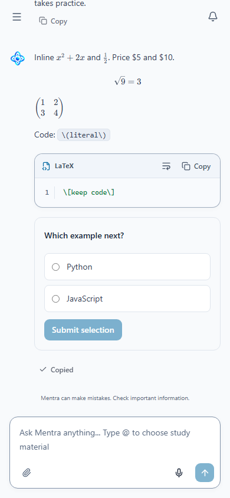

# Product improvements — 17 October 2026

The existing worktree was committed first as `8ce7091` with the requested message:
`backend and frontend unused imports and unreachable code cleanup`.

The subsequent implementation is separate working-tree work. The
[recommendation plan](Mentra_Product_Recommendations_2026-10-17.md) now contains
remaining work only; finished recommendations were removed rather than marked done.

## Delivered behavior

| Area | Result |
| --- | --- |
| Equations | One shared KaTeX/Markdown pipeline renders inline/display equations across chat and assessments. Model-style delimiters are normalized without changing citation offsets or rewriting code/existing math. Plain-text copy retains TeX; ordinary price text remains readable. Rendering uses restricted trust/size/expansion options |
| Assessment materials | Paginated server search reaches materials beyond the initial 25. Selected/preselected materials survive paging/search, can be cleared, and retain owner-checked hydration |
| Practice identity | Progress links retain canonical concept IDs, an owned context and practice/verification purpose. Backend checks context membership before queueing and during generation; model attribution is constrained to exact targets. Legacy request fingerprints remain compatible |
| Material practice | Library/detail **Quiz this material** opens an editable, grounded three-question preset in the existing creation form. Navigation never generates a job |
| Short reviews | **Quick review** prepares three MCQs on one supported follow-up topic. It reuses existing ranking, generation, grading and evidence; it introduces no new retention policy, daily automation or mastery writes |
| Source inspection | A citation loads its exact authorized chunk first, checks document/version/generation identity and offers full-source browsing afterward. Old page requests are fenced when the target changes. Original PDFs receive a page hint |
| Library retrieval | Title/filename search is literal, case-insensitive and server-paginated with owner/context/archive filters. Queries survive reload and filtering |
| Calendar | Owned event details download a UTF-8 `.ics` snapshot with stable identity/revision, UTC timed events, date-only all-day events and escaped/folded content. Source chat evidence and reminder alarms are excluded |
| Mistake practice | Results prepare an explicit wrong/partial-question subset without a model call. New question/attempt IDs retain original item identity and known exposure. Originals and paper references survive; revisions and chat publication preserve exposure |
| Estimate explanations | Each topic exposes bounded accepted practice, independent-item/difficulty coverage, last qualifying practice, heuristic uncertainty and the next check. Only current owned assessment results receive direct attempt links |
| Documentation | README describes the new entry points and correct repository migration head; feature docs describe current contracts |

## Compatibility audit and fixes

| Gap | Resolution |
| --- | --- |
| Material search bubbled through the creation form and changed its retry UUID | Bind generation operation identity to submitted payload; unchanged retries retain it and actual payload changes receive a new ID |
| A queued generation retry revalidated mutable concepts before recovering its saved operation | Recover the owned fingerprint-matching job first, retaining live conversation authorization |
| A missing selected material could vanish from the select's option set and be silently dropped on the next selection | Keep unavailable/loading selections visible and removable; hydrate successful selections even if another fetch fails; retry hydration explicitly |
| Original-file operations could use the next source target's abort state | Capture each operation's original controller and reset busy state on source changes |
| Existing written answer sheets omitted shared passages | Render each question's context while answering/reviewing written work |
| A derivative revision could shed exposure when saved/published through older paths | Inherit exposure and root identity conservatively in both assessment and chat persistence |
| Evidence links previously opened only the paper, not its supporting result | Resolve an explicit owned attempt from the assessment URL |

See [mistake-practice contracts](../assessments/mistake-practice.md) for source snapshots,
evidence semantics, quotas and migration/rollback requirements.

## Initial-batch verification

| Check | Evidence |
| --- | --- |
| Backend | **84 tests passed** in the existing Python 3.12 application image with current source mounted read-only, against a dedicated disposable PostgreSQL 17 container |
| Backend coverage | Assessment intent/flexibility/MCQs, progress, RAG workflows and Events API; new cases cover exact target ownership, attribution, legacy fingerprints, Unicode/literal metadata search, calendar authorization/escaping/folding and timed/all-day semantics |
| Browser | **37 distinct checks passed** across the production route/assessment/product suites and focused reruns. The initial 36-check run passed 35; its stale `Topic` locator was corrected to the existing `Topic (optional)` label and passed on rerun. The final six product checks include the additional calendar download case |
| Frontend | TypeScript/Vite production build, theme checks and shared UI checks passed |
| Visual inspection | Mobile math screenshot inspected: equations, ordinary prices, literal code and composer remain contained in the viewport |
| Documentation | Remaining-plan local links and source references checked; whitespace/diff checks passed |
| Cleanup | The dedicated test PostgreSQL container was removed; application databases were not used as fixtures |

Local execution logs remain under `.cache/product-*`; they are not production
evidence. No application-database migration, production rollout, real learner
experiment or live paid model evaluation was performed. Browser APIs/models were fixture-controlled;
backend persistence and evidence checks used real isolated PostgreSQL.

## Continuation verification

- The final combined Python 3.12 / isolated PostgreSQL run passed **203 tests**
  across assessments, recovery, grading latency, learner policies/progress, RAG
  workflows and Events. One subsequently added withdrawal case passed separately
  (**204 distinct backend checks**). Earlier and targeted reruns overlap these counts.
- All **41** selected production-browser checks passed, including the four new
  follow-up checks and existing assessment/chat/source/refresh flows. The final
  assessment-only rerun covers the subsequent results-panel placement and copy.
  All **14** checks in that final rerun passed; they are part of the same 41.
- TypeScript/Vite production build, theme and shared UI checks passed.
- Migration `20261017_0026` passed upgrade/downgrade/re-upgrade with existing
  question/attempt preservation and an Assessments metadata comparison. The
  destructive downgrade guard passed for saved exposure and unpublished chat drafts.
- Targeted real-PostgreSQL checks cover concurrent duplicate creation, operation
  conflicts, wrong/partial subsets, immutable parents, private keys, paper references,
  corrections, repeated derivatives, source deletion and owner isolation. Known
  exposure overrides independence self-reports and survives revisions/publication.
- Unknown topics, uncertain regrades/withdrawal, bounded accepted observations,
  safe assessment links and heuristic explanations were verified separately from
  real provider quality. No learner records were used as fixtures.

Deploy the new migration before this application version. See
[the mistake-practice contract](../assessments/mistake-practice.md) for the rollback restriction.

## Practical limits

- Equation rendering improves presentation, not mathematical correctness.
- Actual provider quality for newly constrained targets and source-grounded presets
  still needs bounded subject-reviewed samples.
- Quick review selects one supported topic; it is not a calendar scheduler or a
  scientifically calibrated forgetting model.
- PDF page hints and calendar import/update behavior depend on the receiving
  viewer/application. Two-client manual calendar import validation remains pending.
- The larger quality/user pilot remains in the recommendation plan. Mistake practice
  intentionally reuses exposed questions; new verification should use a separately
  generated assessment.

## 18 October hardening continuation

Saved-chat search, deployment fences, responsive evidence/practice dialogs and bounded
material selection are implemented. See the [latest hardening report](../deployment/Product_Deployment_Hardening_2026-10-18.md)
for current checks, image IDs, rollout prerequisites and remaining limitations. Earlier
test totals above describe the earlier pass.
